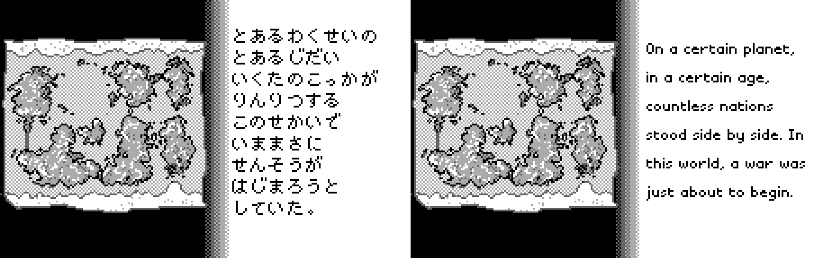
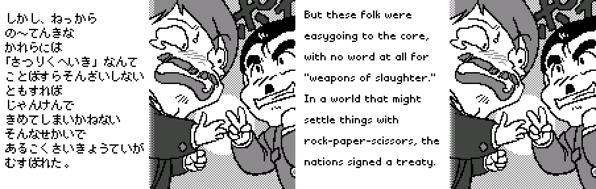
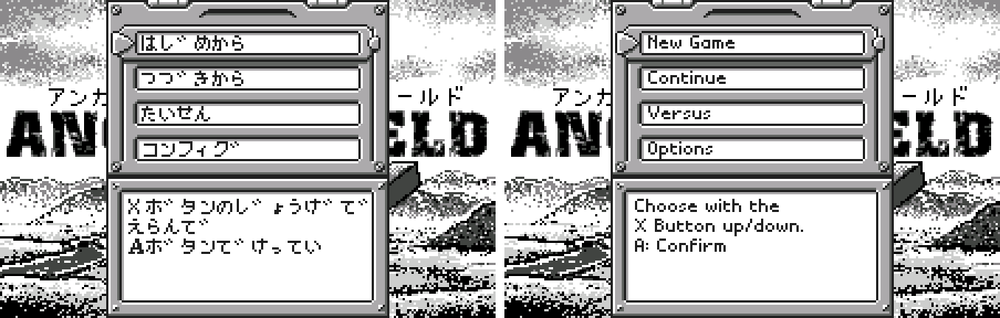
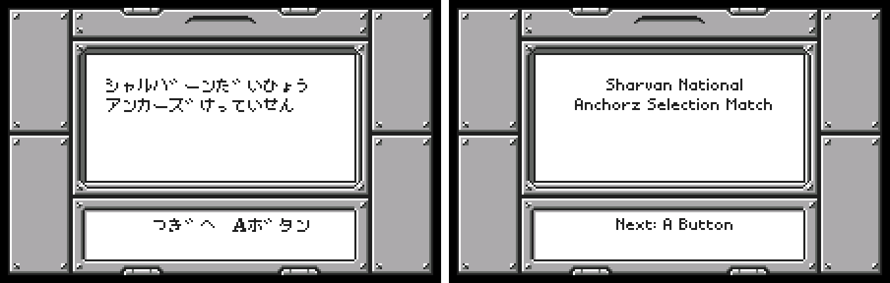
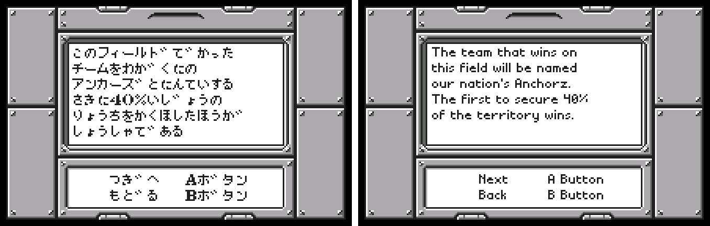
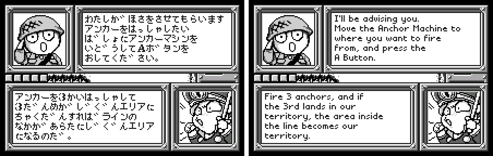
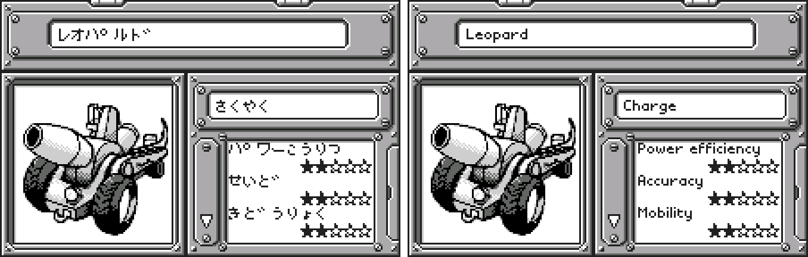
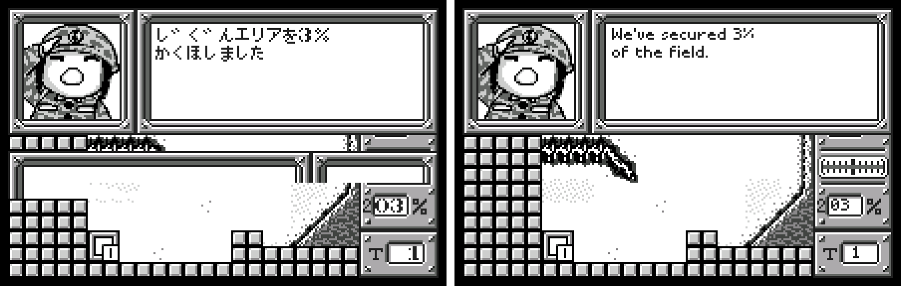
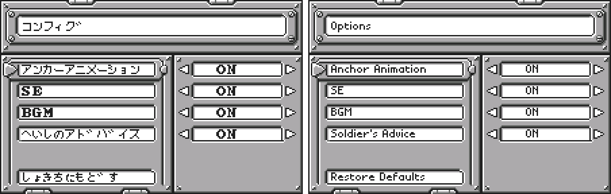

# Anchorz Field (WonderSwan) - AI English translation patch v1.0

**Anchorz Field** (アンカーズフィールド) is Sammy's 1999 turn-based territory game for the original (monochrome) WonderSwan, released only in Japan. Each side fires anchors from its Anchor Machine; an anchor drags a line behind it, and if the third shot of your turn lands back in your own territory, everything the lines enclose becomes yours. The first side to hold the target share of the field (usually 40% or 50%) wins. You're the newest member of Sharvan's national Anchorz team, coached by a soldier adviser and a gruff commanding officer, taking on rival nations one field at a time, and eventually a mysterious enemy from a new continent.

> **Please read:** this translation was made **with AI** (Claude), as a hobby project. A person (me) made every judgement call before release, but nobody on the project is a professional translator. I'm sharing it as it is for anyone who wants to play. Please **don't upload it to romhacking sites** (romhacking.net and the like). It may not be up to the standard of a real fan translation and it doesn't belong there.

**What's translated**

* All 843 of the game's text strings: the campaign, the adviser's and commander's battle dialogue, every rival crew, the rules and tutorials, menus, lists, anchor and machine descriptions, results and options.
* The five illustrated intro story pages, re-set in English.
* Graphics: the list screen's Sort button and the FIRE!! sound effect in the intro are redrawn.
* Left as in the original: the katakana above the title logo (the logo itself already reads ANCHOR FIELD).

Names: your nation is Sharvan; the rivals are Baltz, Bujina, Gibros, Santo Principe, Libitenstainer, Galgis and the Mu Empire. The 27 field names are puns on real places and stay romanised as written. The anchors are the Normal, Chute and Roller Anchors, with "Charge" for the explosive payloads (M Charge, LL Charge, Buster Charge...). The rival crews keep their gimmicks: one crew speaks stereotyped "Chinese" Japanese in the original, rendered as broken English; another makes Russian-style puns, kept as English puns of the same kind; the muffled and the gurgling crews say "Mmph mmph" and "Blub blub". The original's joke about "made from concentrate" (濃縮還元) is kept.

**How it was made: AI translation, independent checks, human decisions**

* Claude translated the script directly from the Japanese in the ROM. The whole script is kana with no kanji, so every line needed careful reading. Claude also did all the hacking: a new variable-width text engine, pointers, labels and the intro pages.
* A second, independent Claude reviewer checked every line against the Japanese. A polish pass followed, with each change checked against the Japanese by a separate verifier. A final separate review read the whole patch again (44 lines fixed), and a mechanics check made sure numbers the game writes into the text still land in the right place.
* Every string was rendered in an emulator with every glyph logged: no overflow and no leftover Japanese. A random walk through the game from several save points found no Japanese reaching the screen, and the campaign was played past the first battle with every printed line logged.
* The judgement calls were listed with the Japanese, a literal reading and the options, and I decided each one by hand: names, the stereotyped accents, the puns, wording in fixed-size boxes, and which art to keep.

**Changelog**

* **v1.0**: first release.

**Sources consulted**

* Japanese text: the WonderSwan ROM itself.
* Font: a proportional pixel font drawn for this project.

**Images** (original on the left, English on the right)

1. Intro story: page 1

   

2. Intro story: the treaty

   

3. Title menu

   

4. The Sharvan National Anchorz Selection Match

   

5. The rules

   

6. Your adviser

   

7. Anchor Machine stats

   

8. In battle

   

9. Options

   

**How to patch**

Apply `anchorz-field-en-1.0.bps` to the Japanese ROM "Anchorz Field (Japan)" (CRC32 425EB893) in your browser with the [Swan Revival patcher](https://swanrevival.com/patcher/), or with Floating IPS, beat or ROM Patcher JS. The result should be CRC32 34A7D483.

The ROM keeps its size (1 MB). It's a WonderSwan (mono) game, so keep the .ws extension.

You must provide your own copy of the original Japanese game to apply it.

**Download:** `anchorz-field-en-1.0.bps` on the [release page](https://github.com/PokemonGoDB/wonderswan-english-patches/releases/tag/anchorz-field-v1.0).

**Known issues**

* It hasn't been played start to finish by a person. If you find leftover Japanese, cut text or a crash, please tell me where it happened.
* A few rarely seen screens (conquering a nation, some item messages) weren't reached in normal play.
* "★Special Stage" is missing its closing star. The original is missing it too, and it was kept that way on purpose.

**Technical notes (for the curious)**

* The game drew text in fixed-width cells. A new variable-width text engine (8086 assembly) fits the English into the original boxes without changing their size.
* Strings are relocated into free ROM space and the game's pointers updated; numbers the game prints into text keep their original positions.
* The intro story pages are pictures: they were redrawn with the English set in the game's small font.

**A Note On My Justifications for AI Use**

I have been an avid fan of the Wonderswan system for a very long time now. It was actually a motivating factor for my various attempts to learn Japanese (which have all failed so far). I always wanted to explore the game catalog more, but the lack of English translations made it extremely difficult to do so. Here's the thing: There's a reason many of these games have not been translated yet. It's not just the fact that Japanese > English translation is difficult. There's also the fact that the original developers used all kinds of tricks and technical feats to make these games work. Most games do not have a searchable directory of text that you can just replace with English equivalents. While some are easier than others, translations for some of these would take not only an expert in Japanese > English translation, but also someone with vast game development and programming experience.

I say all that to say: I get why people are apprehensive about AI usage for this type of thing. However, these games have been around for a very long time now and most of them have still not received a translation. I (and others) have chosen to spend our time and money to utilize AI to translate the games and actually make them playable for the wider community. If you don't agree with that, that's completely fine. I am more than happy to remove any of my translations if better, human ran translations are released at a later date. We already decided to skip any games where someone is actively working on a manual translation. While nowhere near what a manual translation effort would be, I do spend a considerable amount of time trying to work through each game's translation. I stress over small details and try my best to make the right calls. And I've probably messed some stuff up, which is why I welcome feedback.

I'm just looking forward to digging through all of these games. It's a great time to be into Wonderswan games.
