# Another Heaven: Memory of those Days (WonderSwan Color) - AI English translation patch v1.0

**Another Heaven ~memory of those days~** (アナザヘヴン 〜memory of those days〜) is a horror sound novel for the WonderSwan Color by Omega Micott and D's Garage 21, licensed by Bandai and released only in Japan in December 2000. It is a tie-in to Joji Iida's film *Another Heaven* (2000): while the film's "Mad Cook" murders shake Tokyo, a second killer, the Pyromaniac, starts burning men from the inside out. You are Koichiro Hasegawa, a young police sergeant teamed with his old classmate, Lieutenant Natsuko Nishitani, and between crime scenes you trade e-mail on your phone with a crime-buff informant and with Makoto, a shy friend from a mailing list. Read the story, answer the mails, make the choices, and follow its many routes and endings on the route chart. This patch translates it into English.

> **Please read:** this translation was made **with AI** (Claude), as a hobby project. A person (me) made every judgement call before release, but nobody on the project is a professional translator. I'm sharing it as it is for anyone who wants to play. Please **don't upload it to romhacking sites** (romhacking.net and the like). It may not be up to the standard of a real fan translation and it doesn't belong there.

**What's translated**

* The whole script: every page of narration and dialogue (over 6,000 pages), the 223 e-mails on the phone, all 103 choices, every route and ending, the prologue, the attract demo and the Bonus scenario.
* Speaker names, the "Day" cards, the chapter names on the route chart (Index) and its completion label, the save notebooks and the START menu notebook, Options, Ringtone and Phone Model, the boot menu (mono mode, erase save) and the save-and-quit message.
* The pictures with words in them, redrawn in their original style: the title logo (ANOTHER HEAVEN), the copyright line, the title menu (colour and mono mode), the handwritten notebooks, the phone frames and button guide, the staff credits, and every WonderGate screen.
* English text is written left to right in the original's text box instead of the vertical Japanese columns.

**Names and terms**

The film's detectives and places keep the film's names (Hayase, Tobitaka, Morozumi, Inspector Sakaki, UG / Yuji Makuta), and the film's case is "the Mad Cook". Japanese names are romanized without long-vowel marks (Koichiro, Yuji), honorifics are carried by the forms of address (Mr. Hasegawa, Detective Hasegawa), and Japanese specifics stay where they belong to the setting (110 for the police line, 5-chome, the PHS "Public" network sign on the phone). The staff credits use Hepburn readings of the names, except where the ROM gives the person's own spelling.

**How it was made: AI translation, independent checks, human decisions**

* Claude extracted the script from the ROM's own bytecode, wrote a story bible and a binding termbase, and translated it in passes: a draft, a review against the Japanese, a verification pass by a separate agent, and matching wording for repeated lines. It also did the hacking: a new text engine that draws a proportional English font horizontally, e-mails line by line in the phone, choices, and the redrawn pictures.
* A separate, independent Claude reviewer read the whole game against the Japanese; its findings were verified and fixed.
* On screen: every page of the script was drawn in the game's own text box with every character logged (6,234 pages, no Japanese, nothing cut off, e-mails scrolled to the end); a random walk through menus and story in colour and mono mode looking for any Japanese that reached the screen (none; the same check finds it at once on the original); automated play-throughs to three different endings; the full staff roll; the attract demo from power-on; and the menus compared with the Japanese, enlarged, for placement.
* Online: the WonderGate ranking was played for real against a private copy of Swan Revival's server on both the original and the English ROM, including full-length names and the error screens. The requests, the replies and the hang-up are the same on both.
* The judgement calls (names, terms, the darker content, wordplay, shortened choices, the redrawn pictures) were listed with the Japanese and the options, and I decided all 72 by hand over three rounds.

**WonderGate**

The game's WonderGate option uploads your best quick-solve time and shows the national top five. Bandai's server closed long ago; the feature works again through Swan Revival (swanrevival.com), the community's WonderGate revival. Your ranking name is the owner name registered on your WonderSwan.

**Changelog**

* **v1.0**: first release.

**Sources consulted**

* Japanese text: the WonderSwan Color ROM itself.
* Names: Joji Iida's film *Another Heaven* (2000) and the TV series *Another Heaven: Eclipse*.
* WonderGate behaviour: the game's code and Swan Revival's notes on this game.
* Lettering: a 12-dot proportional font derived from Shinonome (public domain) for the text; Kalam and Crimson Text (SIL Open Font License) for the redrawn pictures.

**Images** (original on the left, English on the right)

1. Title screen

   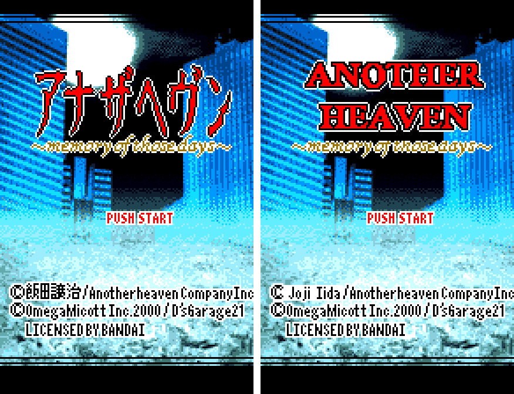

2. Title menu

   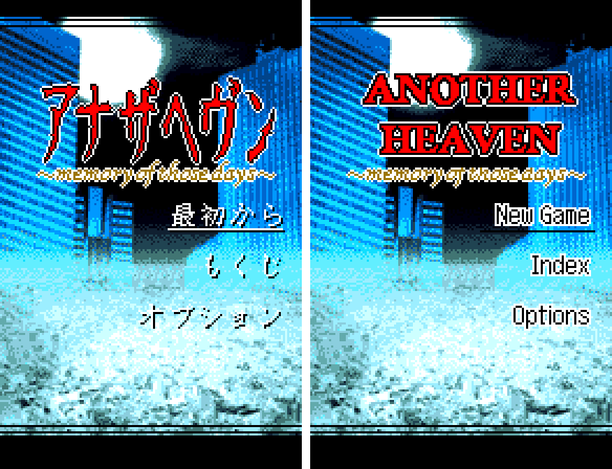

3. The prologue

   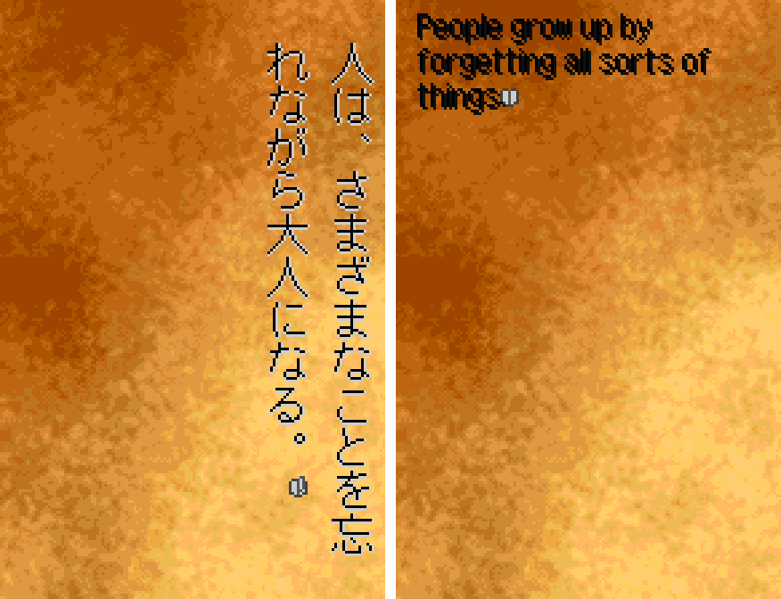

4. An e-mail on the phone

   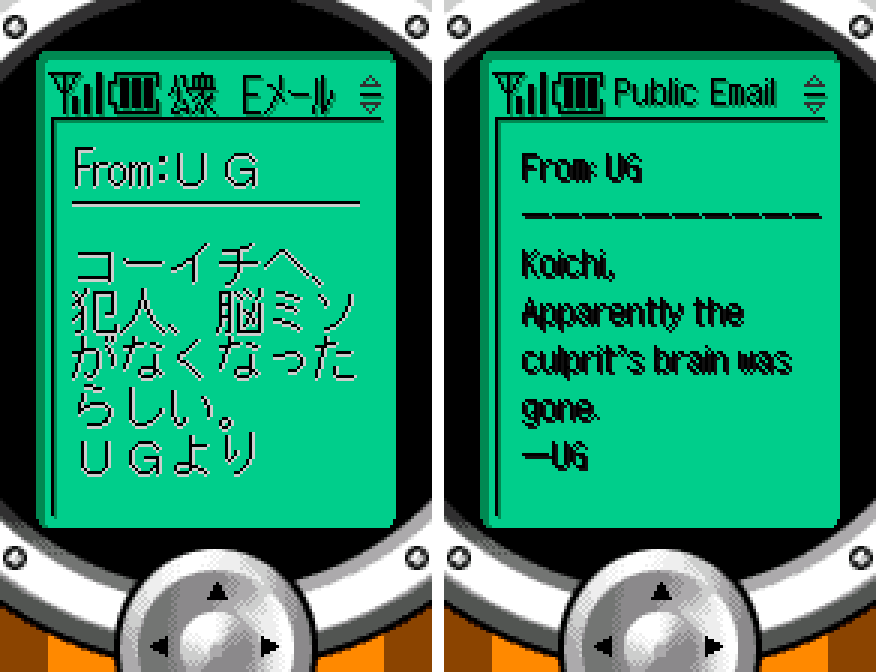

5. Dialogue

   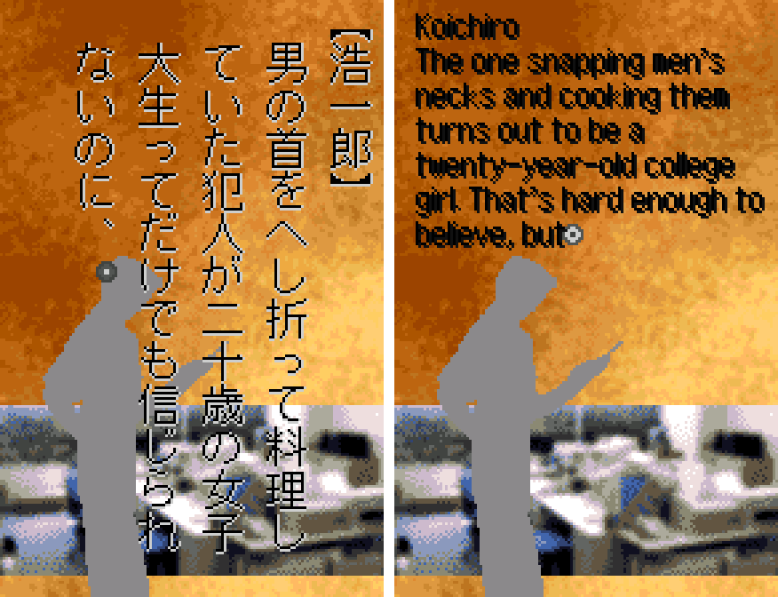

6. The START menu notebook

   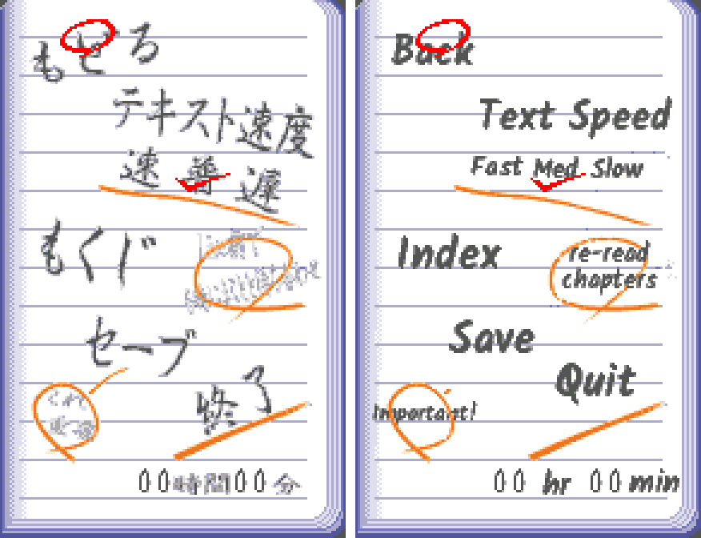

7. Saving (Case Notes)

   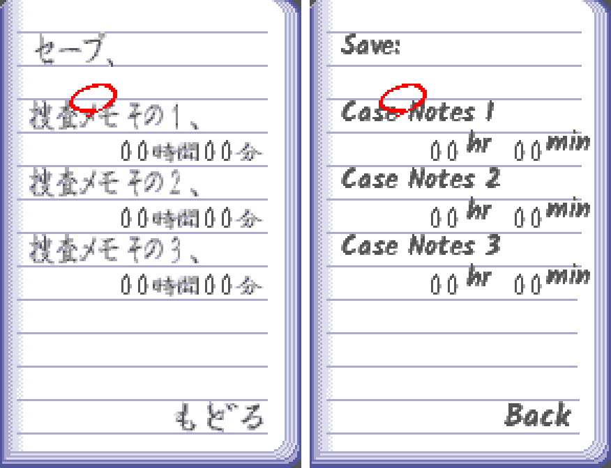

8. The route chart (Index)

   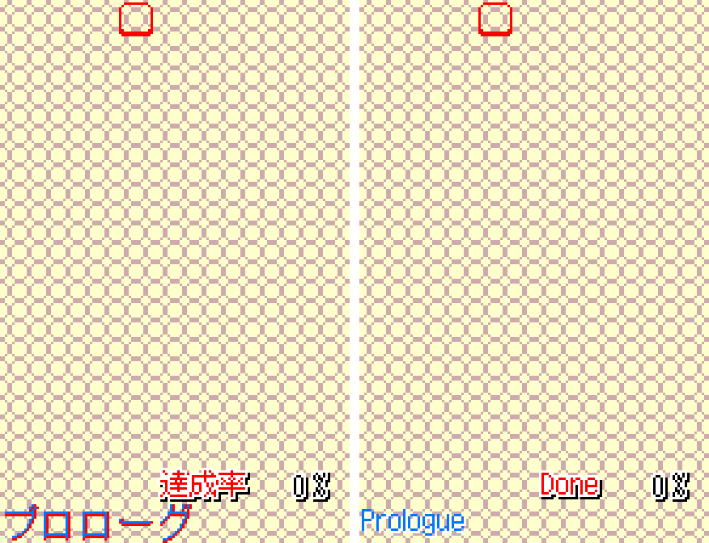

9. Options

   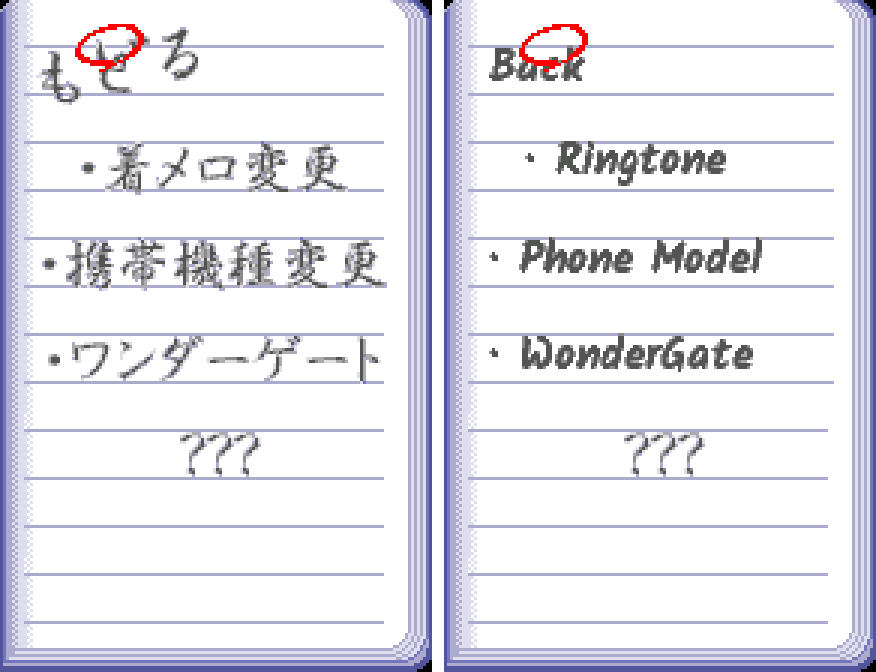

10. Ringtone

   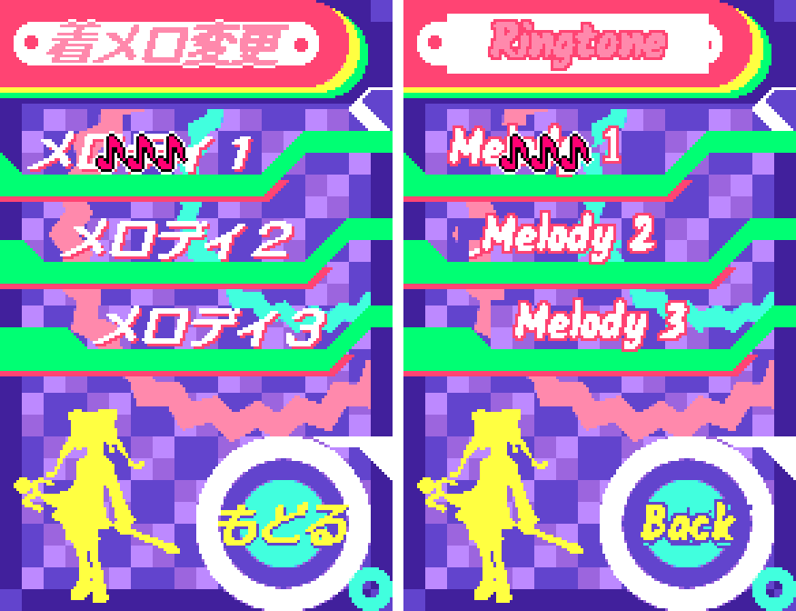

11. Phone Model

   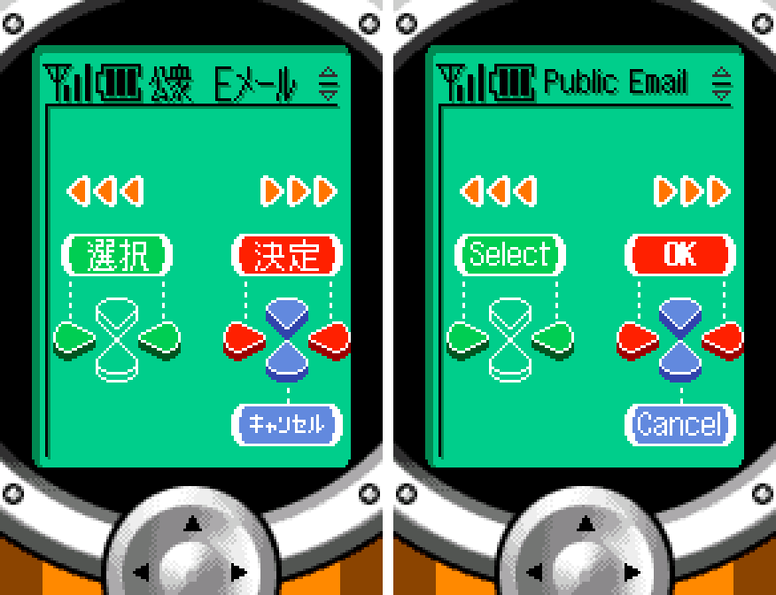

12. WonderGate: phone number

   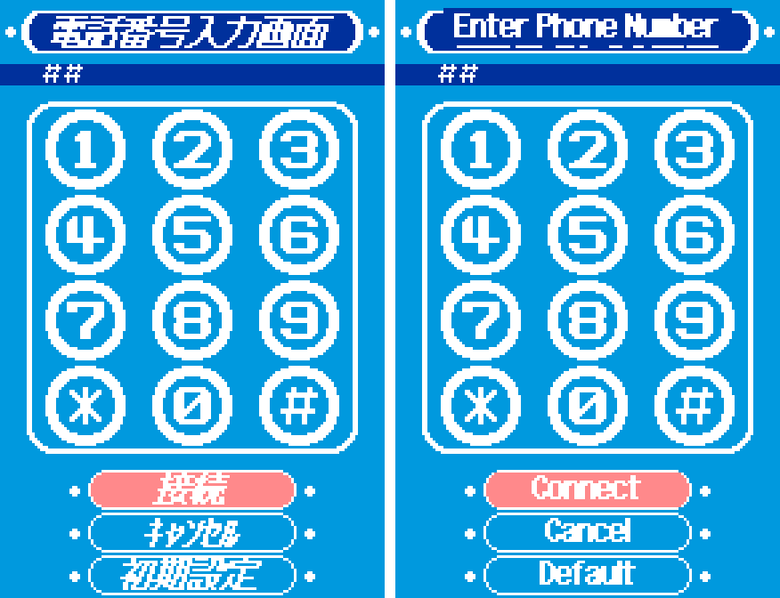

13. WonderGate: the ranking in a real session

   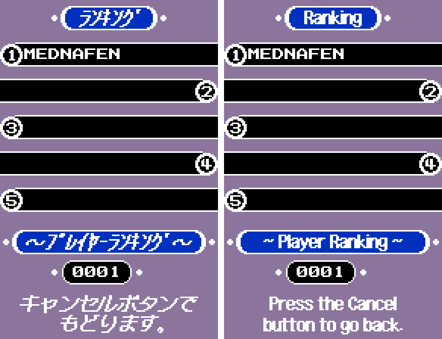

14. Staff credits

   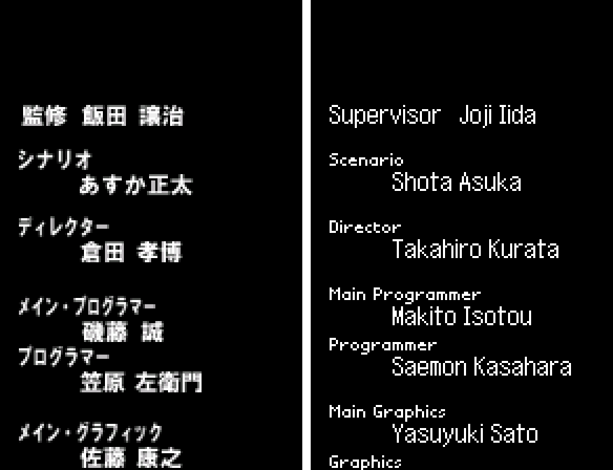

**How to patch**

Apply `another-heaven-en-1.0.bps` to the Japanese ROM "Another Heaven - Memory of those Days (Japan)" (CRC32 D7A0AB74) in your browser with the [Swan Revival patcher](https://swanrevival.com/patcher/), or with Floating IPS, beat or ROM Patcher JS. The result should be CRC32 1B7EF909.

The patched ROM stays 4 MB. It's a WonderSwan Color game, so keep the .wsc extension.

You must provide your own copy of the original Japanese game to apply it.

**Download:** `another-heaven-en-1.0.bps` on the [release page](https://github.com/PokemonGoDB/wonderswan-english-patches/releases/tag/another-heaven-v1.0).

**Known issues**

* It hasn't been played start to finish by a person, and it was tested on emulators, not on real hardware. If you find leftover Japanese, cut text or a crash, please tell me where it happened.
* Between pages the game slides the text off the screen. The original does the same, but the English starts on the left, so it travels across the whole screen.
* Mono mode (the boot menu's "Start in mono mode") was checked on a colour console for the menus and the story; a monochrome WonderSwan itself was not tested.
* One unused-looking picture (a sample of the route chart) was checked only as an image; no place in the game was found that shows it.

**Technical notes (for the curious)**

* The original draws vertical columns of 16x16 kanji, four tiles per character. The English engine draws a 12-row proportional font pixel by pixel into tiles it allocates as it goes, from the game's own tile pool, so a full page of English fits where the Japanese did.
* E-mails are drawn line by line into the phone's screen and scroll with the game's own viewer; the route chart's chapter names and the menus' strings go through the same engine.
* The script was rebuilt and repacked into the original script areas; the edited pictures went into banks the original leaves empty, and no picture uses more tiles than the original (the game loads the next graphic right after it). The ROM stays 4 MB.

**A Note On My Justifications for AI Use**

I have been an avid fan of the Wonderswan system for a very long time now. It was actually a motivating factor for my various attempts to learn Japanese (which have all failed so far). I always wanted to explore the game catalog more, but the lack of English translations made it extremely difficult to do so. Here's the thing: There's a reason many of these games have not been translated yet. It's not just the fact that Japanese > English translation is difficult. There's also the fact that the original developers used all kinds of tricks and technical feats to make these games work. Most games do not have a searchable directory of text that you can just replace with English equivalents. While some are easier than others, translations for some of these would take not only an expert in Japanese > English translation, but also someone with vast game development and programming experience.

I say all that to say: I get why people are apprehensive about AI usage for this type of thing. However, these games have been around for a very long time now and most of them have still not received a translation. I (and others) have chosen to spend our time and money to utilize AI to translate the games and actually make them playable for the wider community. If you don't agree with that, that's completely fine. I am more than happy to remove any of my translations if better, human ran translations are released at a later date. We already decided to skip any games where someone is actively working on a manual translation. While nowhere near what a manual translation effort would be, I do spend a considerable amount of time trying to work through each game's translation. I stress over small details and try my best to make the right calls. And I've probably messed some stuff up, which is why I welcome feedback.

I'm just looking forward to digging through all of these games. It's a great time to be into Wonderswan games.
