# Armored Unit (WonderSwan) - AI English translation patch v1.0

**Armored Unit** (アーマードユニット) is a turn-based space-combat game from Sammy, released in Japan in 1999 for the original (monochrome) WonderSwan. You pilot an AU (Armored Unit, a mech) on a grid, search for hidden enemy AUs and fire your weapons. Story mode has 16 stages: an allied fleet fights a rebel army that is building an ultimate weapon, with briefings between stages. There are also Trial mode, a two-player Duel mode over the link cable, and a Tune Up screen for equipment. The menus and HUD were already in English in the original; the story and status messages were not.

This patch translates it into English.

> **Please read:** this translation was made **with AI** (Claude), as a hobby project. A person (me) made every judgement call before release, but nobody on the project is a professional translator. I'm sharing it as it is for anyone who wants to play. Please **don't upload it to romhacking sites** (romhacking.net and the like). It may not be up to the standard of a real fan translation and it doesn't belong there.

**What's translated**

* **Story:** all 40 briefings and result comments, each speaker with a voice of their own: the calm fleet commander, a rough and cheerful fellow pilot, a polite but frank mechanic, a crisp bridge operator and the arrogant rebel leader. Briefings are typed faster than before so that a page takes about as long to read as the Japanese one did.
* **Battle status line:** all 48 messages (for example "Pick a command", "Took 1 damage!", "Stage Cleared" and the weapon descriptions). The line has 14 fixed cells, so some are short forms such as "Fed. weapon 1". The letters g, j, p, q and y were redrawn so they have proper tails.
* **Boot notice:** the two-line "Save data reset" message.
* **Staff credits:** the credits picture is redrawn in English, with names in Western order. Names are Hepburn romanisations of what is printed; six staff given names are written in kanji, and their readings are best guesses.
* **Weapon-select picture** (WEAPON SELECT / Is this OK? / Yes No): redrawn in English, but see Known issues.
* **Typo fixed:** the original's mode-select picture is lettered "SELELCT MODE". It now reads SELECT MODE.
* **Left as it is:** the title logo keeps its katakana subtitle アーマードユニット. The game's own English stays as it was, including the weapon name SONOR (the original's spelling) and the small-looking "k" in KNIGHT on the unit-select screen, which is the original's own lettering, identical on the Japanese cartridge.

**How it was made: AI translation, independent checks, human decisions**

* Claude worked out the game's text format (kana text in a table, shown in the game's own boxes), wrote the English for 90 strings (40 briefings, 48 status messages, the 2-line boot notice) and rebuilt the ROM from them.
* The draft was reviewed against the Japanese (23 corrections), then polished; the independent verifier accepted 13 of 14 polish edits. A separate read-only Claude reviewer then read all 90 strings and went through the screens of the first test run side by side with the original. It found no wrong meanings; its wording findings were checked and the useful ones applied.
* On screen:
  * all 40 briefings and all 48 status messages were drawn by the game and checked (88 renders, none flagged);
  * random walks drawing 211 text glyphs found no Japanese kana on the English build (the same walk on the original finds 57 kana among 59 glyphs, so the check does detect them);
  * 55 menu and story screens and 42 ending, win, lose and delete screens were captured on both the original and the English build and compared;
  * 2.16 million frames of soak tests across 12 saved states raised no flags;
  * the credits pages were read for English and for spacing from the border.
* Link cable: two emulated copies of the English build played a duel to 2-0 and returned to mode select. The original Japanese cartridge was not part of that test.
* The 12 judgement calls (terms, status wording, the credits picture, the title katakana, the typo fix, KNIGHT and SONOR and more) were listed with the options and pictures, and I decided each one.

**Changelog**

* **v1.0**: first public release.

**Sources consulted**

* Japanese text: the WonderSwan ROM itself.
* The project's own notes on the game's text format, the translation guide and the QA run summary.

**Images** (original on the left, English on the right)

1. Title screen

   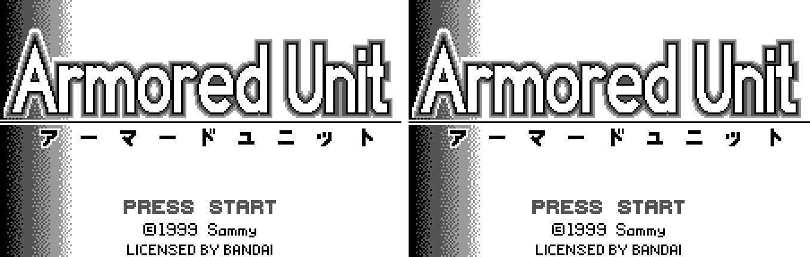

2. Mode select (the SELELCT typo is fixed)

   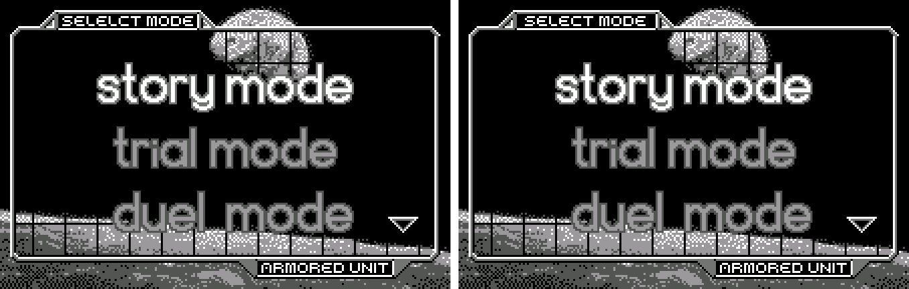

3. Save data reset notice

   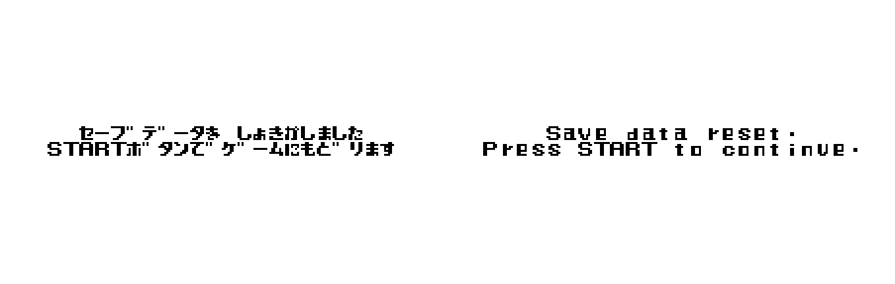

4. Story text: the commander after a stage

   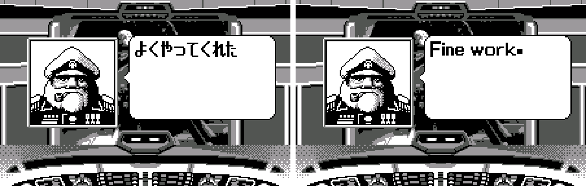

5. Unit select (already English in the original)

   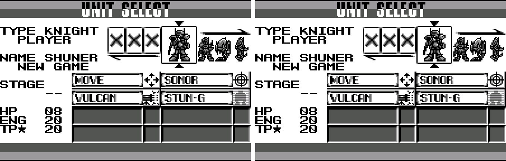

6. Tune Up, with its help line translated

   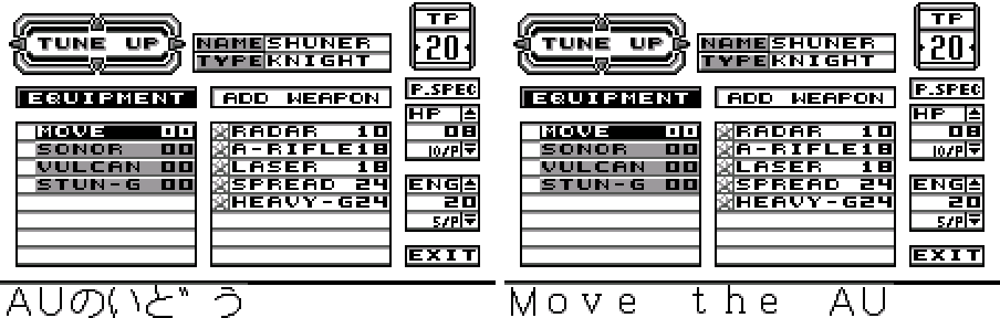

7. Battle with the status line

   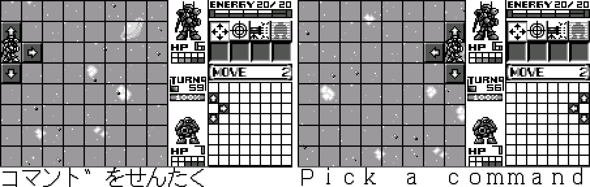

8. Stage cleared

   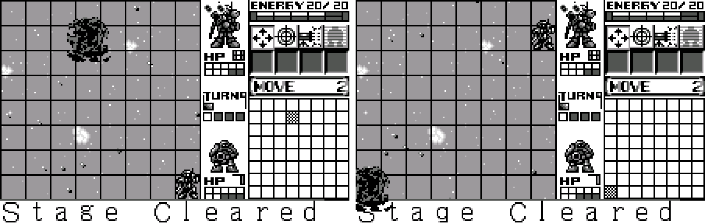

9. Ending text

   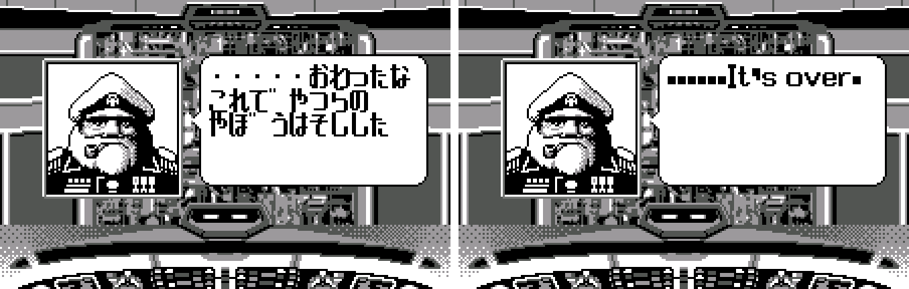

10. Staff credits: Programmer

    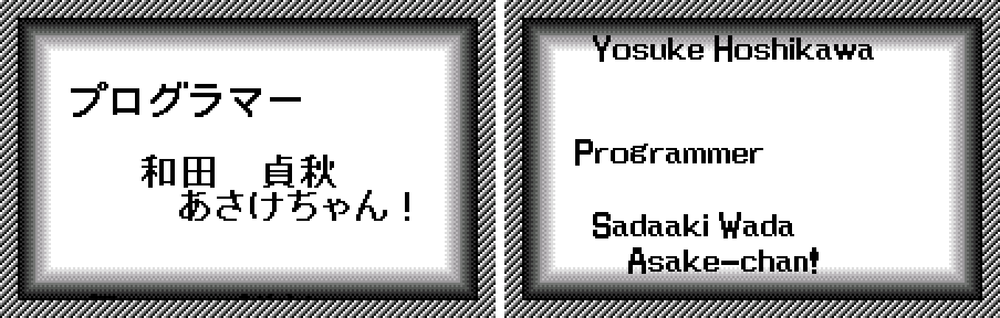

11. Staff credits: Sound Designer

    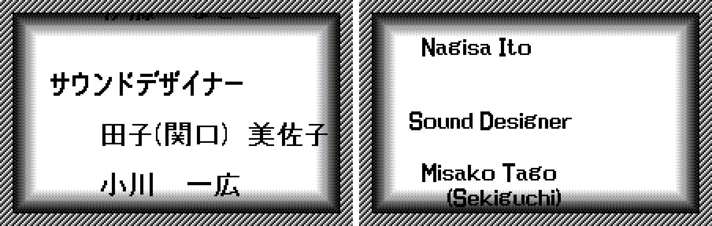

**How to patch**

Apply the BPS file to the Japanese ROM "Armored Unit (Japan)" (CRC32 C11639AF) in your browser with the [Swan Revival patcher](https://swanrevival.com/patcher/), or with Floating IPS, beat or ROM Patcher JS:

* `armored-unit-en-1.0.bps`, the result should be CRC32 B2D98B01.

The patched ROM is 512 KB, the same size as the original. It's a WonderSwan (mono) game, so keep the .ws extension.

You must provide your own copy of the original Japanese game to apply it.

**Download:** `armored-unit-en-1.0.bps` on the [release page](https://github.com/PokemonGoDB/wonderswan-english-patches/releases/tag/armored-unit-v1.0).

**Known issues**

* It hasn't been played start to finish by a person. If you find leftover Japanese or anything broken, please tell me where it happened.
* Of the 16 story stages, only stages 1 and 16 were played in battle; the briefings of stages 2-15 were drawn and checked, but their battles were not.
* The weapon-select picture was translated but never seen in the running game: many test runs and a code search found nothing that draws it, so it may be unused data.
* Duel mode was tested only between two emulated consoles, and only to the end of round 2; round 3 was not seen. The game has no result screen after a duel.
* The credits scroll in the English version takes a different amount of time than the Japanese one. All credits pages were seen.
* The developers' task list in the ROM is not reachable in play and was not tested. A sound mode was not found in the mode list.
* The lettering of a few things is the original's: the heavy periods in briefings and a raised dot in the boot notice are cosmetic quirks of the game's own fonts.

**Technical notes (for the curious)**

* The text uses the same byte code as Sammy's Anchorz Field: kana in JIS X 0201 order, with markers for speaker portraits and page breaks. The game's menus and HUD are English tiles drawn as pictures; the credits, mode select label and weapon-select dialog are pictures that were redrawn.
* The status line draws each character in a fixed 16 x 16 cell from its own tile font, which is why the messages are limited to 14 characters.
* The patch changes the text, some picture tiles and the briefing typing speed. The ROM keeps its size of 512 KB.

**A Note On My Justifications for AI Use**

I have been an avid fan of the Wonderswan system for a very long time now. It was actually a motivating factor for my various attempts to learn Japanese (which have all failed so far). I always wanted to explore the game catalog more, but the lack of English translations made it extremely difficult to do so. Here's the thing: There's a reason many of these games have not been translated yet. It's not just the fact that Japanese > English translation is difficult. There's also the fact that the original developers used all kinds of tricks and technical feats to make these games work. Most games do not have a searchable directory of text that you can just replace with English equivalents. While some are easier than others, translations for some of these would take not only an expert in Japanese > English translation, but also someone with vast game development and programming experience.

I say all that to say: I get why people are apprehensive about AI usage for this type of thing. However, these games have been around for a very long time now and most of them have still not received a translation. I (and others) have chosen to spend our time and money to utilize AI to translate the games and actually make them playable for the wider community. If you don't agree with that, that's completely fine. I am more than happy to remove any of my translations if better, human ran translations are released at a later date. We already decided to skip any games where someone is actively working on a manual translation. While nowhere near what a manual translation effort would be, I do spend a considerable amount of time trying to work through each game's translation. I stress over small details and try my best to make the right calls. And I've probably messed some stuff up, which is why I welcome feedback.

I'm just looking forward to digging through all of these games. It's a great time to be into Wonderswan games.
