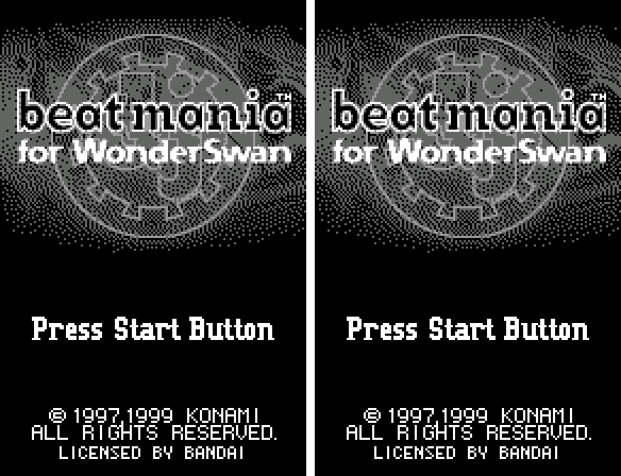
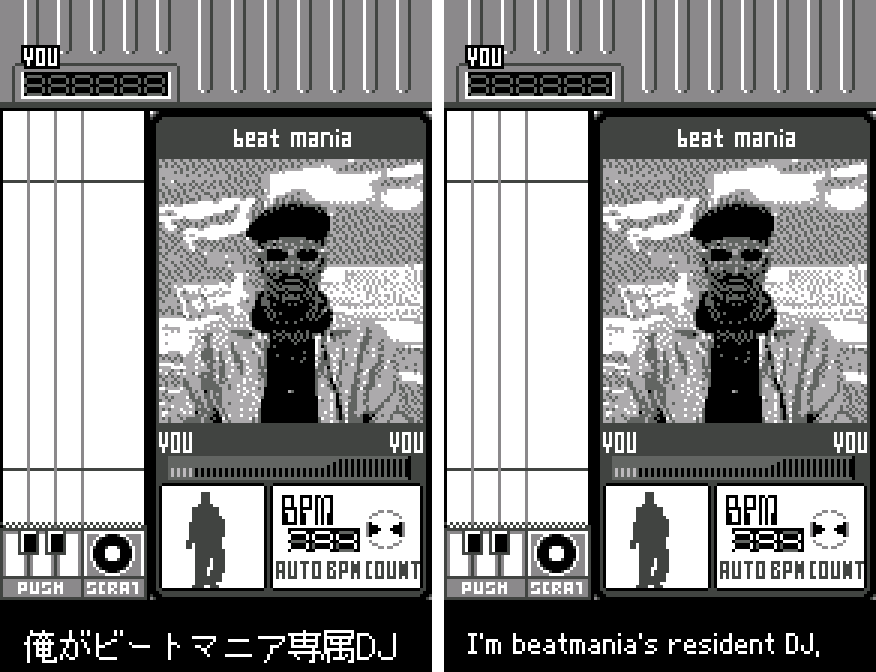
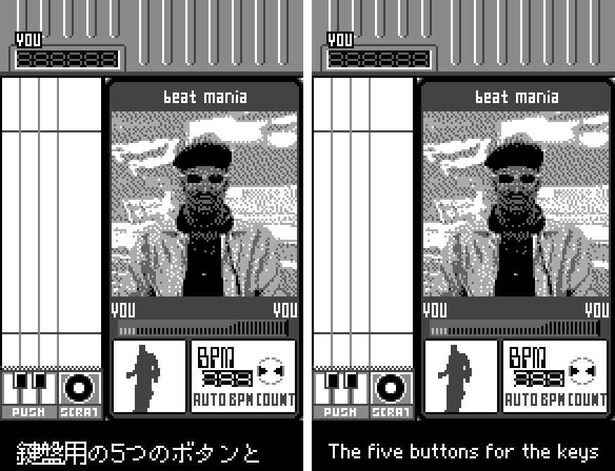
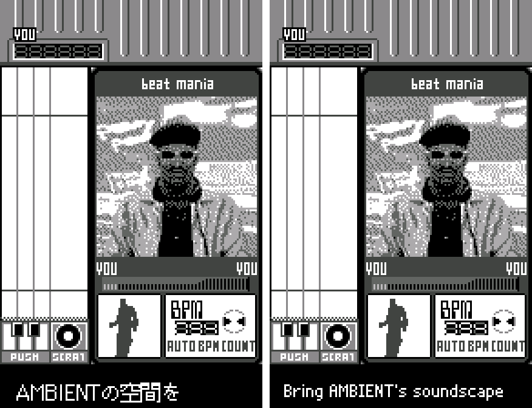
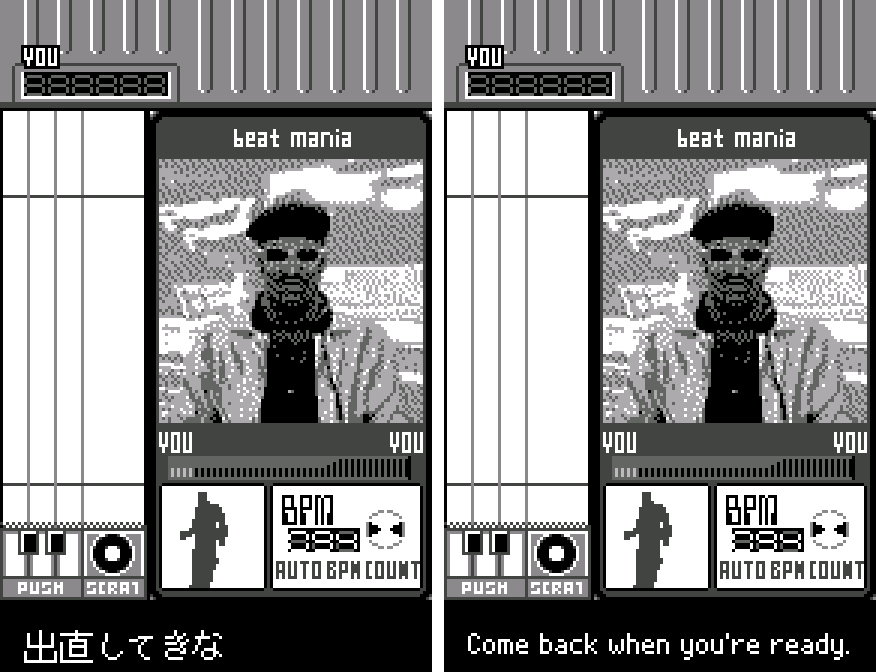

# beatmania for WonderSwan (WonderSwan) - AI English translation patch for Practice mode v1.0 (all 77 lines of it)

**beatmania for WonderSwan** is Konami's 1999 port of the arcade DJ rhythm game, for the original (monochrome) WonderSwan, released only in Japan. You hold the console sideways and scratch and key your way through club tracks. Almost everything in it is already in English: menus, options, song info, results, name entry, records and the staff roll. The one exception is Practice mode, where DJ KONAMI coaches you in Japanese subtitles through the tutorial and two practice songs, then challenges you to a DJ battle.

This patch translates those 77 subtitle lines into English. Nothing else in the game changes. Let's be honest: this isn't a big one. Konami already did the heavy lifting by writing the rest of the game in English. If Grand Battle was a full set, this is a quick scratch. But if DJ KONAMI has been yelling at you in Japanese since 1999, now you'll know what he was saying.

> **Please read:** this translation was made **with AI** (Claude), as a hobby project. A person (me) made every judgement call and played Practice mode before release, but nobody on the project is a professional translator. I'm sharing it as it is for anyone who wants to play. Please **don't upload it to romhacking sites** (romhacking.net and the like). It may not be up to the standard of a real fan translation and it doesn't belong there.

**What's translated**

* All 77 of DJ KONAMI's lines: the Practice-mode tutorial, both practice songs, and the DJ battle challenge with its three verdicts.
* Kept as written in the original: "DJ KONAMI", lowercase "beatmania", and the capitalised game terms that the menus already use (AMBIENT, FUNK, OPTION, KEYSET, FREE PLAY, START).

DJ KONAMI keeps his attitude: he's a cocky club DJ, so the English is casual and a little rude ("Come back when you're ready.", "Newcomer, you're on a roll.").

**How it was made: AI translation, independent checks, human decisions**

* The subtitles are pictures, not text, so each line was transcribed from the ROM's images and checked on screen.
* Claude translated the lines and redrew each picture with a proportional pixel font. A separate Claude reviewer checked every line against the Japanese, then a polish pass made the lines sound natural.
* Every line was drawn by the game itself in an emulator and compared pixel for pixel with the new picture: 77 lines, none clipped. A random walk through the menus and modes on the English ROM found no Japanese subtitle tiles (the same walk on the original finds them).
* The judgement calls were listed with the Japanese, a literal reading and the options, and I decided each one by hand. They include tone, terms and the font. Then I played Practice mode.

**Changelog**

* **v1.0**: first release. Probably also the last, since there's nothing left to translate.

**Sources consulted**

* Japanese text: the subtitle images in the ROM itself.
* Font: a proportional pixel font drawn for our other WonderSwan patches.

**Images** (original on the left, English on the right)

1. Title screen

   

2. DJ KONAMI introduces himself

   

3. Tutorial: the keys

   

4. Practice song (AMBIENT)

   

5. DJ battle: the verdict if you lose

   

**How to patch**

Apply the BPS to the Japanese ROM "Beatmania for WonderSwan (Japan)" (CRC32 324622C9) in your browser with the [Swan Revival patcher](https://swanrevival.com/patcher/), or with Floating IPS, beat or ROM Patcher JS. The result should be CRC32 513EE998. The ROM keeps its size (16 MB), so it runs on the same flash carts as the original. It's a WonderSwan (mono) game, so keep the .ws extension.

You must provide your own copy of the original Japanese game to apply it.

**Download:** [`beatmania-en-1.0.bps`](https://github.com/PokemonGoDB/wonderswan-english-patches/releases/tag/beatmania-v1.0) on its release page.

**Known issues**

* The DJ battle comes before the special song, which seems to unlock at stage 5 or later once all ten songs are cleared. Its lines were checked in English on screen, but nobody has reached it in normal play yet. If you have a save that gets there, tell me how it looks.
* Each subtitle stays on screen for about 1.3 to 2 seconds, timed to the music as in the original. English lines are longer than the Japanese, so a few go by quickly. DJ KONAMI doesn't wait for anyone.

**Technical notes (for the curious)**

* Each subtitle is a 128×16 bitmap in a fixed 512-byte slot. The patch redraws each picture in place, so no code, pointers or memory use change. The whole patch is about 29 KB, for a 16 MB game.

**A Note On My Justifications for AI Use**

I have been an avid fan of the Wonderswan system for a very long time now. It was actually a motivating factor for my various attempts to learn Japanese (which have all failed so far). I always wanted to explore the game catalog more, but the lack of English translations made it extremely difficult to do so. Here's the thing: There's a reason many of these games have not been translated yet. It's not just the fact that Japanese > English translation is difficult. There's also the fact that the original developers used all kinds of tricks and technical feats to make these games work. Most games do not have a searchable directory of text that you can just replace with English equivalents. While some are easier than others, translations for some of these would take not only an expert in Japanese > English translation, but also someone with vast game development and programming experience.

I say all that to say: I get why people are apprehensive about AI usage for this type of thing. However, these games have been around for a very long time now and most of them have still not received a translation. I (and others) have chosen to spend our time and money to utilize AI to translate the games and actually make them playable for the wider community. If you don't agree with that, that's completely fine. I am more than happy to remove any of my translations if better, human ran translations are released at a later date. We already decided to skip any games where someone is actively working on a manual translation. While nowhere near what a manual translation effort would be, I do spend a considerable amount of time trying to work through each game's translation. I stress over small details and try my best to make the right calls. And I've probably messed some stuff up, which is why I welcome feedback.

I'm just looking forward to digging through all of these games. It's a great time to be into Wonderswan games.
