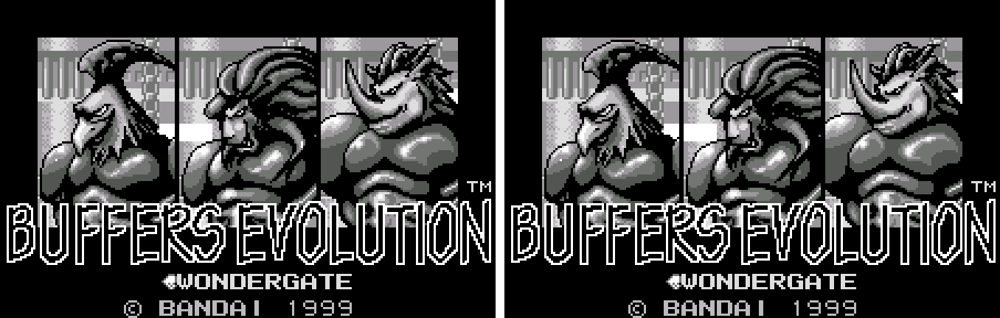
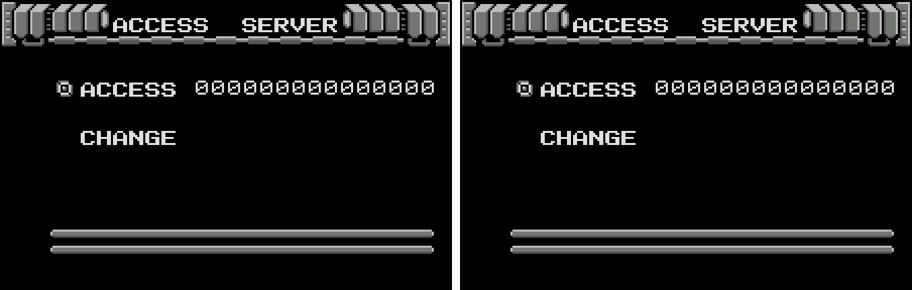
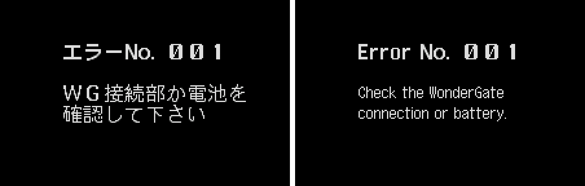
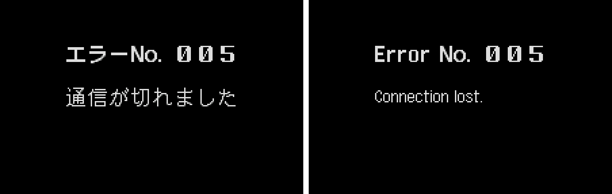
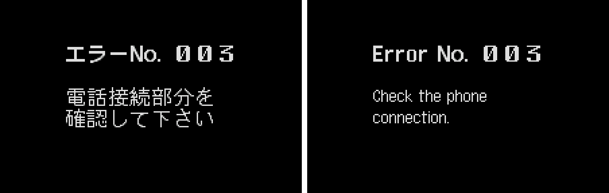
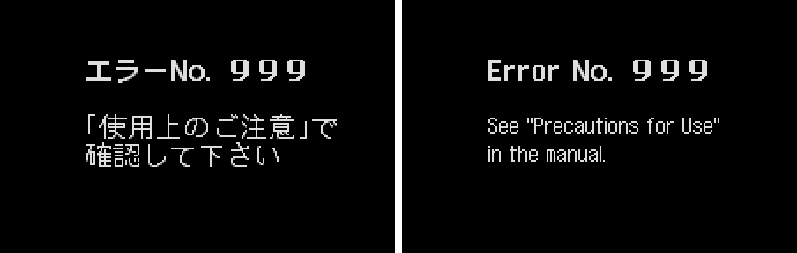
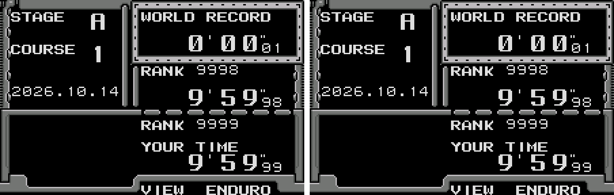

# Buffers Evolution (WonderSwan) - AI English translation patch v1.0 (+ WonderGate edition)

**Buffers Evolution** is Bandai's 1999 side-scrolling action game for the original (monochrome) WonderSwan, released only in Japan (December 1999). You pick a beast-like "Buffer" type and an item, then run, jump and slide through ENDURO courses against the clock, or clear S.S. arenas of enemies; RECORD mode keeps your best times, and a hidden WONDERGATE mode once uploaded them through Bandai's Mobile WonderGate phone adapter for national rankings and contests.

Almost the whole game was already in English: the menus, the courses, the results, the records, the trophies and the staff roll. The only Japanese is the WonderGate error box (error number and message). It is the first thing anyone sees in the hidden mode today, because without an adapter the connection always fails. This patch translates it.

> **Please read:** this translation was made **with AI** (Claude), as a hobby project. A person (me) made every judgement call before release, but nobody on the project is a professional translator. I'm sharing it as it is for anyone who wants to play. Please **don't upload it to romhacking sites** (romhacking.net and the like). It may not be up to the standard of a real fan translation and it doesn't belong there.

**What's translated**

* **The WonderGate error box:** the "Error No." header and all four messages the game can show: "Check the WonderGate connection or battery." (error 001, what you get without an adapter), "Check the phone connection." (003), "See "Precautions for Use" in the manual." (999) and "Connection lost." (all other errors, such as 005 when the server can't be reached).
* Everything else was already English in the original and is left alone, including the WONDERGATE title label and every WonderGate menu (MODE SELECT, ACCESS SERVER, CHANGE, VIEW ENDURO / VIEW S.S. / VIEW CONTEST).

**How to reach the WonderGate mode:** hold **A + B + RIGHT** while switching the WonderSwan on. Once a course record is saved, press RIGHT on the title's mode line (ENDURO > S.S. > RECORD > WONDERGATE). The mode also appears without the code once a download has been stored. The WonderGate edition shows it without the code.

**Terms**

The Japanese abbreviates the adapter as "WG"; the English writes WonderGate in full. 使用上のご注意 ("Precautions for Use") is the usual title of the troubleshooting section of a Japanese instruction leaflet, so the English adds "in the manual".

**The WonderGate edition**

The WonderGate edition (`buffers-evolution-en-wondergate-1.0.bps`) is the standard patch with the game's hidden WonderGate mode always on: WONDERGATE is on the title's mode line without holding A, B and RIGHT while switching the console on (as in the original, the mode line moves once a course record is saved). It's for posting times to the national rankings through [RevivalGate](https://swanrevival.com/revival-gate/), which serves this game's WonderGate features today. Everything else is the standard patch.

**How it was made: AI translation, independent checks, human decisions**

* Claude rendered every graphic in the 4 MB ROM, played every mode and found the hidden mode in the game's code (a key check at power-on). It then redrew the error pictures in English and adjusted the error routine so each message keeps its own second line.
* A separate, independent Claude reviewer checked the translation, the code changes, a byte-by-byte comparison with the original and the screens; its findings were verified and fixed.
* On screen: every distinct error box was compared side by side with the original; random play from ten starting points across the game (1,510 screens) found no Japanese tile on the English build (the same check finds it on the original); five minutes of the attract demo are identical on both ROMs.
* Online: the WonderGate session was played for real against a private copy of the project's WonderGate revival server (swanrevival.com), on the original and the English ROM: the upload, the server's reply and the hang-up all work, and the ranking screens fill with real data (tested with rank 9999 and a world record of 0'00"01). The live server was not used for testing.
* The judgement calls (writing "WonderGate" in full, adding "in the manual", the short "Connection lost.") were listed with the Japanese, a literal reading and the options, and I decided all six by hand.

**Changelog**

* **v1.0**: first release.

**Sources consulted**

* Japanese text: the WonderSwan ROM itself (the error box is a picture).
* WonderGate behaviour: the game's code and the WonderGate revival's notes on this game.
* Lettering: Shinonome 12-dot (public domain) for the messages, and a bold "Error" drawn to match the game's own "No." and digits.

**Images** (original on the left, English on the right)

1. Title with the hidden WONDERGATE mode

   

2. ACCESS SERVER

   

3. Error 001: no adapter

   

4. Error 005: the server can't be reached

   

5. Error 003

   

6. Error 999

   

7. VIEW ENDURO after a real online session (unchanged: already English)

   

**How to patch**

Apply one of the BPS files to the Japanese ROM "Buffers Evolution (Japan)" (CRC32 B25A0635) in your browser with the [Swan Revival patcher](https://swanrevival.com/patcher/), or with Floating IPS, beat or ROM Patcher JS:

* Standard: `buffers-evolution-en-1.0.bps`, the result should be CRC32 378A17BC.
* WonderGate edition (the WonderGate mode without the code): `buffers-evolution-en-wondergate-1.0.bps`, the result should be CRC32 1E355E65.

The ROM keeps its size (4 MB). It's a WonderSwan (mono) game, so keep the .ws extension.

You must provide your own copy of the original Japanese game to apply it.

**Download:** `buffers-evolution-en-1.0.bps`, `buffers-evolution-en-wondergate-1.0.bps` on the [release page](https://github.com/PokemonGoDB/wonderswan-english-patches/releases/tag/buffers-evolution-v1.0).

**Known issues**

* It hasn't been played start to finish by a person. If you find leftover Japanese or anything broken, please tell me where it happened.
* Error 003 and 999 depend on the adapter and the phone; they were checked by forcing the error code in a test build, not with a real adapter.

**Technical notes (for the curious)**

* The error box is a block of 224 tiles holding 16x16 glyphs; the routine places them by index lists stored in its code bank. The English is drawn into the same block (41 of its 44 free glyph slots), with new index lists in empty space in the same bank.
* In the original, all three two-line messages share one second line (確認して下さい, "please check"). A six-byte change makes each message read its own second line right after its first.
* The hidden mode is unlocked when exactly A + B + RIGHT are held at power-on, or when the cartridge EEPROM already holds a downloaded date. The ROM also contains the developers' own sample server reply (a contest called ARIOCH).
* The cartridge checksum is updated.

**A Note On My Justifications for AI Use**

I have been an avid fan of the Wonderswan system for a very long time now. It was actually a motivating factor for my various attempts to learn Japanese (which have all failed so far). I always wanted to explore the game catalog more, but the lack of English translations made it extremely difficult to do so. Here's the thing: There's a reason many of these games have not been translated yet. It's not just the fact that Japanese > English translation is difficult. There's also the fact that the original developers used all kinds of tricks and technical feats to make these games work. Most games do not have a searchable directory of text that you can just replace with English equivalents. While some are easier than others, translations for some of these would take not only an expert in Japanese > English translation, but also someone with vast game development and programming experience.

I say all that to say: I get why people are apprehensive about AI usage for this type of thing. However, these games have been around for a very long time now and most of them have still not received a translation. I (and others) have chosen to spend our time and money to utilize AI to translate the games and actually make them playable for the wider community. If you don't agree with that, that's completely fine. I am more than happy to remove any of my translations if better, human ran translations are released at a later date. We already decided to skip any games where someone is actively working on a manual translation. While nowhere near what a manual translation effort would be, I do spend a considerable amount of time trying to work through each game's translation. I stress over small details and try my best to make the right calls. And I've probably messed some stuff up, which is why I welcome feedback.

I'm just looking forward to digging through all of these games. It's a great time to be into Wonderswan games.
