# Cardcaptor Sakura: Sakura to Fushigi na Clow Card (WonderSwan) - AI English translation patch v1.0

**Cardcaptor Sakura: Sakura to Fushigi na Clow Card** (カードキャプターさくら さくらとふしぎなクロウカード) is a game from Bandai, released in Japan in 1999 for the original (monochrome) WonderSwan. It follows the first anime season, with Sakura in grade 4, and wraps it in a weekly life sim: each week you plan lessons and activities with Kero, go out to visit friends, shop, help at home or write the diary, and raise your friends' affinity. The story walks through the Clow Cards in roughly the order of the anime, up to Earthy, Yue and the Final Judgment, and the cards are caught in turn-based battles. There is also a link-cable deck mode.

This patch translates it into English.

> **Please read:** this translation was made **with AI** (Claude), as a hobby project. A person (me) made every judgement call before release, but nobody on the project is a professional translator. I'm sharing it as it is for anyone who wants to play. Please **don't upload it to romhacking sites** (romhacking.net and the like). It may not be up to the standard of a real fan translation and it doesn't belong there.

**What's translated**

* **Story:** all 6,915 story texts, including the Hoe? and Hanyaan catchphrases and the Clow Card chants.
* **Menus and messages:** all menus, the weekly planner, shop and weekly results, battle messages and card descriptions, and Kero's data screens.
* **Pictures that contain text:** the title subtitle and start prompt, date cards, profile cards, weekend menu icons, battle command labels and the card-name pictures were redrawn in English.
* **Taller letters:** the English text is drawn with capitals and digits 10 pixels tall, as tall as the Japanese kana, and lowercase letters 8 pixels tall. The letters are about 5 pixels wide, narrower than the Japanese characters, so a little more fits on a line.
* **Developer debug menu:** the game contains a debug menu that cannot be reached in normal play. Its labels are translated too, but this patch does not add a way to open it.
* **Left as it is:** the Japanese series logo above the English title, and the copyright line (including 講談社, Kodansha), because they are the rights holders' own lettering.

**Names and terms**

* Western name order (Sakura Kinomoto, Syaoran Li). I kept the honorifics -san, -kun and -chan, as the English manga releases do. Teachers are "Mr. Terada" and "Ms. Mizuki".
* Toya's nickname for Sakura is "kaiju" (I liked it better than "monster" or "squirt").
* Catchphrases are fixed everywhere: "Hoe?" (longer "Hoee!" and "Hoeeee!" for bigger shocks), "Hanyaan...", "Everything will surely be all right" for the spell (short form "It'll be all right!") and "Heeeey there!!" for Kero. Kero is slangy, casual American.
* Kero's nicknames: "little girl" for Meiling, "kid" for Syaoran ("brat" when he is angry) and "Snow Bunny" for Yukito.
* Card names follow the spellings printed on the English cards (Firey, Watery, Earthy, Windy, Glow, Wood, Sweet). In text a card name may drop "the" where a box is tight.
* Terms the game made up: Heart Stones, charm cards, One-Point Check, Affinity, Training, Friends (the comic magazine), Fabric, Diary (the save), Sensitivity (the stat).
* "Final Judgment" (American spelling), Yue the Judge, "Cerberus, the Selector".
* Syaoran is "Li" on the battle command, and "Li:" or "Mei:" names the actor in the damage line.
* Dates are month/day with the weekday in capitals, for example "4/ 4 (SUN)".
* The weekly results label is "Stamina"; the other stat labels are mixed case.
* Romance, kisses and grief are translated literally, nothing added or softened.
* The four elemental cards (Windy, Watery, Firey, Earthy) and two rules texts (Freeze, Firey) keep the Japanese semicolon ("One of the four great elements; rules fire."). I had the semicolon redrawn so it can't be mistaken for a comma.
* Two lines depart from a plain reading on purpose: Sakura's father "teaches at a university", and Toya's peach keeps its wordplay.
* Tomoyo's profile picture says her birthday is Sep 2; I made it Sep 3, which is her birthday and what the game's own profile page says.

*Shortened or reworded to fit.* The English has to fit lines of 158 pixels and two lines per box, and fixed-width boxes elsewhere. To fit, I had 87 story texts (99 ids) and 85 system strings reworded; most lost only a filler word such as "somehow" or "sometime". Where the meaning or a spell's wording changed:

* The spell chants are one English sentence per line, and the Japanese misprint 軽鹿霹靂 (it should be 軽雷霹靂) is translated by its meaning:
  * Key chant: "Key that hides dark power, show your true form before me!" (the full "power of darkness" needs a third line).
  * "Metal, wood, water, fire, earth! Thunder, wind, lightning, decree!"
  * "Royal decree, four quarters! Metal, wood, water, fire, earth!"
  * "Thunder, wind, lightning, decree! Light thunder, bolt, flash, turn!"
  * "Return to the guise you should be in!"
  * "become a sword of divine punishment!" and "become the white blade piercing evil!"
* "It'll work out! Everything will surely be all right!"
* "It's hard...... what others can't see... when you can see it..."
* "The seaside school, the zoo, the night festival... I think."
* "As thanks for yesterday, want to go eat something yummy?"
* "I have a conference today too. Sorry, I'm counting on you."
* Shop: "Mirror & Brush 700 Makes hair you prize next to life neat and pretty. For long-haired girls." and Libra: "Cancels out any points the opponent recovered."
* Battle messages are number-neutral ("{n} damage dealt!"). The settings help is one line.

**How it was made: AI translation, independent checks, human decisions**

* Claude worked out the game's text format, wrote the English for the story and all system text, and rebuilt the ROM from it. The patched ROM is 4 MB; the original is 2 MB.
* Independent reviewers (separate Claude sessions) read all 7,901 unique texts against the Japanese; every finding was checked before any change. A second pass read 137 changed strings and found 4 errors, which were fixed. Reviewers also read the changed screens: the logged review covered 13 reviewers.
* On screen, on the final build:
  * a static check of 9,267 strings found 0 problems;
  * all 6,915 story boxes and 668 system strings were drawn by the game in their real boxes and none was flagged;
  * random walks and 126 scripted walks through 63 saved states (about 7 million frames) were scanned for Japanese text; every Japanese glyph drawn was accounted for in a list of known cases, and the same scan on the original finds its Japanese, so it does detect it;
  * 4,492 idle-loop samples of both ROMs, 834 ending screens compared with the original (102 credit-roll pages identical), and the link menu flow equal to the original;
  * 2,114 screens were checked for alignment against the original, side by side and enlarged;
  * 2,138,400 frames of soak tests across 18 saved states raised no flags.
* Font size was measured against the original on 12 kinds of text (see Known issues for where the English is smaller).
* There were 20 judgement calls (honorifics, "kaiju", the nicknames, catchphrases, tone, invented terms, the chants, the semicolon, text size and more). Each was shown with the options and pictures, and I decided every one.

**Changelog**

* **v1.0**: first public release.

**Sources consulted**

* Japanese text: the WonderSwan ROM itself.
* English forms of names and terms from the series' English-language releases (subtitled anime, manga) and English card listings, read through public web pages and reviews; I could not check printed copies, so a few rarer terms follow the project's own choice.
* The project's own notes on the game's text format, the translation guide and the QA run summaries.

**Images** (original on the left, English on the right)

1. Title screen

   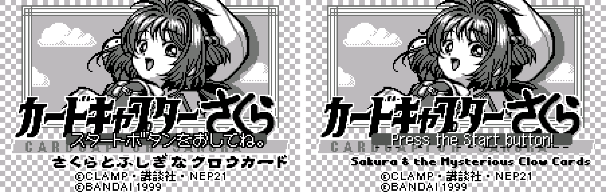

2. Title menu (New Game / Settings)

   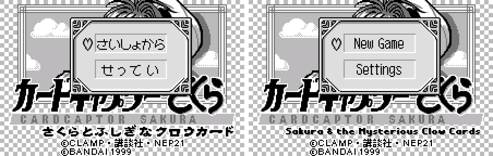

3. Dialogue box with the taller letters

   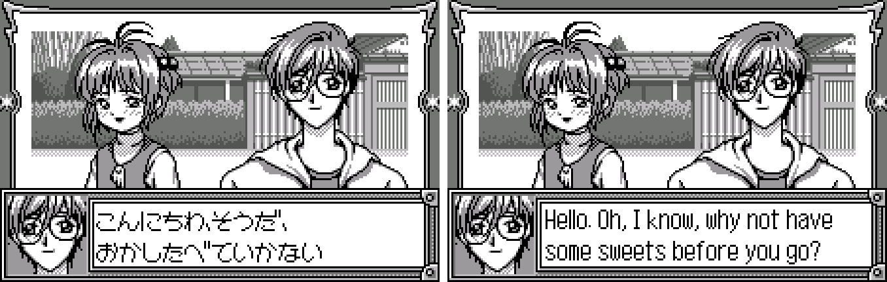

4. Weekly planner

   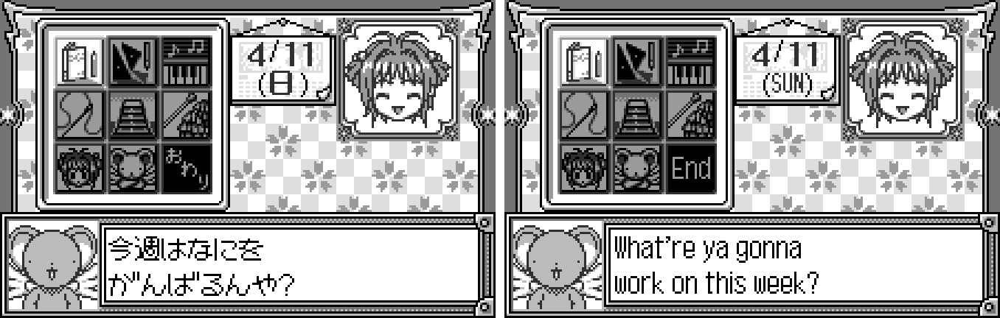

5. Shop with the money panel

   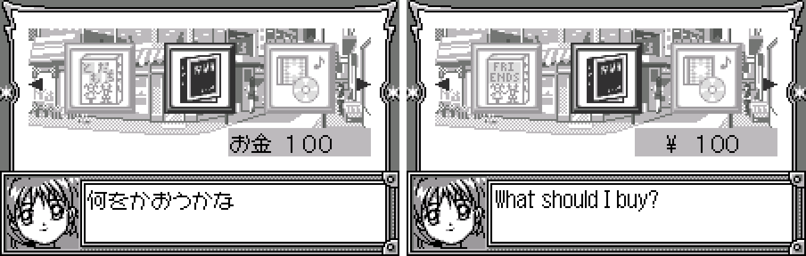

6. Battle with its command menu

   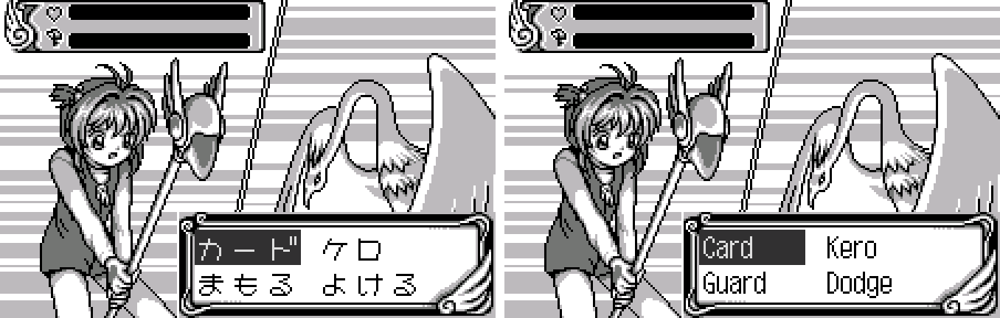

7. Clow Card description

   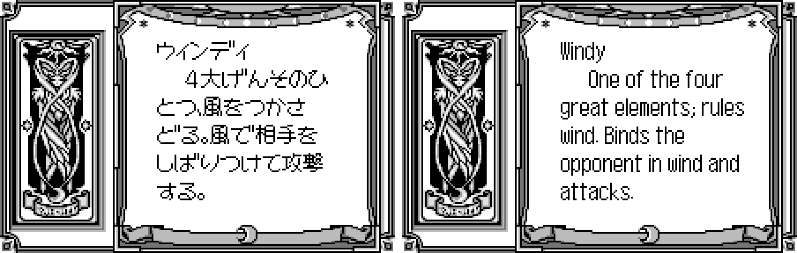

8. Profile page

   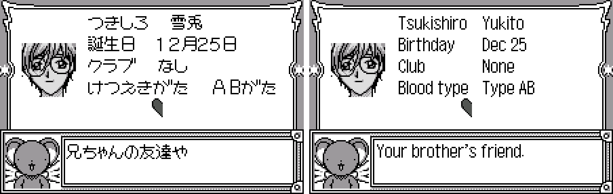

9. Weekly results

   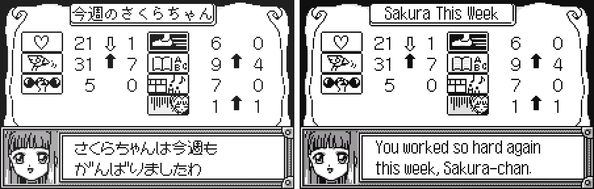

10. Diary (save) screen

    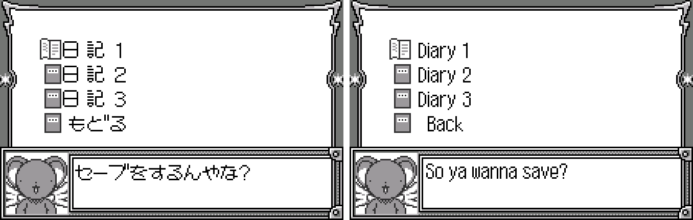

11. Date card

    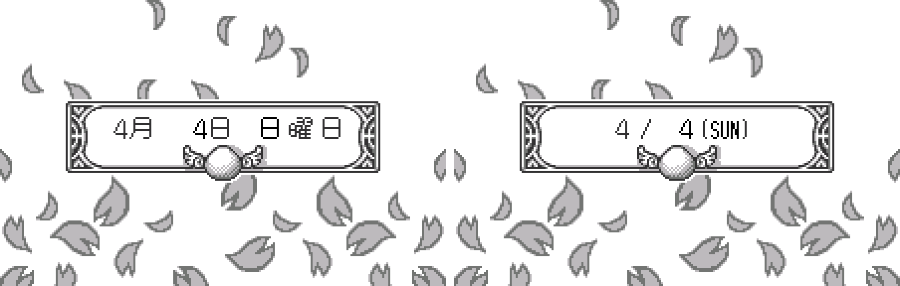

**How to patch**

Apply the BPS file to the Japanese ROM "Cardcaptor Sakura - Sakura to Fushigi na Clow Card (Japan)" (CRC32 7F3A14C0) in your browser with the [Swan Revival patcher](https://swanrevival.com/patcher/), or with Floating IPS, beat or ROM Patcher JS:

* `cardcaptor-sakura-en-1.0.bps`, the result should be CRC32 C11D3CEA.

The patched ROM is 4 MB (4,194,304 bytes); the original is 2 MB. It's a WonderSwan (mono) game, so keep the .ws extension.

You must provide your own copy of the original Japanese game to apply it.

**Download:** `cardcaptor-sakura-en-1.0.bps` on the [release page](https://github.com/PokemonGoDB/wonderswan-english-patches/releases/tag/cardcaptor-sakura-v1.0).

**Known issues**

* It hasn't been played start to finish by a person. If you find leftover Japanese or anything broken, please tell me where it happened.
* Nothing has been seen on a real device, only in an emulator. The taller dialogue letters and the redrawn semicolon were checked on enlarged screenshots and by measuring pixels.
* A few places have English letters smaller than the original's:
  * Weekdays and dates (WED, SUN) are 9 pixels tall against 11 for the Japanese kanji, because three letters have to fit between the planner's painted brackets.
  * Two black caption bars are in smaller letters: "I, Sakura, command you under our contract!" (6 pixels against 11) and "Become a binding chain!!" (10 against 14); at the original's size they would be wider than their bars. I never found either on screen in play, so I only checked them as drawn pictures.
  * The title subtitle and the start prompt are 9 pixels tall against 10.
  * "Stamina" on the weekly results uses the same capital height but fills its slot to within 1 pixel; the normal weekly results screen shows an icon there, so I only saw the word on the debug results screen.
* The money digits in the shop sit 1 to 2 pixels off the original's columns, and the Back label on the diary list sits 2 pixels further right than in the original.
* Some things were not seen in play: the Turn and Damage panels and the deck menu with the profile card lettering (checked only as picture renders), some rare battle messages and the nobody-home scenes (seen only by forcing them), the very large values on the weekly results, and 115 of the 668 system strings, which no screen event reaches in play.
* The game has a trial-version farewell scene in its data that shows on neither ROM, and a Title Diary submenu (Read / Erase) that no code draws.
* After a link duel, the English loser's title intro finishes sooner than the original's. I did not find the cause; it isn't text.

**Technical notes (for the curious)**

* The text is stored as kana in a table and drawn by the game's own text engine in 16 x 16 cells. The patch uses English text in a 12-dot font (capitals 10 rows tall) and redraws the text-bearing pictures; the ROM grows from 2 MB to 4 MB.
* The dialogue wraps at 158 pixels and two lines per box.
* The cartridge dates from 1999, before the WonderGate service, and has no WonderGate support.

**A Note On My Justifications for AI Use**

I have been an avid fan of the Wonderswan system for a very long time now. It was actually a motivating factor for my various attempts to learn Japanese (which have all failed so far). I always wanted to explore the game catalog more, but the lack of English translations made it extremely difficult to do so. Here's the thing: There's a reason many of these games have not been translated yet. It's not just the fact that Japanese > English translation is difficult. There's also the fact that the original developers used all kinds of tricks and technical feats to make these games work. Most games do not have a searchable directory of text that you can just replace with English equivalents. While some are easier than others, translations for some of these would take not only an expert in Japanese > English translation, but also someone with vast game development and programming experience.

I say all that to say: I get why people are apprehensive about AI usage for this type of thing. However, these games have been around for a very long time now and most of them have still not received a translation. I (and others) have chosen to spend our time and money to utilize AI to translate the games and actually make them playable for the wider community. If you don't agree with that, that's completely fine. I am more than happy to remove any of my translations if better, human ran translations are released at a later date. We already decided to skip any games where someone is actively working on a manual translation. While nowhere near what a manual translation effort would be, I do spend a considerable amount of time trying to work through each game's translation. I stress over small details and try my best to make the right calls. And I've probably messed some stuff up, which is why I welcome feedback.

I'm just looking forward to digging through all of these games. It's a great time to be into Wonderswan games.
