# Chaos Gear: Michibikareshi Mono (WonderSwan) - AI English translation patch v1.3

**Chaos Gear: Michibikareshi Mono** (カオスギア 導かれし者) is a strategy game from Bandai, released in Japan in 1999 for the original (monochrome) WonderSwan. You play a Chaos Gainer, a being summoned into a world where four powers (the Empire, the Mana Kingdom, the Gaia tribes and the Eleal Brigade) fight over castles and over chaos gear, the substance only Chaos Gainers can produce. You build up your main tower and its facilities, plan, hire units and deploy them, collect cards in a Binder, and send your army into battle on the map.

This patch translates it into English.

> **Please read:** this translation was made **with AI** (Claude), as a hobby project. A person (me) made every judgement call before release, but nobody on the project is a professional translator. I'm sharing it as it is for anyone who wants to play. Please **don't upload it to romhacking sites** (romhacking.net and the like). It may not be up to the standard of a real fan translation and it doesn't belong there.

**What's translated**

* **Messages:** the story, the opening poem, battle shouts and quotes, and the game's system messages, in the game's own message boxes. Names you enter are inserted into messages.
* **Names:** card names, unit names, weapon names and the names of facilities and castles.
* **Menus:** the command menu reads Build / Plan / Hire / Deploy (the game's keiryaku command is called Plan everywhere), and the facility, Binder and phase menus are in English too.
* **Pictures and label plates:** the text the game draws as pictures is redrawn in English: tag and label plates, banners such as Stage Clear and Game Over, weapon and formation plates, and the card and facility name strips.
* **Title menu:** New Game and, when there is a save, Continue / View Binder / History / Exchange.
* **History screens:** the Main Tower History and Force History screens.
* **Attract mode:** the faction pages that scroll when the title is left idle.
* **Staff credits:** the credits that roll after the ending.
* **A crash fixed:** the original game hangs if you open Data on an empty facility record (it starts its graphics decompressor with an invalid index). The patch changes one byte so this no longer happens.

**How it was made: AI translation, independent checks, human decisions**

* Claude worked out the game's text format (Shift-JIS text in a table, shown in the game's own boxes), wrote the English for the game's strings (the checks below cover 1,324 catalogued strings) and rebuilt the ROM from them.
* Checks on the final build (QA run t25, 9 of 9 checks passed):
  * the string check found 0 problems in 1,324 strings (width, bytes, escapes, untranslated);
  * 958 non-story strings were each drawn by the game in a test build and none was flagged;
  * random presses over 217 saved states drew no Japanese on the English build (the same detector does find Japanese on the original);
  * 203 screens were captured on both the original and the English build and reviewed for English and for alignment, with independent Claude reviewers for the later changes;
  * the attract mode, the endings and a random-press hang test were also run.
* 58 decision items (terms, names, wording, lettering, the Plan / Scheme question and more) were laid out with pictures and options, and I decided every one.

**Changelog**

* **v1.3**: first release on this page. Earlier builds were not published here.

**Sources consulted**

* Japanese text and pictures: the WonderSwan ROM itself.
* The project's own notes on the game's text format, the term list, the story notes and the QA run summary.

**Images** (original on the left, English on the right)

1. Title screen

   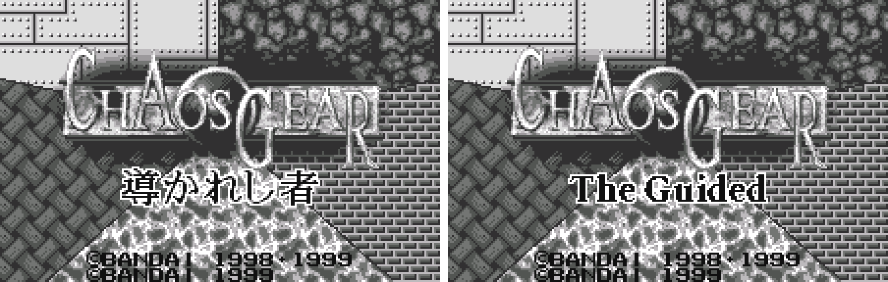

2. Opening poem

   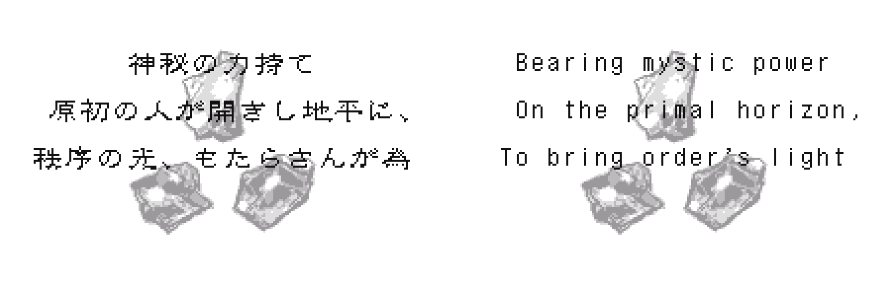

3. A message box (the ending text)

   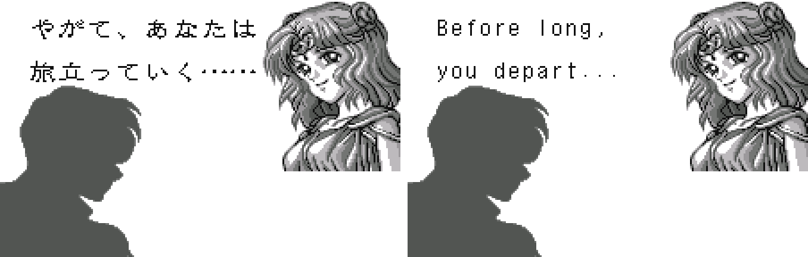

4. Command menu: Build / Plan / Hire / Deploy

   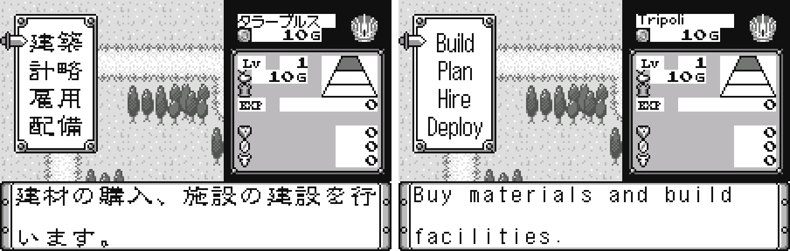

5. Build grid with the Build / Repair / Data menu

   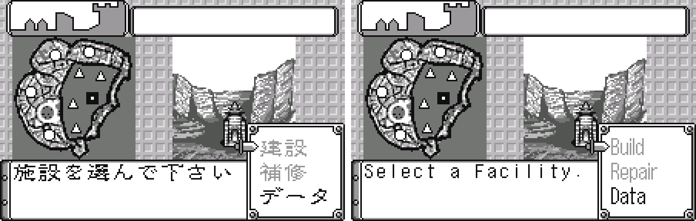

6. Battle

   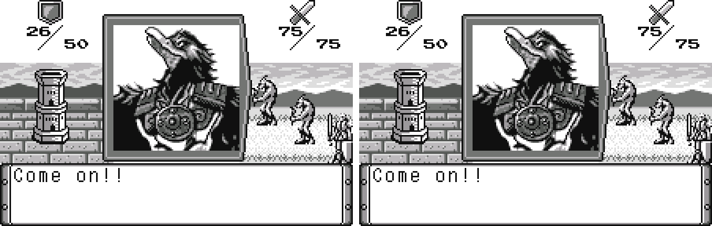

7. Sortie screen: "5 left" (the Japanese reads あと5体)

   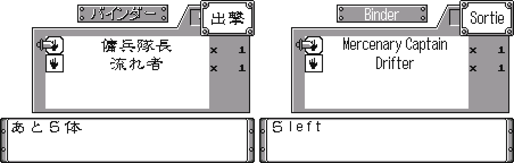

8. Card data in the Binder

   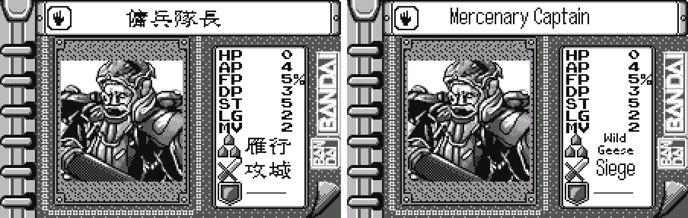

9. Force History table (Hero / Cmdr. / Troop)

   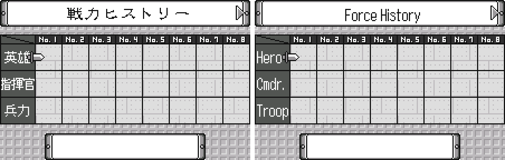

10. Title menu with a save: New Game / Continue / View Binder / History / Exchange

   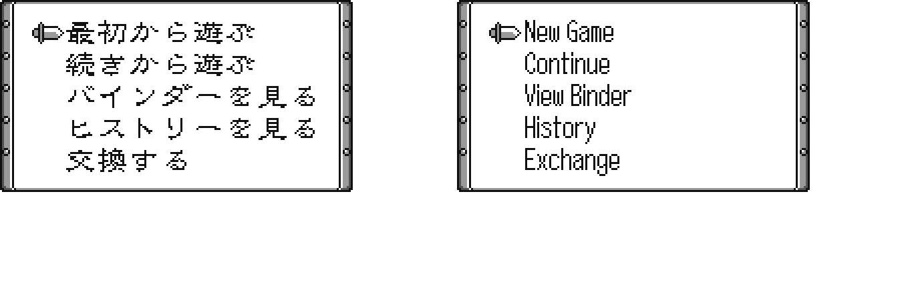

11. Staff credits

   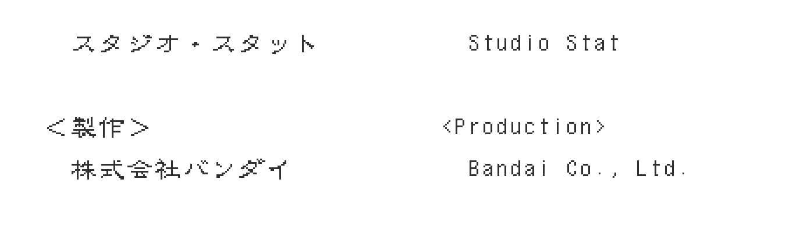

**How to patch**

Apply the BPS file to the Japanese ROM "Chaos Gear - Michibikareshi Mono (Japan)" (CRC32 27B3CC18) in your browser with the [Swan Revival patcher](https://swanrevival.com/patcher/), or with Floating IPS, beat or ROM Patcher JS:

* `chaos-gear-en-1.3.bps`, the result should be CRC32 66BDB34A.

The patched ROM is 2 MB, the same size as the original. It's a WonderSwan (mono) game, so keep the .ws extension.

You must provide your own copy of the original Japanese game to apply it.

**Download:** `chaos-gear-en-1.3.bps` on the [release page](https://github.com/PokemonGoDB/wonderswan-english-patches/releases/tag/chaos-gear-v1.3).

**Known issues**

* It hasn't been played start to finish by a person. If you find leftover Japanese or anything broken, please tell me where it happened.
* Text in message boxes is smaller than the original's letters (capitals 9 px against 11 px). Taller letters did not fit two lines in a box, so I kept the smaller size. Menus, plates and names use the taller letters.
* A few label plates are smaller than the original's for lack of room.
* Chapters 2 to 5 were not played to their own wins; their cards were seen by writing to the game's memory.
* A few messages were seen only in test builds, not in play: the name messages "obtained", "castle built" and "Main Tower leveled up".
* The Game Over banner was not seen on screen in this build; only its picture was checked. Of the 31 castle name panels of chapters 2 to 5, only two were seen on screen; the others share the same code.
* Some plates and menus could not be reached in play (the Standby and Card plates were seen only through test routes) and were checked as drawn pictures.
* Exchange (the link cable feature) was tested only between two emulated consoles.

**Technical notes (for the curious)**

* The Japanese text is Shift-JIS, two bytes a character, in tables ending in a zero word. The English is stored as two ASCII letters per 16-bit word and drawn in 8 px columns from a font table built into the patch; message boxes are 13 cells wide.
* Strings sit in fixed slots, so a name or message is limited to the length of its slot. Entered names are copied into messages by a small routine added to the ROM, which uses free space.
* Text drawn as pictures is stored compressed in the ROM; the patch replaces those pictures with English ones.
* The ROM keeps its size of 2 MB. The crash fix is one byte at ROM address 1421D1h.

**A Note On My Justifications for AI Use**

I have been an avid fan of the Wonderswan system for a very long time now. It was actually a motivating factor for my various attempts to learn Japanese (which have all failed so far). I always wanted to explore the game catalog more, but the lack of English translations made it extremely difficult to do so. Here's the thing: There's a reason many of these games have not been translated yet. It's not just the fact that Japanese > English translation is difficult. There's also the fact that the original developers used all kinds of tricks and technical feats to make these games work. Most games do not have a searchable directory of text that you can just replace with English equivalents. While some are easier than others, translations for some of these would take not only an expert in Japanese > English translation, but also someone with vast game development and programming experience.

I say all that to say: I get why people are apprehensive about AI usage for this type of thing. However, these games have been around for a very long time now and most of them have still not received a translation. I (and others) have chosen to spend our time and money to utilize AI to translate the games and actually make them playable for the wider community. If you don't agree with that, that's completely fine. I am more than happy to remove any of my translations if better, human ran translations are released at a later date. We already decided to skip any games where someone is actively working on a manual translation. While nowhere near what a manual translation effort would be, I do spend a considerable amount of time trying to work through each game's translation. I stress over small details and try my best to make the right calls. And I've probably messed some stuff up, which is why I welcome feedback.

I'm just looking forward to digging through all of these games. It's a great time to be into Wonderswan games.
