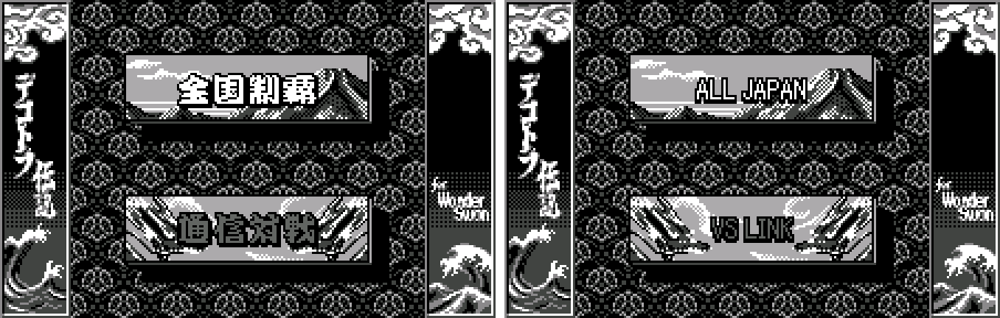
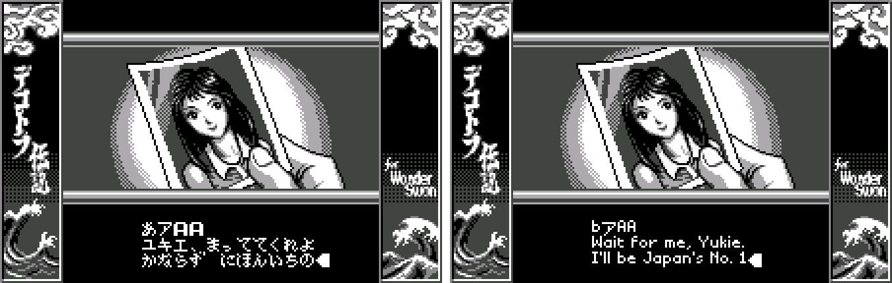
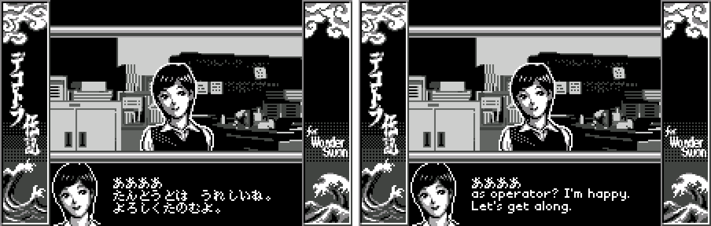
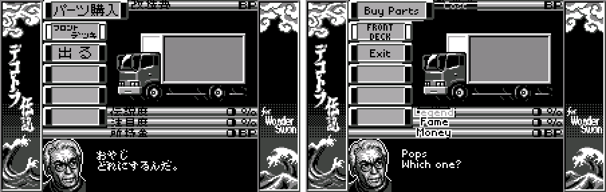
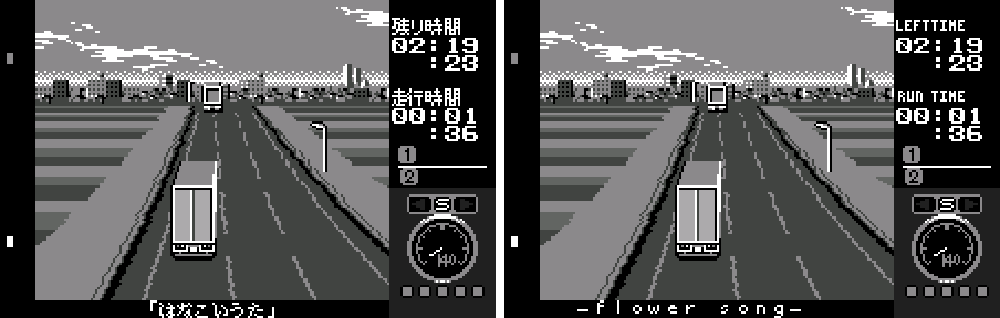
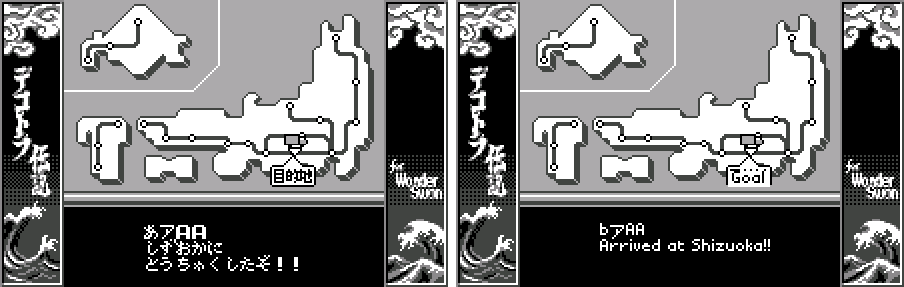
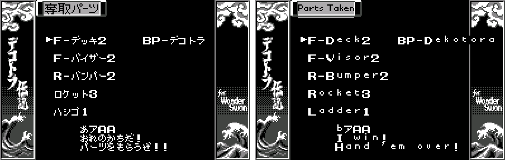
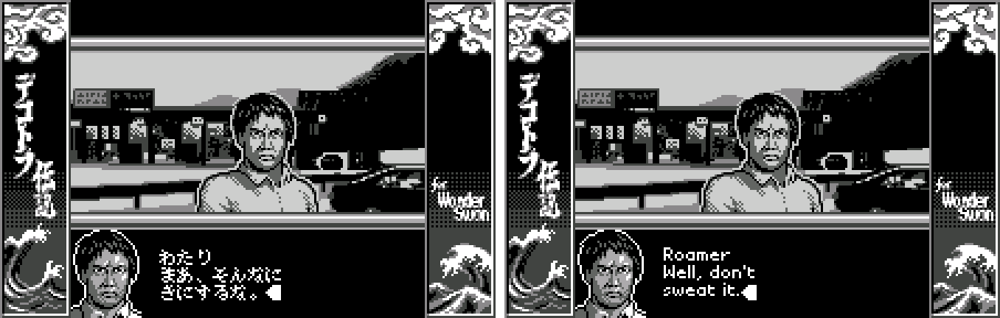
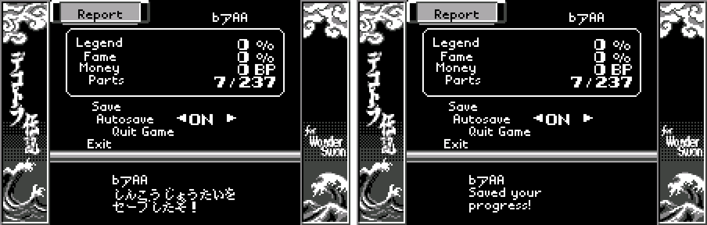

# Bakusou Dekotora Densetsu for WonderSwan (WonderSwan) - AI English translation patch v1.0 (+ special edition, may be buggy)

**Bakusou Dekotora Densetsu for WonderSwan** (爆走デコトラ伝説) is KID and Kaga Tech's 1999 trucking-and-racing game about *dekotora*, Japan's lit-up, chrome-covered decorated trucks, released only in Japan for the original (monochrome) WonderSwan. You play a young trucker who left his hometown girlfriend Yukie with a promise: he'll become Japan's No. 1 trucker and come back for her. You haul cargo between 20 cities, race rival truckers over the CB radio for their parts and their money (BP), climb a ladder of expressway bosses all the way to Hokkaido, and tune and decorate your truck. Along the way you meet six women, and at the end you choose where to go. It's earnest, corny, hot-blooded melodrama with plenty of trash talk, and nobody in it is subtle. That's the charm.

> **Please read:** this translation was made **with AI** (Claude), as a hobby project. A person (me) made every judgement call before release, but nobody on the project is a professional translator. I'm sharing it as it is for anyone who wants to play. Please **don't upload it to romhacking sites** (romhacking.net and the like). It may not be up to the standard of a real fan translation and it doesn't belong there.

**What's translated**

* The whole script, about 4,900 lines: the story, every rival trucker's challenge and taunts, the six women's stories and the endings, jobs and cargo, shops, parts, and the CB radio chatter.
* Menus, the name entry (an English letter grid), race HUD labels and song captions, results, the report and save screens, and the ending credits.
* Graphics: the title buttons (ALL JAPAN / VS LINK); the hub, garage, shop and report buttons and headings (208 labels); SHOW / DOWN for rival showdowns; YOU WIN! / YOU LOSE banners.
* Left as in the original: the title logo, the side banners, and three kanji on the two-player course map.

Names: the women are Yukie, Kumi (the operator), Aki, Miki, Nami, Megumi and Maki. The expressway bosses run from Tanaka in Kyushu through Kojiro, Ueno, Ishii, Keiko, Shizuka and more, up to Bunjiro in Hokkaido. Pops runs the parts shop, and Roamer is the trucker who first shows you the ropes.

**Content note:** it's a 1999 trucker melodrama and the script shows it: a kidnapping and trafficking threat, smugglers with drugs and guns, a drunk passenger, butt-pat jokes, toilet humour, and characters with sexist attitudes that the women racers push back on. None of it was softened or added to.

**The special edition: Event Select (may be buggy)**

The developers left a hidden event selector in the game that nothing in the original can reach. The special edition (`dekotora-en-special-1.0.bps`) puts it on the start menu:

* **Opening it:** Title screen → ALL JAPAN → the third entry, which reads **Event Select** in the special edition. It needs a saved game. (That entry was View Parts List; the parts list is still in the garage under List.)
* **Using it:** EVENT NO= appears over a truck-stop picture. UP/DOWN change the number by 1, LEFT/RIGHT by 10 (0-199), and A plays that event: job offers, each region's arrival and rest scenes, rival challenges and races, the endings' openings, and event 199, the staff credits.
* **Limits:** there's no way back out. B and START do nothing in the original code, so you leave by choosing an event or switching off. Events start out of story order, so it's for viewing scenes, not for playing the story through. About 40 numbers show nothing, event 99 never finishes, and event 148 shows garbage on the original Japanese cartridge too.
* **It may be buggy.** It's the developers' leftover tool, not a finished feature. Keep a copy of your save and play the standard edition for the actual game.

**How it was made: AI translation, independent checks, human decisions**

* Claude translated the script directly from the Japanese in the ROM, and did all the hacking: a variable-width dialogue engine, a lowercase menu font, a wider speaker-name field, the English name grid, rebuilt credits and the 208 redrawn labels.
* A second, independent Claude reviewer checked every line against the Japanese (282 corrections). A polish pass followed, with each change checked by a separate verifier, and then a naturalness pass over the whole script. A final separate review read the whole patch again, and a mechanics check counted each inserted part name at its widest.
* Every one of the 4,252 printed lines was rendered in an emulator with every glyph logged: no overflow and no leftover Japanese. All 200 story events were run through the game's own hidden event selector.
* The judgement calls were listed with the Japanese, a literal reading and the options, and I decided each one by hand. That includes the rougher content, which is kept as written.

**Changelog**

* **v1.0**: first release.

**Sources consulted**

* Japanese text: the WonderSwan ROM itself.
* Fonts: pixel fonts drawn for this project.

**Images** (original on the left, English on the right)

1. Title menu

   

2. The promise to Yukie

   

3. Kumi

   

4. Pops' parts shop

   

5. Racing a rival

   

6. Arriving at Shizuoka

   

7. Parts taken from a beaten rival

   

8. Roamer

   

9. The report screen

   

**How to patch**

Apply one of the BPS files to the Japanese ROM "Bakusou Dekotora Densetsu for WonderSwan (Japan)" (CRC32 392DD813) in your browser with the [Swan Revival patcher](https://swanrevival.com/patcher/), or with Floating IPS, beat or ROM Patcher JS:

* Standard: `dekotora-en-1.0.bps`, the result should be CRC32 E7B6B96E.
* Special edition (Event Select, may be buggy): `dekotora-en-special-1.0.bps`, the result should be CRC32 37431865.

The English ROM is 4 MB (the original is 2 MB) because the translation needed more room: use an emulator or a flash cart that takes 32 Mbit WonderSwan ROMs. It's a WonderSwan (mono) game, so keep the .ws extension.

You must provide your own copy of the original Japanese game to apply it.

**Download:** `dekotora-en-1.0.bps`, `dekotora-en-special-1.0.bps` on the [release page](https://github.com/PokemonGoDB/wonderswan-english-patches/releases/tag/dekotora-v1.0).

**Known issues**

* It hasn't been played start to finish by a person. If you find leftover Japanese, cut text or a crash, please tell me where it happened.
* In the Parts Taken list, a very long part name can run under the border art. It's rare.
* The two-player VS LINK screens are translated but untested (they need two consoles).

**Technical notes (for the curious)**

* The dialogue now uses a variable-width font, so English fits the original boxes. The ROM was expanded to 4 MB to hold the longer text.
* The hub, garage, shop and report screens were buttons and headings drawn as pictures; all 208 were redrawn.
* The event selector is unused developer code at F000:E005. The special edition swaps the start menu's View Parts List call for the scene setup and the selector.

**A Note On My Justifications for AI Use**

I have been an avid fan of the Wonderswan system for a very long time now. It was actually a motivating factor for my various attempts to learn Japanese (which have all failed so far). I always wanted to explore the game catalog more, but the lack of English translations made it extremely difficult to do so. Here's the thing: There's a reason many of these games have not been translated yet. It's not just the fact that Japanese > English translation is difficult. There's also the fact that the original developers used all kinds of tricks and technical feats to make these games work. Most games do not have a searchable directory of text that you can just replace with English equivalents. While some are easier than others, translations for some of these would take not only an expert in Japanese > English translation, but also someone with vast game development and programming experience.

I say all that to say: I get why people are apprehensive about AI usage for this type of thing. However, these games have been around for a very long time now and most of them have still not received a translation. I (and others) have chosen to spend our time and money to utilize AI to translate the games and actually make them playable for the wider community. If you don't agree with that, that's completely fine. I am more than happy to remove any of my translations if better, human ran translations are released at a later date. We already decided to skip any games where someone is actively working on a manual translation. While nowhere near what a manual translation effort would be, I do spend a considerable amount of time trying to work through each game's translation. I stress over small details and try my best to make the right calls. And I've probably messed some stuff up, which is why I welcome feedback.

I'm just looking forward to digging through all of these games. It's a great time to be into Wonderswan games.
