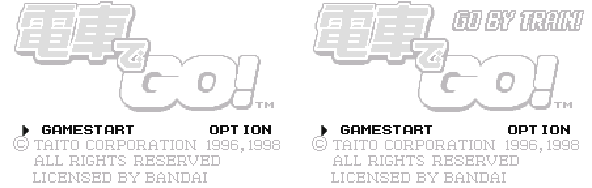
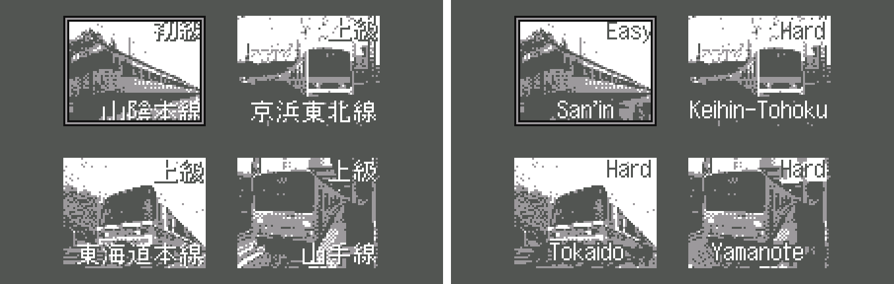
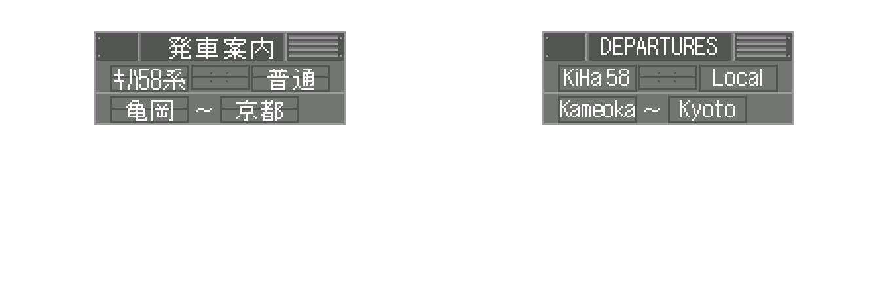
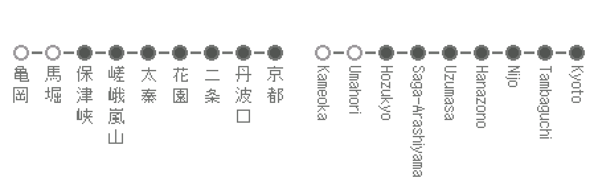
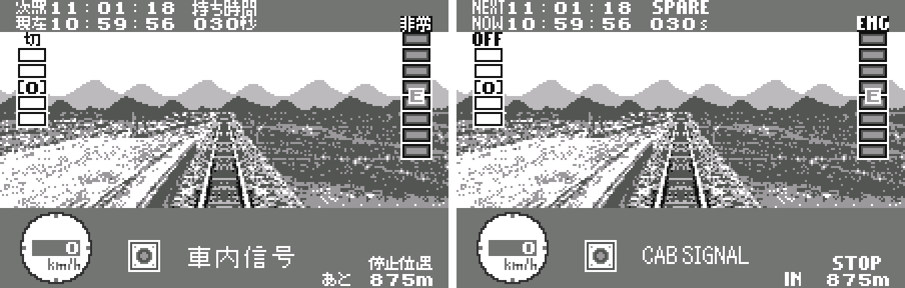
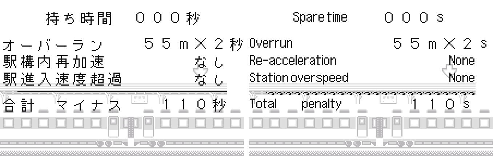
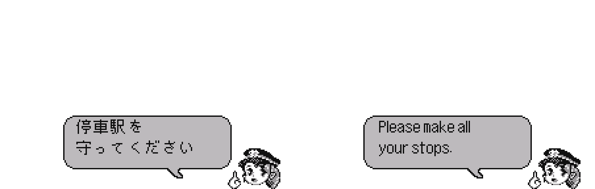
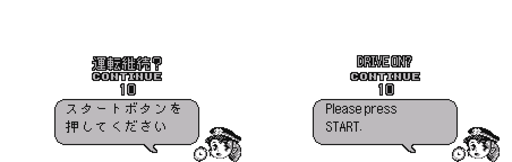

# Densha de Go! (WonderSwan) - AI English translation patch v1.0

**Densha de Go!** (電車でGO!) is Taito's train-driving simulator for the original (monochrome) WonderSwan, released only in Japan. You're the driver: keep to the timetable to the second, obey the signals and speed limits, and stop the train on each platform's mark, while your conductor grades every stop. There are four lines: the San'in Main Line (Easy), and the Keihin-Tohoku, Tokaido and Yamanote lines (Hard).

> **Please read:** this translation was made **with AI** (Claude), as a hobby project. A person (me) made every judgement call before release, but nobody on the project is a professional translator. I'm sharing it as it is for anyone who wants to play. Please **don't upload it to romhacking sites** (romhacking.net and the like). It may not be up to the standard of a real fan translation and it doesn't belong there.

**What's translated**

The game has no text font at all: every word on screen is a picture. All of these were redrawn in English:

* The line select screen (line names and Easy / Hard badges), the departure board, and the route strips with JR's own English station names, written sideways under each stop.
* The driving screen: every HUD label, the cab signal, trackside signs (Sound Horn, Slow Ahead, Slow Zone, Uphill, Downhill, Level...), and run messages (Depart!, Pull Forward, ATS Brake, Missed Stop, Time Up!...).
* All 27 of the conductor's speech bubbles, the results screen, the continue screen (DRIVE ON?), the pause menu (Continue / Quit) and the settings screen.
* The title screen adds GO BY TRAIN! next to the logo.
* Left as in the original: the title logo itself and the station name boards on the platforms.

**How it was made: AI translation, independent checks, human decisions**

* Claude walked the game's resource archives (15 archives, 1,638 items), found every picture with Japanese in it, translated it, redrew it in the game's own style, and recompressed it.
* A second, independent Claude reviewer checked the wording against the Japanese, and a final separate review went through the whole patch again.
* Every redrawn screen was checked in an emulator, during runs and on the results and conductor screens.
* The judgement calls were listed with the Japanese, a literal reading and the options, and I decided each one by hand: station names, train types (KiHa 58, 209, 221, 205), sign and message wording, the logo, and what to leave as art.

**Changelog**

* **v1.0**: first release.

**Sources consulted**

* Japanese text: the pictures in the ROM itself.
* Station names: JR's own English station names.

**Images** (original on the left, English on the right)

1. Title screen

   

2. Line select

   

3. Departure board

   

4. Route strip

   

5. Driving: the cab signal

   

6. Results

   

7. The conductor

   

8. Continue?

   

**How to patch**

Apply `densha-de-go-en-1.0.bps` to the Japanese ROM "Densha de Go! (Japan)" (CRC32 B62E5DD0) with Floating IPS, beat or ROM Patcher JS. The result should be CRC32 A8ACDDA0.

The ROM keeps its size (4 MB). It's a WonderSwan (mono) game, so keep the .ws extension.

You must provide your own copy of the original Japanese game to apply it.

**Download:** `densha-de-go-en-1.0.bps` on the [release page](https://github.com/PokemonGoDB/wonderswan-english-patches/releases/tag/densha-de-go-v1.0).

**Known issues**

* It hasn't been played start to finish by a person. If you find leftover Japanese, cut text or a crash, please tell me where it happened.
* The station name boards on the platforms are still Japanese, on purpose.

**Technical notes (for the curious)**

* There is no font or encoded text in this game. Every word is a picture in an LZSS-compressed archive: the patch decompresses each one, redraws it and compresses it again, so the ROM doesn't grow.
* Route strips set each English station name sideways under its stop, reading top to bottom, to fit the narrow columns.

**A Note On My Justifications for AI Use**

I have been an avid fan of the Wonderswan system for a very long time now. It was actually a motivating factor for my various attempts to learn Japanese (which have all failed so far). I always wanted to explore the game catalog more, but the lack of English translations made it extremely difficult to do so. Here's the thing: There's a reason many of these games have not been translated yet. It's not just the fact that Japanese > English translation is difficult. There's also the fact that the original developers used all kinds of tricks and technical feats to make these games work. Most games do not have a searchable directory of text that you can just replace with English equivalents. While some are easier than others, translations for some of these would take not only an expert in Japanese > English translation, but also someone with vast game development and programming experience.

I say all that to say: I get why people are apprehensive about AI usage for this type of thing. However, these games have been around for a very long time now and most of them have still not received a translation. I (and others) have chosen to spend our time and money to utilize AI to translate the games and actually make them playable for the wider community. If you don't agree with that, that's completely fine. I am more than happy to remove any of my translations if better, human ran translations are released at a later date. We already decided to skip any games where someone is actively working on a manual translation. While nowhere near what a manual translation effort would be, I do spend a considerable amount of time trying to work through each game's translation. I stress over small details and try my best to make the right calls. And I've probably messed some stuff up, which is why I welcome feedback.

I'm just looking forward to digging through all of these games. It's a great time to be into Wonderswan games.
