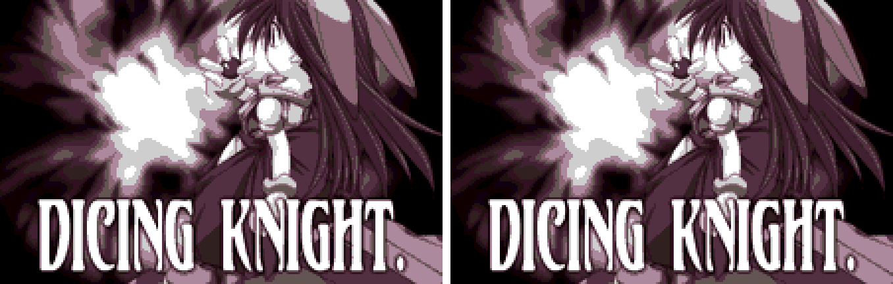
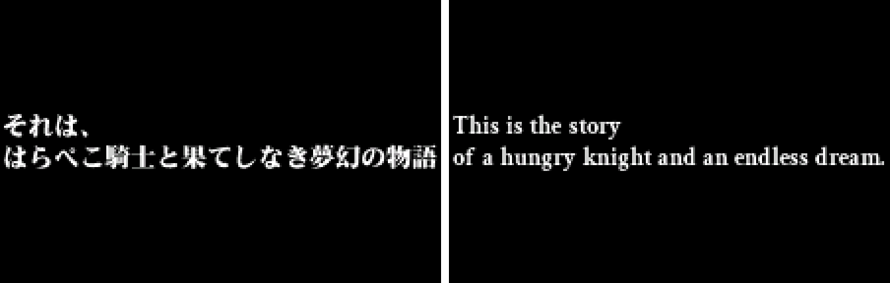
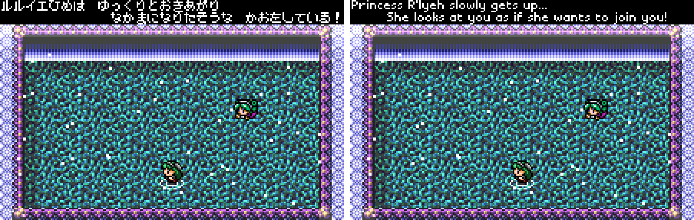
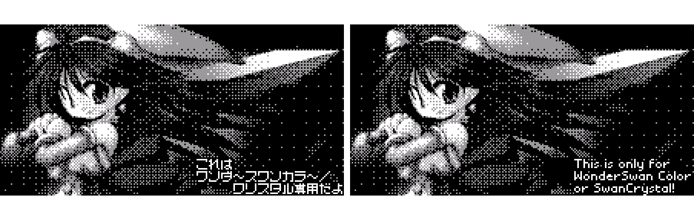

# Dicing Knight. (WonderSwan Color) - AI English translation patch v1.1

**Dicing Knight.** (賽目騎士遊戯) is an action roguelike by Platine Dispositif. It began as a winner of the WonderWitch programming contest and was released on cartridge in Japan in 2002 for the WonderSwan Color. You guide a hungry knight through randomly built dungeon floors, rolling dice to attack and watching your food.

Nearly all of the game is already in English: the menus, the item names and the messages. What is Japanese is four captions drawn as pictures. This patch puts those into English.

> **Please read:** this translation was made **with AI** (Claude), as a hobby project. A person (me) made every judgement call before release, but nobody on the project is a professional translator. I'm sharing it as it is for anyone who wants to play. Please **don't upload it to romhacking sites** (romhacking.net and the like). It may not be up to the standard of a real fan translation and it doesn't belong there.

**What's translated**

* **The intro caption:** "This is the story of a hungry knight and an endless dream."
* **The party-join message** when Princess R'lyeh gets up and looks at you. The original parodies a famous RPG recruitment line, and the English follows that formula: "She looks at you as if she wants to join you!"
* **The bonus-dungeon ending caption** ("Good work! (lol)").
* **The lockout screen** a black-and-white WonderSwan shows: "This is only for WonderSwan Color or SwanCrystal!"
* **One fix to the game's own English:** DEFFENCE UP is now DEFENSE UP.
* **File labels:** the save files and the eight data files have English labels (DK Save, DK Map, DK Data 1-6, DK Music, DK SFX). Only a WonderWitch file manager shows them; the game never draws them.
* **Left as the developer wrote it:** the rest of the game's English, including GOODLUCK!!, UROBOROS, FOURTUNE, LOTTEN MAGIUS, MISSING LINQUE, DAWN OF HERBAY and SELECT YOUR MASQUER.

**Sound test**

The original has a hidden sound test, and it works in the patched game: on the main menu press Y1 sixteen times, at an unhurried pace. X1 and X3 choose a track, A plays it, B leaves.

**How it was made: AI translation, independent checks, human decisions**

* Claude found the four caption pictures in the ROM, translated them from the Japanese, and redrew them in English in the same places and sizes.
* A separate, independent Claude reviewer checked the whole game against the Japanese. It found the eight file labels, which were then translated, and no defect in the patch.
* On screen:
  * 74 screens were captured on the original and on the English game side by side (boot, menus, the lottery, orbs, the dungeon, pause, results, death, the bonus ending, the R'lyeh scene), and a reviewer went through all of them for leftover Japanese and for alignment;
  * the intro and the title's idle loop were captured with no input;
  * a freeze check played more than two million frames of the same random button presses on the original and the English game, with no stall the original does not have.
* The judgement calls (the wording of each caption, the princess's name, which of the developer's spellings to fix, the file labels) were listed with the options, and I decided all 14 by hand.

**Changelog**

* **v1.1**: first public release. (1.0 was an internal build; 1.1 moves the intro caption one pixel and adds the eight data-file labels.)

**Credits**

* Lettering: Crimson Text Bold (The Crimson Text Project Authors) and Kalam Bold (Indian Type Foundry), both under the SIL Open Font License 1.1, and a small pixel font drawn for this patch.
* Japanese text: the WonderSwan Color ROM itself.

**Images** (original on the left, English on the right)

1. Title screen (unchanged; the game is already in English here)

   

2. Intro caption

   

3. Princess R'lyeh asks to join you

   

4. The screen a black-and-white WonderSwan shows

   

**How to patch**

Apply `dicing-knight-en-1.1.bps` to the Japanese ROM "Dicing Knight. (Japan)" (CRC32 D28DC930, 524,288 bytes) in your browser with the [Swan Revival patcher](https://swanrevival.com/patcher/), or with Floating IPS, beat or ROM Patcher JS. The result should be CRC32 3CFAF6B3.

The patched ROM is 512 KB, the same size as the original. It's a WonderSwan Color game, so keep the .wsc extension.

This patch is for the 2002 cartridge. It is not for *Dicing Knight. Period* (2004), which is a different ROM.

You must provide your own copy of the original Japanese game to apply it.

**Download:** `dicing-knight-en-1.1.bps` on the [release page](https://github.com/PokemonGoDB/wonderswan-english-patches/releases/tag/dicing-knight-v1.1).

**Known issues**

* It hasn't been played start to finish by a person. If you find leftover Japanese or anything broken, please tell me where it happened.
* The R'lyeh scene and the bonus-dungeon ending were reached by editing save data in the emulator, not by playing a thousand floors.
* The black-and-white lockout screen was checked by making the emulator report a monochrome system. It has not been tried on a real black-and-white WonderSwan.
* The floors of the bonus dungeon beyond its entrance, and how the game unlocks them, were not reached.

**Technical notes (for the curious)**

* The cartridge is a WonderWitch image: a small file system holding the program and its data files. The four captions are stored as pictures, not text, so each was redrawn and written back in the picture's own format and size.
* The file labels sit in the cartridge's file directory, 24 bytes each.

**A Note On My Justifications for AI Use**

I have been an avid fan of the Wonderswan system for a very long time now. It was actually a motivating factor for my various attempts to learn Japanese (which have all failed so far). I always wanted to explore the game catalog more, but the lack of English translations made it extremely difficult to do so. Here's the thing: There's a reason many of these games have not been translated yet. It's not just the fact that Japanese > English translation is difficult. There's also the fact that the original developers used all kinds of tricks and technical feats to make these games work. Most games do not have a searchable directory of text that you can just replace with English equivalents. While some are easier than others, translations for some of these would take not only an expert in Japanese > English translation, but also someone with vast game development and programming experience.

I say all that to say: I get why people are apprehensive about AI usage for this type of thing. However, these games have been around for a very long time now and most of them have still not received a translation. I (and others) have chosen to spend our time and money to utilize AI to translate the games and actually make them playable for the wider community. If you don't agree with that, that's completely fine. I am more than happy to remove any of my translations if better, human ran translations are released at a later date. We already decided to skip any games where someone is actively working on a manual translation. While nowhere near what a manual translation effort would be, I do spend a considerable amount of time trying to work through each game's translation. I stress over small details and try my best to make the right calls. And I've probably messed some stuff up, which is why I welcome feedback.

I'm just looking forward to digging through all of these games. It's a great time to be into Wonderswan games.
