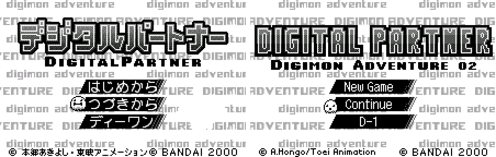
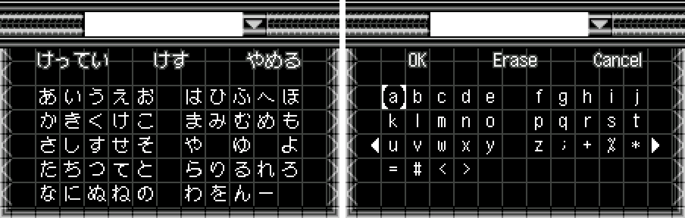
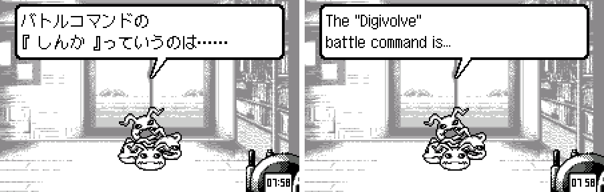
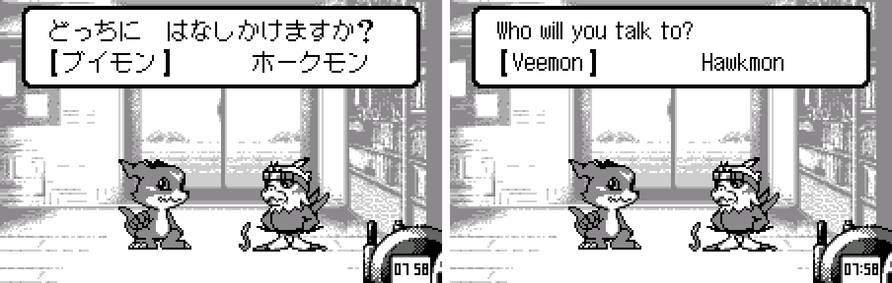
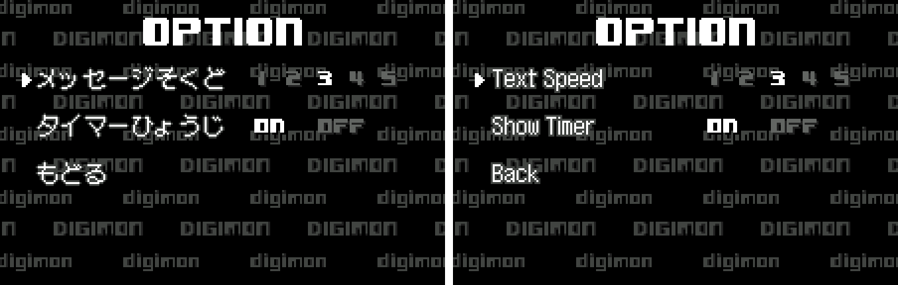
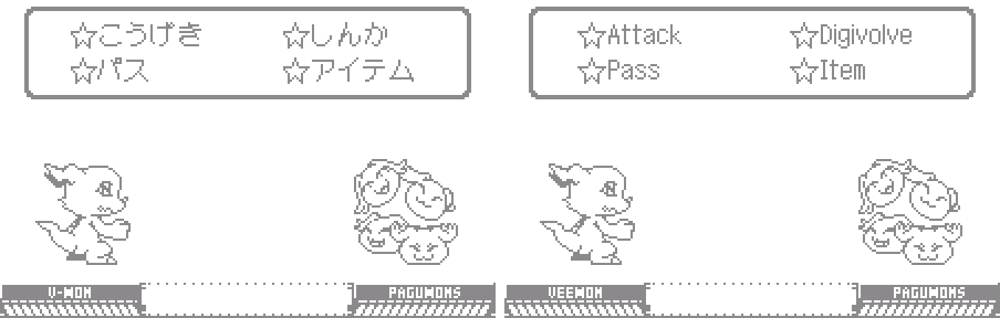
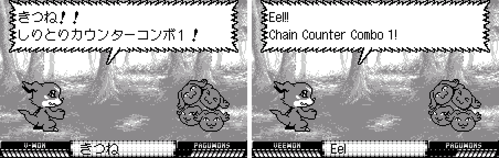
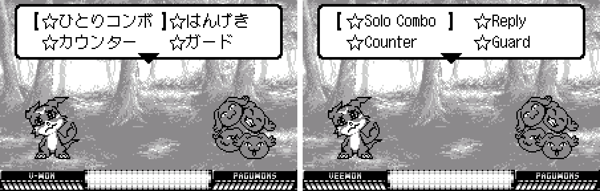
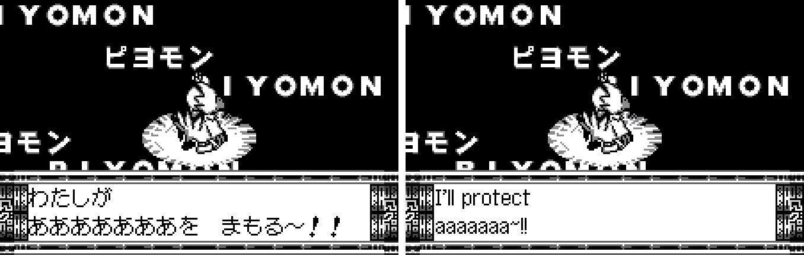
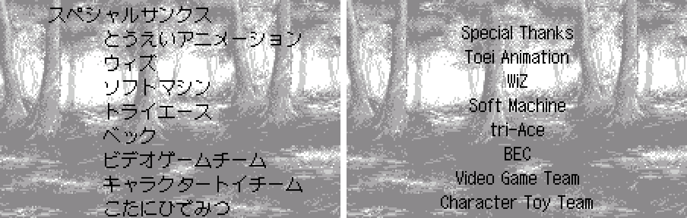

# Digital Partner (WonderSwan) - AI English translation patch v1.8 (+ Long Words edition)

**Digimon Adventure 02: Digital Partner** (デジタルパートナー) is a Bandai game from 2000, released only in Japan for the original (monochrome) WonderSwan. It's a virtual-pet game with RPG parts, based on the Digimon Adventure 02 anime. Gennai greets you on File Island and gives you a limited time, measured by an eclipse clock that starts at 478 minutes, to teach words to the partner Digimon. You talk to them, bring one to your room and teach it words, and battle with those words: in the Japanese game a battle follows the rules of shiritori (each word starts with the last kana of the previous one). When the clock reaches zero, one of the partners sees you off, and the game has 34 different endings.

This patch translates it into English.

> **Please read:** this translation was made **with AI** (Claude), as a hobby project. A person (me) made every judgement call before release, but nobody on the project is a professional translator. I'm sharing it as it is for anyone who wants to play. Please **don't upload it to romhacking sites** (romhacking.net and the like). It may not be up to the standard of a real fan translation and it doesn't belong there.

**What's translated**

* **The story:** all 4,820 story strings: Gennai's introduction, the File Island tour, the partners' and visitors' talk, the word-teaching conversations, the farewells and the endings. Digimon, places and attacks use the names of the English dub.
* **Menus and screens:** the room and field menus, status screen, items, the battle commands and the battle messages, help, option, the D-1 link menus and the "Portable Digimon Adapter" screens, the name-entry grid (A-Z), and the title screen with its menu. The title-screen demo (the Wonder Wave promo that plays when you leave the title idle) is in English too.
* **Pictures:** the title logo, the boy/girl labels and the name banners on the status screen are in English. The 34 Digimon name pictures of the digivolution scene keep the original art where its Latin name already matches the English dub name; for 11 of them the Latin line is redrawn with the dub name (for example PIYOMON became BIYOMON). The katakana line of those pictures is left as the original drew it. The staff credits are in English and centred on the screen.
* **Shortened names:** three attack names are shortened to fit the status screen: V-Head Butt, March Fishes and Bolt Paw.
* **The word game:** it was rebuilt for English. A chain word starts with the last letter of the previous word, a match word starts with the same letter, capitals count the same as small letters, and a word ending in N no longer breaks the chain (that was the Japanese ん rule). The game's own word dictionary, which gives each word a genre and a meaning, was rebuilt in English.

**Long Words edition**

The standard patch keeps the Japanese save format, so a word you teach is up to 7 letters. The Long Words edition lets you teach words of up to 10 letters, and battles use all 10 letters. It needs a bigger save (128 KB, save type 03h), so it works in Mednafen-based emulators and on flash carts with 128 KB of save memory. Everything else is the same as the standard patch. Where a long word makes a story page longer than two lines, the box scrolls.

**How it was made: AI translation, independent checks, human decisions**

* Claude worked out how the game stores and draws its text, wrote the English, and built a new text engine with a proportional English font, relocated text tables, redrawn pictures and the English word-game rules into the ROM.
* A separate, independent Claude reviewer read all 4,820 story strings and the system text against the Japanese: 289 findings (21 high, 122 medium, 146 low), which were fixed and checked. A second independent review of the title-screen demo found no bugs.
* On screen, on this version (QA run on build 1.8, 12 of 12 checks pass for the standard edition):
  * all 4,775 story strings (the story tables and the visitor grid) were drawn one at a time through the game's own speech bubble: none has kana left, none runs past the text area, none needs more lines than the Japanese page except pages I accepted as scrolling;
  * the game's own endings were played to the staff credits and the title: 34 scenarios, no problem found;
  * the opening was played from New Game to the first field screen (88 pages), and 6,000 frames of the idle title demo were captured;
  * 117 screens of the battle, room and field menus, help, link and teaching routes were compared with the original;
  * 20 saved states were run through random button presses for millions of frames, with only the "waiting for a link cable" stops that the original has too;
  * the 192 credits screens that changed in 1.8 each passed a text review and an alignment review.
* The Long Words edition had only a partial QA run on 1.8 (static check, random-press detector, string sweep and the 34 endings, all passed). It is not a full run and its screens were not reviewed separately.
* The judgement calls (word-game rules, the Long Words edition, wording, names, the title-screen demo, the credits, and more) were listed with the options and pictures, and I decided all 28 by hand.

**Changelog**

* **v1.8**: first release on this page. Earlier builds were not published here.

**Sources consulted**

* Japanese text: the WonderSwan ROM itself.
* Names: the English dub of Digimon Adventure 02 (Gennai, Agumon, Gatomon and so on).
* Lettering: Shinonome 12-dot (public domain) for the English text.

**Images** (original on the left, English on the right)

1. Title screen

   

2. Name entry

   

3. A visitor talks

   

4. Choosing who to talk to

   

5. Option screen

   

6. Battle commands

   

7. Chain combo in battle

   

8. Battle help topics

   

9. Digivolution scene with its name picture (the player's name here is a test name)

   

10. Staff credits (Special Thanks)

   

**How to patch**

Apply one of the BPS files to the Japanese ROM "Digital Partner (Japan)" (CRC32 B5E675AE) in your browser with the [Swan Revival patcher](https://swanrevival.com/patcher/), or with Floating IPS, beat or ROM Patcher JS:

* Standard: `digital-partner-en-1.8.bps`, the result should be CRC32 88CFF1A6.
* Long Words edition: `digital-partner-en-long-1.8.bps`, the result should be CRC32 B6426E83.

The patched ROM is 4 MB (the original is 2 MB). It's a WonderSwan (mono) game, so keep the .ws extension.

You must provide your own copy of the original Japanese game to apply it.

**Download:** `digital-partner-en-1.8.bps` and `digital-partner-en-long-1.8.bps` on the [release page](https://github.com/PokemonGoDB/wonderswan-english-patches/releases/tag/digital-partner-v1.8).

**Known issues**

* It hasn't been played start to finish by a person. If you find leftover Japanese or anything broken, please tell me where it happened.
* Not seen on screen: the armor-evolution scenes, the plain Chain Combo banner, the "no words left" messages, the Digi-Egg power up, the help topics Counter and Guard, talking to wild Digimon, and some other areas.
* A real two-console D-1 transfer was not tried.
* No game-over screen was found, and visitors were checked only for their first 4 pages.
* In the Long Words edition, pages that scroll twice were seen only as scrolled lines. That edition had no separate screen review.
* The status screen's "Love:" shows no value on screen (not checked against the original).

**Technical notes (for the curious)**

* The standard edition keeps the original 32 KB save. The Long Words edition needs a 128 KB save (save type 03h).
* The English text uses a proportional font and relocated text tables, and the word game's rules and dictionary were rebuilt in the ROM.
* The standard patch file is 664,045 bytes and the Long Words patch 668,885 bytes.

**A Note On My Justifications for AI Use**

I have been an avid fan of the Wonderswan system for a very long time now. It was actually a motivating factor for my various attempts to learn Japanese (which have all failed so far). I always wanted to explore the game catalog more, but the lack of English translations made it extremely difficult to do so. Here's the thing: There's a reason many of these games have not been translated yet. It's not just the fact that Japanese > English translation is difficult. There's also the fact that the original developers used all kinds of tricks and technical feats to make these games work. Most games do not have a searchable directory of text that you can just replace with English equivalents. While some are easier than others, translations for some of these would take not only an expert in Japanese > English translation, but also someone with vast game development and programming experience.

I say all that to say: I get why people are apprehensive about AI usage for this type of thing. However, these games have been around for a very long time now and most of them have still not received a translation. I (and others) have chosen to spend our time and money to utilize AI to translate the games and actually make them playable for the wider community. If you don't agree with that, that's completely fine. I am more than happy to remove any of my translations if better, human ran translations are released at a later date. We already decided to skip any games where someone is actively working on a manual translation. While nowhere near what a manual translation effort would be, I do spend a considerable amount of time trying to work through each game's translation. I stress over small details and try my best to make the right calls. And I've probably messed some stuff up, which is why I welcome feedback.

I'm just looking forward to digging through all of these games. It's a great time to be into Wonderswan games.
