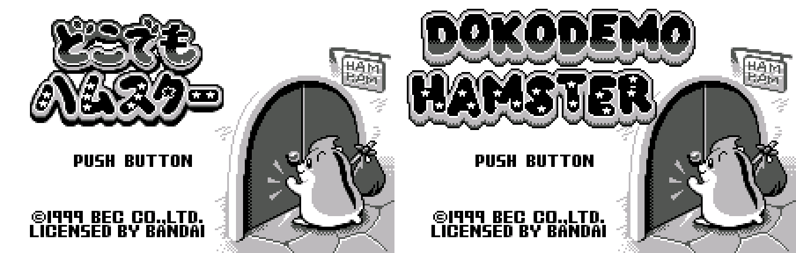
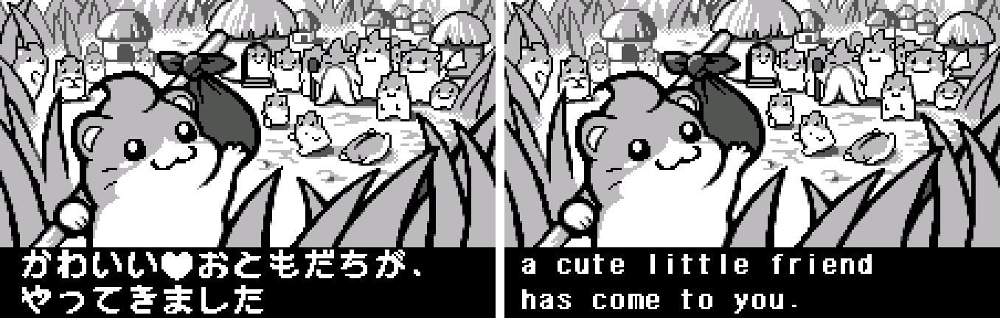
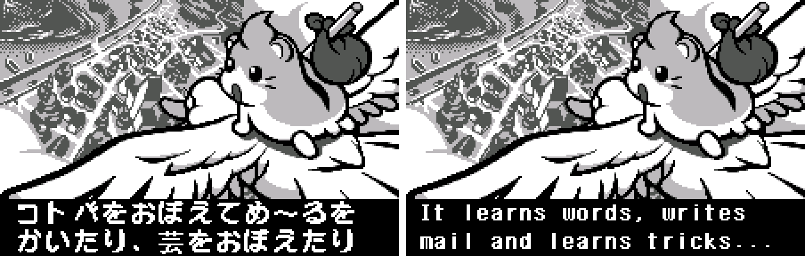
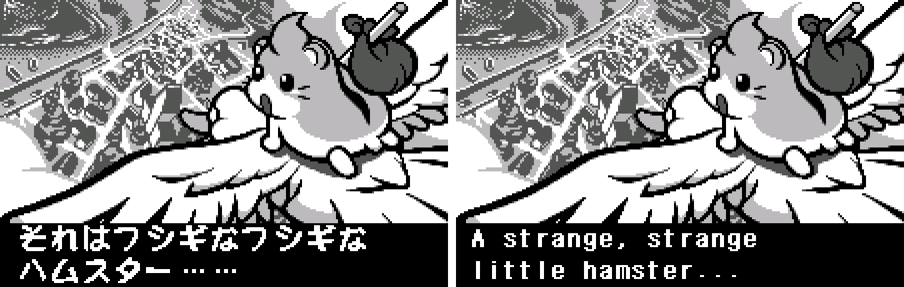
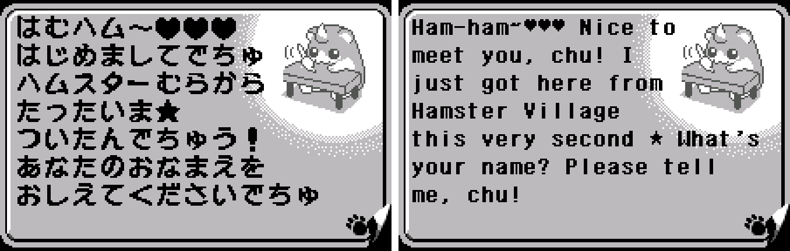
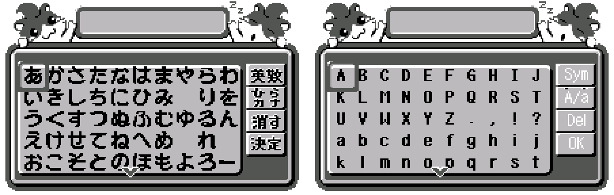

# Dokodemo Hamster (WonderSwan) - AI English translation patch v1.0 (+ Long Names edition, may be buggy)

**Dokodemo Hamster** (どこでもハムスター) is BEC's 1999 virtual pet for the original (monochrome) WonderSwan, released only in Japan. A little hamster arrives from faraway Hamster Village to live with you. You feed it, play with it and teach it words, and it writes you letters, learns tricks and chatters at you in baby talk, chu.

> **Please read:** this translation was made **with AI** (Claude), as a hobby project. A person (me) made every judgement call before release, but nobody on the project is a professional translator. I'm sharing it as it is for anyone who wants to play. Please **don't upload it to romhacking sites** (romhacking.net and the like). It may not be up to the standard of a real fan translation and it doesn't belong there.

**What's translated**

* All of the hamster's talk and letters (about 1,100 messages), the intro, menus and screen labels (Talk, Food, Mail, Status, Trick List, Remodel, Save...), items, foods, and all 20 tricks (Ninja Vanishing, Moonsault Flip, Parasol Spinning, Juggling...).
* The words your hamster already knows: 55 built-in English words, in the same categories as the Japanese.
* Name entry with an English letter grid (capitals, lowercase and symbols), and "Day N" / "Letter N" counters in place of the Japanese ones.
* Graphics: the title logo is redrawn as DOKODEMO HAMSTER in the original's bouncy style.

The hamster's baby talk (でちゅ) becomes a cute "chu" ("Ham-ham~ Nice to meet you, chu!"). Every sentence that inserts a word you taught was rewritten so any word fits it, so you won't see "a owl".

**Two editions**

* **Standard** (`dokodemo-hamster-en-1.0.bps`): names and taught words up to 6 letters, the same limit as the Japanese save format. A few built-in words were shortened to fit.
* **Long Names** (`dokodemo-hamster-en-long-1.0.bps`, may be buggy): your name, your hamster's name and the words you teach can be up to 10 letters, and the built-in words use their longer forms (Restaurant, Somersault...). It uses its own save: a standard save won't load in it (the game starts fresh), and the standard edition won't load a Long Names save. Link play still sends the first 6 letters of each name and is untested. It was checked on screen with 10-letter names and words (speech, Status, Save, Mailbox, taught words, save and continue), but it's newer and less tested than the standard edition, so **it may be buggy**: play the standard edition first and use this one at your own risk.

**How it was made: AI translation, independent checks, human decisions**

* Claude translated the script directly from the Japanese in the ROM, and did all the hacking: a narrow 8-pixel English font, the letter grid, the redrawn logo, the new counters and the Long Names edition.
* A second, independent Claude reviewer checked every line against the Japanese. A polish pass followed, with each change checked by a separate verifier. A final separate review read all 1,111 messages again (about 100 corrected), and a mechanics check tested how taught words drop into sentences (16 reworded).
* Every message was rendered in an emulator with every glyph logged, in both editions (712 drawn messages each, 0 flagged).
* The judgement calls were listed with the Japanese, a literal reading and the options, and I decided each one by hand: the baby talk, the logo, puns and Japan-specific references, trick names, and the word limits.

**Changelog**

* **v1.0**: first release.

**Sources consulted**

* Japanese text: the WonderSwan ROM itself.
* Font: Shinonome 6x12 (public domain), for the 8-pixel English letters.

**Images** (original on the left, English on the right)

1. Title screen

   

2. Intro: from faraway Hamster Village...

   

3. Intro: it learns words, writes mail and learns tricks

   

4. Intro: a strange, strange little hamster

   

5. Your hamster says hello

   

6. Name entry

   

**How to patch**

Apply one of the BPS files to the Japanese ROM "Dokodemo Hamster (Japan)" (CRC32 89E7D950) in your browser with the [Swan Revival patcher](https://swanrevival.com/patcher/), or with Floating IPS, beat or ROM Patcher JS:

* Standard: `dokodemo-hamster-en-1.0.bps`, the result should be CRC32 F67C5588.
* Long Names (may be buggy): `dokodemo-hamster-en-long-1.0.bps`, the result should be CRC32 22F04AF5.

The ROM keeps its size (1 MB). It's a WonderSwan (mono) game, so keep the .ws extension.

You must provide your own copy of the original Japanese game to apply it.

**Download:** `dokodemo-hamster-en-1.0.bps`, `dokodemo-hamster-en-long-1.0.bps` on the [release page](https://github.com/PokemonGoDB/wonderswan-english-patches/releases/tag/dokodemo-hamster-v1.0).

**Known issues**

* It hasn't been played start to finish by a person. If you find leftover Japanese, cut text or a crash, please tell me where it happened.
* Link play with another hamster (about 70 lines) is translated but untested, because it needs a second WonderSwan and a link cable.

**Technical notes (for the curious)**

* The original draws every character in a 16-pixel cell. English letters use a new narrow 8-pixel font, so twice as many fit on a line.
* The title logo was redrawn and the whole picture re-tiled to fit the original's tile space.
* Long Names edition: names live in unused RAM and taught words move to a new 14-byte save record; the save signature changes so the two editions never read each other's saves.

**A Note On My Justifications for AI Use**

I have been an avid fan of the Wonderswan system for a very long time now. It was actually a motivating factor for my various attempts to learn Japanese (which have all failed so far). I always wanted to explore the game catalog more, but the lack of English translations made it extremely difficult to do so. Here's the thing: There's a reason many of these games have not been translated yet. It's not just the fact that Japanese > English translation is difficult. There's also the fact that the original developers used all kinds of tricks and technical feats to make these games work. Most games do not have a searchable directory of text that you can just replace with English equivalents. While some are easier than others, translations for some of these would take not only an expert in Japanese > English translation, but also someone with vast game development and programming experience.

I say all that to say: I get why people are apprehensive about AI usage for this type of thing. However, these games have been around for a very long time now and most of them have still not received a translation. I (and others) have chosen to spend our time and money to utilize AI to translate the games and actually make them playable for the wider community. If you don't agree with that, that's completely fine. I am more than happy to remove any of my translations if better, human ran translations are released at a later date. We already decided to skip any games where someone is actively working on a manual translation. While nowhere near what a manual translation effort would be, I do spend a considerable amount of time trying to work through each game's translation. I stress over small details and try my best to make the right calls. And I've probably messed some stuff up, which is why I welcome feedback.

I'm just looking forward to digging through all of these games. It's a great time to be into Wonderswan games.
