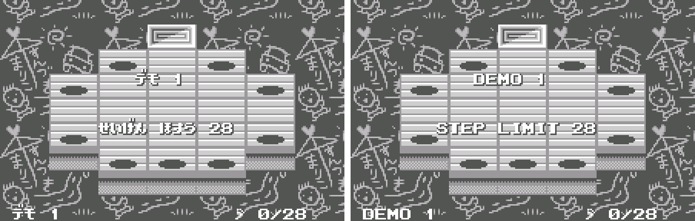
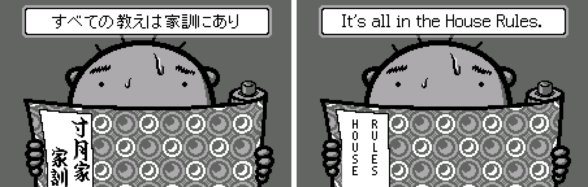
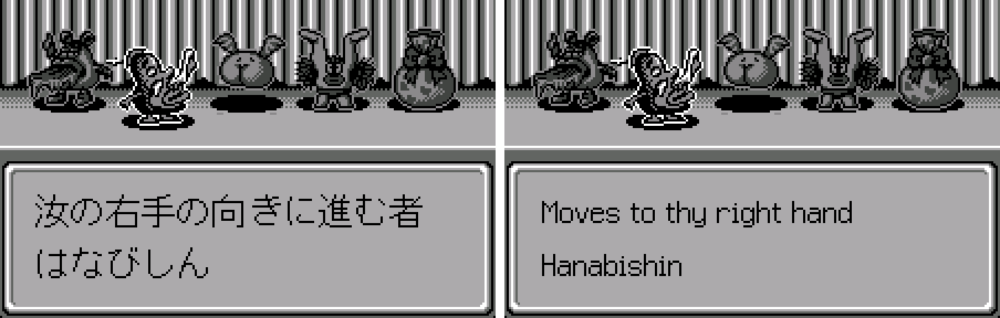
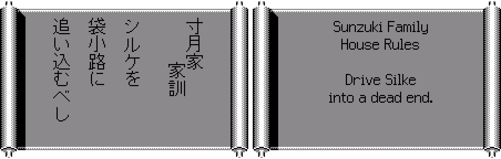
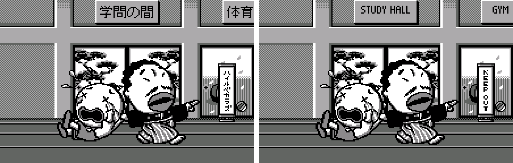
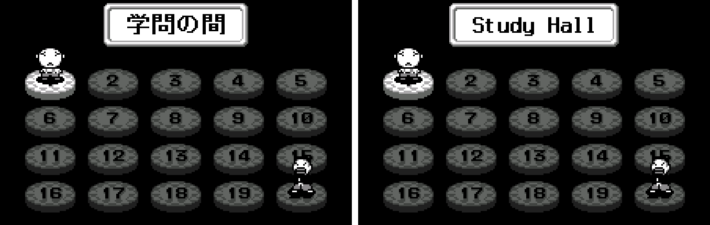
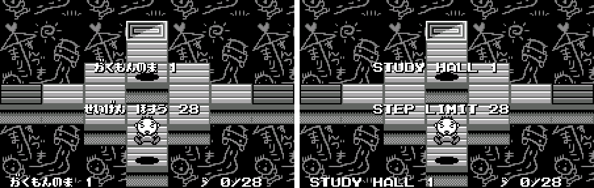
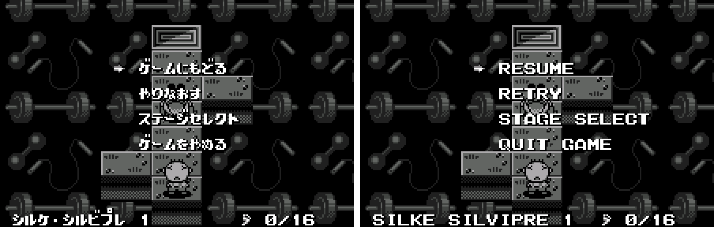
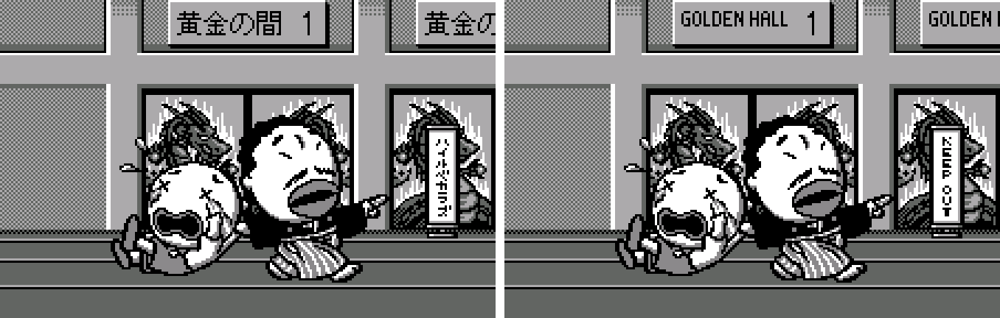
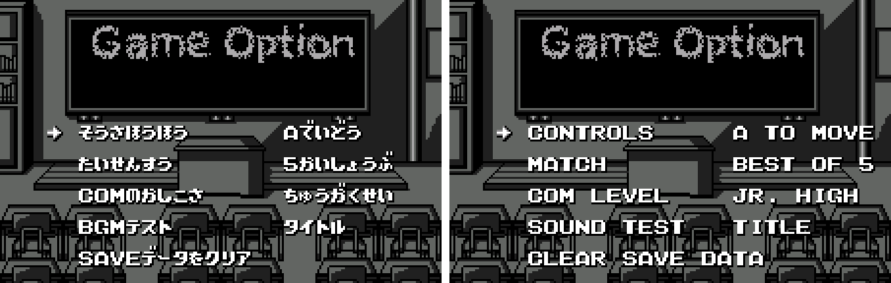

# Engacho! (WonderSwan) - AI English translation patch v1.0

**Engacho!** (えんがちょ! for ワンダースワン) is Nihon Application's (NAC) 1999 step puzzle for the original (monochrome) WonderSwan, with characters by UrumaDelvi, released only in Japan. You guide Sunzuki, a schoolboy, to the exit of each board within a step limit without touching the five "dirty" creatures. They don't chase you: each one reacts to your moves by a fixed rule (same direction as you, toward your right hand, opposite, toward your left hand, or not at all), so every stage is a little logic problem. Push them off the edge, trap them in dead ends, merge and split them. "Engacho" is what Japanese kids shout to ward off something dirty, like "cooties".

> **Please read:** this translation was made **with AI** (Claude), as a hobby project. A person (me) made every judgement call before release, but nobody on the project is a professional translator. I'm sharing it as it is for anyone who wants to play. Please **don't upload it to romhacking sites** (romhacking.net and the like). It may not be up to the standard of a real fan translation and it doesn't belong there.

**What's translated**

* Every Japanese string: menus, the status bar and stage names, step limits, pause menus, options and the sound test, the save prompt, the VS COM messages, and the two-player BATTLE mode's text.
* The House Rules: the 50 hint scrolls shown before each training stage, re-set horizontally in a proportional font (the original writes them vertically in kanji), and the five creature descriptions.
* Graphics redrawn: the door signs along the school corridor (four sets), the room-select headers, the KEEP OUT scroll on locked doors, the training intro banner and the book cover, and the two link-cable screens.
* Already in English in the original and left alone: the title logo, the main menu, Game Option, Records, the result screens (STAGE CLEAR, YOU WIN, Excellent, Oops!) and the staff roll.
* Left as drawn: a classroom doodle in the Study Hall background, two names under a love umbrella (まりこ / すんづき).

Names: the creatures are **Silke Silvipre** (moves the way you move), **Hanabishin** (toward your right hand), **Denboo** (opposite to you), **Spicy** (toward your left hand) and **Fancy** (doesn't move). The hero's family name 寸月 follows the game's own spelling すんづき, **Sunzuki**. The school rooms are the Study, Gym, Lunch, Music and Final Halls; VS COM is played in the Duel Halls and Special mode in the Golden Halls. The House Rules are written in old-fashioned Japanese ("thou shalt", "thou shalt not"), so the English keeps a light archaic voice: "Moves as thou movest", "Be not misled by the terrain."

**How it was made: AI translation, independent checks, human decisions**

* Claude translated everything directly from the Japanese in the ROM and did all the hacking: a hook in the game's kanji renderer that draws pre-rendered English, a horizontal layout for the House Rules scroll, relocated strings and the redrawn graphics.
* A second, independent Claude reviewer checked every line against the Japanese, a polish pass followed with each change checked by a separate verifier, and a final separate review read the whole patch again (it found the doodle and the game's own spelling of the hero's name).
* On screen: every hint and description drawn by the game and compared with the intended text; a tour of every mode and room; a 25-minute capture of the attract demo loop; all three endings and the staff roll; random play from 13 save points across the game with every glyph logged and the screen checked for Japanese pictures; an alignment pass on every screen against the original; saving and reloading checked against the original game byte for byte.
* The judgement calls were listed with the Japanese, a literal reading and the options, and I decided each one by hand: names, the archaic voice, room names, the banner wording, the doodle.

**Hidden code (we couldn't find it documented anywhere)**

While working on the game we found a developer cheat that is in the retail cartridge. On the **title screen**, press **Up, Up, Down, Down, Left, Right, Left, Right, B, A on the Y buttons** (Y1 Y1 Y3 Y3 Y4 Y2 Y4 Y2 B A). A sound confirms it. Then:

* hold **X2** (right on the X buttons) while choosing PUZZLE, VS COM or ??????? (Special) to open every room of that mode;
* hold **X2** while choosing BATTLE to enter the **Exam Halls**, the developers' test rooms (two rooms of 20 test stages with a 512-step limit; halls 3-5 are locked doors);
* the pause menu gains **GOAL!**, which clears the current stage.

We searched The Cutting Room Floor, Hardcore Gaming 101, GameFAQs and Japanese cheat sites and found no mention of it (we didn't check 1999 magazines). It works the same in the English patch.

**Changelog**

* **v1.0**: first release.

**Sources consulted**

* Japanese text: the WonderSwan ROM itself.
* The hero's name: the game's own spelling すんづき, also used by Hardcore Gaming 101's article on the game.
* Fonts: a thin proportional font drawn for this project to sit beside the game's kanji, and small capitals for the door signs.

**Images** (original on the left, English on the right)

1. Attract-mode demo

   

2. Training intro: the banner and the House Rules book

   

3. A creature description (Hanabishin)

   

4. The House Rules scroll before a training stage

   

5. The school corridor: door signs and the KEEP OUT scroll

   

6. Room select

   

7. A Study Hall stage

   

8. Pause menu

   

9. Special mode: the Golden Hall corridor

   

10. Options

   

**How to patch**

Apply `engacho-en-1.0.bps` to the Japanese ROM "Engacho! for WonderSwan (Japan)" (CRC32 4E467626) with Floating IPS, beat or ROM Patcher JS. The result should be CRC32 31F0D8F8.

The ROM keeps its size (1 MB). It's a WonderSwan (mono) game, so keep the .ws extension.

You must provide your own copy of the original Japanese game to apply it.

**Download:** `engacho-en-1.0.bps` on the [release page](https://github.com/PokemonGoDB/wonderswan-english-patches/releases/tag/engacho-v1.0).

**Known issues**

* It hasn't been played start to finish by a person. If you find leftover Japanese, cut text or a crash, please tell me where it happened.
* BATTLE (two players with a link cable) couldn't be tested in a real link game. Its text was checked by drawing it on other screens.
* The "Save the game?" prompt and VS COM's "CAN'T MOVE" message never came up in the emulator; they were checked in test builds.
* Menu lines with an odd number of letters sit half a letter left of centre. The game centres text on whole 8-pixel cells and its own Japanese lines do the same.

**Technical notes (for the curious)**

* The training hints and descriptions were drawn by a kanji renderer from a 16x16 font. The patch hooks its font lookup: English lines are drawn in a proportional font, centred to the pixel, cut into 16x16 cells and stored in free ROM space, and the game copies them like kanji.
* The House Rules scroll was laid out vertically; it now draws horizontal lines centred on the paper.
* Menu text uses the game's own 8x8 font, in capitals like the game's own English (the font's lower case is hard to read).
* Door signs, headers, the banner, the book cover and the link screens are compressed graphics; they were decoded, redrawn and recompressed in place. Each puzzle room got its own sign tiles so every sign can be centred.

**A Note On My Justifications for AI Use**

I have been an avid fan of the Wonderswan system for a very long time now. It was actually a motivating factor for my various attempts to learn Japanese (which have all failed so far). I always wanted to explore the game catalog more, but the lack of English translations made it extremely difficult to do so. Here's the thing: There's a reason many of these games have not been translated yet. It's not just the fact that Japanese > English translation is difficult. There's also the fact that the original developers used all kinds of tricks and technical feats to make these games work. Most games do not have a searchable directory of text that you can just replace with English equivalents. While some are easier than others, translations for some of these would take not only an expert in Japanese > English translation, but also someone with vast game development and programming experience.

I say all that to say: I get why people are apprehensive about AI usage for this type of thing. However, these games have been around for a very long time now and most of them have still not received a translation. I (and others) have chosen to spend our time and money to utilize AI to translate the games and actually make them playable for the wider community. If you don't agree with that, that's completely fine. I am more than happy to remove any of my translations if better, human ran translations are released at a later date. We already decided to skip any games where someone is actively working on a manual translation. While nowhere near what a manual translation effort would be, I do spend a considerable amount of time trying to work through each game's translation. I stress over small details and try my best to make the right calls. And I've probably messed some stuff up, which is why I welcome feedback.

I'm just looking forward to digging through all of these games. It's a great time to be into Wonderswan games.
