# Final Lap 2000 (WonderSwan) - AI English translation patch v1.0

**Final Lap 2000** (ファイナルラップ2000) is Namco's 2000 Formula racer for the original (monochrome) WonderSwan, published with Bandai and released only in Japan (March 2000). It brings the arcade Final Lap series to a handheld: an Arcade mode against the clock, a World Tour season of 15 rounds plus a special round, Time Trial, a course editor, and link-cable racing and course swapping with a second WonderSwan.

Most of the game was already in English: the menus, the race screens, the results, the rankings and the staff credits. The Japanese was hidden in pictures: the Arcade entry screen everyone sees, the course-exchange messages, the link-play error, a hidden online-ranking menu, and billboards beside the tracks. This patch translates all of it.

> **Please read:** this translation was made **with AI** (Claude), as a hobby project. A person (me) made every judgement call before release, but nobody on the project is a professional translator. I'm sharing it as it is for anyone who wants to play. Please **don't upload it to romhacking sites** (romhacking.net and the like). It may not be up to the standard of a real fan translation and it doesn't belong there.

**What's translated**

* **Arcade entry screen**, the 15-second "now accepting entries" countdown before every Arcade race: NOW ACCEPTING ENTRIES / TIME LEFT 15 SEC, in the game's own lettering.
* **Course Edit > Exchange** (swapping a course over the link cable): all four messages, including the ones you see without a cable (the confirm prompt and "Time's up").
* **Link play**: the communication error screen.
* **Mobile WonderGate** (the cell-phone adapter for the online ranking): the name prompt and all 22 messages (connecting, finished, battery low and every numbered error).
* **Trackside billboards** advertising other WonderSwan games, redrawn in English at every size as they approach: Tane o Maku Tori, Wonder Stadium, Klonoa: Moonlight Museum, Tekken Card Challenge and Kosodate Quiz Dokodemo My Angel. Each matches that game's English logo where one exists (Klonoa, Tekken; Tane o Maku Tori uses the logo from our own patch of that game).
* Already in English in the original and left alone: menus, options, HUD, results, rankings, World Tour, course editor and the credits.

Names: the series' English names are used on the billboards (KLONOA, TEKKEN). The adapter is written "WonderGate" in the messages, Bandai's spelling of the Mobile WonderGate; the game's own menu art says WONDER GATE and is unchanged.

**The original's English**

The game shipped with a few English typos. This patch fixes **TELEPHNE NO.** on the WonderGate number pad (now TELEPHONE NO.). Two are deliberately **left as shipped**: **SPECIAL TAHNKS** in the staff credits and **TIME TRYAL** on the W.G Ranking screen.

**Hidden WONDER GATE menu**

On the **Ranking** menu, press **Y1, Y3, Y4, Y2** (the Y-pad: up, down, left, right). A **WONDER GATE** entry appears above YOUR RANKING. It was for uploading times to the game's online ranking through the Mobile WonderGate adapter; the service closed long ago, so without the adapter you get the number pad, the name entry, "Connecting..." and Error No. 001. All of it is in English now.

**How it was made: AI translation, independent checks, human decisions**

* Claude translated the Japanese directly from the ROM's pictures and did all the hacking: every text picture was found, rendered and redrawn in English, re-using only the tile slots the Japanese lettering had used.
* A separate, independent Claude reviewer checked every line and every screen against the Japanese; its findings were verified and fixed (it also found the first billboards).
* On screen: every translated screen was seen in the emulator in English; the screens that need a link cable or the WonderGate adapter were shown through test builds; every course was driven to find billboards; random play from nine points across the game checked for leftover Japanese pictures (none); the title loop left alone matched the original frame for frame; the ending and the staff credits were seen.
* The judgement calls were listed with the Japanese, a literal reading and the options, and I decided each one by hand over two rounds: the entry-screen wording, the message lettering, WonderGate's spelling, which original typos to fix, and redrawing the billboards.

**Changelog**

* **v1.0**: first release.

**Sources consulted**

* Japanese text: the WonderSwan ROM itself (all of it is in pictures).
* Fonts: the game's own 8x8 capitals, the public-domain Shinonome 12-dot font (trimmed to proportional widths) for message boxes, the project's small pixel capitals, and Kalam Bold (SIL Open Font License) for the Tane o Maku Tori billboard.
* Logos: the English series names Klonoa and Tekken; Tane o Maku Tori's English logo from our patch of that game.

**Images** (original on the left, English on the right)

1. Title screen (already English)

   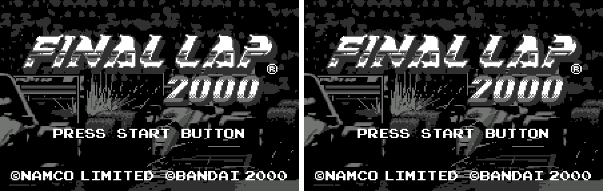

2. Arcade entry countdown

   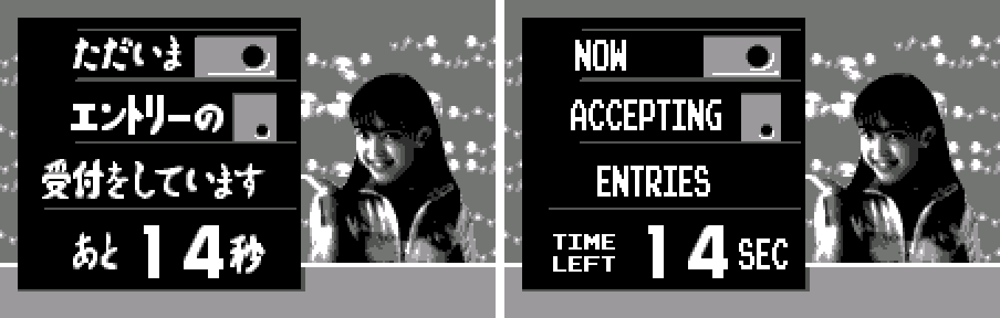

3. Exchange: confirm the course

   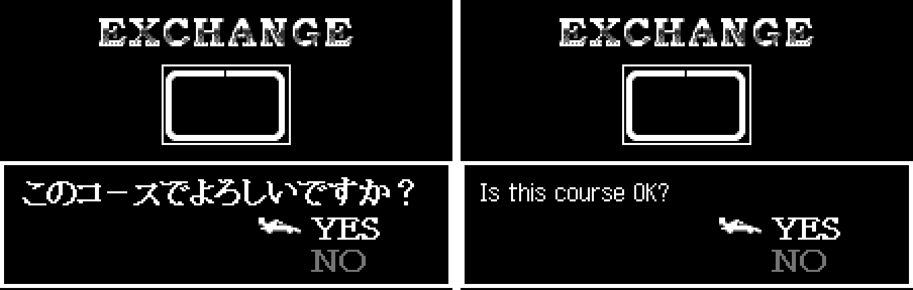

4. Exchange: preparing

   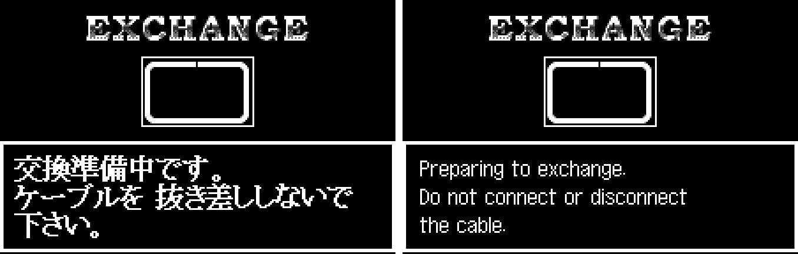

5. Exchange: time's up

   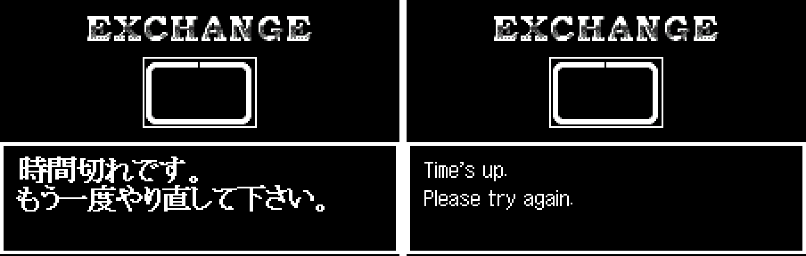

6. Ranking menu with the hidden WONDER GATE entry

   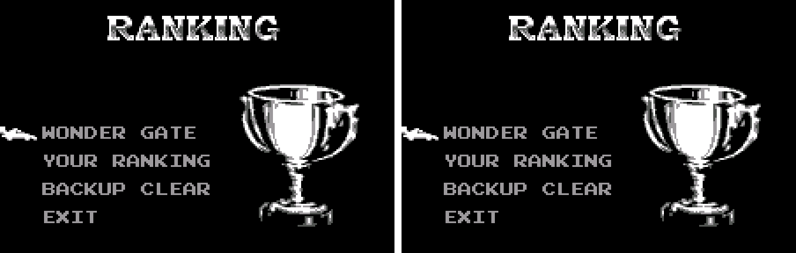

7. WonderGate number pad (TELEPHNE fixed)

   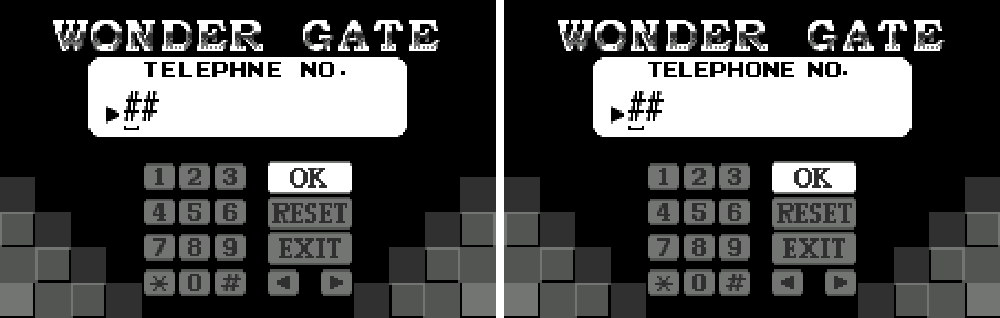

8. WonderGate name entry

   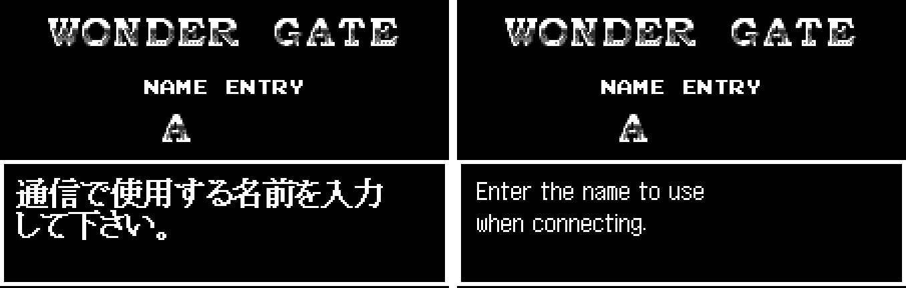

9. WonderGate: confirm the name

   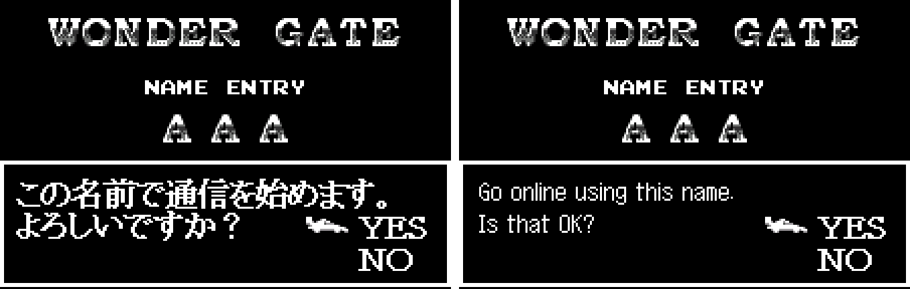

10. WonderGate: Error No. 001

   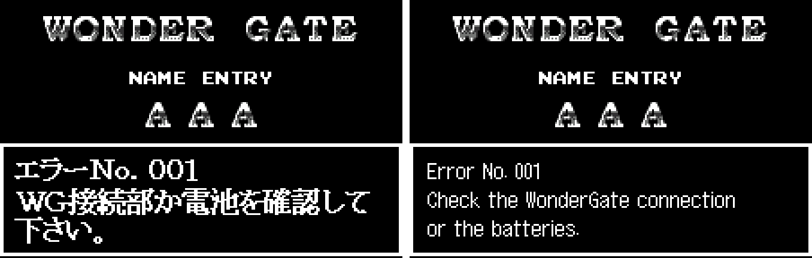

11. Billboard: Tane o Maku Tori

   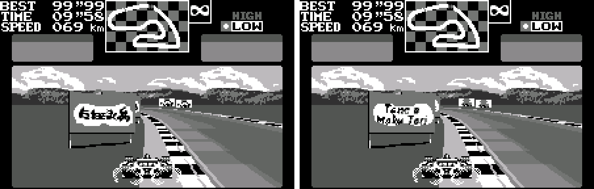

12. Billboard: Wonder Stadium

   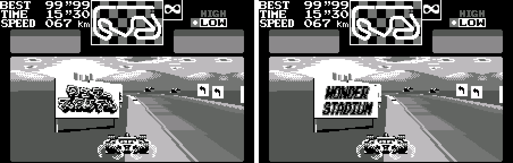

13. Billboard: Klonoa

   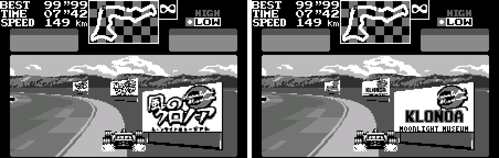

**How to patch**

Apply `final-lap-2000-en-1.0.bps` to the Japanese ROM "Final Lap 2000 (Japan)" (CRC32 CE2F1A1D) with Floating IPS, beat or ROM Patcher JS. The result should be CRC32 53CEAD54.

The ROM keeps its size (1 MB). It's a WonderSwan (mono) game, so keep the .ws extension.

You must provide your own copy of the original Japanese game to apply it.

**Download:** `final-lap-2000-en-1.0.bps` on the [release page](https://github.com/PokemonGoDB/wonderswan-english-patches/releases/tag/final-lap-2000-v1.0).

**Known issues**

* It hasn't been played start to finish by a person. If you find leftover Japanese, cut text or a crash, please tell me where it happened.
* Link-cable play and the WonderGate adapter could not be tested on real hardware; those screens were checked in the emulator through test builds.
* The farthest-away billboard sizes are a few pixels wide, in either language.

**Technical notes (for the curious)**

* The game's only font is ASCII capitals, so every Japanese word was a picture: uncompressed tiles plus a tile map, loaded by small descriptors (segment, offset, VRAM address, length). The builder erases the Japanese lettering, draws English, and gives new tiles only to cells that changed, in the slots the old lettering freed. Two WonderGate messages needed a few more tiles and moved to free space in the same bank, because that loader keeps its bank fixed.
* The billboards are race sprites stored at 13 pre-scaled sizes each (73x62 pixels down to 10x8). Each English logo was drawn once at full size and every smaller size was generated from it into the same sprite layout.
* The WONDER GATE code is checked by a routine on the Ranking menu that sets a flag; the menu is then built with the extra entry.

**A Note On My Justifications for AI Use**

I have been an avid fan of the Wonderswan system for a very long time now. It was actually a motivating factor for my various attempts to learn Japanese (which have all failed so far). I always wanted to explore the game catalog more, but the lack of English translations made it extremely difficult to do so. Here's the thing: There's a reason many of these games have not been translated yet. It's not just the fact that Japanese > English translation is difficult. There's also the fact that the original developers used all kinds of tricks and technical feats to make these games work. Most games do not have a searchable directory of text that you can just replace with English equivalents. While some are easier than others, translations for some of these would take not only an expert in Japanese > English translation, but also someone with vast game development and programming experience.

I say all that to say: I get why people are apprehensive about AI usage for this type of thing. However, these games have been around for a very long time now and most of them have still not received a translation. I (and others) have chosen to spend our time and money to utilize AI to translate the games and actually make them playable for the wider community. If you don't agree with that, that's completely fine. I am more than happy to remove any of my translations if better, human ran translations are released at a later date. We already decided to skip any games where someone is actively working on a manual translation. While nowhere near what a manual translation effort would be, I do spend a considerable amount of time trying to work through each game's translation. I stress over small details and try my best to make the right calls. And I've probably messed some stuff up, which is why I welcome feedback.

I'm just looking forward to digging through all of these games. It's a great time to be into Wonderswan games.
