# Fire Pro Wrestling for WonderSwan (WonderSwan) - AI English translation patch v1.0

**Fire Pro Wrestling for WonderSwan** (ファイヤープロレスリング for WonderSwan) is Human Entertainment's handheld entry in the Fire Pro series, released in 2000 by Kaga Tech for the original (monochrome) WonderSwan and only in Japan. It plays like the other Fire Pro games, with timing-based grapples and a roster of 132 wrestlers who are thinly veiled parodies of 1990s stars. Its main mode, **Master of Ring**, makes you the promoter: you book shows venue by venue, pick title matches and five bouts, play or watch them, and are judged on the matchmaking, the match quality and the attendance. There are also single matches, one-night tournaments, round-robin leagues, team elimination matches, a wrestler editor (looks, moves, stats and CPU logic) and link-cable trading. This patch translates it into English.

> **Please read:** this translation was made **with AI** (Claude), as a hobby project. A person (me) made every judgement call before release, but nobody on the project is a professional translator. I'm sharing it as it is for anyone who wants to play. Please **don't upload it to romhacking sites** (romhacking.net and the like). It may not be up to the standard of a real fan translation and it doesn't belong there.

**What's translated**

* Every menu, prompt and message of every mode: Master of Ring (with its Free mode), One Night Match, One Night Tournament, Open League, Elimination Match, Edit, Network Battle and Options.
* All 132 wrestler names, their profiles and about 860 move names.
* Match results, rankings, records, the ending and the staff credits.
* All the words drawn as pictures: screen headings, buttons, plates, rank marks, the attendance stamps (DEEP IN THE RED, FULL HOUSE, SUPER FULL HOUSE and the SOLD OUT tag, hand-drawn), the title logo and the intro tagline.
* Name entry has an English keyboard (lower case, capitals, digits and symbols); letters go straight into the name.
* Kept as they are: the ring-mat logos (the Yukiguni promotion's mat keeps its Japanese logo, which is art on the mat), and the music titles, which were already in English in the original.

**Names and terms**

As in every Fire Pro game, the wrestlers are parodies with deliberately altered names, and they stay altered. Their spellings follow the English names the Fire Pro community uses for this roster and the official English spellings of the series' own legends (Victory Musashi, Great Shiba, Mask de Panther...). Japanese names are in Western order, given name first. Moves use their names in English-language wrestling and in Fire Pro Wrestling World; Japanese names that English fans use as they are stay romanized (Enzuigiri, Shiranui, Koppo, Nodowa Otoshi). The promotions keep their acronyms (VIEW JAPAN, FWN, WWC, WFW, GONGS).

**How it was made: AI translation, independent checks, human decisions**

* Claude translated everything directly from the Japanese in the ROM and did all the hacking: a variable-width font, a larger 8 MB ROM, the English keyboard and about 490 redrawn pictures.
* A separate, independent Claude reviewer checked the whole game against the Japanese; its findings were verified and fixed.
* On screen: every scene of the game booted in turn and pressed through, a full Master of Ring show played, tournaments, the editor and name entry used, the ending and the credits seen to the last line, with every character the game drew logged (no Japanese left). Every screen was also compared with the Japanese, enlarged, for centring and spacing.
* The judgement calls (names, terms, abbreviations, the stamps, the logo, the codes below) were listed with the Japanese, a literal reading and the options, and I decided each one by hand over seven rounds.

**Secret codes**

In Master of Ring, choose **Free** and rename the show (Rename Show). Type one of these as the name, in **capitals on the ABC page** (the space is the Spc key on the abc page):

* **GOLDEN REVIVAL** (ゴールデン復活 in the original): the original's unlock code. It sets the game's unlock flag; we could not tell what it changes (the menus and rosters looked the same in our testing).
* **DEBUG1** (デバッグ１): shows a "Show Rating Detail" screen after each Master of Ring match.
* **DEBUG2**, **DEBUG3** (デバッグ２, ３): the developers' "Game Monitor" screens.

The Japanese codes cannot be typed on the English keyboard, so the patch accepts the English ones instead.

**Notes on the original**

* **Rack Bottom:** the move list calls one move ラックボトム, "Rack Bottom". The patch keeps the game's own name; it may be a play on, or a misspelling of, Rock Bottom.
* **Music titles:** the sound test titles were already in English in the original and are shown as the game spells them, including its typos "orvercrowded" and "geish".

**Changelog**

* **v1.0**: first release.

**Sources consulted**

* Japanese text: the WonderSwan ROM itself.
* Move names: Fire Pro Wrestling World's English move list; wrestler names: the English-speaking Fire Pro community's names for this roster.
* Font: the public-domain Shinonome 12-dot font (proportional widths) for text, a bold style of it for picture labels.

**Images** (original on the left, English on the right)

1. Title screen

   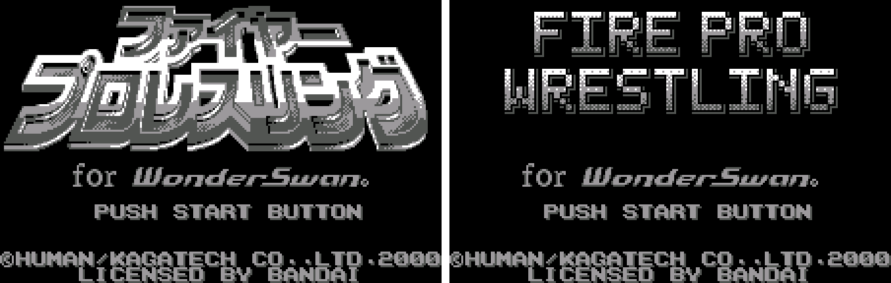

2. The intro

   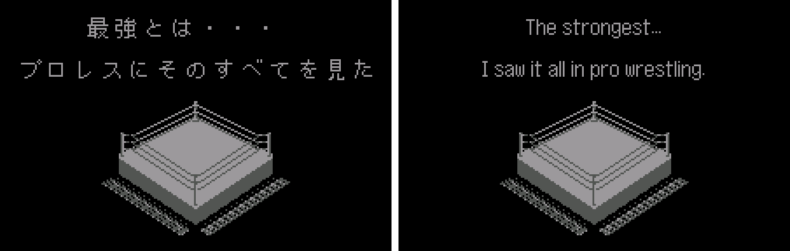

3. Master of Ring: a stage card

   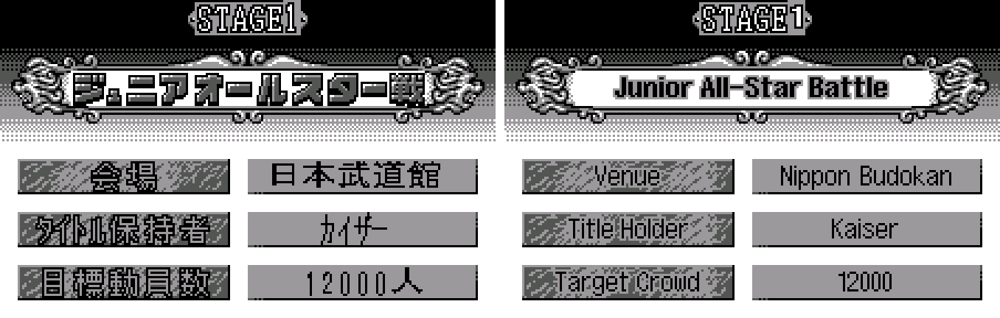

4. Match Making

   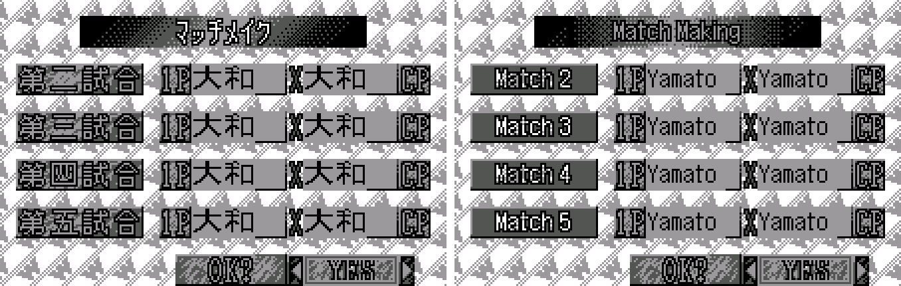

5. Match Setup

   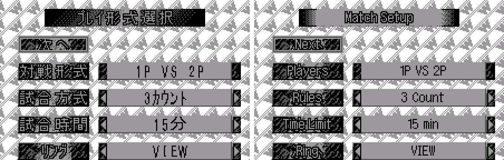

6. Wrestler Select

   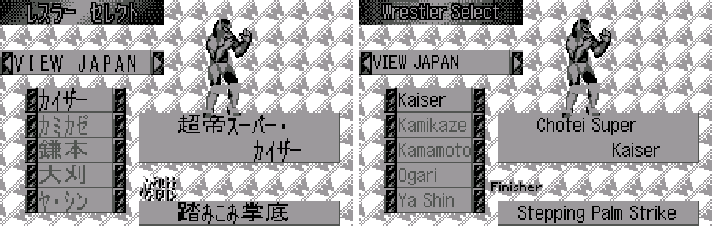

7. Match result

   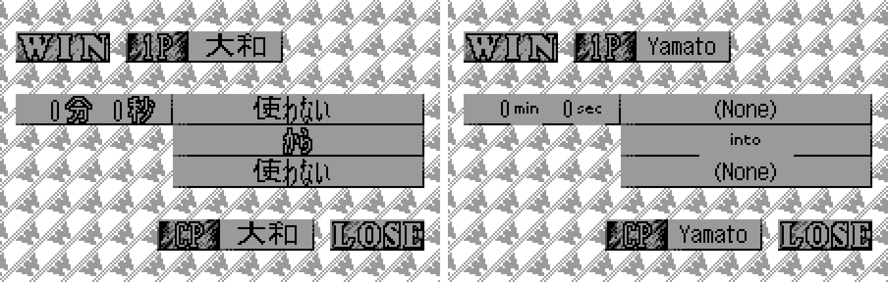

8. Show Rating

   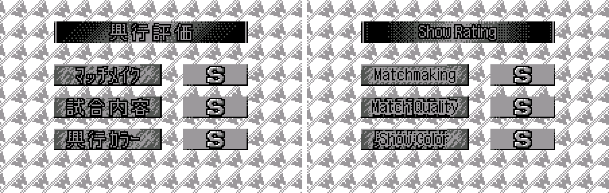

9. Attendance with the SUPER FULL HOUSE and SOLD OUT stamps

   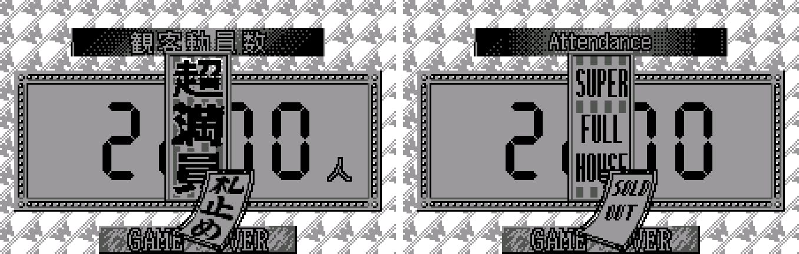

10. Wrestler Edit Menu

   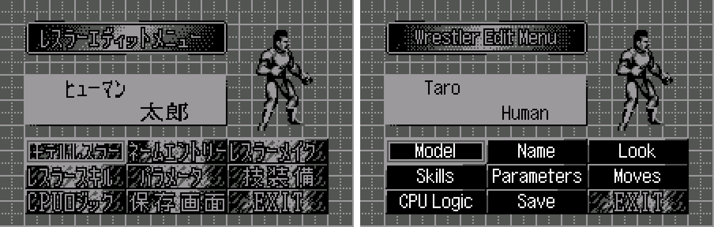

11. Wrestler Skills (profile)

   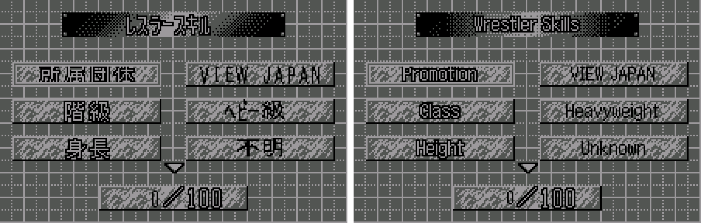

12. Parameters

   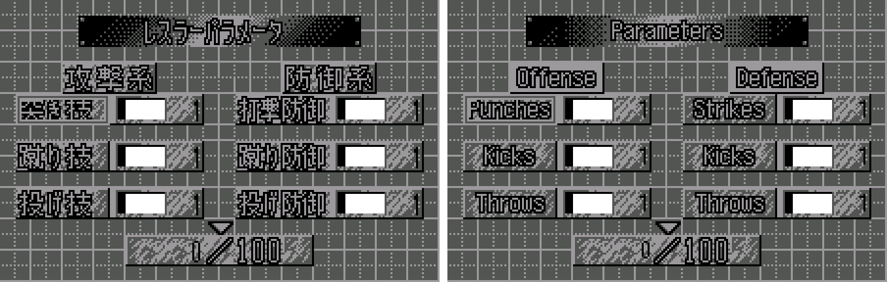

13. CPU Logic

   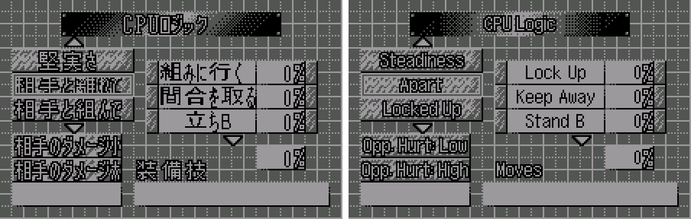

14. Name entry

   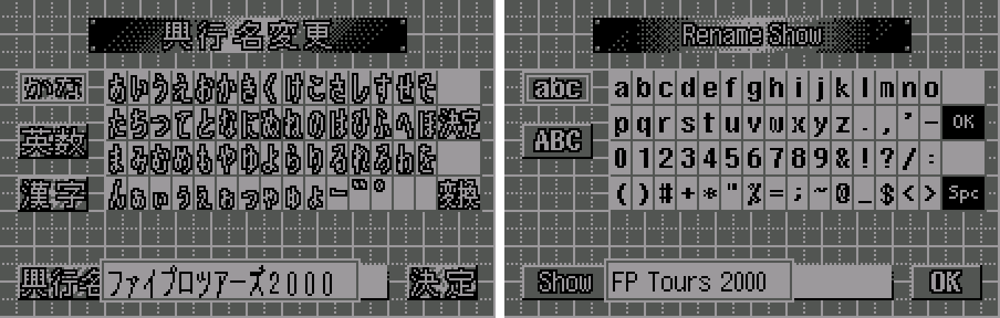

15. Elimination Match

   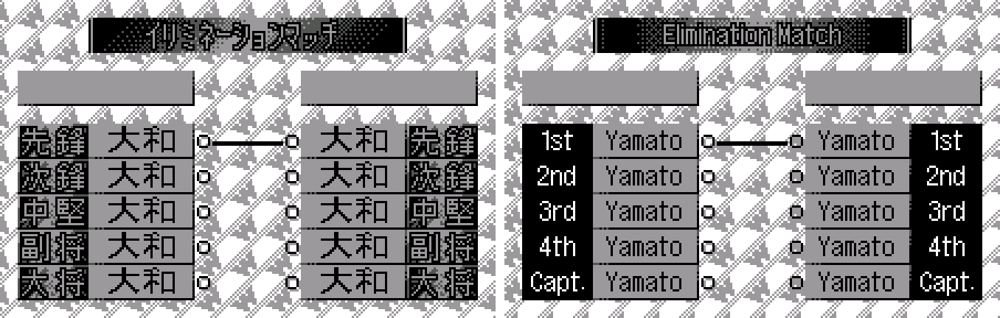

16. League standings

   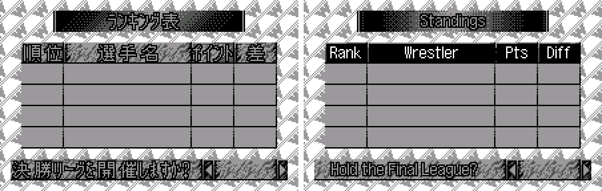

17. The ending

   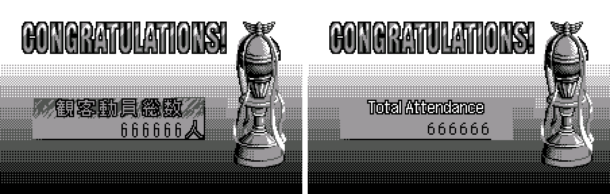

18. Staff credits

   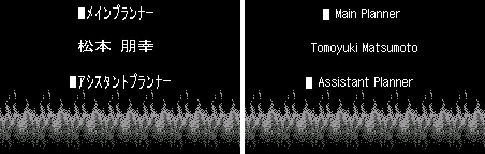

**How to patch**

Apply `fire-pro-en-1.0.bps` to the Japanese ROM "Fire Pro Wrestling for WonderSwan (Japan)" (CRC32 F246A68E) with Floating IPS, beat or ROM Patcher JS. The result should be CRC32 7E701D9E.

The patched ROM is **8 MB** (the original is 4 MB): the English needs more room, so the patch doubles the ROM. It's a WonderSwan (mono) game, so keep the .ws extension.

You must provide your own copy of the original Japanese game to apply it.

**Download:** `fire-pro-en-1.0.bps` on the [release page](https://github.com/PokemonGoDB/wonderswan-english-patches/releases/tag/fire-pro-v1.0).

**Known issues**

* It hasn't been played start to finish by a person. If you find leftover Japanese, cut text or a crash, please tell me where it happened.
* The link-cable screens (trading wrestlers, Title Match Mode) are translated but could not be tested with a second unit.
* "Kakracon" fills its plate edge to edge on the Team Select screen (the name is exactly as wide as the plate).

**Technical notes (for the curious)**

* The game prints every character into its own 8x16 cell. The patch adds a variable-width renderer that packs English letters by their pixel width into the same cells, and corrects the game's centring (which rounds to whole cells) so centred English stays centred.
* The ROM is expanded from 4 MB to 8 MB: the game moves to the upper half and the new graphics, text and pictures go in the lower half.
* About 490 words drawn as pictures are redrawn in their tile sets. Some list plates (the editor's categories and the data prompts) need more tiles than their sets have; the game now draws those at run time, copying each plate's English picture into a few spare tiles whenever the plate appears on screen.
* The name entry's kana grid became an English keyboard; letters skip the kana-to-kanji conversion step and go straight into the name, and the box around the name now follows the English text.

**A Note On My Justifications for AI Use**

I have been an avid fan of the Wonderswan system for a very long time now. It was actually a motivating factor for my various attempts to learn Japanese (which have all failed so far). I always wanted to explore the game catalog more, but the lack of English translations made it extremely difficult to do so. Here's the thing: There's a reason many of these games have not been translated yet. It's not just the fact that Japanese > English translation is difficult. There's also the fact that the original developers used all kinds of tricks and technical feats to make these games work. Most games do not have a searchable directory of text that you can just replace with English equivalents. While some are easier than others, translations for some of these would take not only an expert in Japanese > English translation, but also someone with vast game development and programming experience.

I say all that to say: I get why people are apprehensive about AI usage for this type of thing. However, these games have been around for a very long time now and most of them have still not received a translation. I (and others) have chosen to spend our time and money to utilize AI to translate the games and actually make them playable for the wider community. If you don't agree with that, that's completely fine. I am more than happy to remove any of my translations if better, human ran translations are released at a later date. We already decided to skip any games where someone is actively working on a manual translation. While nowhere near what a manual translation effort would be, I do spend a considerable amount of time trying to work through each game's translation. I stress over small details and try my best to make the right calls. And I've probably messed some stuff up, which is why I welcome feedback.

I'm just looking forward to digging through all of these games. It's a great time to be into Wonderswan games.
