# Fishing Freaks: Bass Rise for WonderSwan - AI English translation patch v1.1

**Fishing Freaks: Bass Rise for WonderSwan** (フィッシングフリークス バスライズ for WonderSwan) is Bec's 2000 bass-fishing game for the original (monochrome) WonderSwan, released only in Japan and played holding the console vertically. You pick a lake (a farm pond, Kasumigaura, Lake Biwa, Lake Ikehara, Lake Hibara), a season and a time of day, fill your lure box from 16 lure types in several colours, choose tackle and a rig, then cast, work the lure, set the hook and fight the fish. Lecture Mode has a guide who tips you on lures, colours and spots as you fish; Free Mode has free fishing and three tournament types (Most Weight, Biggest Fish, Most Fish) of three rounds each against 20 rival anglers, with prize lures; win all three for the ending. There's also a Lure Manual, a catch log, a link battle for two consoles, and a hidden sound test.

Its text is a normal 12x12 text engine plus a lot of words drawn as pictures (menus, lure and fish names, place names, headers). This patch translates both.

> **Please read:** this translation was made **with AI** (Claude), as a hobby project. A person (me) made every judgement call before release, but nobody on the project is a professional translator. I'm sharing it as it is for anyone who wants to play. Please **don't upload it to romhacking sites** (romhacking.net and the like). It may not be up to the standard of a real fan translation and it doesn't belong there.

**What's translated**

* All the game's text: the guide's lines, Lecture Mode tips and fishing advice, the Lure Manual, tournament messages and results, save/load and link battle messages, sound test track names.
* Everything drawn as pictures: title and mode menus, the free-mode tournament banners, screen headers, the 16 lure name plates, colour names, rig names on Rig Select, fish names on the catch screen, place/season/time labels, round and link headers, the Ranking header, the field menu and the catch screen labels.
* **Name entry:** an English letter grid (capitals, small letters, digits, a few symbols); names can be up to 10 letters.
* Rankings show the 20 rival anglers by name (they are the staff's surnames, romanized), with weights, sizes, fish counts and points in one column.
* Already in English in the original and left alone: the title screen, PUSH START KEY, the INTERBEC logo, "Hit!", TIME, NAVI and the staff credits.

Names and terms: standard English bass-fishing terms for lures and rigs (Popper, Swisher, Pencil Bait, Suspend/Floating Minnow, Deep/Shallow Crank, Spinnerbait, Buzzbait, Craw, Grub, Texas Rig, Drop Shot, Split Shot, Jighead, Rubber Jig, No Sinker). The Japanese colour names keep their usual English forms (Black Gold for kinkuro, Ayu, Oikawa, Hot Tiger, Watermelon, Smoke, Chartreuse, Motor Oil). イワナ and ヤマメ are Char and Masu Trout.

**Things to know**

* **Sound test:** hold Y1+Y3 and X1+X3 while switching the console on (in the vertical grip: left and right on the Y pad, plus the confirm and cancel buttons).
* **Fish password and ranking code:** pressing START on a catch (right after landing it, or in Catch Data) shows the game's "password for this fish". The original showed 10 kana/kanji symbols, meant to be written down and used outside the game (probably a ranking of the time; I couldn't confirm what); the patch shows the same code as 20 hex digits, and [`password-table.md`](password-table.md) converts it back to the original symbols. New in 1.1, a **Ranking code** of 16 characters appears under it: it holds the whole catch (species, size, weight, lure, colour, lake, season, time, weather), a fingerprint of your name and a check against typos, for online leaderboards. The format and a ready-made decoder ([`ranking/fishcode.js`](ranking/fishcode.js), [`ranking/SPEC.md`](ranking/SPEC.md), with test vectors) are in this folder and attached to the release for anyone who wants to run a leaderboard. Like the original password, it can't prove a catch is real; it's for honour-system boards.

**How it was made: AI translation, independent checks, human decisions**

* Claude translated all 236 text strings and redrew about 160 picture labels, and did all the hacking: a variable-width English font in the game's 12x12 text engine, relocated text, recompressed pictures, an English name-entry grid with 10-letter names, a fixed value column in the rankings, and English "total" lines on the catch list.
* A separate, independent Claude reviewer checked every line, name and picture against the Japanese; its findings were verified and fixed (it caught the rig names on Rig Select, which were still Japanese).
* On screen: every string was drawn by the game in its own box with the widest name and numbers; a random walk from 18 save states across the game found no Japanese reaching the screen (the same check finds Japanese on the original); a small bot played the fishing itself (casting, hooking, fighting), landed fish, won two tournament types and lost one; the ending and credits were seen; the title was left idle for six minutes on both ROMs (there is no demo); every screen was compared side by side with the original, enlarged, for alignment and clearance.
* The judgement calls were listed with the Japanese, a literal reading and the options, and I decided all 20 by hand over three rounds: colour, fish, rig and place names, the season and time abbreviations, the tournament names, name entry, the password, the ranking layout, the lettering on the rig banners and place names, and the sound test.

**Changelog**

* **v1.1**: adds the Ranking code under the fish password, and the website decoder and format spec.
* **v1.0**: first release.

**Sources consulted**

* Japanese text: the WonderSwan ROM itself.
* Official English: none exists for this game. The series' only Western release, the PlayStation Bass Rise (1999), uses Megabass lure models rather than this game's generic lures, so standard English fishing terms are used.
* Font: a variable-width font made from Shinonome 12-dot (public domain).

**Images** (original on the left, English on the right)

1. Title menu

   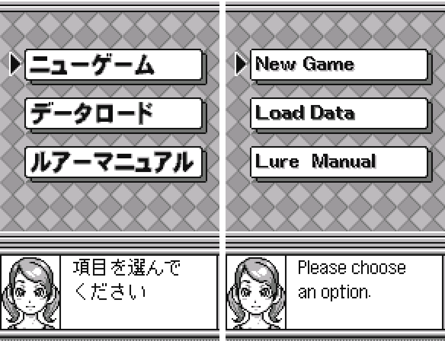

2. Name entry

   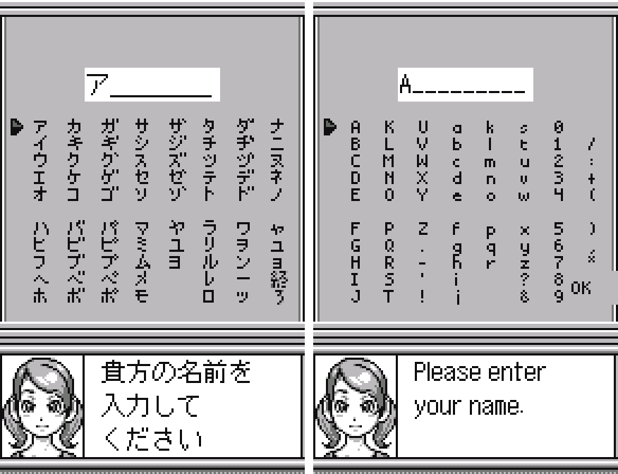

3. Mode menu

   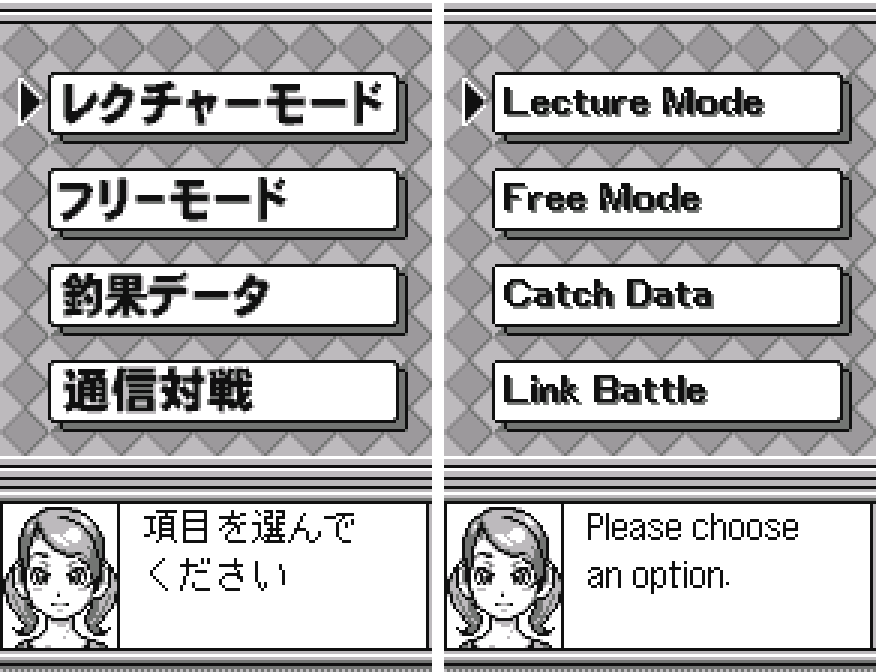

4. Free Mode: the tournament types

   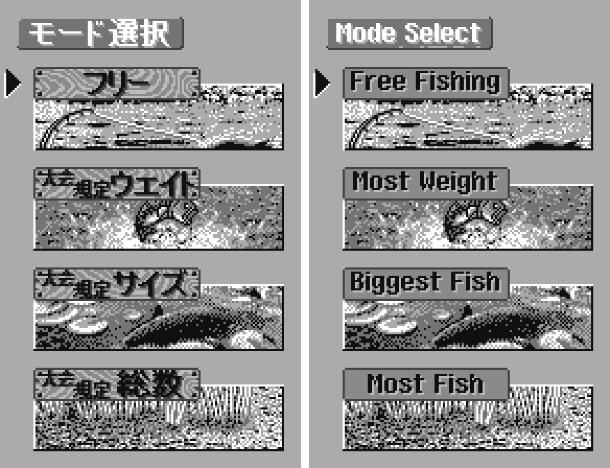

5. Map select (place, season, time)

   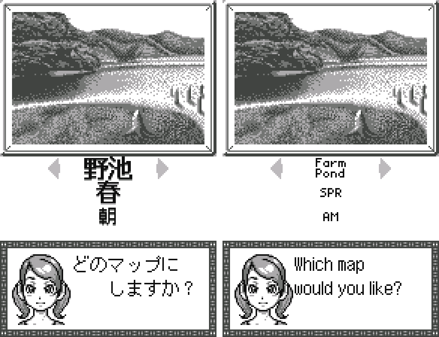

6. Lure Select

   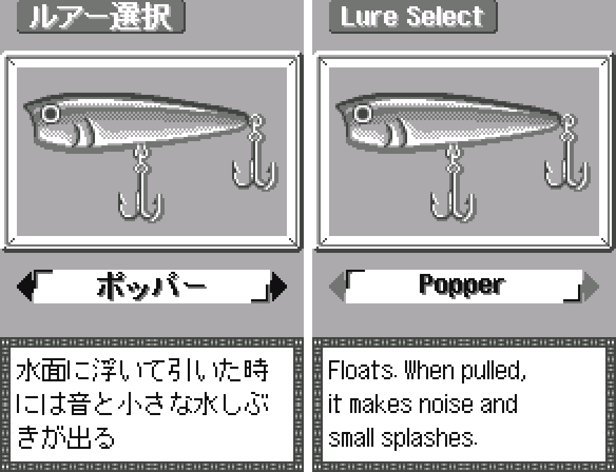

7. Rig Select

   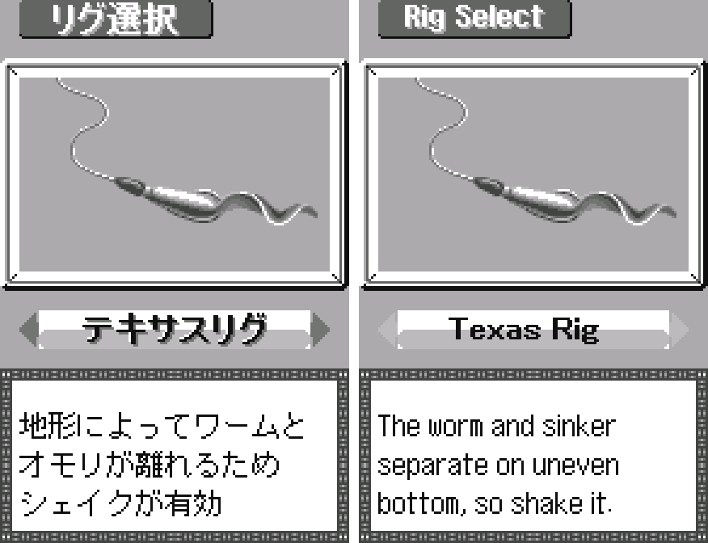

8. Fishing menu

   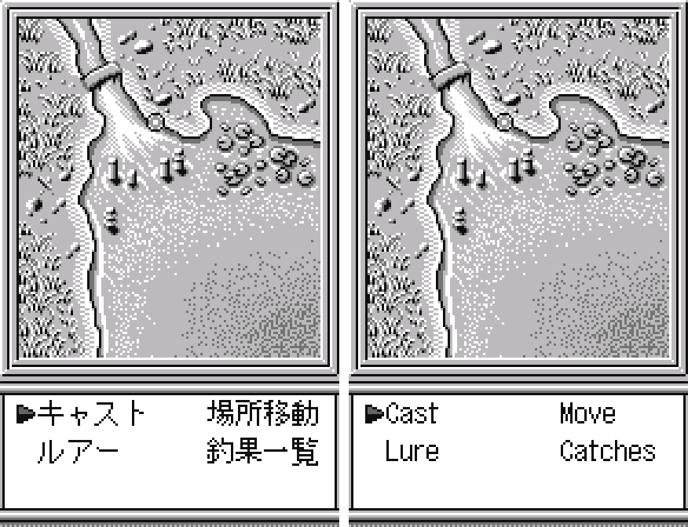

9. Catch screen

   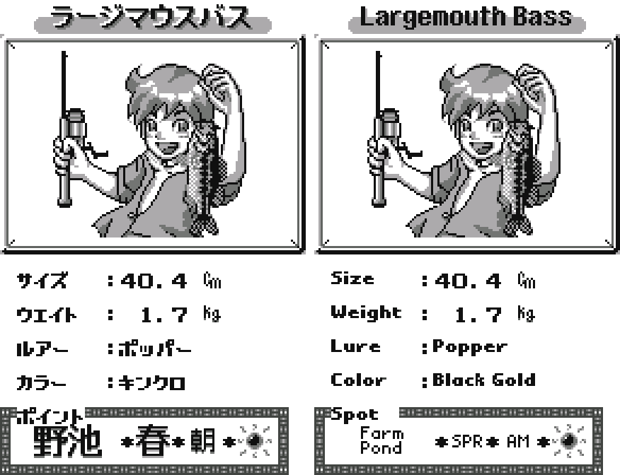

10. Catch List

   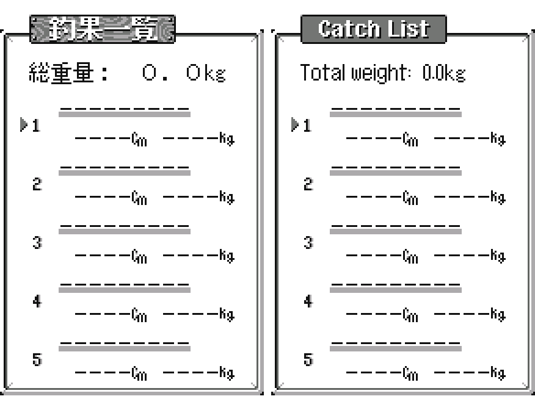

11. Tournament round

   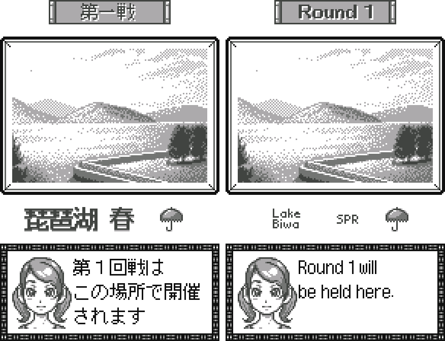

12. Round ranking

   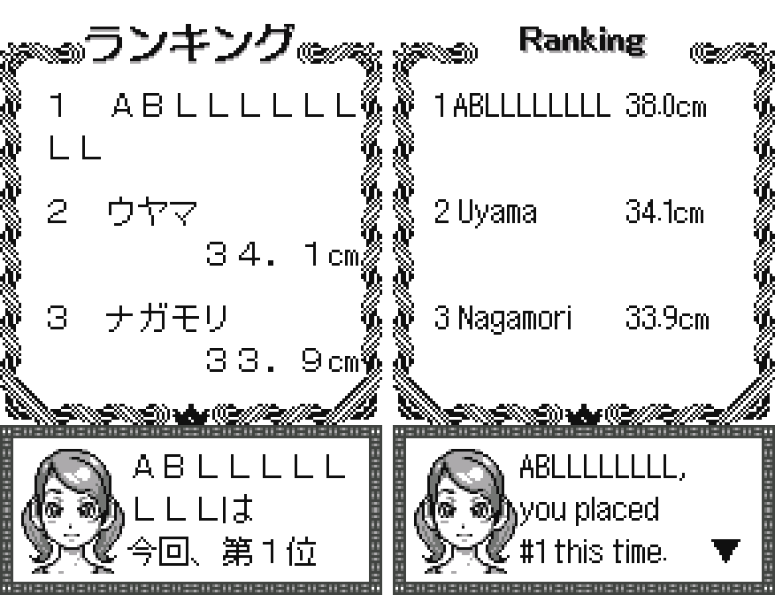

13. Lure Manual: colours

   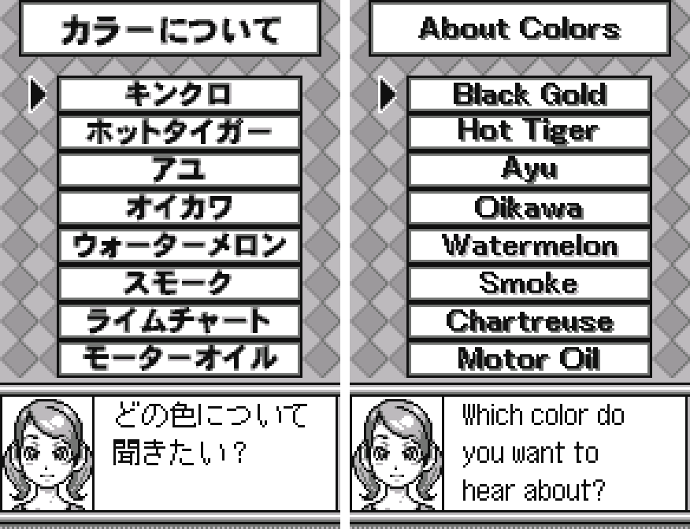

14. Fish password and ranking code

   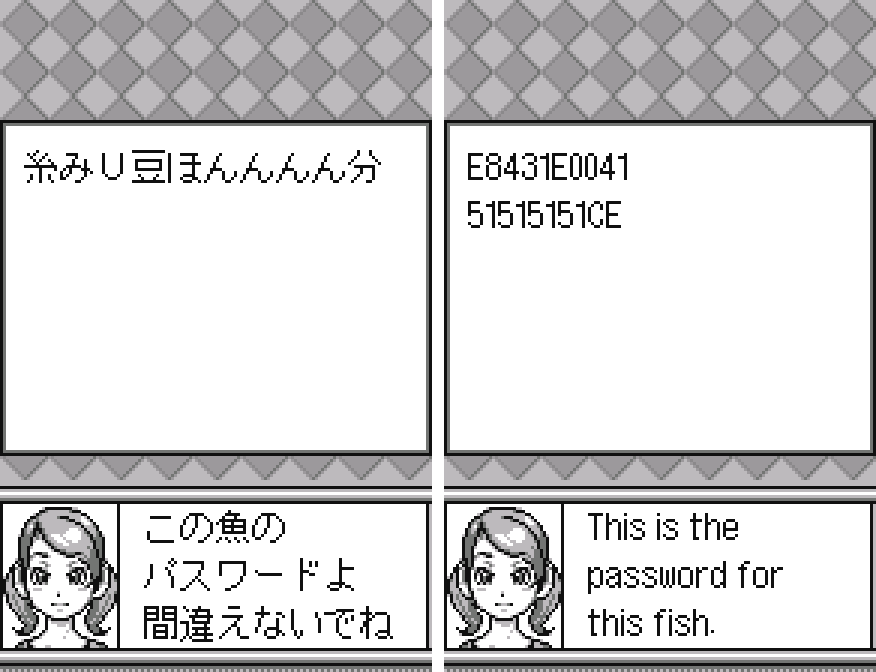

15. Link Battle

   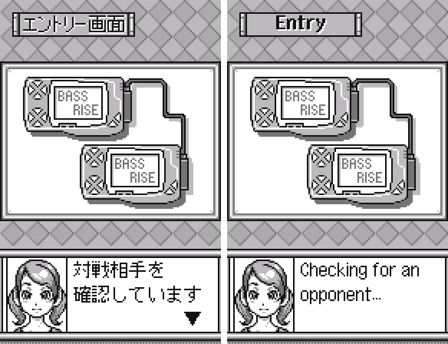

**How to patch**

Apply `fishing-freaks-en-1.1.bps` to the Japanese ROM "Fishing Freaks - Bass Rise for WonderSwan (Japan)" (CRC32 A1FB16FC) in your browser with the [Swan Revival patcher](https://swanrevival.com/patcher/), or with Floating IPS, beat or ROM Patcher JS; the result should be CRC32 BF700918. The ROM keeps its size (1 MB). It's a WonderSwan (mono) game, so keep the .ws extension.

You must provide your own copy of the original Japanese game to apply it.

**Download:** `fishing-freaks-en-1.1.bps` on the [release page](https://github.com/PokemonGoDB/wonderswan-english-patches/releases/tag/fishing-freaks-v1.1).

**Known issues**

* It hasn't been played start to finish by a person. If you find leftover Japanese or anything broken, please tell me where it happened.
* Not seen on screen in testing: the two-console link match (the emulator has no link cable), "Saved." and "The save data is damaged" (all three were checked by drawing the text in the game's box).
* The place names and the season and time icons are small, because they fit in the space of one or two kanji.
* The Lure Manual title button reads "Lure  Manual" with a wide gap: the tiles between the words are shared with the other buttons.
* A photo on the tournament-loss screen has a sign with unreadable lettering; it is left as it is.

**Technical notes (for the curious)**

* The game's 12x12 text engine drew one full-width character per 12-pixel cell. The patch keeps a pixel position in the engine's column byte and draws a proportional English font, with a new control code to put the ranking values in one column.
* The 1.1 ranking code is built by a new routine from the catch record and the name: 10 bytes (version, species, 12-bit size and weight, lure, colour, lake, season, time, weather, a CRC-16 of the name, a CRC-16 check keyed with a constant) shown in Crockford base32. It uses cartridge RAM the game never touches.
* Names are now one byte per letter (10 letters in the same 11 save bytes as 5 kana).
* Picture text was redrawn in the LZ-compressed tile resources; pictures that grew when recompressed were moved, and their pointers updated.
* The catch list's total lines were built in memory from fixed-length copies; the Japanese one copied 6 bytes of program code after the unit, which the Japanese box hid but the English didn't, so the copy was shortened.

**A Note On My Justifications for AI Use**

I have been an avid fan of the Wonderswan system for a very long time now. It was actually a motivating factor for my various attempts to learn Japanese (which have all failed so far). I always wanted to explore the game catalog more, but the lack of English translations made it extremely difficult to do so. Here's the thing: There's a reason many of these games have not been translated yet. It's not just the fact that Japanese > English translation is difficult. There's also the fact that the original developers used all kinds of tricks and technical feats to make these games work. Most games do not have a searchable directory of text that you can just replace with English equivalents. While some are easier than others, translations for some of these would take not only an expert in Japanese > English translation, but also someone with vast game development and programming experience.

I say all that to say: I get why people are apprehensive about AI usage for this type of thing. However, these games have been around for a very long time now and most of them have still not received a translation. I (and others) have chosen to spend our time and money to utilize AI to translate the games and actually make them playable for the wider community. If you don't agree with that, that's completely fine. I am more than happy to remove any of my translations if better, human ran translations are released at a later date. We already decided to skip any games where someone is actively working on a manual translation. While nowhere near what a manual translation effort would be, I do spend a considerable amount of time trying to work through each game's translation. I stress over small details and try my best to make the right calls. And I've probably messed some stuff up, which is why I welcome feedback.

I'm just looking forward to digging through all of these games. It's a great time to be into Wonderswan games.
