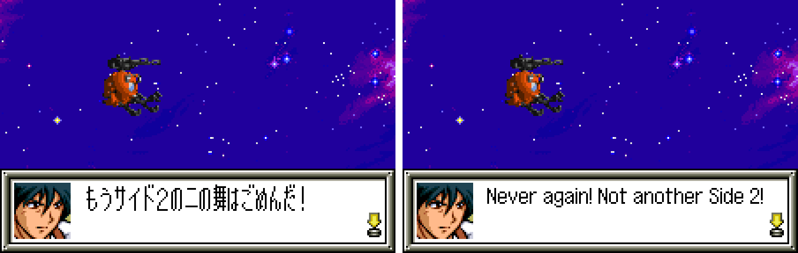
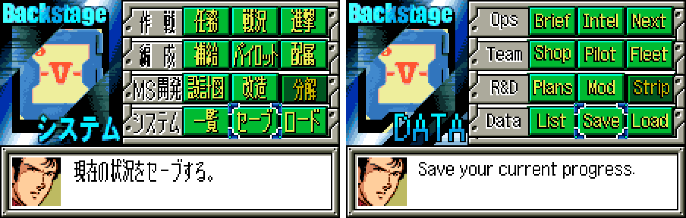
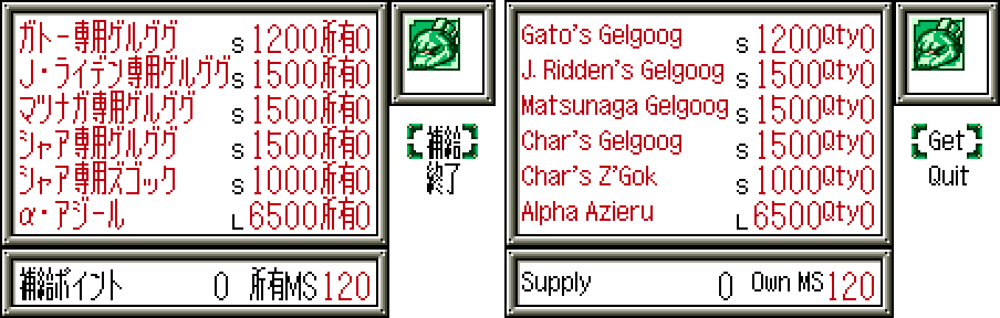
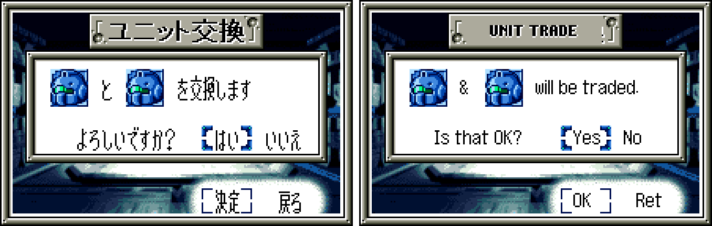

# SD Gundam G Generation: Gather Beat 2 (WonderSwan Color) - AI English translation patch v1.2 (+ Stage Select edition)

**SD Gundam G Generation: Gather Beat 2** (SDガンダム Gジェネレーション ギャザービート2) is Bandai's 2001 G Generation strategy game for the WonderSwan Color, released only in Japan. You command a mixed force of mobile suits and ships from across the Gundam series on grid maps, replaying battles from Mobile Suit Gundam, The 08th MS Team, 0083, Zeta, ZZ, Char's Counterattack, Victory, G Gundam, Gundam Wing, Gundam X, Turn A and more. Pilots fire ID commands (special abilities with their own speech), between stages you manage the Backstage (buying, developing and modifying units, assigning pilots), and the game adds an encyclopedia of characters and mobile suits, adventure scenes, two endings and unit trading over the link cable. This patch translates it into English. (The first Gather Beat has its own patch and release.)

> **Please read:** this translation was made **with AI** (Claude), as a hobby project. A person (me) made every judgement call before release, but nobody on the project is a professional translator. I'm sharing it as it is for anyone who wants to play. Please **don't upload it to romhacking sites** (romhacking.net and the like). It may not be up to the standard of a real fan translation and it doesn't belong there.

**What's translated**

* All story, map and battle dialogue, ID and battle speech, the adventure scenes, menus and names, the encyclopedia (684 entries), and the narration of both endings.
* Link cable: the Unit Trade screens and messages.
* WonderGate: the shop screens for the post-game downloads of extra units, pilots and scenarios. The downloads work with the Swan Revival service.
* Pictures redrawn in English: the 33 stage title cards, the Backstage panel and its captions, the effect markers (hand-drawn letters), the battle words (CRITICAL!, MISS!, I-FIELD ...), the title menus and copyright, the UNIT TRADE plate and both staff rolls.
* Kept as they are, because the original is already in English: the title logo, PRESS START BUTTON, the Backstage logo, the turn banners, and the NEWS and EYES ONLY signs in the second ending.

**Names and terms**

Characters, mobile suits, ships and places use Bandai's current official English (the English Gundam site): Elpeo Ple, Dark Gundam, Shadow Gundam, Nu Gundam, Turn A Gundam, Confeito, Kailash Geary, Dogosse Giar. Military ranks use the naval set the English anime releases use (Ensign Shiro Amada, Lieutenant Quattro, Commander Char, Captain Bright); sergeants and corporals keep their army titles, and OZ officers use plain ranks (Lieutenant Zechs, Colonel Une). Master Asia's techniques are romanized, as English G Gundam media do. Stage titles use the official English episode titles where they exist. The staff roll follows the romanizations in the first Gather Beat's own English credits where the same people appear. Where a label has no room, it uses a short form (the encyclopedia's series list says "Turn A"; the weapon list says "Def." for Guard).

**How it was made: AI translation, independent checks, human decisions**

* Claude translated everything directly from the Japanese in the ROM and did all the hacking: a variable-width English text renderer, about 17,000 lines moved into new space, recompressed title cards and rebuilt staff rolls.
* A separate, independent Claude reviewer checked the game against the Japanese; its findings were verified and fixed.
* On screen: every translated text box was shown in the game's own dialogue boxes in the emulator with every drawn letter logged (12,583 boxes and 5,911 other lines), random walks through menus and maps were watched for any Japanese reaching the screen and for any English label drawn over a window frame, both endings and staff rolls were played in test ROMs, screens were compared with the Japanese side by side for centring and spacing, real WonderGate sessions were run against the project's own server, and unit trades were made between two emulated consoles (English with English, and English with Japanese).
* The judgement calls (names, ranks, short forms, redrawn pictures, typos in the original art) were listed with the Japanese, a literal reading and the options, and I decided each one by hand over three rounds.

**Special edition: Stage Select**

`gather-beat-gb2-en-stagesel-1.2.bps` adds the developers' own stage select, which the original leaves unused: New Game opens "Stage Select" over the opening; UP and DOWN choose an entry (the developers' labels ST00, ST01 ... with route tags), A starts it, B goes on with the normal game. It plays each stage's scenes and battle the way the developers' tool sets them up, which is not always the same as reaching the stage in a normal game. Use it for exploring; play the standard patch for the game itself.

**Notes on the original**

* The allied turn banner reads FRIENDRY TURN. It is the original's spelling and is kept.
* After the first ending the original shows, in its own English: "The war is not finished. / Try to seek your another future....". That line is the original game's, not this translation's.

**Changelog**

* **v1.2**: names and labels the original wrote in Latin letters (0080 and 0083 in the encyclopedia's series list, F91, ID in the command menu, the WonderGate keypad, Total EXP) now use the same English font as the text around them instead of the original's taller letters.
* **v1.1**: link-cable Unit Trade checked on two linked consoles; the UNIT TRADE plate redrawn in English (it was still Japanese) and the trade prompt no longer hides "will be" under a unit icon; labels that drew over window frames fixed (the weapon list's "Guard" is now "Def.", the encyclopedia's series list says "Turn A"). Now released separately from the first Gather Beat.
* **v1.0**: first release (together with the first Gather Beat).

**Sources consulted**

* Japanese text: the WonderSwan Color ROM itself.
* Names and terms: Bandai's English Gundam site (en.gundam-official.com), Gundam Wiki and the G Generation wiki; staff romanizations from the first Gather Beat's English credits.
* WonderGate: the Swan Revival project's documentation of the game's downloads.

**Images** (original on the left, English on the right)

1. Title screen

   

2. A stage title card

   

3. Story dialogue

   

4. Battle speech

   

5. The Backstage

   

6. The encyclopedia's index

   

7. The WonderGate shop

   

8. Link-cable Unit Trade

   

**How to patch**

Apply one of the BPS files to the Japanese ROM "SD Gundam G Generation - Gather Beat 2 (Japan)" (CRC32 4D21A347) in your browser with the [Swan Revival patcher](https://swanrevival.com/patcher/), or with Floating IPS, beat or ROM Patcher JS:

* Standard: `gather-beat-gb2-en-1.2.bps`, the result should be CRC32 5DC527DC.
* Stage Select edition (Stage Select on New Game): `gather-beat-gb2-en-stagesel-1.2.bps`, the result should be CRC32 EBA90D51.

Keep the .wsc extension. The ROM keeps its size (8 MB). Saves from the Japanese version work.

You must provide your own copy of the original Japanese game to apply it.

**Download:** `gather-beat-gb2-en-1.2.bps`, `gather-beat-gb2-en-stagesel-1.2.bps` on the [release page](https://github.com/PokemonGoDB/wonderswan-english-patches/releases/tag/gather-beat-2-v1.2).

**Known issues**

* The game hasn't been played start to finish by a person. If you find leftover Japanese or anything broken, please tell me where it happened.
* The WonderGate connection-failure screen was not produced in testing; its text is translated (the "not connected" screen was seen in English).
* Stage Select edition: a stage started from the select can show a small red square on the map, where the developers' select skips part of the normal pre-stage setup.

**Technical notes (for the curious)**

* The game draws text with a fixed-cell Japanese renderer; the patch adds a variable-width English renderer and moves the English into free ROM banks through escape codes, so no Japanese line had to be shortened to fit its old space.
* The encyclopedia's index tabs are a byte in each entry; the patch re-sorts the character and mobile suit tables by English name and regroups them as A-B, C-D ... W-Z (the entry pages and the "seen" records use ids, not positions).
* The stage title cards are LZ-compressed pictures; they were redrawn at twice the dialogue font's size and recompressed. The staff rolls are animation records rewritten in place, because moving them broke the cards.
* The unused stage select ends by jumping back to a context that its removed debug loop used to set up; the special edition sets that context at the game's top-level loop, so a chosen stage starts cleanly.

**A Note On My Justifications for AI Use**

I have been an avid fan of the Wonderswan system for a very long time now. It was actually a motivating factor for my various attempts to learn Japanese (which have all failed so far). I always wanted to explore the game catalog more, but the lack of English translations made it extremely difficult to do so. Here's the thing: There's a reason many of these games have not been translated yet. It's not just the fact that Japanese > English translation is difficult. There's also the fact that the original developers used all kinds of tricks and technical feats to make these games work. Most games do not have a searchable directory of text that you can just replace with English equivalents. While some are easier than others, translations for some of these would take not only an expert in Japanese > English translation, but also someone with vast game development and programming experience.

I say all that to say: I get why people are apprehensive about AI usage for this type of thing. However, these games have been around for a very long time now and most of them have still not received a translation. I (and others) have chosen to spend our time and money to utilize AI to translate the games and actually make them playable for the wider community. If you don't agree with that, that's completely fine. I am more than happy to remove any of my translations if better, human ran translations are released at a later date. We already decided to skip any games where someone is actively working on a manual translation. While nowhere near what a manual translation effort would be, I do spend a considerable amount of time trying to work through each game's translation. I stress over small details and try my best to make the right calls. And I've probably messed some stuff up, which is why I welcome feedback.

I'm just looking forward to digging through all of these games. It's a great time to be into Wonderswan games.
