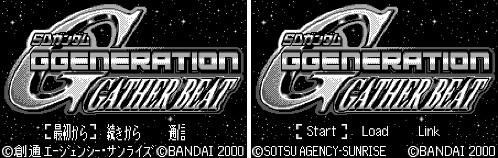
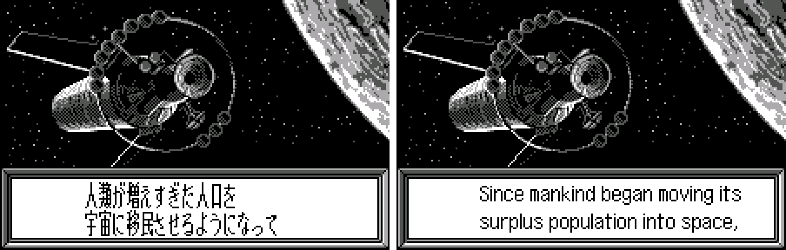
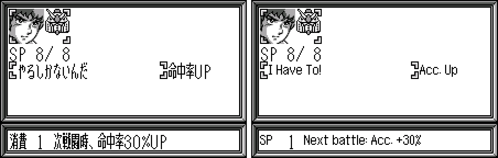
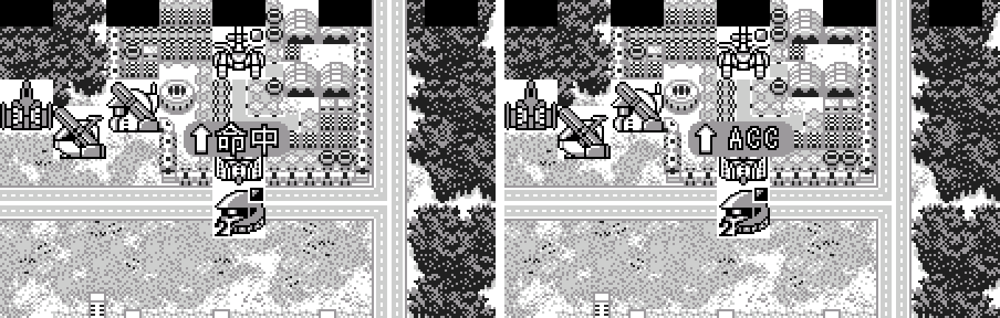
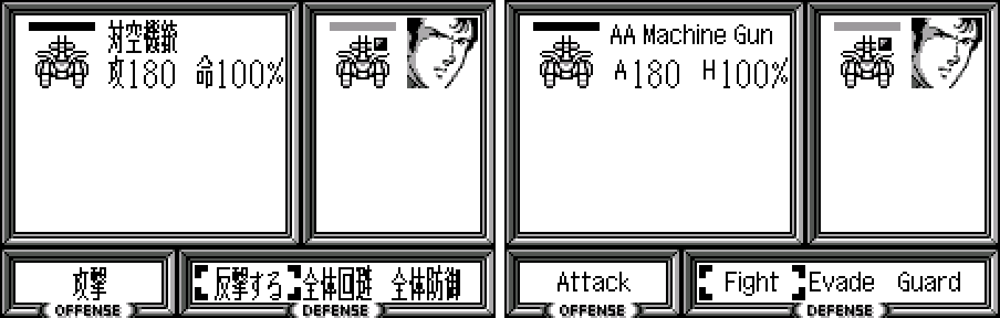

# SD Gundam G Generation: Gather Beat (WonderSwan) - AI English translation patch v1.2

**SD Gundam G Generation: Gather Beat** (SDガンダム Gジェネレーション ギャザービート) is Bandai's 2000 G Generation strategy game for the WonderSwan, released only in Japan. You command a mixed force of mobile suits and ships from across the Gundam series on grid maps, replaying battles from Mobile Suit Gundam, The 08th MS Team, 0083, Zeta, ZZ, Char's Counterattack, G Gundam, Gundam Wing, Gundam X, Turn A and more. Pilots fire ID commands (special abilities with their own speech), and between stages you manage the Backstage: buying units, developing and modifying machines, assigning pilots. Two players can fight each other over the link cable. This patch translates it into English. (Gather Beat 2 has its own patch and release.)

> **Please read:** this translation was made **with AI** (Claude), as a hobby project. A person (me) made every judgement call before release, but nobody on the project is a professional translator. I'm sharing it as it is for anyone who wants to play. Please **don't upload it to romhacking sites** (romhacking.net and the like). It may not be up to the standard of a real fan translation and it doesn't belong there.

**What's translated**

* All stage and battle dialogue, ID commands and their speech, menus, unit, pilot and weapon names, the Backstage menus, the stage objectives, the prologue and the ending narration.
* Link-cable battles: map select, turn and battle menus, the defender's Fight / Evade / Guard choice and the result messages.
* WonderGate: the shop screens for the post-game downloads of extra units, characters and parts. The downloads work with the Swan Revival service.
* Pictures redrawn in English: the Backstage bars, the Pilot tab, the effect markers over units (EVA, ACC, HIT!, REPAIR ...) and the title copyright line.
* Kept as they are, because the original is already in English: the title logo, PRESS START BUTTON, the Backstage logo, the turn banners and the staff credits.

**Names and terms**

Characters, mobile suits, ships and places use Bandai's current official English (the English Gundam site): Shadow Gundam, Nu Gundam, Turn A Gundam. Military ranks use the naval set the English anime releases use (Ensign Shiro Amada, Commander Char, Captain Bright); sergeants and corporals keep their army titles. Master Asia's techniques are romanized, as English G Gundam media do. Stage titles use the official English episode titles where they exist. Where a label has no room, it uses a short form (Eva. for Evade on the weapon list, Atk., Acc., Def.).

**How it was made: AI translation, independent checks, human decisions**

* Claude translated everything directly from the Japanese in the ROM and did all the hacking: a variable-width English text renderer and a dictionary compressor, so no Japanese line had to be shortened to fit its old space.
* A separate, independent Claude reviewer checked the game against the Japanese; its findings were verified and fixed.
* On screen: 10,674 text boxes were shown in the game's own dialogue box in the emulator with every drawn letter logged, random walks through menus and maps were watched for any Japanese reaching the screen, the ending was played in a test ROM, screens were compared with the Japanese side by side for centring and spacing, random walks were watched for any English label drawn over a window frame, a real WonderGate session was run against the project's own server, and a whole link-cable battle was played on two emulated consoles, original and English side by side.
* The judgement calls (names, ranks, short forms, redrawn pictures, typos in the original art) were listed with the Japanese, a literal reading and the options, and I decided each one by hand over three rounds.

**Notes on the original**

* The Backstage picture reads HANGER ("hangar"). It is the original's spelling and is kept.
* An earlier English patch for this game exists in another catalog; this translation was made independently and uses none of its text, code or graphics.

**Changelog**

* **v1.2**: names and labels the original wrote in Latin letters (ID in the command menu, STAGE01 in the save list, MAP SELECT, AI) now use the same English font as the text around them instead of the original's taller letters.
* **v1.1**: link-cable play checked on two linked consoles; the WonderGate requirement message reworded so its last line no longer runs under the page arrow; labels that drew over window frames fixed (the weapon list's "Evade" is now "Eva.", and the unit info's "Effect Yes" sits inside its frame). Gather Beat 2 now has its own release.
* **v1.0**: first release (together with Gather Beat 2).

**Sources consulted**

* Japanese text: the WonderSwan ROM itself.
* Names and terms: Bandai's English Gundam site (en.gundam-official.com), Gundam Wiki and the G Generation wiki.
* WonderGate: the Swan Revival project's documentation of the game's downloads.

**Images** (original on the left, English on the right)

1. Title screen

   

2. The prologue

   

3. An ID command

   

4. An effect marker

   

5. A link-cable battle: the defender's choice

   

**How to patch**

Apply `gather-beat-gb1-en-1.2.bps` to "SD Gundam G-Generation - Gather Beat (Japan)" (CRC32 E4EB3AB1) with Floating IPS, beat or ROM Patcher JS; the result should be CRC32 F2DF9A5A. It's a WonderSwan (mono) game, so keep the .ws extension. The ROM keeps its size (4 MB). Saves from the Japanese version work.

You must provide your own copy of the original Japanese game to apply it.

**Download:** `gather-beat-gb1-en-1.2.bps` on the [release page](https://github.com/PokemonGoDB/wonderswan-english-patches/releases/tag/gather-beat-v1.2).

**Known issues**

* The game hasn't been played start to finish by a person. If you find leftover Japanese or anything broken, please tell me where it happened.
* Two link messages ("Link error. Cannot continue." and "No link device connected.") and the WonderGate error screens were not produced in testing; their text is translated.
* The repair marker (REPAIR) was checked as a picture, not seen in play.

**Technical notes (for the curious)**

* The game draws text with a fixed-cell Japanese renderer; the patch adds a variable-width English renderer and stores the English through escape codes into free ROM space.
* The link battle shares inputs: each console simulates the whole battle and shows the other player's menus as they open. Testing it on two emulated consoles showed that two consoles started in exactly the same frame end in a sync error, in the original too; real consoles never do.

**A Note On My Justifications for AI Use**

I have been an avid fan of the Wonderswan system for a very long time now. It was actually a motivating factor for my various attempts to learn Japanese (which have all failed so far). I always wanted to explore the game catalog more, but the lack of English translations made it extremely difficult to do so. Here's the thing: There's a reason many of these games have not been translated yet. It's not just the fact that Japanese > English translation is difficult. There's also the fact that the original developers used all kinds of tricks and technical feats to make these games work. Most games do not have a searchable directory of text that you can just replace with English equivalents. While some are easier than others, translations for some of these would take not only an expert in Japanese > English translation, but also someone with vast game development and programming experience.

I say all that to say: I get why people are apprehensive about AI usage for this type of thing. However, these games have been around for a very long time now and most of them have still not received a translation. I (and others) have chosen to spend our time and money to utilize AI to translate the games and actually make them playable for the wider community. If you don't agree with that, that's completely fine. I am more than happy to remove any of my translations if better, human ran translations are released at a later date. We already decided to skip any games where someone is actively working on a manual translation. While nowhere near what a manual translation effort would be, I do spend a considerable amount of time trying to work through each game's translation. I stress over small details and try my best to make the right calls. And I've probably messed some stuff up, which is why I welcome feedback.

I'm just looking forward to digging through all of these games. It's a great time to be into Wonderswan games.
