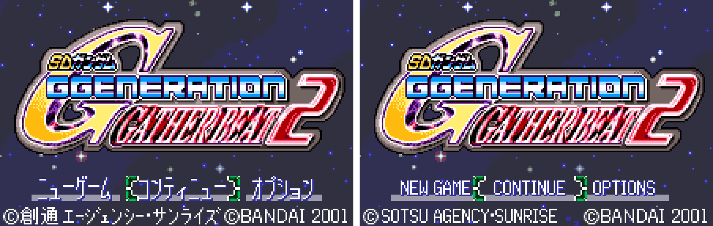
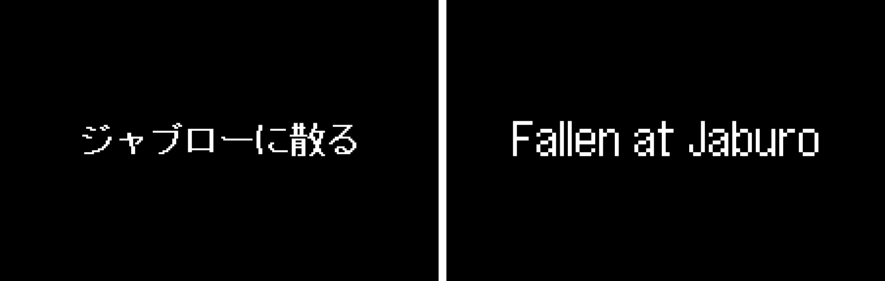
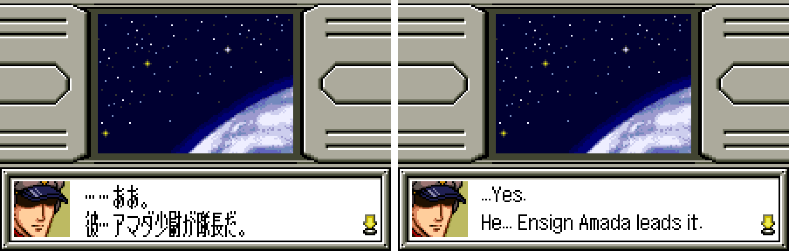
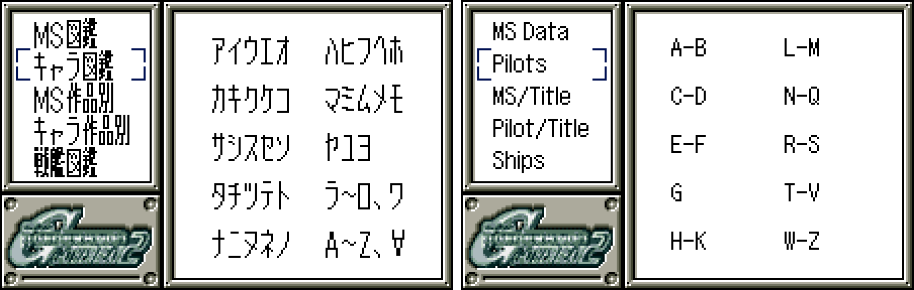

# SD Gundam G Generation: Gather Beat 1 & 2 (WonderSwan | WonderSwan Color) - AI English translation patch v1.0 (+ Stage Select edition)

**SD Gundam G Generation: Gather Beat** (SDガンダム Gジェネレーション ギャザービート, WonderSwan, 2000) and **Gather Beat 2** (ギャザービート2, WonderSwan Color, 2001) are Bandai's handheld G Generation strategy games, released only in Japan. You command a mixed force of mobile suits and ships from across the Gundam series on grid maps, replaying battles from Mobile Suit Gundam, The 08th MS Team, 0083, Zeta, ZZ, Char's Counterattack, G Gundam, Gundam Wing, Gundam X, Turn A and more. Pilots fire ID commands (special abilities with their own speech), and between stages you manage the Backstage: buying units, developing and modifying machines, assigning pilots. Gather Beat 2 adds an encyclopedia of characters and mobile suits, adventure scenes and two endings. This patch translates both games into English.

> **Please read:** this translation was made **with AI** (Claude), as a hobby project. A person (me) made every judgement call before release, but nobody on the project is a professional translator. I'm sharing it as it is for anyone who wants to play. Please **don't upload it to romhacking sites** (romhacking.net and the like). It may not be up to the standard of a real fan translation and it doesn't belong there.

**What's translated**

* **Gather Beat:** all stage and battle dialogue, ID commands and their speech, menus, unit, pilot and weapon names, the Backstage menus, the stage objectives, the prologue and the ending narration. Pictures redrawn in English: the Backstage bars, the Pilot tab, the effect markers over units (EVA, ACC, HIT!, REPAIR ...) and the title copyright line.
* **Gather Beat 2:** all story, map and battle dialogue, ID and battle speech, the adventure scenes, menus and names, the encyclopedia (684 entries), and the narration of both endings. Pictures redrawn in English: the 33 stage title cards, the Backstage panel and its captions, the effect markers (hand-drawn letters), the battle words (CRITICAL!, MISS!, I-FIELD ...), the title menus and copyright, and both staff rolls.
* **WonderGate:** both games' WonderGate shop screens (the post-game downloads of extra units, pilots and scenarios). The downloads work with the Swan Revival service.
* Kept as they are, because the original is already in English: the title logos, PRESS START BUTTON, the Backstage logo, the turn banners, Gather Beat 1's staff credits, and the NEWS and EYES ONLY signs in Gather Beat 2's second ending.

**Names and terms**

Characters, mobile suits, ships and places use Bandai's current official English (the English Gundam site): Elpeo Ple, Dark Gundam, Shadow Gundam, Nu Gundam, Turn A Gundam, Confeito, Kailash Geary, Dogosse Giar. Military ranks use the naval set the English anime releases use (Ensign Shiro Amada, Lieutenant Quattro, Commander Char, Captain Bright); sergeants and corporals keep their army titles, and OZ officers use plain ranks (Lieutenant Zechs, Colonel Une). Master Asia's techniques are romanized, as English G Gundam media do. Stage titles use the official English episode titles where they exist. The Gather Beat 2 staff roll follows the romanizations in Gather Beat 1's own English credits where the same people appear.

**How it was made: AI translation, independent checks, human decisions**

* Claude translated everything directly from the Japanese in the ROMs and did all the hacking: a variable-width English text renderer for each game, about 17,000 of Gather Beat 2's lines moved into new space, recompressed title cards and rebuilt staff rolls.
* A separate, independent Claude reviewer checked both games against the Japanese; its findings were verified and fixed.
* On screen: every translated text box was shown in the games' own dialogue boxes in the emulator with every drawn letter logged (Gather Beat 10,674 boxes; Gather Beat 2 12,583 boxes and 5,911 other lines), random walks through menus and maps watched for any Japanese reaching the screen, both games' endings and staff rolls played in test ROMs, about 100 screens compared with the Japanese side by side for centring and spacing, and real WonderGate sessions run against the project's own server.
* The judgement calls (names, ranks, short forms, redrawn pictures, typos in the original art) were listed with the Japanese, a literal reading and the options, and I decided each one by hand over three rounds (49 items).

**Special edition: Stage Select (Gather Beat 2)**

`gather-beat-gb2-en-stagesel-1.0.bps` adds the developers' own stage select, which the original leaves unused: New Game opens "Stage Select" over the opening; UP and DOWN choose an entry (the developers' labels ST00, ST01 ... with route tags), A starts it, B goes on with the normal game. It plays each stage's scenes and battle the way the developers' tool sets them up, which is not always the same as reaching the stage in a normal game. Use it for exploring; play the standard patch for the game itself.

**Notes on the original**

* Gather Beat's Backstage picture reads HANGER ("hangar"), and Gather Beat 2's allied turn banner reads FRIENDRY TURN. Both are the original's spellings and are kept.
* After Gather Beat 2's first ending the original shows, in its own English: "The war is not finished. / Try to seek your another future....". That line is the original game's, not this translation's.
* An earlier English patch for Gather Beat 1 exists in another catalog; this translation was made independently and uses none of its text, code or graphics.

**Changelog**

* **v1.0**: first release.

**Sources consulted**

* Japanese text: the WonderSwan ROMs themselves.
* Names and terms: Bandai's English Gundam site (en.gundam-official.com), Gundam Wiki and the G Generation wiki; staff romanizations from Gather Beat 1's English credits.
* WonderGate: the Swan Revival project's documentation of both games' downloads.

**Images** (original on the left, English on the right)

1. Gather Beat: title screen

   

2. Gather Beat: the prologue

   

3. Gather Beat: an ID command

   

4. Gather Beat: an effect marker

   

5. Gather Beat 2: title screen

   

6. Gather Beat 2: a stage title card

   

7. Gather Beat 2: story dialogue

   

8. Gather Beat 2: battle speech

   

9. Gather Beat 2: the Backstage

   

10. Gather Beat 2: the encyclopedia's index

   

11. Gather Beat 2: the WonderGate shop

   

**How to patch**

Apply the BPS files to the Japanese ROMs with Floating IPS, beat or ROM Patcher JS:

* Gather Beat: "SD Gundam G-Generation - Gather Beat (Japan)" (CRC32 E4EB3AB1) with `gather-beat-gb1-en-1.0.bps`; the result should be CRC32 C9C1EC3A. It's a WonderSwan (mono) game, so keep the .ws extension.
* Gather Beat 2: "SD Gundam G Generation - Gather Beat 2 (Japan)" (CRC32 4D21A347) with `gather-beat-gb2-en-1.0.bps`; the result should be CRC32 58494E5B. Keep the .wsc extension.
* Gather Beat 2, Stage Select edition: the same ROM with `gather-beat-gb2-en-stagesel-1.0.bps`; the result should be CRC32 D6CF7E7E.

The ROMs keep their sizes (4 MB and 8 MB). Saves from the Japanese versions work.

You must provide your own copy of the original Japanese games to apply it.

**Download:** `gather-beat-gb1-en-1.0.bps`, `gather-beat-gb2-en-1.0.bps`, `gather-beat-gb2-en-stagesel-1.0.bps` on the [release page](https://github.com/PokemonGoDB/wonderswan-english-patches/releases/tag/gather-beat-v1.0).

**Known issues**

* Neither game has been played start to finish by a person. If you find leftover Japanese or anything broken, please tell me where it happened.
* Link-cable play was not tested with a second unit, and the WonderGate error screens (no adapter, failed connection) were not produced in a session; their text is translated.
* Gather Beat's repair marker (REPAIR) was checked as a picture, not seen in play.
* Stage Select edition: a stage started from the select can show a small red square on the map, where the developers' select skips part of the normal pre-stage setup.

**Technical notes (for the curious)**

* Both games draw text with their own fixed-cell Japanese renderers; each patch adds a variable-width English renderer and moves the English into free ROM banks through escape codes, so no Japanese line had to be shortened to fit its old space.
* The encyclopedia's index tabs are a byte in each entry; the patch re-sorts the character and mobile suit tables by English name and regroups them as A-B, C-D ... W-Z (the entry pages and the "seen" records use ids, not positions).
* The stage title cards are LZ-compressed pictures; they were redrawn at twice the dialogue font's size and recompressed. The staff rolls are animation records rewritten in place, because moving them broke the cards.
* The unused stage select ends by jumping back to a context that its removed debug loop used to set up; the special edition sets that context at the game's top-level loop, so a chosen stage starts cleanly.

**A Note On My Justifications for AI Use**

I have been an avid fan of the Wonderswan system for a very long time now. It was actually a motivating factor for my various attempts to learn Japanese (which have all failed so far). I always wanted to explore the game catalog more, but the lack of English translations made it extremely difficult to do so. Here's the thing: There's a reason many of these games have not been translated yet. It's not just the fact that Japanese > English translation is difficult. There's also the fact that the original developers used all kinds of tricks and technical feats to make these games work. Most games do not have a searchable directory of text that you can just replace with English equivalents. While some are easier than others, translations for some of these would take not only an expert in Japanese > English translation, but also someone with vast game development and programming experience.

I say all that to say: I get why people are apprehensive about AI usage for this type of thing. However, these games have been around for a very long time now and most of them have still not received a translation. I (and others) have chosen to spend our time and money to utilize AI to translate the games and actually make them playable for the wider community. If you don't agree with that, that's completely fine. I am more than happy to remove any of my translations if better, human ran translations are released at a later date. We already decided to skip any games where someone is actively working on a manual translation. While nowhere near what a manual translation effort would be, I do spend a considerable amount of time trying to work through each game's translation. I stress over small details and try my best to make the right calls. And I've probably messed some stuff up, which is why I welcome feedback.

I'm just looking forward to digging through all of these games. It's a great time to be into Wonderswan games.
