# Glocal Hexcite (WonderSwan) - AI English translation patch v1.0 (+ Sound Test edition)

**Glocal Hexcite** (グローカルヘキサイト) is the 2000 WonderSwan (monochrome) version of *Hexcite*, the tile-placing board game by Gu Inc. / GAJIN, published by SUCCESS and released only in Japan. Two players take turns placing triangles, diamonds, trapezoids and hexagons on a board of seven hexagons: every edge your piece touches scores 5 points, filling the last space of an outer hexagon wins a 10- or 30-point bonus, and pieces you can't place cost you points at the end. This version adds a cast of animals: the Hexer Gang, five rivals you beat one by one, Arara the koala with 50 puzzle problems and titles to earn, and Powan the dog, who teaches the rules. This patch translates it into English.

> **Please read:** this translation was made **with AI** (Claude), as a hobby project. A person (me) made every judgement call before release, but nobody on the project is a professional translator. I'm sharing it as it is for anyone who wants to play. Please **don't upload it to romhacking sites** (romhacking.net and the like). It may not be up to the standard of a real fan translation and it doesn't belong there.

**What's translated**

* Everything the game writes in its font: the menus and their settings, the Hexer Gang's dialogue (introductions, rematches, reactions after every round and match, their "thinking" chatter, and both endings), Arara's puzzle mode (class introductions, the puzzle headers, ten "correct!" lines, all 50 hints and the titles), Powan's two rules tutorials, the help pages, the developers' messages and the staff credits.
* The title screen: the katakana reading under the logo (グローカル ヘキサイト) is removed, so the title shows only the logo.
* Already English in the original and unchanged: the logo, PUSH START and the in-game banners (Begin Play, Round, Total Score, You Win!!, Pass...). They come from the English Game Boy Color *Hexcite: The Shapes of Victory*, and the rules use its terms.

Names: the gang is **the Hexer Gang** (the Hexers): **Sartre** the shy monkey (his name is the philosopher's, and he jokes about it), **Tonpei** the brash pig, **Bearnga** the self-styled bear of justice, **Misha** the cat and **Pascowl**, the owl elder (Pascal + owl). **Arara** the koala sets the puzzles and **Powan** the dog is the guide. Their verbal tics stay where the Japanese has them: Powan's "woof", Arara's "ara", Tonpei's "oink" and "snort", Bearnga's "nnga" and Pascowl's "Hoo-hoo!". The cast is new to this version, so there are no official English names.

**The Sound Test edition**

The developers left a sound test in the cartridge that nothing in the original can open. The Sound Test edition (`glocal-hexcite-en-special-1.0.bps`) adds it to a menu:

* **Opening it:** Help > How to Play now lists Game Rules, Puzzle Rules, Other Tips and **Sound Test**. Choose Sound Test.
* **Using it:** four lines, SOUND1 to SOUND4, each with a number. UP/DOWN pick a line, LEFT/RIGHT change its number and A plays it. START leaves.
* **Limits:** it's the developers' bare tool: the numbers aren't labelled, and START goes back to the title screen rather than to the menu. Everything else is the standard patch.

**How it was made: AI translation, independent checks, human decisions**

* Claude translated everything directly from the Japanese in the ROM and did all the hacking. The text uses a Latin font that was already in the cartridge, unused (left over from the English Game Boy Color release), so a box holds about a third more than with the Japanese font's own letters.
* A Claude reviewer checked every line against the Japanese, a naturalness pass was verified line by line, and a separate, independent Claude reviewer then checked the whole game, text, screenshots and documents; its findings were verified and fixed.
* On screen: every message drawn by the game in its own box (all 50 hints in the real hint box), the whole Hexer campaign with both endings and all 50 puzzles played through in the emulator with every character logged (no Japanese left), random play from seven points across the game, the title left alone for 15 minutes (no demo), and 21 menus and boxes compared side by side with the original for alignment.
* The judgement calls were listed with the Japanese, a literal reading and the options, and I decided all 13 by hand over two rounds: names, the title screen, a forced abbreviation, the puns and the Sound Test edition.

**Changelog**

* **v1.0**: first release.

**Sources consulted**

* Japanese text: the WonderSwan ROM itself.
* Rules terms: the English banners in this ROM, shared with *Hexcite: The Shapes of Victory* (Game Boy Color, Ubi Soft, 1998/1999).

**Images** (original on the left, English on the right)

1. Title screen

   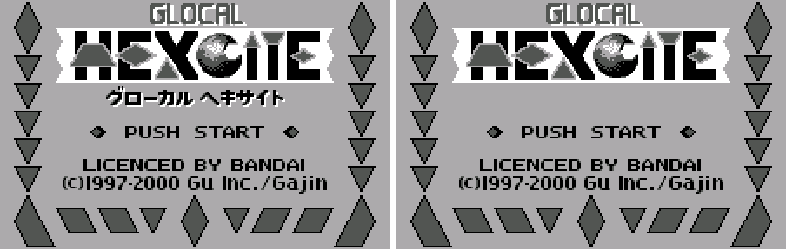
2. Main menu

   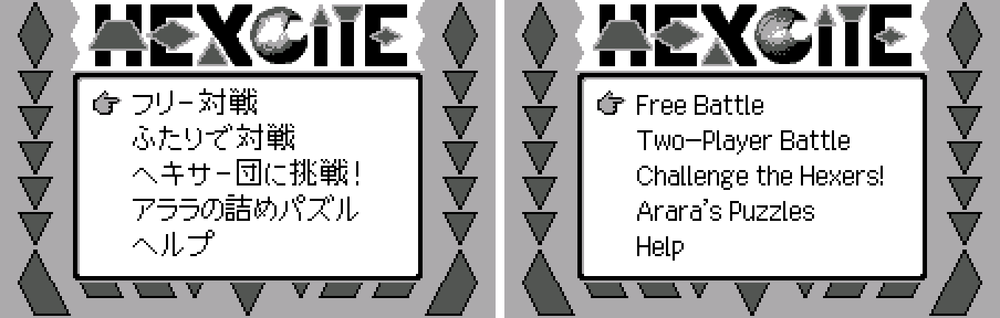
3. Free Battle settings

   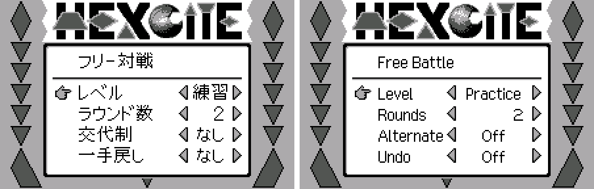
4. Challenge the Hexers

   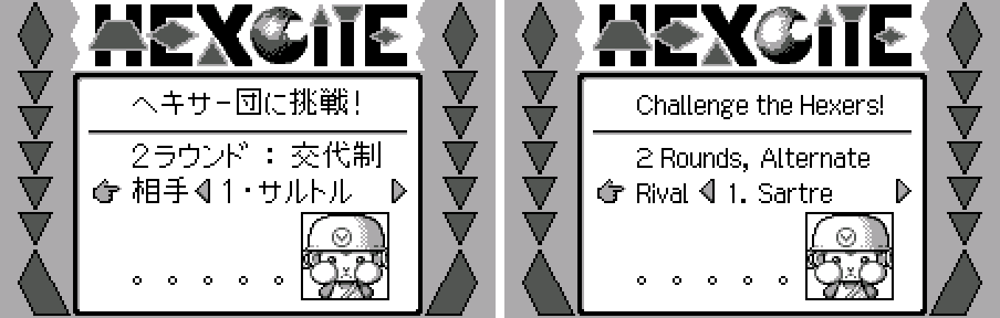
5. The gang's boss

   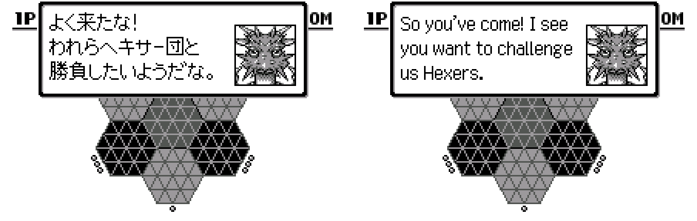
6. Sartre

   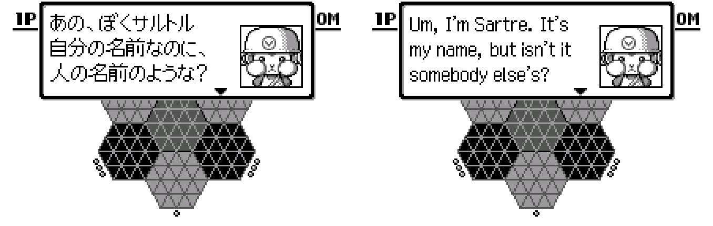
7. Arara's Puzzles

   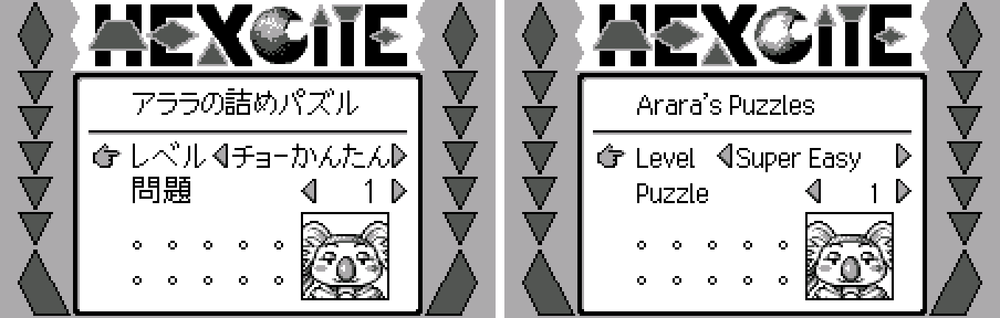
8. Starting a puzzle

   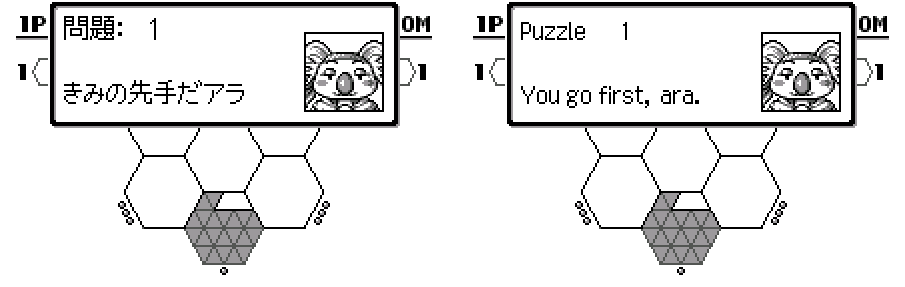
9. A wrong answer

   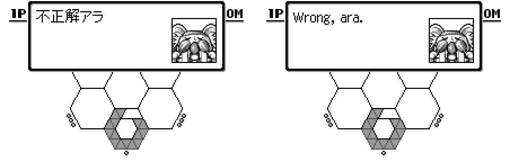
10. The hint

   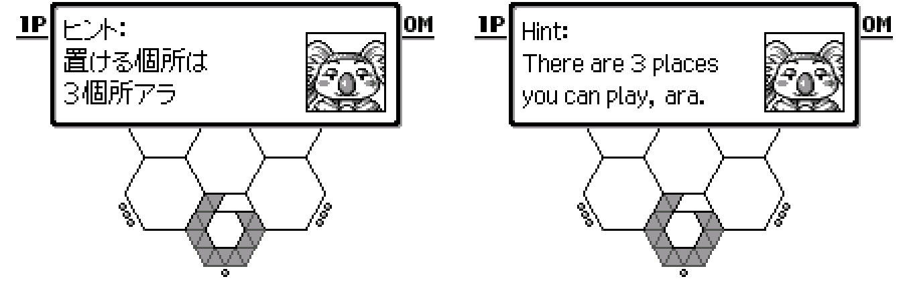
11. Powan's rules tutorial

   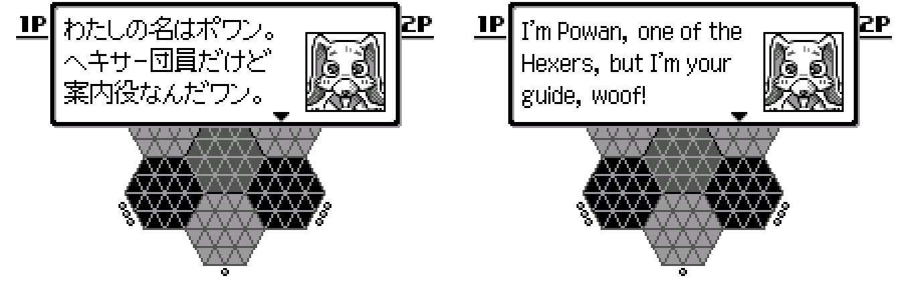
12. Other Tips

   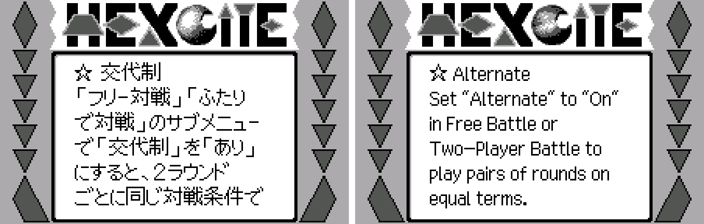
13. Staff credits

   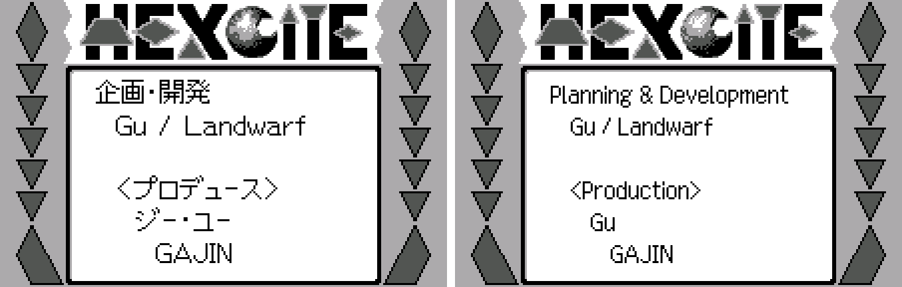
14. Sound Test edition: How to Play with Sound Test

   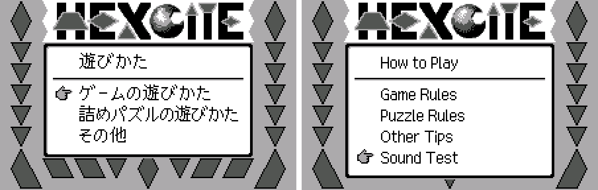

**How to patch**

Apply one of the BPS files to the Japanese ROM "Glocal Hexcite (Japan)" (CRC32 8FCD6D2C) with Floating IPS, beat or ROM Patcher JS:

* Standard: `glocal-hexcite-en-1.0.bps`, the result should be CRC32 F0738013.
* Sound Test edition: `glocal-hexcite-en-special-1.0.bps`, the result should be CRC32 887AD11F.

The ROM stays 512 KB. It's a WonderSwan (mono) game, so keep the .ws extension.

You must provide your own copy of the original Japanese game to apply it.

**Download:** `glocal-hexcite-en-1.0.bps`, `glocal-hexcite-en-special-1.0.bps` on the [release page](https://github.com/PokemonGoDB/wonderswan-english-patches/releases/tag/glocal-hexcite-v1.0).

**Known issues**

* It hasn't been played start to finish by a person. If you find leftover Japanese, cut text or a crash, please tell me where it happened.
* The "Draw" banner (a drawn match) never came up in testing; it's an English picture in the original anyway.
* One menu value is abbreviated to fit: the Free Battle level "Intermed." (Intermediate).
* The A+B+X1-X4 reset goes to the title screen, which the help page (like the Japanese) calls the menu screen.

**Technical notes (for the curious)**

* Text is 16-bit glyph codes drawn by a variable-width 16x16 font routine. The cartridge also holds two Latin-1 fonts that the Japanese game never selects; one immediate in the font-select routine switches all text to the first of them.
* All 272 strings live in one bank behind near-pointer tables; the English is written to the free end of that bank and every pointer is rewritten, so nothing else moves.
* The settings menus are built from small item records (position, width, letter spacing) and stored tilemaps for the arrows; those were widened so the English values fit, keeping the original's centring and right alignment.
* For testing, a RAM flag makes player 1 a computer player, so whole campaigns play themselves; it isn't in the patch.

**A Note On My Justifications for AI Use**

I have been an avid fan of the Wonderswan system for a very long time now. It was actually a motivating factor for my various attempts to learn Japanese (which have all failed so far). I always wanted to explore the game catalog more, but the lack of English translations made it extremely difficult to do so. Here's the thing: There's a reason many of these games have not been translated yet. It's not just the fact that Japanese > English translation is difficult. There's also the fact that the original developers used all kinds of tricks and technical feats to make these games work. Most games do not have a searchable directory of text that you can just replace with English equivalents. While some are easier than others, translations for some of these would take not only an expert in Japanese > English translation, but also someone with vast game development and programming experience.

I say all that to say: I get why people are apprehensive about AI usage for this type of thing. However, these games have been around for a very long time now and most of them have still not received a translation. I (and others) have chosen to spend our time and money to utilize AI to translate the games and actually make them playable for the wider community. If you don't agree with that, that's completely fine. I am more than happy to remove any of my translations if better, human ran translations are released at a later date. We already decided to skip any games where someone is actively working on a manual translation. While nowhere near what a manual translation effort would be, I do spend a considerable amount of time trying to work through each game's translation. I stress over small details and try my best to make the right calls. And I've probably messed some stuff up, which is why I welcome feedback.

I'm just looking forward to digging through all of these games. It's a great time to be into Wonderswan games.
