# Gomoku Narabe & Reversi: Touryuumon (WonderSwan) - AI English translation patch v1.0

**Gomoku Narabe & Reversi: Touryuumon** (五目並べ&リバーシ 登龍門) is a 2000 WonderSwan (monochrome) board-game cartridge by Sammy, released only in Japan. It holds two classic games against the computer: **Gomoku** (five in a row on a 15x15 board, with free rules or tournament **Renju** rules, where Black is barred from overlines, double threes and double fours and can start from any of the 24 standard Renju openings) and **Reversi** (with six starting layouts). Each has three levels, a Free Match, a Tournament against nine computer opponents in a row with an ending for clearing it, and a 2P Match over the link cable. *Touryuumon* (登龍門, the "dragon gate") means a gateway to success. This patch translates it into English.

> **Please read:** this translation was made **with AI** (Claude), as a hobby project. A person (me) made every judgement call before release, but nobody on the project is a professional translator. I'm sharing it as it is for anyone who wants to play. Please **don't upload it to romhacking sites** (romhacking.net and the like). It may not be up to the standard of a real fan translation and it doesn't belong there.

**What's translated**

Every word in this game is a picture, so everything was redrawn in English:

* The title logo (GOMOKU & REVERSI over TORYUMON) and the menu logo drawn in stones.
* The main menu (Free Match, Tournament, 2P Match, Settings), Match Setup (rules, level, side, Renju opening, Reversi layout) and Settings.
* All 24 Renju opening names and the six Reversi layouts.
* The game screens: 1st/2nd panels, Thinking, the pause menu (Undo, Quit, Back), "Can't play there", the pass messages, the Reversi stone tally and every result banner (five in a row, the Renju fouls, wins, losses and draws).
* The tournament (opponent list with WON badges, New Game / Continue), both endings and the staff credits.
* The message shown on a blank or reset save.
* Already English in the original and unchanged: PRESS START BUTTON, the copyright lines, COM, ON/OFF and the GOMOKU label on the board.

Names and terms: the Renju openings use the standard romanised names used in English Renju (Chosei, Kyogetsu, ... Sangetsu); long names are written over two lines (Shin- / getsu) to fit their cells. The levels are Easy / Medium / Hard. The counter word 石 ("stones") after the counts is dropped, so the tally reads "64" and "64 diff". The credits give the staff's names in Western order with their most common readings.

**How it was made: AI translation, independent checks, human decisions**

* Claude translated everything directly from the Japanese pictures and did all the hacking, including the lettering: a small pixel font in the style of the original, drawn into the game's own picture sheets.
* A separate, independent Claude reviewer checked the whole game against the Japanese (screens, text and documents); its 13 findings were verified and fixed.
* On screen, in the emulator: every screen of the game from power-on (menus, setups, both games, the Renju fouls, Reversi wins, losses and draws as both colours, passes, the pause menu), both tournaments through all nine opponents to the endings and the credits, random play from three points, and the title left alone for 10 minutes (no demo). A detector compared the Japanese lettering with every tile on screen and found none left. 2P Match was played between two linked emulators. Every screen was also compared side by side with the original, enlarged, for alignment.
* The judgement calls were listed with the Japanese, a literal reading, screenshots and the options, and I decided all 16 by hand over two rounds: the title and logos, the opening names, the levels, the banners, the dropped "stones", the endings and the credits.

**Changelog**

* **v1.0**: first release.

**Sources consulted**

* Japanese text: the WonderSwan ROM itself.
* Renju terms and the opening names: the standard English Renju names, as listed on Wikipedia's "Renju opening pattern".

**Images** (original on the left, English on the right)

1. Title screen

   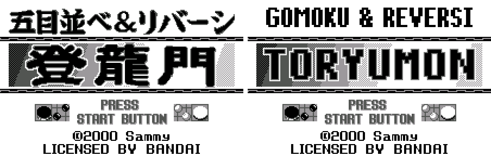

2. Main menu

   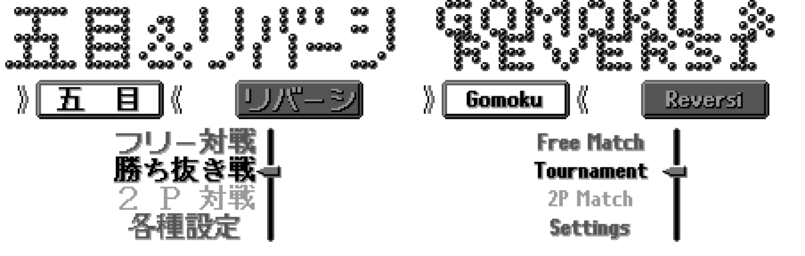

3. Match Setup (Gomoku)

   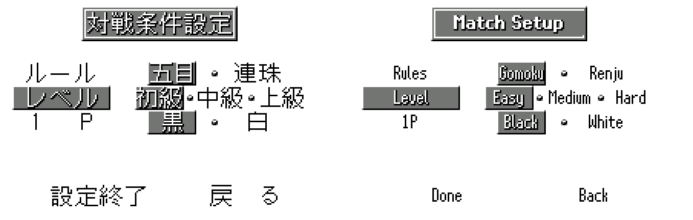

4. Match Setup (Renju, with an opening chosen)

   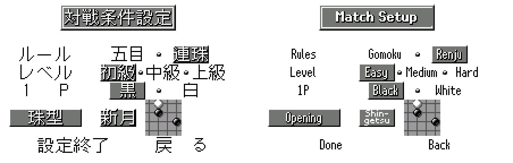

5. Choosing a Renju opening

   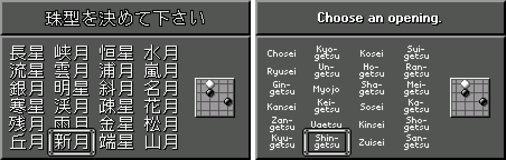

6. Settings

   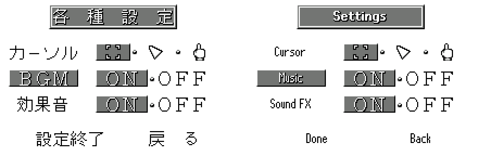

7. Choosing a Reversi layout

   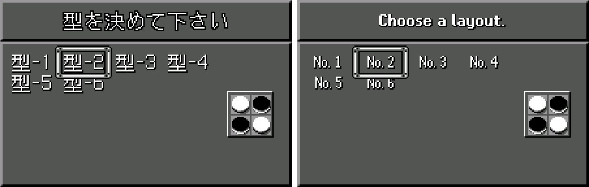

8. Five in a row

   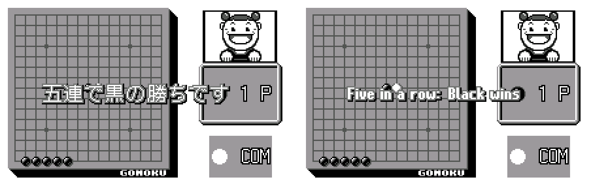

9. A Renju foul: overline

   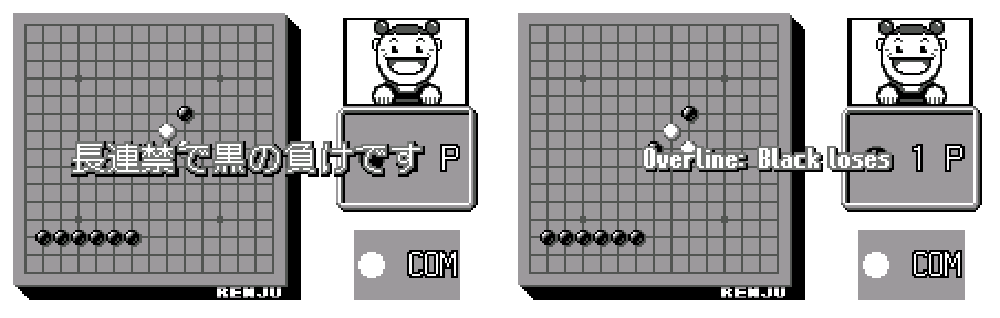

10. Reversi: can't play there

   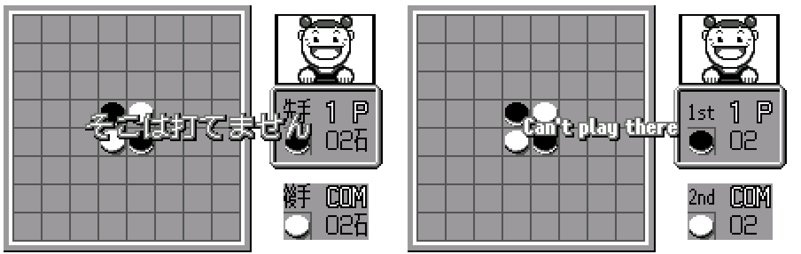

11. Reversi: the stone tally

   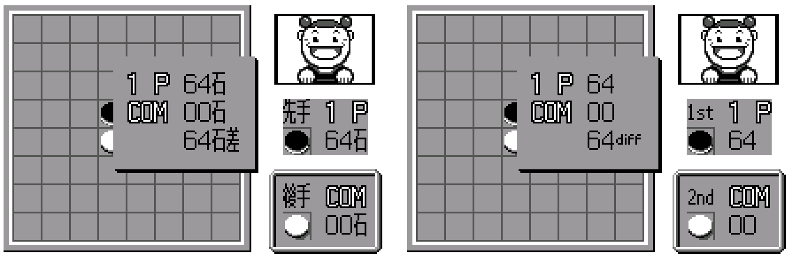

12. Reversi: the result

   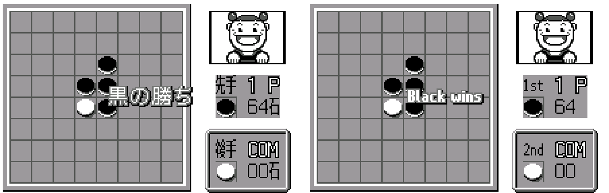

13. The pause menu

   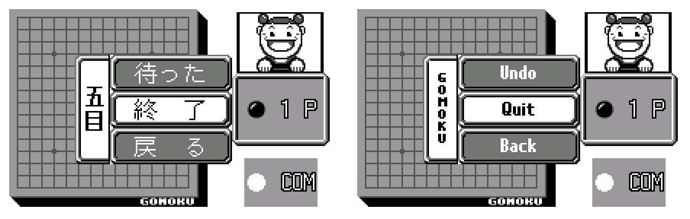

14. The tournament

   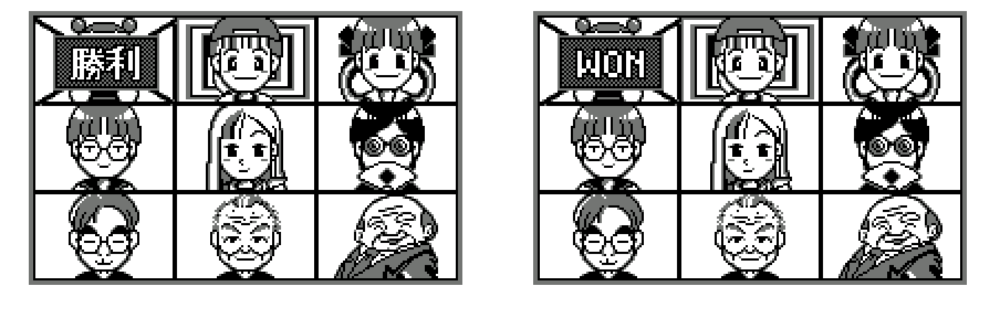

15. The ending

   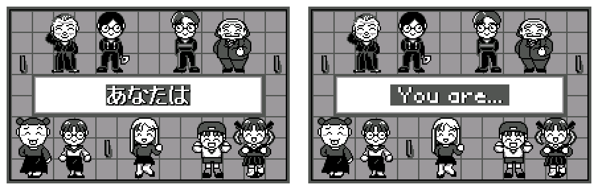

16. Staff credits

   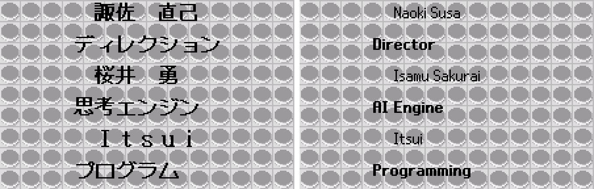

**How to patch**

Apply `gomoku-reversi-en-1.0.bps` to the Japanese ROM "Gomoku Narabe & Reversi - Touryuumon (Japan)" (CRC32 6CD1411E) in your browser with the [Swan Revival patcher](https://swanrevival.com/patcher/), or with Floating IPS, beat or ROM Patcher JS. The result should be CRC32 36BF164B.

The ROM stays 512 KB. It's a WonderSwan (mono) game, so keep the .ws extension.

You must provide your own copy of the original Japanese game to apply it.

**Download:** `gomoku-reversi-en-1.0.bps` on the [release page](https://github.com/PokemonGoDB/wonderswan-english-patches/releases/tag/gomoku-reversi-v1.0).

**Known issues**

* It hasn't been played start to finish by a person. If you find leftover Japanese, a broken picture or a crash, please tell me where it happened.
* A few banners never came up in testing and were only checked as pictures: "Black passes" and the Renju foul banners for White (they share their letters with banners that were seen).
* 2P Match was tested between two linked emulators, not on real hardware with a link cable.

**Technical notes (for the curious)**

* The game has almost no text: every word is a picture in one of 25 image resources (2-bit tiles plus a tile map), and each screen copies rectangles of those pictures into place. Only the blank-save message uses a font.
* The English is drawn into the same pictures. Only changed cells are re-tiled, and new tiles are shared wherever possible, because several screens load a whole picture sheet into 512 tile slots that were already nearly full; repeated banner halves ("Black wins", "White loses"...) are split at a fixed place so they share tiles. Pictures that grew were moved to free space and every reference to them was repointed.
* The game also copies tiles into the screen at run time, so the redrawn pictures keep those target tiles separate, and the ending text stays inside the strip the game redraws between frames.
* The cartridge contains a developer task menu (pad check, memory viewer, a console expecting a development keyboard). It helped test the endings; it isn't in the patch.

**A Note On My Justifications for AI Use**

I have been an avid fan of the Wonderswan system for a very long time now. It was actually a motivating factor for my various attempts to learn Japanese (which have all failed so far). I always wanted to explore the game catalog more, but the lack of English translations made it extremely difficult to do so. Here's the thing: There's a reason many of these games have not been translated yet. It's not just the fact that Japanese > English translation is difficult. There's also the fact that the original developers used all kinds of tricks and technical feats to make these games work. Most games do not have a searchable directory of text that you can just replace with English equivalents. While some are easier than others, translations for some of these would take not only an expert in Japanese > English translation, but also someone with vast game development and programming experience.

I say all that to say: I get why people are apprehensive about AI usage for this type of thing. However, these games have been around for a very long time now and most of them have still not received a translation. I (and others) have chosen to spend our time and money to utilize AI to translate the games and actually make them playable for the wider community. If you don't agree with that, that's completely fine. I am more than happy to remove any of my translations if better, human ran translations are released at a later date. We already decided to skip any games where someone is actively working on a manual translation. While nowhere near what a manual translation effort would be, I do spend a considerable amount of time trying to work through each game's translation. I stress over small details and try my best to make the right calls. And I've probably messed some stuff up, which is why I welcome feedback.

I'm just looking forward to digging through all of these games. It's a great time to be into Wonderswan games.
