# Goraku Ou Tango! (WonderSwan) - AI English translation patch v1.0

**Goraku Ou Tango!** (語楽王TANGO!) is Mebius's 1999 word puzzle for the original (monochrome) WonderSwan, published by Bandai and released only in Japan. Each puzzle gives you a category (home appliances, Japanese castles, rainbow colours...) and a 6x6 board of scattered letter blocks. Slide the blocks one square at a time to spell the category's words across or down, then clear them; clear every block to win. Words cross and share blocks, so the order you clear them in matters. A short adventure ties it together: Shingo, a Japanese boy on a homestay in America, sets off with the archaeologist Professor McManan's spoiled daughter Milly and his assistant Ian to search seven ruins for crystal plates and rescue the missing professor. The title is a pun: 娯楽王 "king of fun" written with 語 "word".

> **Please read:** this translation was made **with AI** (Claude), as a hobby project. A person (me) made every judgement call before release, but nobody on the project is a professional translator. I'm sharing it as it is for anyone who wants to play. Please **don't upload it to romhacking sites** (romhacking.net and the like). It may not be up to the standard of a real fan translation and it doesn't belong there.

**What's translated**

* The whole story (the opening, the thieves, the crystal tablet, the villain Ornandez and the ending), in a new proportional English font.
* Menus and messages: the title menu, file select and file delete, the pause and item menus, the bonus card screen, the save message, the status screen, the Time Attack screen and the "No moves left!" message.
* Graphics redrawn: the title logo, the eight area names on the map and stage cards, and the "how to play" demo that plays when the title is left alone.
* **All 120 puzzles, rebuilt in English** (see the next section).
* Already in English in the original and left alone: Select Card, FILE / LOAD / SAVE, BLOCK / CHAIN / BEST / TIME / NEW RECORD, PUSH START and the staff credits.

Names: **Shingo**, **Milly**, **Ian**, **Professor McManan**, **Patricia**, Milly's mother **Fionnuala**, and the villain **Ornandez**. His snobbish thief henchman ends every sentence with "my dears" in place of the Japanese "-zansu".

**How this English version differs from the original**

Goraku Ou Tango! is a word game, so a translation cannot be one-to-one. Everything below was changed on purpose; the story, menus and game rules are otherwise the original's.

*The puzzles are adapted, not translated.* Every one of the 120 puzzles is built from Japanese words written in kana blocks, and those words cannot be swapped letter for letter. Each puzzle was rebuilt in English:

* Every category is kept, including the Japanese ones (lakes, castles, shoguns, festivals, sweets and more). Answers are the original's own words, in English where English has a name for the same thing and in romaji where it does not. Where an original answer is too long for the six-block board, another member of the same category takes its place.
* Each puzzle was tuned against the original to match its size, the room to slide blocks and how much the starting board gives away, and every puzzle was solved in the game.
* English words are longer than kana words, so most puzzles hold a few fewer words, and fewer blocks shared between two words, than the Japanese ones.
* The original mixes look-alike blocks, the same sound written in hiragana and katakana or with and without the voicing marks, which you must not mix up. That trick has no English counterpart and is not in this version.
* Answers are as of 1999, when the game came out (for example the French franc, and Japan's 1999 ministries and bullet trains).

*Other changes*

* Title logo: the three kanji 語楽王 above TANGO! now read WORD / PLAY / KING (their meaning), and the katakana line under the logo is the title's reading, GORAKU-OH TANGO.
* Demo: the "how to play" demo spells CAT in the category ANIMALS instead of タンゴ (tango, "word") in the category TANGO.
* Pause menu: item names are shortened to fit (1000 Pts, 5000 Pts, Clear, Hammer, Undo); the bonus card screen still names them in full.
* Wordplay: the villain Ornandez's name joke is a new English pun, Fionnuala's ghost joke gets one extra line so it makes sense in English (Japanese ghosts have no legs), and the thief's "-zansu" is "my dears".

**How it was made: AI translation, independent checks, human decisions**

* Claude translated everything directly from the Japanese in the ROM and did all the hacking: a new text renderer for the story and the menus, the rebuilt puzzle data, and the redrawn graphics.
* The 120 English puzzles were designed with a generator that places the words with their crossings, checks no word is already formed at the start, and scrambles by real block moves, so every puzzle is provably solvable. Each was compared with its Japanese original on size, room to move, crossings and how much the start gives away.
* A separate, independent Claude reviewer checked every line and every puzzle against the Japanese; its findings were verified and fixed.
* On screen: every story box drawn by the game; all 120 puzzles loaded and solved in the game; random play from eight points across the game with every character logged (no Japanese left); the full title-screen demo loop; the ending and the staff credits.
* The judgement calls were listed with the Japanese, a literal reading and the options, and I decided each one by hand over five rounds: how to adapt the puzzles, the Japanese categories, names, the logo, the jokes and the note above.

**Hidden code (we couldn't find it documented anywhere)**

On the **title screen**, press **Up, Up, Down, Down, Right, Left, Right, Left, Up, Down**. A sound plays and **Special** (Time Attack) appears in the menu. Its stage select lets you pick any area, round and puzzle. Normally Special appears only after you finish the game. We found the code in the game's program and searched Japanese cheat pages and English cheat sites without finding it (we didn't check 1999 magazines). It works the same in the English patch.

**Changelog**

* **v1.0**: first release.

**Sources consulted**

* Japanese text and puzzles: the WonderSwan ROM itself.
* Fonts: the public-domain Shinonome 12-dot font (trimmed to proportional widths) for the story, a bold style of it for menus, and the project's small pixel font for small labels.

**Images** (original on the left, English on the right)

1. Title screen

   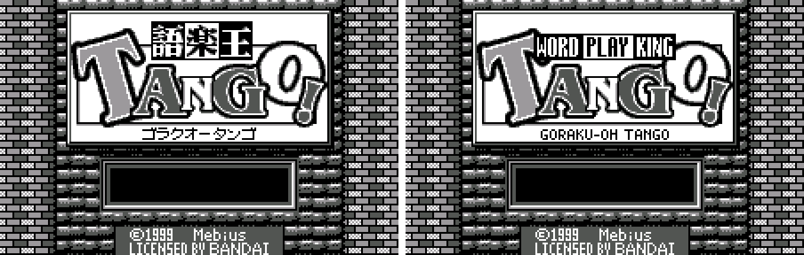

2. Title menu

   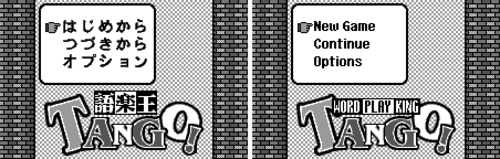

3. The "how to play" demo

   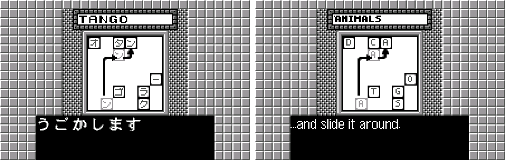

4. The opening

   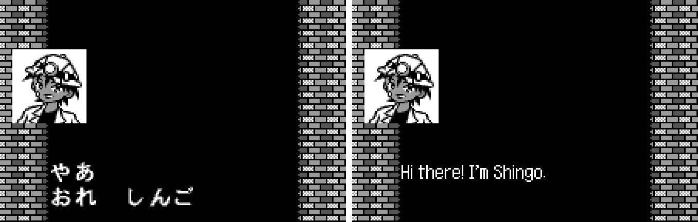

5. World map

   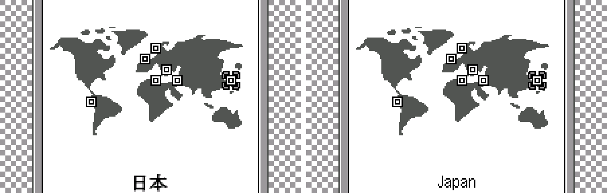

6. Puzzle 1-1, Home Appliances

   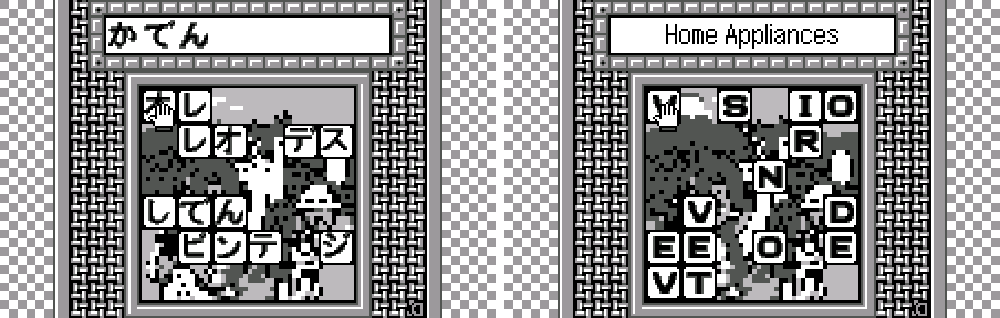

7. Pause menu: items

   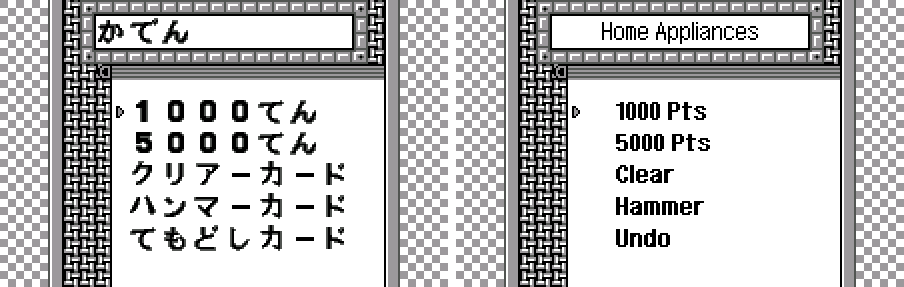

8. Bonus card screen

   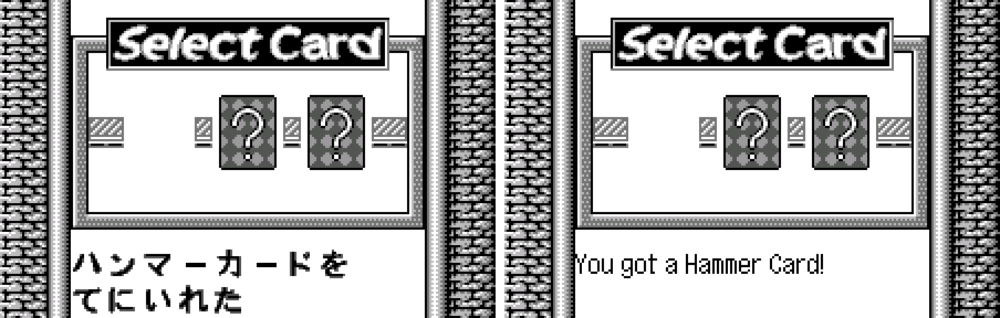

9. Continue: status

   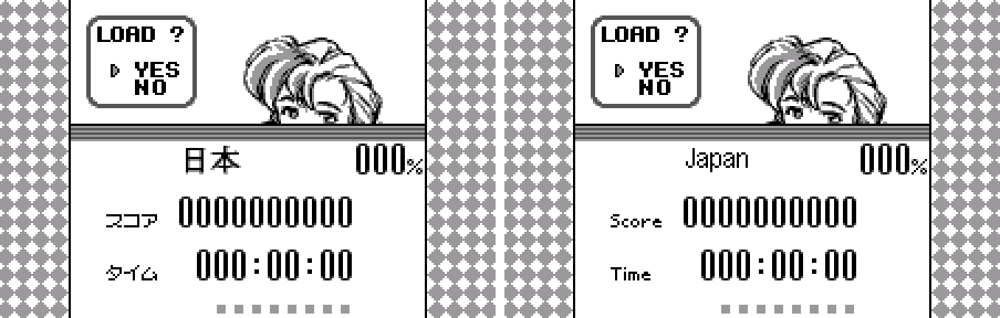

10. Time Attack (Special)

   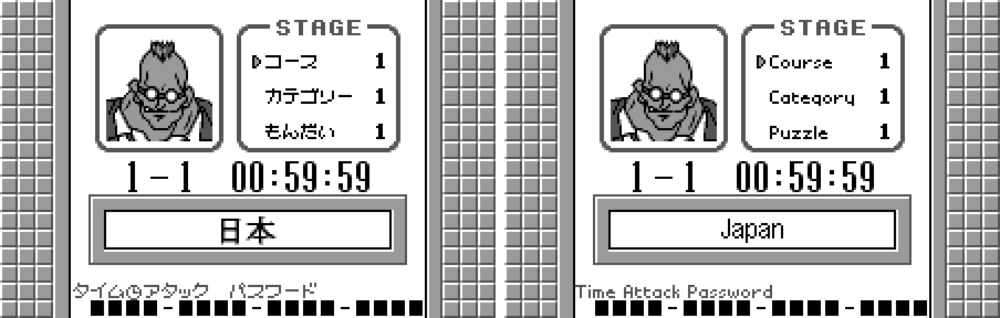

11. The ending

   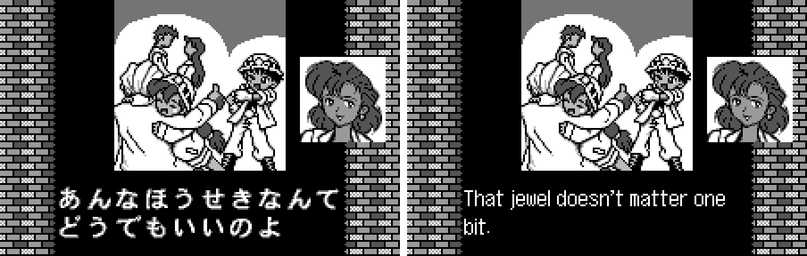

**How to patch**

Apply `goraku-ou-tango-en-1.0.bps` to the Japanese ROM "Goraku Ou Tango! (Japan)" (CRC32 00137E86) in your browser with the [Swan Revival patcher](https://swanrevival.com/patcher/), or with Floating IPS, beat or ROM Patcher JS. The result should be CRC32 76D6F197.

The ROM keeps its size (1 MB). It's a WonderSwan (mono) game, so keep the .ws extension.

You must provide your own copy of the original Japanese game to apply it.

**Download:** `goraku-ou-tango-en-1.0.bps` on the [release page](https://github.com/PokemonGoDB/wonderswan-english-patches/releases/tag/goraku-ou-tango-v1.0).

**Known issues**

* It hasn't been played start to finish by a person. If you find leftover Japanese, cut text, an unsolvable puzzle or a crash, please tell me where it happened.
* The puzzles are an adaptation: they will not play exactly like the Japanese ones (see above).

**Technical notes (for the curious)**

* The story was typed by the game one 16x16 kana at a time. The patch replaces that with a variable-width renderer that draws English letter by letter into the same text box, about 30 characters to a line.
* Menu words are pre-rendered in a bold 12-pixel font and stored as the game's own 16x16 glyph cells; the pause menu shares cells between items to fit the 24 it has room for.
* A puzzle is a category label, a list of block letters, a 6x6 starting board and a list of answer words. The game finds a word wherever its blocks read across or down, and only the first listed word at each starting square counts, so the English lists put longer words first.
* The title logo, demo pictures and screen labels are compressed tile sets; they were decoded, redrawn and recompressed, keeping the tile numbers the game's own code refers to.

**A Note On My Justifications for AI Use**

I have been an avid fan of the Wonderswan system for a very long time now. It was actually a motivating factor for my various attempts to learn Japanese (which have all failed so far). I always wanted to explore the game catalog more, but the lack of English translations made it extremely difficult to do so. Here's the thing: There's a reason many of these games have not been translated yet. It's not just the fact that Japanese > English translation is difficult. There's also the fact that the original developers used all kinds of tricks and technical feats to make these games work. Most games do not have a searchable directory of text that you can just replace with English equivalents. While some are easier than others, translations for some of these would take not only an expert in Japanese > English translation, but also someone with vast game development and programming experience.

I say all that to say: I get why people are apprehensive about AI usage for this type of thing. However, these games have been around for a very long time now and most of them have still not received a translation. I (and others) have chosen to spend our time and money to utilize AI to translate the games and actually make them playable for the wider community. If you don't agree with that, that's completely fine. I am more than happy to remove any of my translations if better, human ran translations are released at a later date. We already decided to skip any games where someone is actively working on a manual translation. While nowhere near what a manual translation effort would be, I do spend a considerable amount of time trying to work through each game's translation. I stress over small details and try my best to make the right calls. And I've probably messed some stuff up, which is why I welcome feedback.

I'm just looking forward to digging through all of these games. It's a great time to be into Wonderswan games.
