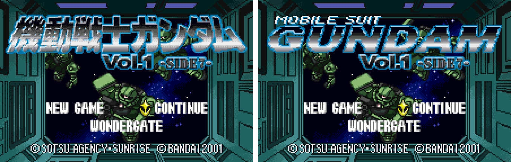
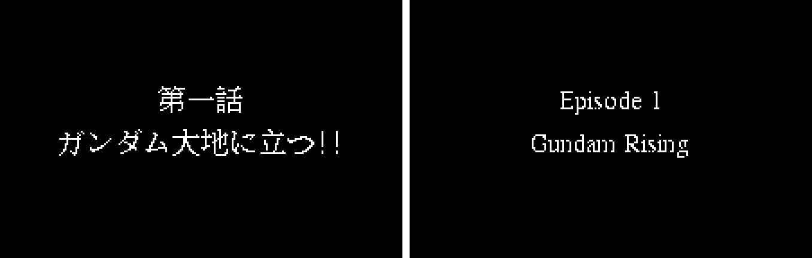
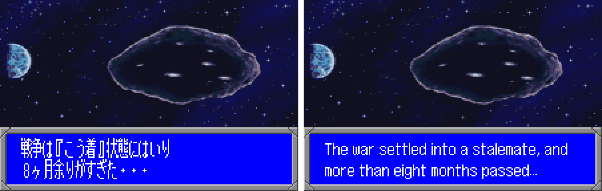
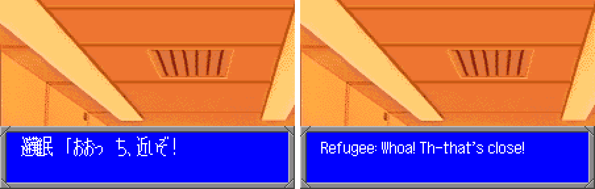
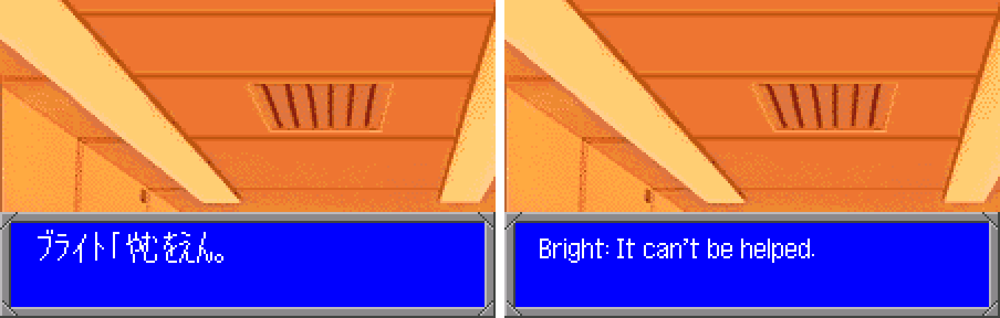
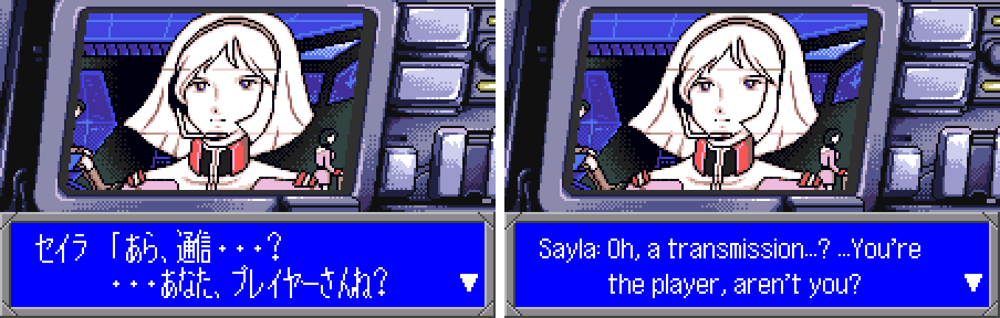
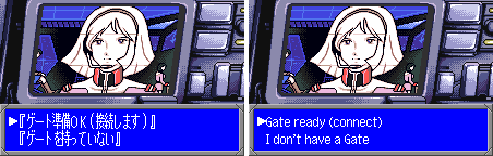
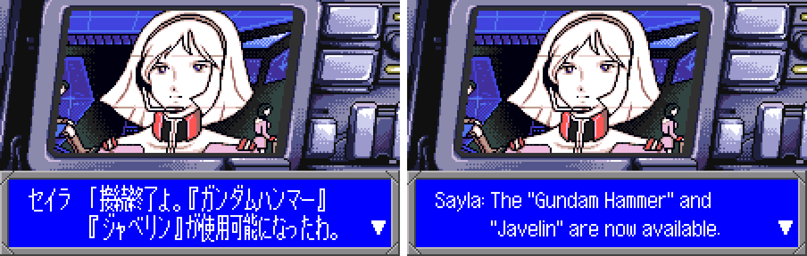
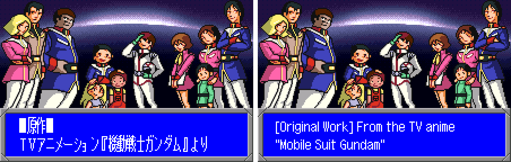

# Kidou Senshi Gundam Vol. 1: Side 7 (WonderSwan Color) - AI English translation patch v1.1

**Kidou Senshi Gundam Vol. 1: Side 7** (機動戦士ガンダム Vol.1 〜SIDE7〜, "Mobile Suit Gundam Vol. 1: Side 7") is Bandai's 2001 game for the WonderSwan Color, released only in Japan, and the first of three cartridges that retell the 1979 anime *Mobile Suit Gundam*. This one covers episodes 1-12: Zeon's raid on Side 7, Amuro Ray climbing into the Gundam, the White Base's flight to Earth and the fight with Garma Zabi. Each episode is told in story scenes, with mobile-suit battles in between, and the crew's trust in Amuro rises and falls with how he fights.

This patch translates it into English. Vol. 1, Vol. 2 and Vol. 3 each have their own patch and their own page.

> **Please read:** this translation was made **with AI** (Claude), as a hobby project. A person (me) made every judgement call before release, but nobody on the project is a professional translator. I'm sharing it as it is for anyone who wants to play. Please **don't upload it to romhacking sites** (romhacking.net and the like). It may not be up to the standard of a real fan translation and it doesn't belong there.

**What's translated**

* The whole script: every story scene and narration, the prologue, the battle chatter and the mission briefings, the ending and the staff credits.
* Every menu and prompt: the episode select and its maps, weapon help, saving and continuing.
* Everything drawn as a picture: the title logo (MOBILE SUIT GUNDAM), the 12 episode title cards, the battle labels (commands, weapons and Amuro's mood) and the results screen after each episode.
* WonderGate: Sayla's lines on the monitor, the connecting and error screens.

**How it was made: AI translation, independent checks, human decisions**

* Claude translated everything directly from the Japanese in the ROM and did all the hacking. The game's text engine draws English with a variable-width font, with the letters, the page breaks and the colours added to the engine; the English text is moved to free space and every reference to it is rewritten. Every picture with words in it was redrawn in the original's lettering.
* Five separate Claude reviewers checked the three games against the Japanese, packet by packet. Their findings were verified and fixed.
* On screen: every page of every story message was drawn in the game's own box, and every one of the 3,404 English rows was compared pixel for pixel with what it should look like (anything cut short, drawn over or missing would show). Random walks through menus, battles and the map looked for leftover Japanese, with sample screenshots checked by eye. The attract loop, the ending and the staff credits were seen on screen, every graphics resource was examined for lettering, and the screens were compared side by side with the original for alignment.
* Online: the WonderGate session was played for real against a private copy of Swan Revival's server, on both the original and the English ROM. It unlocks the Gundam Hammer and the Beam Javelin in both, with the same request and reply. The live server was not used for testing.
* The judgement calls (official English names, ranks and forms of address, catchphrases, the title cards, the logo) were listed with the Japanese and the options, and I decided all 30 by hand (for the three volumes together).
* English patches for these games already exist elsewhere. This is an independent translation: those patches were used only to compare which parts of the ROM they change, to make sure no text had been missed. Their English wasn't read or used.

**Things to know**

* The title logo is redrawn in English (my call, after 1.0): MOBILE SUIT over GUNDAM, in the original logo's colours, outline and slant.
* The Gundam Hammer and the Javelin come from the WonderGate. The original's WONDERGATE item appears on the title menu as in the Japanese version.

**Changelog**

* **v1.1**: the title logo in English.
* **v1.0**: first release.

**Sources consulted**

* Japanese text: the WonderSwan Color ROM itself.
* Names: Bandai's official English spellings (its English Gundam Card Game database), and the English dub's episode titles for the title cards. A few minor characters have no official English spelling; theirs are ours.
* WonderGate behaviour: the game's code and Swan Revival's server.

**Images** (original on the left, English on the right)

1. Title screen

   

2. Episode title card

   

3. The prologue

   

4. Side 7 under attack

   

5. Bright

   

6. WonderGate: Sayla on the monitor

   

7. WonderGate: the choice

   

8. WonderGate: the Gundam Hammer and the Javelin unlocked

   

9. The staff credits

   

**How to patch**

Apply `gundam-vol1-side7-en-1.1.bps` to the Japanese ROM "Kidou Senshi Gundam Vol. 1 - Side 7 (Japan)" (CRC32 08C0247B) in your browser with the [Swan Revival patcher](https://swanrevival.com/patcher/), or with Floating IPS, beat or ROM Patcher JS. The result is a 4 MB ROM with CRC32 19AC67B5 (SHA-1 5f3b81c2f7459b602fecb621d288cf4ddf5e640f).

It's a WonderSwan Color game, so keep the .wsc extension. You must provide your own copy of the original Japanese game to apply it.

**Download:** `gundam-vol1-side7-en-1.1.bps` on the [release page](https://github.com/PokemonGoDB/wonderswan-english-patches/releases/tag/gundam-vol1-side7-v1.1).

**Known issues**

* It hasn't been played start to finish by a person. Episode 1 was played through (with a bot for the sniping event), battles were played with tools that keep Amuro alive, and the ending and staff credits were seen on screen; the text of every other episode was checked in the game's own box.
* Bandai's WonderGate server is long gone. Swan Revival's server supports this game's WonderGate features.
* If you find leftover Japanese or anything broken, please tell me where it happened.

**Technical notes (for the curious)**

* The game's dialogue renderer was extended to draw English letters with variable widths. Two English letters share one of the game's two-byte text units, and frequent words are stored once and referenced by code, so the English fits in the free space without growing the ROM.
* Where the English needs more rows than the Japanese page, the text continues on an added page with its own wait, which the game's scripts never mistake for the end of a message.
* The episode title cards and the labelled panels are pictures. Each was redrawn and cut back into the game's own tiles, within the number of tiles the original reserves.

**A Note On My Justifications for AI Use**

I have been an avid fan of the Wonderswan system for a very long time now. It was actually a motivating factor for my various attempts to learn Japanese (which have all failed so far). I always wanted to explore the game catalog more, but the lack of English translations made it extremely difficult to do so. Here's the thing: There's a reason many of these games have not been translated yet. It's not just the fact that Japanese > English translation is difficult. There's also the fact that the original developers used all kinds of tricks and technical feats to make these games work. Most games do not have a searchable directory of text that you can just replace with English equivalents. While some are easier than others, translations for some of these would take not only an expert in Japanese > English translation, but also someone with vast game development and programming experience.

I say all that to say: I get why people are apprehensive about AI usage for this type of thing. However, these games have been around for a very long time now and most of them have still not received a translation. I (and others) have chosen to spend our time and money to utilize AI to translate the games and actually make them playable for the wider community. If you don't agree with that, that's completely fine. I am more than happy to remove any of my translations if better, human ran translations are released at a later date. We already decided to skip any games where someone is actively working on a manual translation. While nowhere near what a manual translation effort would be, I do spend a considerable amount of time trying to work through each game's translation. I stress over small details and try my best to make the right calls. And I've probably messed some stuff up, which is why I welcome feedback.

I'm just looking forward to digging through all of these games. It's a great time to be into Wonderswan games.
