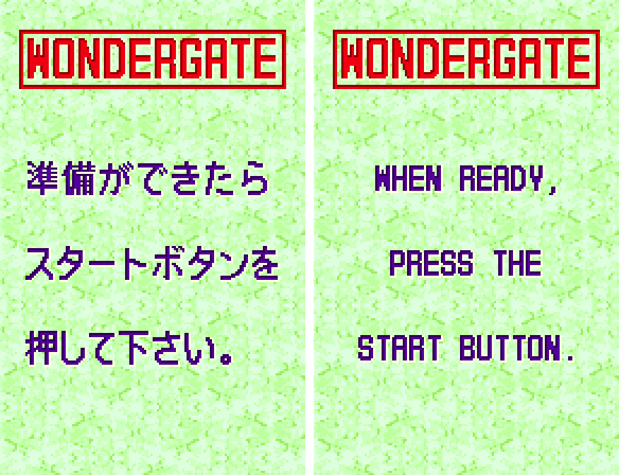
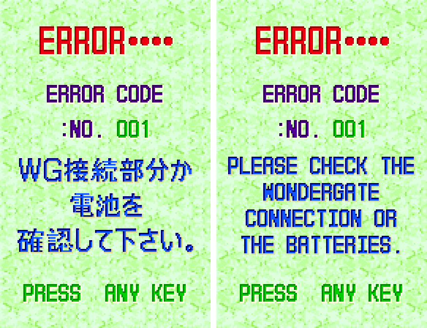
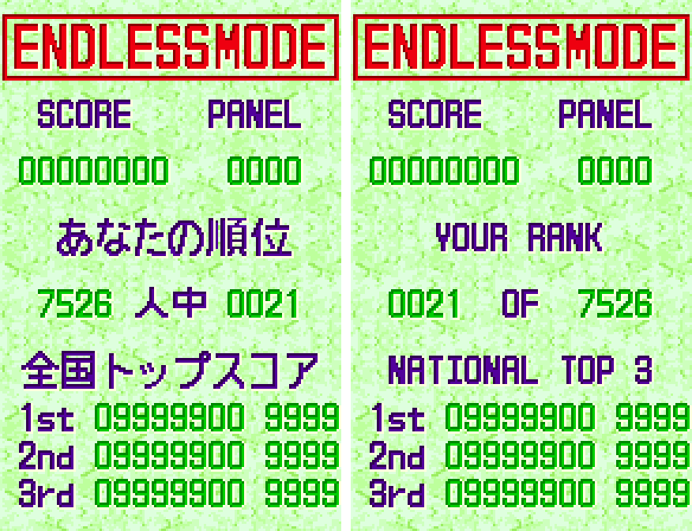
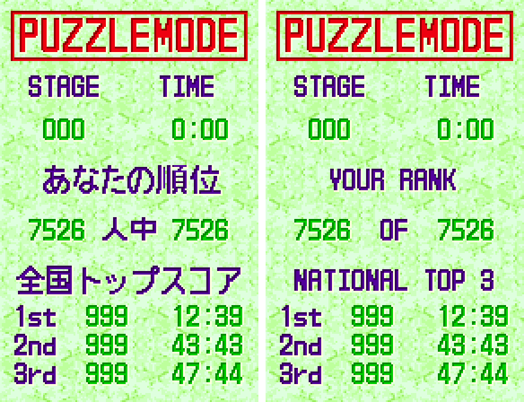
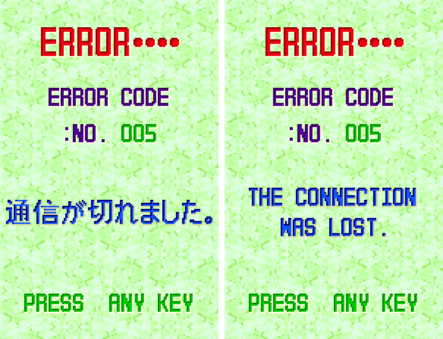
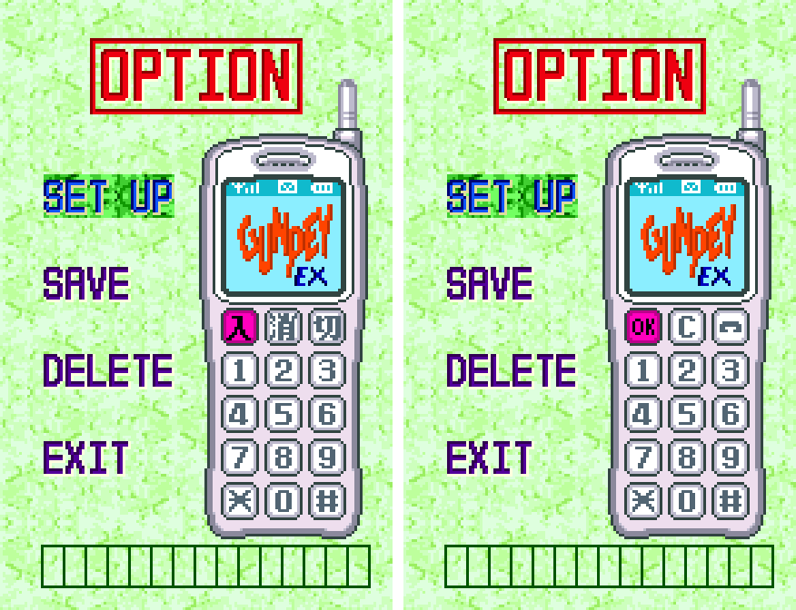
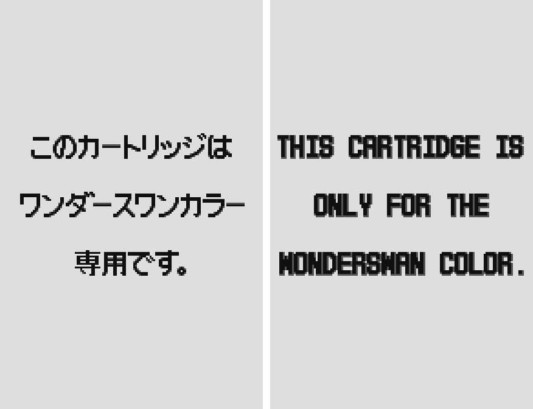

# GunPey EX (WonderSwan Color) - AI English translation patch v1.0

**GunPey EX** is the WonderSwan Color sequel to GunPey, the puzzle game named after the WonderSwan's designer Gunpei Yokoi, released by Bandai only in Japan in December 2000. You swap panels up and down a grid to join their line pieces into paths that run from one side to the other, which clears them. It has five single-player modes (Endless, Stage, Puzzle, Time Attack and Free), two-player link-cable battles, and a national ranking through Bandai's Mobile WonderGate phone adapter.

This patch translates it into English.

> **Please read:** this translation was made **with AI** (Claude), as a hobby project. A person (me) made every judgement call before release, but nobody on the project is a professional translator. I'm sharing it as it is for anyone who wants to play. Please **don't upload it to romhacking sites** (romhacking.net and the like). It may not be up to the standard of a real fan translation and it doesn't belong there.

**What's translated**

The game itself was already in English. Everything Japanese in it is a picture, and every one of those pictures is redrawn:

* **WonderGate:** the prompt before connecting, all four error messages (check the adapter or batteries, check the phone, connection lost, see the manual), and the three Japanese lines on the five national ranking screens: YOUR RANK, the rank line ("0021 OF 7526", reordered so your rank comes first) and NATIONAL TOP 3.
* **WonderGate OPTION:** the three Japanese keys on the phone keypad (OK, C and a hang-up handset).
* **The warning a black-and-white WonderSwan shows**, since this cartridge only works on a WonderSwan Color.
* Left as it is: the game's own English, including its "PLEASE WAITING".

**WonderGate works again**

Bandai's ranking server closed in 2001-2003. Swan Revival (swanrevival.com), the community's WonderGate revival, has GunPey EX online in testing: the game uploads your best results for all five modes and shows your national rank and the top three, now in English.

**How it was made: AI translation, independent checks, human decisions**

* Claude rendered every graphic and every screen layout in the 1 MB ROM to find the Japanese, and redrew it in the game's own 8x16 capital letters, with the same colours and shading.
* A separate, independent Claude reviewer read the whole patch against the Japanese; it found no translation errors, and its other findings were verified and fixed.
* On screen, every translated screen was checked on both ROMs: no Japanese tile is left on the English build (the same check finds it on the original), and every line is centred and clear of the frames and numbers. All five modes, the stage and puzzle clears, the Puzzle ending, the records and two-player link play (the English build linked with an original cartridge too) were played through as well, and the title screen was left running for six minutes.
* Online: the WonderGate session was played for real against a private copy of Swan Revival's server on both the original and the English ROM, with thousands of test players in the rankings: the upload, the server's reply, the ranking screens and a real connection error behave the same on both. The live server was not used for testing.
* The judgement calls (the rank line, the wording of the headings and errors, the key labels, the capital letters) were listed with the Japanese, a literal reading and the options, and I decided all 7 by hand.

**Changelog**

* **v1.0**: first release.

**Sources consulted**

* Japanese text: the WonderSwan Color ROM itself.
* WonderGate behaviour: the game's code and Swan Revival's notes on this game.
* Lettering: the game's own capital letters (a comma, quotes, an apostrophe, a slash and "!" added in the same style).

**Images** (original on the left, English on the right)

1. WonderGate: before connecting

   

2. WonderGate: error 001 (what a player without the adapter sees)

   

3. WonderGate: Endless ranking from a real session

   

4. WonderGate: Puzzle ranking from a real session

   

5. WonderGate: connection lost (a real connection error)

   

6. WonderGate OPTION: the phone keypad

   

7. The warning on a black-and-white WonderSwan

   

**How to patch**

Apply `gunpey-ex-en-1.0.bps` to the Japanese ROM "GunPey EX (Japan)" (CRC32 0C9CB12C) in your browser with the [Swan Revival patcher](https://swanrevival.com/patcher/), or with Floating IPS, beat or ROM Patcher JS. The result should be CRC32 16998248.

The patched ROM is the same size as the original (1 MB). It's a WonderSwan Color game, so keep the .wsc extension.

You must provide your own copy of the original Japanese game to apply it.

**Download:** `gunpey-ex-en-1.0.bps` on the [release page](https://github.com/PokemonGoDB/wonderswan-english-patches/releases/tag/gunpey-ex-v1.0).

**Known issues**

* It hasn't been played start to finish by a person. If you find leftover Japanese or anything broken, please tell me where it happened.
* The error messages other than 001 and 005 were checked with test values; the revival's adapter can't fail in those ways. The "check the phone" message is almost never shown by the game itself.
* The OK key on the phone keypad is drawn with thinner strokes than the digits; there are only 8 pixels.
* With very high scores, the top-three rows run to the right edge of the screen, as in the original.

**Technical notes (for the curious)**

* Every Japanese word in the game is a picture in one of three tile sets (the WonderGate screens, the OPTION phone, the black-and-white warning). The English is lettered to the pixel at build time and written into tiles that only the Japanese used; the game's screen maps are rewritten to show it.
* The ranking screen printed the number of players before your rank (Japanese word order); a two-byte change in each of the five ranking routines prints your rank first.
* The cartridge holds a sample server reply the developers left in it, written for an earlier reply format; it is not used by the game.

**A Note On My Justifications for AI Use**

I have been an avid fan of the Wonderswan system for a very long time now. It was actually a motivating factor for my various attempts to learn Japanese (which have all failed so far). I always wanted to explore the game catalog more, but the lack of English translations made it extremely difficult to do so. Here's the thing: There's a reason many of these games have not been translated yet. It's not just the fact that Japanese > English translation is difficult. There's also the fact that the original developers used all kinds of tricks and technical feats to make these games work. Most games do not have a searchable directory of text that you can just replace with English equivalents. While some are easier than others, translations for some of these would take not only an expert in Japanese > English translation, but also someone with vast game development and programming experience.

I say all that to say: I get why people are apprehensive about AI usage for this type of thing. However, these games have been around for a very long time now and most of them have still not received a translation. I (and others) have chosen to spend our time and money to utilize AI to translate the games and actually make them playable for the wider community. If you don't agree with that, that's completely fine. I am more than happy to remove any of my translations if better, human ran translations are released at a later date. We already decided to skip any games where someone is actively working on a manual translation. While nowhere near what a manual translation effort would be, I do spend a considerable amount of time trying to work through each game's translation. I stress over small details and try my best to make the right calls. And I've probably messed some stuff up, which is why I welcome feedback.

I'm just looking forward to digging through all of these games. It's a great time to be into Wonderswan games.
