# Hanafuda Shiyouyo (WonderSwan) - AI English translation patch v1.0

**Hanafuda Shiyouyo** (花札しようよ, "Let's play hanafuda") is Success's 2000 hanafuda game for the original (monochrome) WonderSwan, licensed by Bandai and released only in Japan. It has the two classic games: **Koi-Koi**, one on one against the computer (6 rounds, 12 rounds or no limit), and **Hana-Awase**, three players (you and two computer opponents) scored against the 88-point par. Each game has its own house rules (Moon/Flower viewing yaku, Oya-Ken, the rain set, Fuke), and with a link cable two players can play either game against each other.

The game has no text engine: every Japanese word is a picture (compressed tiles and raw tile blocks). This patch redraws all of them in English.

> **Please read:** this translation was made **with AI** (Claude), as a hobby project. A person (me) made every judgement call before release, but nobody on the project is a professional translator. I'm sharing it as it is for anyone who wants to play. Please **don't upload it to romhacking sites** (romhacking.net and the like). It may not be up to the standard of a real fan translation and it doesn't belong there.

**What's translated**

* **Title logo:** the oval now reads "Hanafuda / Let's Play!".
* **Menus:** 1-Player Game / 2-Player Match (with a link cable), New Game / Continue, Game Select, both games' Settings with every value, Choose Dealer with the Oya and Ko badges, and the pause box ("Quit to title?").
* **Play:** the Yaku Complete! popup with all 13 koi-koi and 17 hana-awase yaku, the points and Total, the Stop! / Koi-Koi choice, the captured-cards views ("Your Cards", "COM's Cards", "Rival's Cards", the short yaku list and the yaku total), and the yaku-void tag.
* **Scores:** the koi-koi score table (and its year counter in no-limit matches) and the hana-awase score sheet (Cards, Yaku, Paid, Par, Net, Total).
* **Results:** You Win! / You Lose... / Draw, the Fuke banner ("Fuke (20 Pts or Less): No Contest") and the hana-awase final ranking (Final Result, 1st/2nd/3rd Place).
* **Link play:** the same screens with "Rival" for the other player.
* Already in English in the original and left alone: PUSH START BUTTON, the copyright line, COM, YES/NO and the numbers. The calligraphy printed on the cards themselves is part of the card art and is not translated (the cards are recognised by their pictures, as on real cards).

**Terms**

Hanafuda has no official English release of this game, so the terms follow common English hanafuda usage: yaku (scoring combinations) such as Five Lights, Four Lights, Rainy Four Lights, Three Lights, Boar Deer Butterfly, Poetry Ribbons, Blue Ribbons, Ribbons, Animals, Chaff, Flower Viewing and Moon Viewing; for hana-awase also Wisteria / Rain / Paulownia Set, Grass Ribbons, Drinking, Sugawara, Pine, Paulownia & Moon, Six and Seven Ribbons. Koi-Koi and Hana-Awase keep their names. The dealer is Oya and the other player Ko, and the house rule 親権 is Oya-Ken. Fuke also keeps its Japanese name, and the banner says what it means: a player who ends a hana-awase round with 20 points or less makes the round no contest. The score units 文 (mon) and 点 are both "pt".

**How it was made: AI translation, independent checks, human decisions**

* Claude found every text picture in the ROM (55 compressed tile sets, 6 raw tile blocks and the two yaku name tables), redrew them in English and did all the hacking: re-tiling maps within each screen's tile budget, moving grown data to free space and repointing it, new name tiles for the card views, and the final ranking laid out as one line across two pictures.
* A separate, independent Claude reviewer checked every word and screen against the Japanese; its findings were verified and fixed.
* On screen: every screen was played on the English ROM and compared side by side with the original; a coverage check confirms that no Japanese tile is left in the English build; random play from power-on (three runs of 60,000 frames, about 13 minutes each) and about 10 minutes of idling at the title found no Japanese tile on screen (the same check on the original finds hundreds); every yaku name was shown in its real popup, also with the widest value (200); every text was measured for centring and clearance against the original.
* Link play was played on two emulators joined by a virtual link cable: both consoles through the 2-Player Match menu, koi-koi and hana-awase, the views, the score table and the match result, with the same Japanese check on both screens.
* The judgement calls were listed with the Japanese, a literal reading and the options, and I decided all 17 by hand over three rounds: the logo, the yaku names, the units, the dealer and rule names, Fuke, the score sheet and view labels, the result lettering and the final ranking line.

**Changelog**

* **v1.0**: first release.

**Sources consulted**

* Japanese text: the WonderSwan ROM itself (all of it is in pictures).
* Hanafuda terms and rules: English Wikipedia (Koi-Koi, Hanafuda), pagat.com and Board Game Arena (hachi-hachi), Japanese Wikipedia (花合わせ) for the hana-awase yaku and the Fuke rule.
* Lettering: Shinonome 12-dot (public domain) and the project's 8 px font for menus and labels, Kalam Bold (SIL Open Font License) for the logo and the big result lettering.

**Images** (original on the left, English on the right)

1. Title screen

   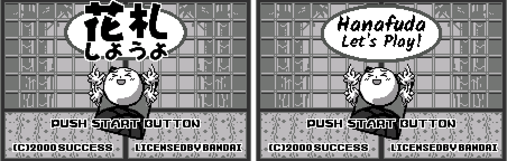

2. Main menu with a link cable connected

   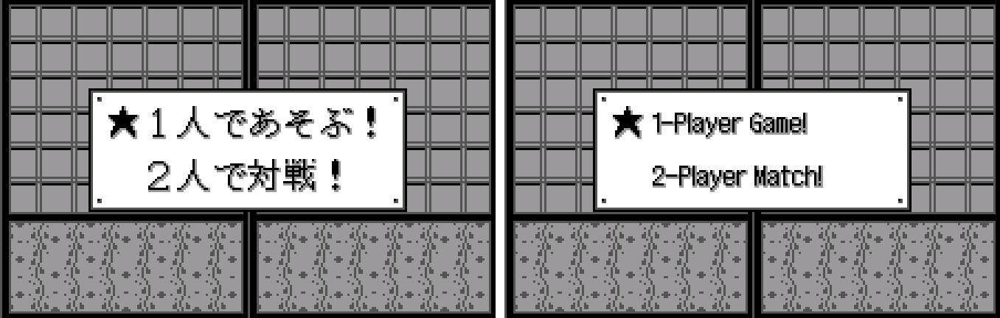

3. Game Select

   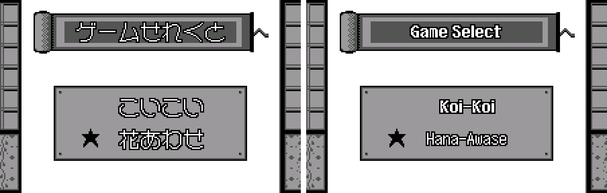

4. Koi-Koi settings

   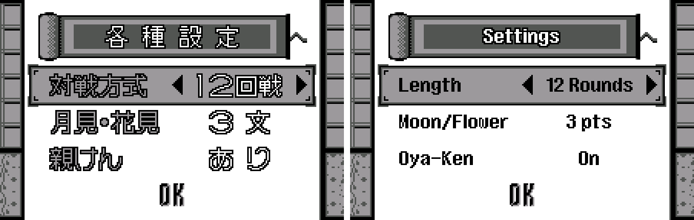

5. Hana-Awase settings

   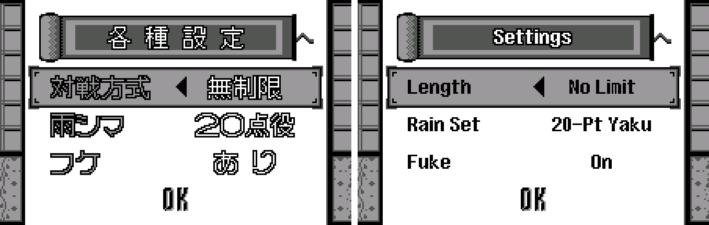

6. Choose Dealer

   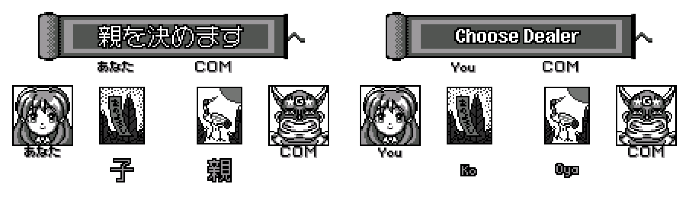

7. Yaku popup: Stop! or Koi-Koi

   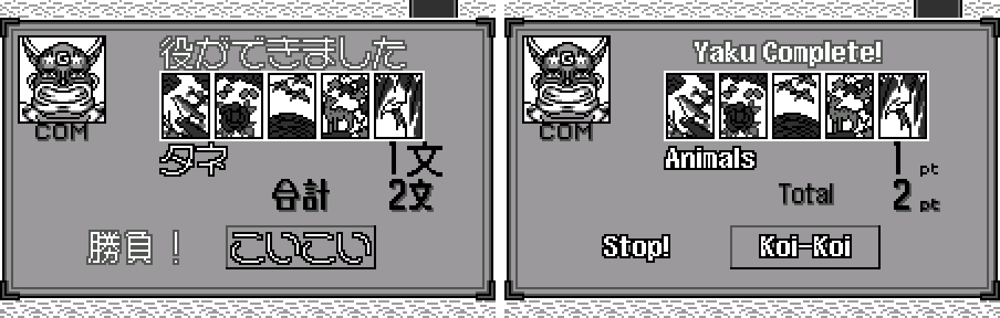

8. Koi-Koi score table

   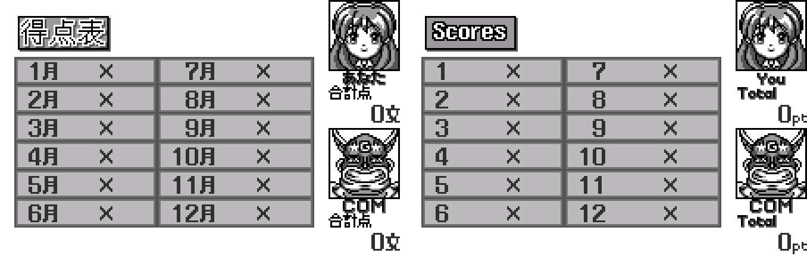

9. Captured cards

   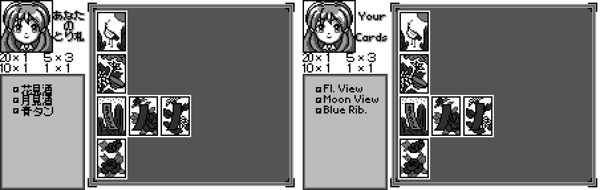

10. Pause

   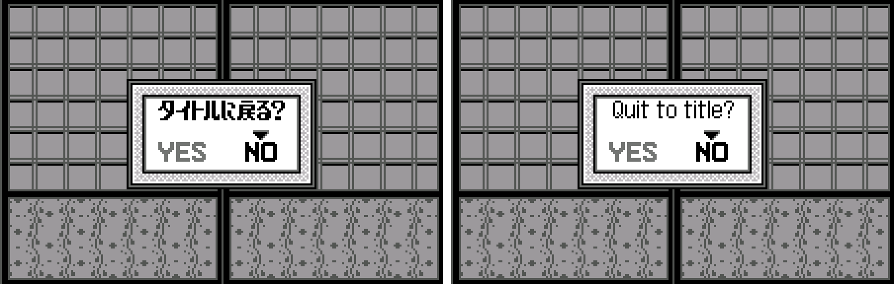

11. You Win!

   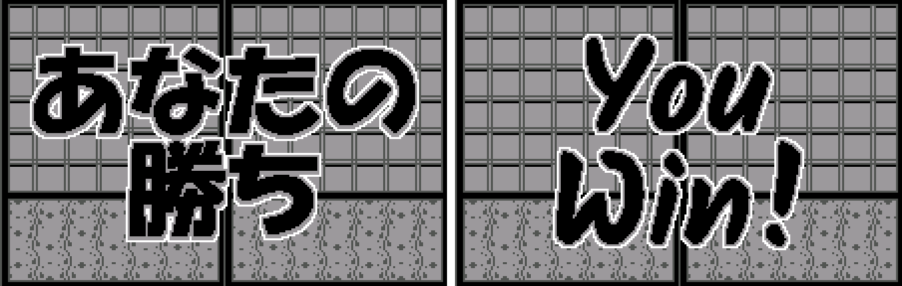

12. Hana-Awase yaku popup

   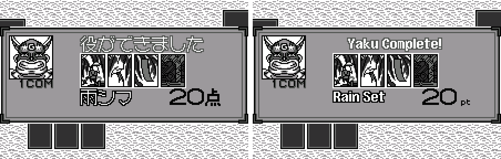

13. Hana-Awase score sheet

   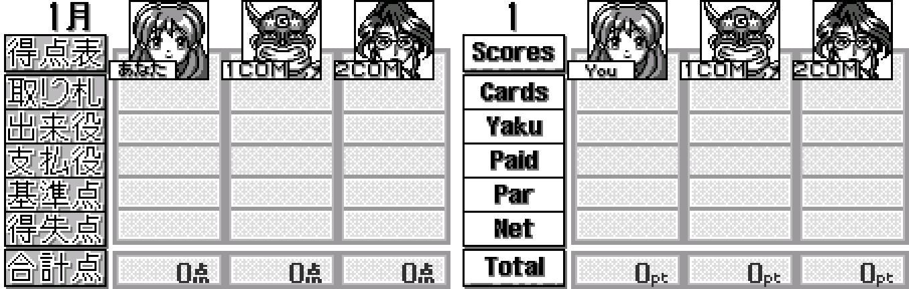

14. Fuke: No Contest

   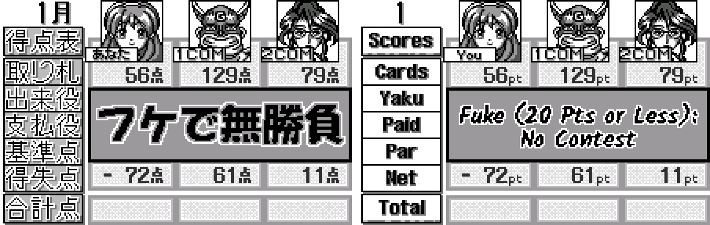

15. Final ranking

   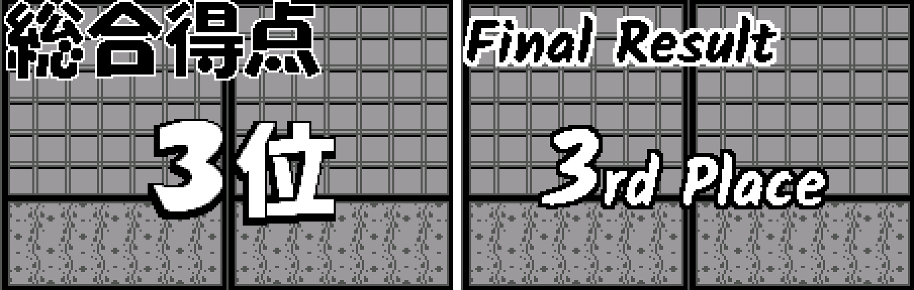

16. Link play: choosing the dealer (You and Rival)

   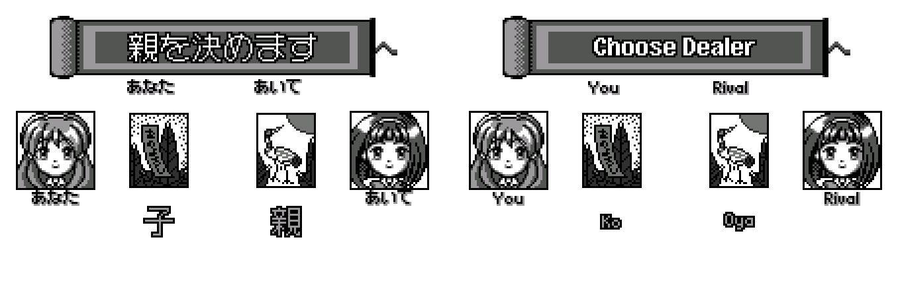

**How to patch**

Apply the BPS file to the Japanese ROM "Hanafuda Shiyouyo (Japan)" (CRC32 8E027330) in your browser with the [Swan Revival patcher](https://swanrevival.com/patcher/), or with Floating IPS, beat or ROM Patcher JS: `hanafuda-shiyouyo-en-1.0.bps`, the result should be CRC32 496B1FB2.

The ROM keeps its size (512 KB). It's a WonderSwan (mono) game, so keep the .ws extension.

You must provide your own copy of the original Japanese game to apply it.

**Download:** `hanafuda-shiyouyo-en-1.0.bps` on the [release page](https://github.com/PokemonGoDB/wonderswan-english-patches/releases/tag/hanafuda-shiyouyo-v1.0).

**Known issues**

* It hasn't been played start to finish by a person. If you find leftover Japanese or anything broken, please tell me where it happened.
* Link play was tested with two emulators joined by a virtual cable, not on two real WonderSwans with a cable.
* The calligraphy on the cards is not translated (it is part of the card art).
* Short spaces force a few abbreviations in the captured-cards list (for example "Fl. View", "Blue Rib.", "Pine-Paul.").

**Technical notes (for the curious)**

* The text pictures are LZ-compressed tile sets and maps (a 2-bit tile format with a tile-count or width/height header), plus raw tile blocks that code places one tile at a time (labels, units, name plates). Each was redrawn into its own tile budget; some grew and moved to free space with every pointer to them updated.
* The yaku names are tile strips listed in two tables (one per game) with their widths; the koi-koi strips are 6 tiles, the hana-awase ones as wide as each name.
* The card views and the score tables used to share the same "You" and 合計点 tiles; the views now get their own copies, so "Your Cards" and "Yaku … pt" don't change the other screens.
* Link play: the game sends 7-byte packets with a checksum and an acknowledge byte over the serial port. To test it, two emulator cores were joined port to port (that needed the core's transmit interrupt to behave like the hardware).
* The patched ROM's header checksum is updated.

**A Note On My Justifications for AI Use**

I have been an avid fan of the Wonderswan system for a very long time now. It was actually a motivating factor for my various attempts to learn Japanese (which have all failed so far). I always wanted to explore the game catalog more, but the lack of English translations made it extremely difficult to do so. Here's the thing: There's a reason many of these games have not been translated yet. It's not just the fact that Japanese > English translation is difficult. There's also the fact that the original developers used all kinds of tricks and technical feats to make these games work. Most games do not have a searchable directory of text that you can just replace with English equivalents. While some are easier than others, translations for some of these would take not only an expert in Japanese > English translation, but also someone with vast game development and programming experience.

I say all that to say: I get why people are apprehensive about AI usage for this type of thing. However, these games have been around for a very long time now and most of them have still not received a translation. I (and others) have chosen to spend our time and money to utilize AI to translate the games and actually make them playable for the wider community. If you don't agree with that, that's completely fine. I am more than happy to remove any of my translations if better, human ran translations are released at a later date. We already decided to skip any games where someone is actively working on a manual translation. While nowhere near what a manual translation effort would be, I do spend a considerable amount of time trying to work through each game's translation. I stress over small details and try my best to make the right calls. And I've probably messed some stuff up, which is why I welcome feedback.

I'm just looking forward to digging through all of these games. It's a great time to be into Wonderswan games.
