# Harobots (WonderSwan) - AI English translation patch v1.0 (+ special edition)

**Harobots** (ハロボッツ) is Sunrise Interactive's 1999 robot-raising RPG for the original (monochrome) WonderSwan, released only in Japan. Haro, the ball-shaped robot from *Mobile Suit Gundam*, is everyone's pet in this world, and with the right robot data a Haro can "Harobots Change" into robots from Sunrise anime (Dougram, VOTOMS, Dunbine, L-Gaim, Layzner, the Brave series, Escaflowne and more, 106 in all) for arcade battles. You play a boy who finds a stray Haro in the junkyard, trains it at the dojo, fits it with parts, combines items to unlock new robots and battles your way from town to town to the national tournament, while the expelled scientist Dr. Baro schemes to get his hands on the prototype Haro. This patch translates it into English.

> **Please read:** this translation was made **with AI** (Claude), as a hobby project. A person (me) made every judgement call before release, but nobody on the project is a professional translator. I'm sharing it as it is for anyone who wants to play. Please **don't upload it to romhacking sites** (romhacking.net and the like). It may not be up to the standard of a real fan translation and it doesn't belong there.

**What's translated**

* The whole script: the story, every town's people, the trainers' challenges, the tournament, the shop and the dojo, about 1,700 different dialogue lines.
* Menus and screens: items (106 robots' attacks and skills, item names and descriptions), status pages, parts, Robot Set, Combinize, the shop, the dojo and its courses, battles and level-ups, the save screen, the title menu, name entry with an English letter grid, and the 17 pages of staff credits.
* Graphics redrawn: the copyright screens, the shop and dojo menus, the course pages, the training screen, the mini-game titles and instructions, the result banners (GOOD JOB! / TOO BAD, drawn in the style of the original 成功 / 失敗), and the attribute marks (P S L M O).
* Left as art: the title logo (already English) and the dojo's calligraphy sign 心技一体 ("mind, technique and body as one").

Names: the hero defaults to **Noboru** and his Haro to **Haro** (you can rename both). Friends and rivals are **Youko**, **Noriko** of the Haro Lab, rich rival **Mitsuo**, **Gain**, the pickpocket **Heizou**, **Aya**, the idol **Miyako**, the farm boy **Takeo** and **Iwao**; the villain is **Dr. Baro**, and his henchmen call him "Master Baro". Robots use their official English names where they exist (English releases, Bandai and Max Factory kits), then spellings from English fan references such as the Super Robot Wars wiki, and romanizations otherwise. The five attributes are Paranormal, Science, Life, Mind and Otherworld.

**The special edition: the developers' test menu**

The developers left a test menu in the game that nothing in the original can reach. The special edition (`harobots-en-special-1.0.bps`) adds it to the title menu:

* **Opening it:** on the title screen, press START; the menu reads New Game, Continue and **Debug**. Choose Debug.
* **Using it:** one entry shows at a time. LEFT/RIGHT choose Map, Battle, Menu, Link, Sound check, From title or Ending, and A opens it. Map drops you on the town map, Battle starts a test battle, Menu opens the main menu, Ending plays the ending and the staff credits, and From title goes back to the title screen.
* **Limits:** it's the developers' leftover tool. B does nothing (use From title to leave), the Battle and Sound check numbers aren't shown on screen, and it works with whatever is in memory, so a test battle without real progress can look broken. Play the standard patch (or Continue) for the actual game.

**How it was made: AI translation, independent checks, human decisions**

* Claude translated everything directly from the Japanese in the ROM and did all the hacking: a proportional English font and printer for the menus, the English letter pairs for the dialogue, the redrawn pictures and the result banners.
* Three Claude reviewers checked every line against the Japanese, a naturalness pass was verified line by line, and a separate, independent Claude reviewer then checked the whole game, text and screenshots; its findings were verified and fixed.
* On screen: every dialogue line drawn by the game with the longest possible names, random play from fifteen points across the game with every character logged (no Japanese left), 72 screens compared side by side with the original, an alignment audit of every screen, all 17 credits pages, and the mini-game banners in play.
* The judgement calls were listed with the Japanese, a literal reading and the options, and I decided all 37 by hand over four rounds: names, item names, the banners, the special edition and more.

**Changelog**

* **v1.0**: first release.

**Sources consulted**

* Japanese text: the WonderSwan ROM itself.
* Robot names: official kit names (Bandai's Promeus Type and Durun Type, Max Factory's Wug), English releases, the Super Robot Wars wiki, English Wikipedia and a mecha wiki's list of Harobots robots.

**Images** (original on the left, English on the right)

1. Title menu

   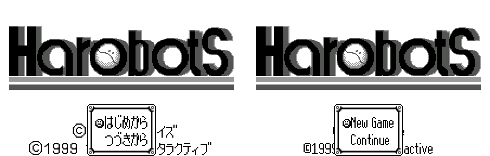

2. Name entry

   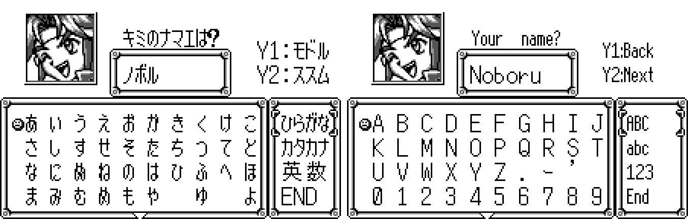

3. The shop

   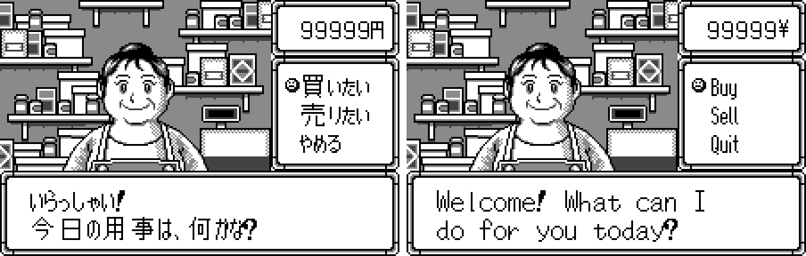

4. Main menu

   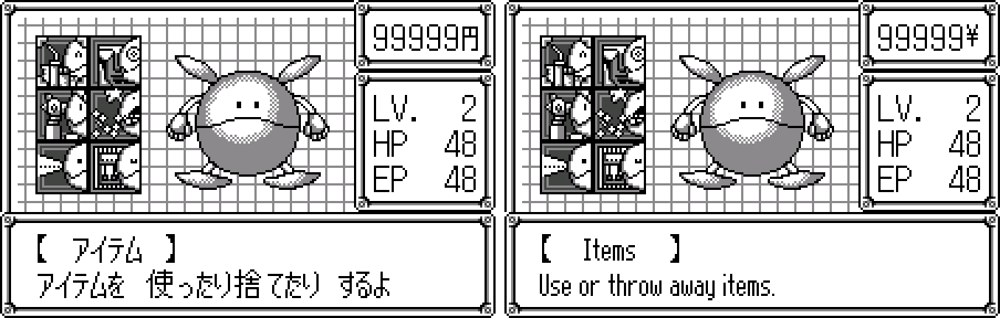

5. Status

   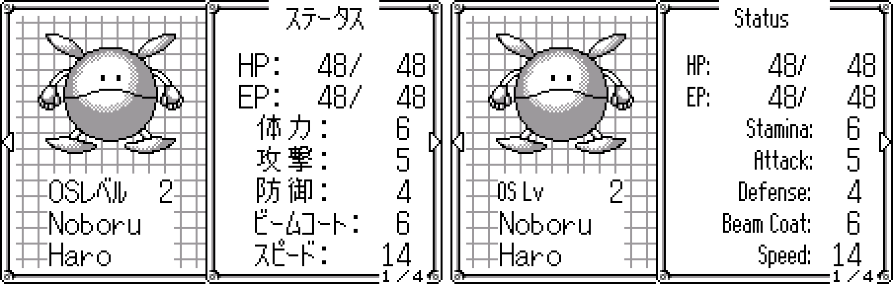

6. A robot's page

   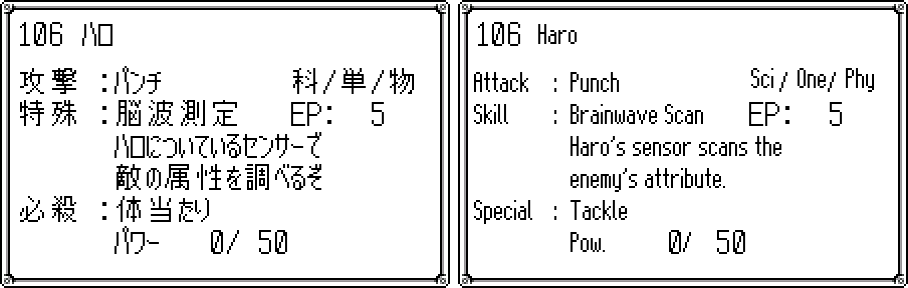

7. Combinize

   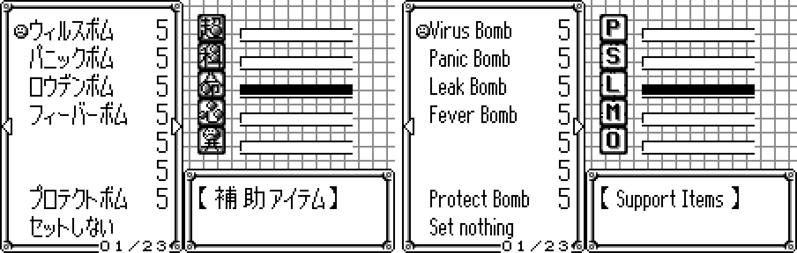

8. The dojo

   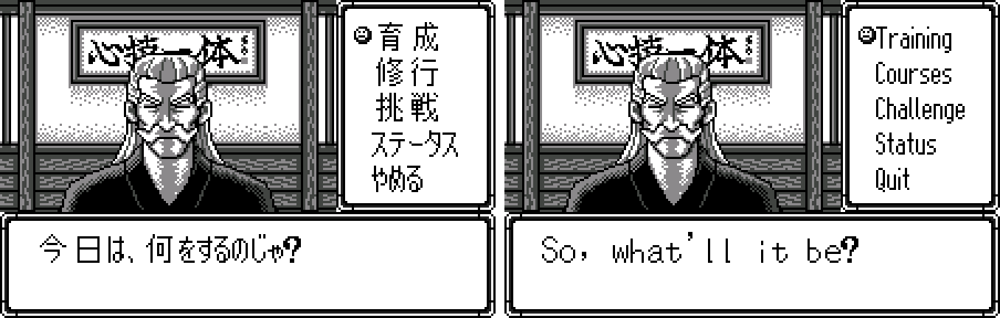

9. The mini-games

   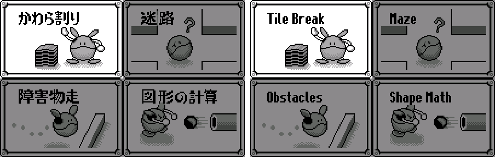

10. Mini-game success

   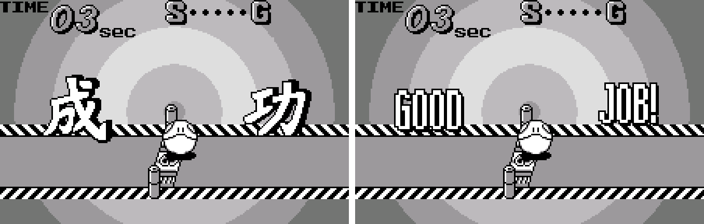

11. Mini-game failure

   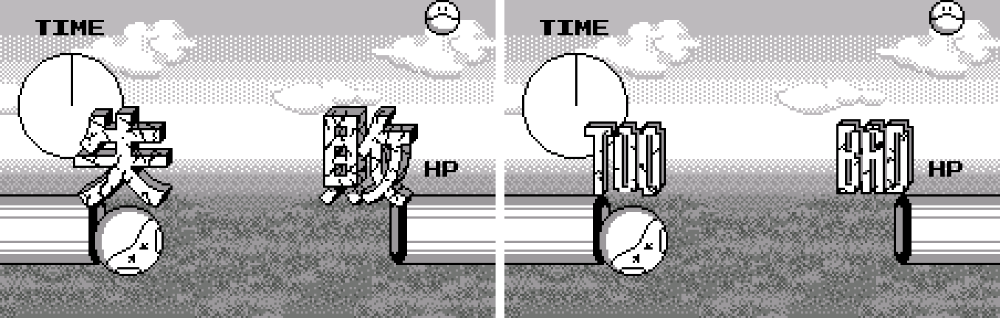

12. Before a battle

   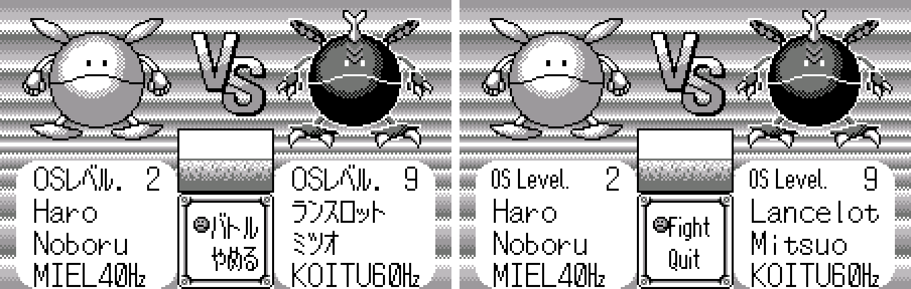

13. A battle message

   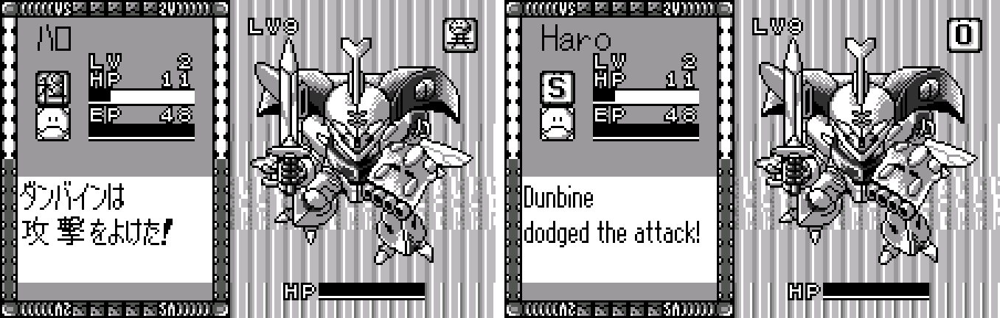

14. Level up

   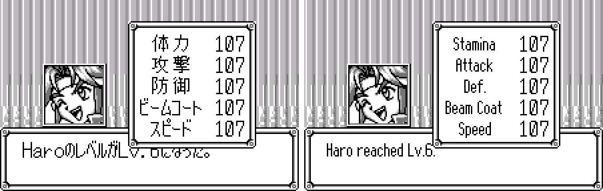

15. Staff credits

   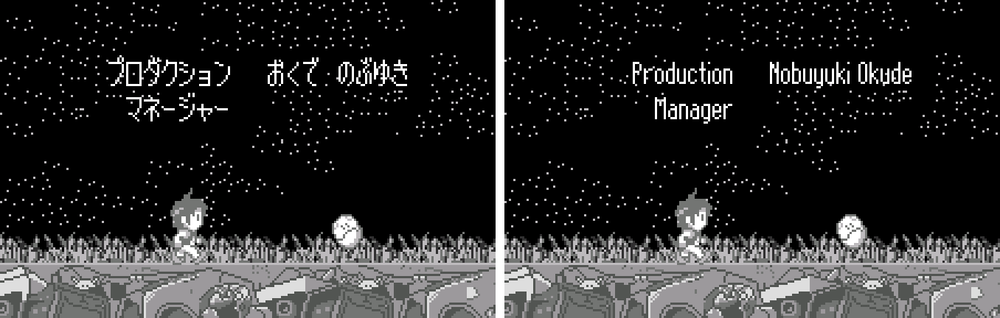

16. Special edition: the title menu with Debug

   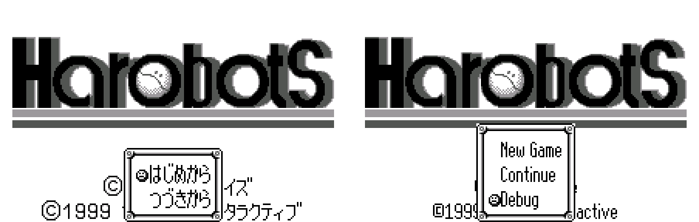

**How to patch**

Apply one of the BPS files to the Japanese ROM "Harobots (Japan)" (CRC32 AA525C04) in your browser with the [Swan Revival patcher](https://swanrevival.com/patcher/), or with Floating IPS, beat or ROM Patcher JS:

* Standard: `harobots-en-1.0.bps`, the result should be CRC32 0311B0F8.
* Special edition (Debug on the title menu): `harobots-en-special-1.0.bps`, the result should be CRC32 796D9DB0.

The English ROM is 4 MB (the original is 2 MB) because the translation needed more room: use an emulator or a flash cart that takes 32 Mbit WonderSwan ROMs. It's a WonderSwan (mono) game, so keep the .ws extension.

You must provide your own copy of the original Japanese game to apply it.

**Download:** `harobots-en-1.0.bps`, `harobots-en-special-1.0.bps` on the [release page](https://github.com/PokemonGoDB/wonderswan-english-patches/releases/tag/harobots-v1.0).

**Known issues**

* It hasn't been played start to finish by a person. If you find leftover Japanese, cut text or a crash, please tell me where it happened.
* Link play (battles and trades with a second WonderSwan) is translated but untested, and a few rare messages (some battle rewards and errors) were checked for fit but not seen on screen.
* Dialogue keeps the game's own fixed-width letter cells, so it looks evenly spaced like a typewriter; menus use a proportional font.

**Technical notes (for the curious)**

* The ROM was expanded to 4 MB. The dialogue keeps the game's own printer, with two-letter glyphs so English fits its 2-line boxes; everything else goes through a new proportional printer that replaces the game's glyph loop.
* Many menu labels share one string whose glyphs the game draws into consecutive tiles and places with tilemaps; those were re-laid in English cell by cell.
* The mini-game result banners are sprites shaped like the kanji; the sprites were moved into solid blocks so the English letters could be drawn large.
* Digits in English text use the game's own digit style at the letters' height, so numbers match the game's own counters.

**A Note On My Justifications for AI Use**

I have been an avid fan of the Wonderswan system for a very long time now. It was actually a motivating factor for my various attempts to learn Japanese (which have all failed so far). I always wanted to explore the game catalog more, but the lack of English translations made it extremely difficult to do so. Here's the thing: There's a reason many of these games have not been translated yet. It's not just the fact that Japanese > English translation is difficult. There's also the fact that the original developers used all kinds of tricks and technical feats to make these games work. Most games do not have a searchable directory of text that you can just replace with English equivalents. While some are easier than others, translations for some of these would take not only an expert in Japanese > English translation, but also someone with vast game development and programming experience.

I say all that to say: I get why people are apprehensive about AI usage for this type of thing. However, these games have been around for a very long time now and most of them have still not received a translation. I (and others) have chosen to spend our time and money to utilize AI to translate the games and actually make them playable for the wider community. If you don't agree with that, that's completely fine. I am more than happy to remove any of my translations if better, human ran translations are released at a later date. We already decided to skip any games where someone is actively working on a manual translation. While nowhere near what a manual translation effort would be, I do spend a considerable amount of time trying to work through each game's translation. I stress over small details and try my best to make the right calls. And I've probably messed some stuff up, which is why I welcome feedback.

I'm just looking forward to digging through all of these games. It's a great time to be into Wonderswan games.
