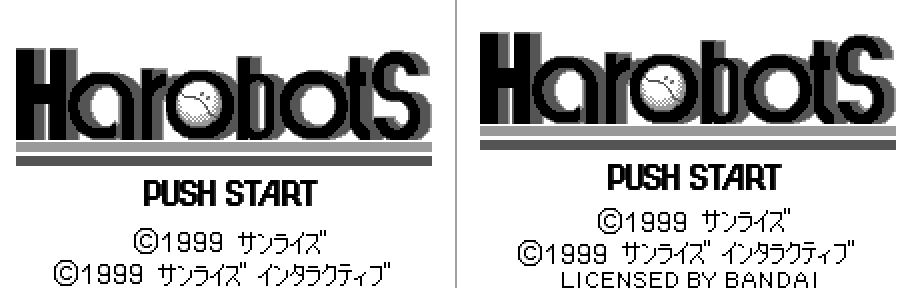
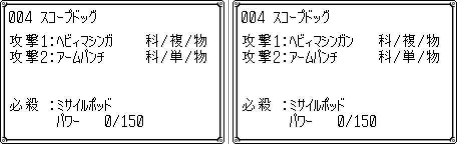
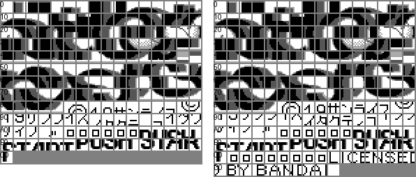

# Harobots: what differs between the two dumps

*Harobots* (ハロボッツ, Sunrise Interactive, WonderSwan, 1999) exists as two dumps: "Harobots (Japan)" and
"Harobots (Japan) (Rev 1)". This document lists every byte that differs between them and says what each
difference is. It was written on 2026-11-14 from the two dumps themselves; nothing in it comes from an
outside description of the revisions.

Conventions:

- "The original" is "Harobots (Japan)"; "Rev 1" is "Harobots (Japan) (Rev 1)".
- Addresses are offsets in the 2 MiB ROM file, in hexadecimal. A bank is 64 KiB of the file: bank 1D is
  1D0000-1DFFFF, which the game selects with bank value FDh and reads through segment 3000h, so file offset
  1D9E00 is "FD:9E00". Segment E000h is file 1E0000-1EFFFF and segment F000h is file 1F0000-1FFFFF.
- "0F/07" means block 07h of graphics group 0Fh (see "The graphics loader" below).
- Every statement is marked *verified* (with how), *hypothesis* or *unknown*. Unless a line says otherwise,
  "verified" means: read from the two files with the script in "How to reproduce", which checks every range
  in the tables below.
- Text formats, the font and the rest of the game's layout are described in `TEXT-FORMAT.md` in the
  translation project; this document does not need it.

## Summary

Rev 1 makes two changes a player can see, and nothing else:

1. **The title screen has a third line, LICENSED BY BANDAI.** To make room, the logo and PUSH START sit
   8 pixels higher, and the two copyright lines 10 to 11 pixels higher.
2. **One attack name is completed.** The robot Scopedog (スコープドッグ, robot 004) has the attack
   ヘビィマシンガ in the original, which is "Heavy Machine Gun" with its last character missing; Rev 1 has
   ヘビィマシンガン.

Everything else that differs is a consequence of the first change: the title's picture data grew by 205
bytes (CDh), the data stored after it in the same bank moved 205 bytes later, and the pointers and code
operands that refer to the moved data were adjusted. The footer's version byte went from 00h to 01h and the
checksum changed with the contents.

No program code changed apart from seven operands (six addresses and one screen coordinate). *Verified*: the
list of differing bytes below is complete, and each entry outside the data bank is an operand, a table entry
or a footer field.

*Hypothesis*: saved games are interchangeable between the two dumps, because the code that reads and writes
them is byte for byte the same. This was not tested by moving a save from one dump to the other.

## The two dumps

*Verified* (hashes and footer fields computed from the files; the footer is the last 16 bytes, 1FFFF0-1FFFFF).

| | Harobots (Japan) | Harobots (Japan) (Rev 1) |
| --- | --- | --- |
| Size | 2,097,152 bytes | 2,097,152 bytes |
| CRC32 | `AA525C04` | `F75CE82C` |
| SHA-256 | `019799e885bee6097bedebdbe35bcb7cf389ad9e1151bc9b36a359fff4c6a7fe` | `e6d10623aae6746e78b8edd4b284496950dadc04372f8118800eff672dd55f20` |
| 1FFFF0: reset jump | `EA A0 18 00 F0` (jmp F000:18A0) | the same |
| 1FFFF5: reserved byte | 00h | 00h |
| 1FFFF6: publisher | 19h | 19h |
| 1FFFF7: system | 00h (monochrome WonderSwan) | 00h |
| 1FFFF8: game id | 01h | 01h |
| 1FFFF9: version | **00h** | **01h** |
| 1FFFFA: ROM size | 04h (2 MiB, 16 Mbit) | 04h |
| 1FFFFB: save type | 01h (SRAM, 64 Kbit) | 01h |
| 1FFFFC: flags | 04h | 04h |
| 1FFFFD: mapper | 00h | 00h |
| 1FFFFE: checksum | **A238h** | **2F91h** |

The checksum is the 16-bit sum of every byte before it, and both dumps' checksums are correct.
*Unknown*: which company publisher id 19h names, and what the single set bit in the flags byte selects on
hardware; neither was looked up, and neither differs between the dumps.

The names are the ones the dumps carry in ROM catalogues. *Verified* only this far: the file with footer
version 00h has CRC32 AA525C04 and the file with footer version 01h has CRC32 F75CE82C.

## What a player sees

### The title screen

*Verified* on screen (both dumps run from power-on in an emulator with the Mednafen WonderSwan core,
630 frames, no input) and in the data (sections "The title's tile block" and "One code operand" below).



Original on the left, Rev 1 on the right. Measured on the screenshots, in pixels from the top of the
224 x 144 screen:

| Element | Original | Rev 1 | Moved |
| --- | --- | --- | --- |
| Logo and the bar under it | 24-82 | 16-74 | up 8, pixels identical |
| PUSH START (blinks: 30 frames on, 30 off) | 90-102 | 82-94 | up 8, pixels identical |
| ©1999 サンライズ | 114-126 | 104-116 | "©1999" up 10, the kana up 11 |
| ©1999 サンライズ インタラクティブ | 130-142 | 120-132 | "©1999" up 10, the kana up 11 |
| LICENSED BY BANDAI | absent | 136-143 | new |

The two copyright lines were redrawn, not only moved: in the original the kana stand one pixel lower than
the "©1999" beside them, in Rev 1 their tops are level. The letters themselves are the same pixels.

The menu that opens on START (はじめから / つづきから) is in the same place in both dumps; it covers the
middle of the copyright lines in both. *Verified* on screen from a save state.

### Scopedog's attack name

*Verified* in the data (section "The attack name" below) and on screen (the robot's attack page, reached
from a save state that owns the robot).



攻撃1 (attack 1) reads ヘビィマシンガ in the original and ヘビィマシンガン in Rev 1.

### Nothing else

*Verified* by a tour of 72 screens (boot, title, name entry, the opening, town, every menu and its pages,
shop, dojo, mini-game pages, battle, level-up, game over, credits), each reached the same way on both dumps
and compared pixel for pixel: the only screens that differ are the title, the title with its menu open, and
Scopedog's attack page. A tour is a sample of the game, not all of it; the claim that nothing else changed
rests on the byte lists below, which are complete.

## Every byte that differs

Comparing the files offset by offset, 29,112 bytes differ: 2 in bank 1A, 29,092 in bank 1D, 8 in bank 1E
and 10 in bank 1F. *Verified*.

### Outside bank 1D (20 bytes, 12 ranges)

*Verified*: this is the complete list. What each range is was read from a disassembly of the code around
it; the readers are described under "Changed references".

| Offset | Bytes | Original -> Rev 1 | What it is |
| --- | --- | --- | --- |
| 1A02BB-1A02BC | 2 | `FF FF` -> `7D 00` | text: the eighth character of Scopedog's attack name (FFFFh ends a string; 007Dh is ン) |
| 1E43AF-1E43B0 | 2 | `96 9C` -> `63 9D` | code operand: address of the main-menu help pointers, 9C96h -> 9D63h |
| 1E4489 | 1 | `00` -> `CD` | code operand, low byte: address of the menu-string pointers, 9E00h -> 9ECDh |
| 1E44F0-1E44F1 | 2 | `84 A3` -> `51 A4` | code operand: address of the screen-tilemap pointers, A384h -> A451h |
| 1E4886 | 1 | `28` -> `F5` | code operand, low byte: address of the item-category pointers, A328h -> A3F5h |
| 1E84A1-1E84A2 | 2 | `84 A3` -> `51 A4` | code operand: address of the screen-tilemap pointers, a second reader |
| 1F1E09-1F1E0A | 2 | `B0 F4` -> `80 F5` | table entry: sprite-group table, entry 0Eh, offset word F4B0h -> F580h |
| 1F1E89-1F1E8A | 2 | `B0 F4` -> `80 F5` | table entry: graphics-group table, entry 0Bh, offset word F4B0h -> F580h |
| 1F6D82-1F6D83 | 2 | `8A 9C` -> `57 9D` | code operand: address of the main-menu cursor positions, 9C8Ah -> 9D57h |
| 1FC8D7 | 1 | `58` -> `50` | code operand, low byte: the Y coordinate of PUSH START, 88 -> 80 |
| 1FFFF9 | 1 | `00` -> `01` | footer: version |
| 1FFFFE-1FFFFF | 2 | `38 A2` -> `91 2F` | footer: checksum |

Every address operand grew by CDh (205) except the two table entries, which grew by D0h (208); see
"The two table entries" for why.

### Inside bank 1D

Offset by offset, 29,092 bytes differ between 1D5D1E and 1DF574, but nearly all of that is the same data
205 bytes later. Read as a layout, bank 1D differs in exactly these places (*verified*: every row of this
table is checked by the script, the "identical" rows byte for byte):

| Original | Rev 1 | Bytes | Contents | Difference |
| --- | --- | --- | --- | --- |
| 1D0000-1D5D1D | same place | 23,838 | graphics group 07h, text tables, sprite data, the first eight pointers of graphics group 0Fh | identical |
| 1D5D1E-1D5D2B | same place | 14 | graphics group 0Fh pointer table, entries 08h-0Eh (7 words) | every word +CDh: 6AE7 -> 6BB4, 72E9 -> 73B6, 7882 -> 794F, 8084 -> 8151, 843D -> 850A, 8C3F -> 8D0C, 9488 -> 9555 |
| 1D5D2C-1D6466 | same place | 1,851 | blocks 0F/00-0F/06; the header word of block 0F/07 (C000h, at 1D6465) | identical |
| 1D6467-1D6468 | same place | 2 | block 0F/07: its size after decompression | 0C10h -> 0DA0h (3,088 -> 3,488 bytes; 193 -> 218 tiles) |
| 1D6469-1D68D7 | same place | 1,135 | block 0F/07: the start of its compressed stream | identical |
| 1D68D8-1D6AE6 | 1D68D8-1D6BB3 | 527 -> 732 | block 0F/07: the rest of its compressed stream | replaced; 205 bytes longer |
| 1D6AE7-1D72E8 | 1D6BB4-1D73B5 | 2,050 | block 0F/08: the title's background map (header word 2020h, then 32 x 32 words) | 306 bytes differ (306 map words, in rows 2-10 and 13-17) |
| 1D72E9-1D9C95 | 1D73B6-1D9D62 | 10,669 | blocks 0F/09-0F/0E; the main-menu cursor positions (6 words at original 1D9C8A) | identical |
| 1D9C96-1D9CA1 | 1D9D63-1D9D6E | 12 | main-menu help: 6 pointers | every word +CDh (9CA2 -> 9D6F ... 9DC4 -> 9E91) |
| 1D9CA2-1D9DFF | 1D9D6F-1D9ECC | 350 | main-menu help: the strings | identical |
| 1D9E00-1D9E4D | 1D9ECD-1D9F1A | 78 | menu strings: 39 pointers | every word +CDh (9E4E -> 9F1B ... A302 -> A3CF) |
| 1D9E4E-1DA327 | 1D9F1B-1DA3F4 | 1,242 | menu strings | identical |
| 1DA328-1DA331 | 1DA3F5-1DA3FE | 10 | item categories: 5 pointers | every word +CDh (A332 -> A3FF ... A372 -> A43F) |
| 1DA332-1DA383 | 1DA3FF-1DA450 | 82 | item categories: the strings | identical |
| 1DA384-1DA3B7 | 1DA451-1DA484 | 52 | screen tilemaps: 26 pointers | every word +CDh (A3B8 -> A485 ... F358 -> F425) |
| 1DA3B8-1DF4A7 | 1DA485-1DF574 | 20,720 | screen tilemaps (370 rows of 28 words) | identical |
| 1DF4A8-1DFFFF | 1DF575-1DFFFF | 2,904 -> 2,699 | unused, all FFh | 205 bytes shorter |

## The layout change in bank 1D

*Verified* (the table above). One block grew and everything stored after it moved:

- Block 0F/07, the title's tiles, starts at 1D6465 in both dumps: a header word, a size word and the
  compressed stream. The stream is 1,662 bytes in the original and 1,867 bytes in Rev 1, so the block is
  1,666 bytes (1D6465-1D6AE6) in the original and 1,871 bytes (1D6465-1D6BB3) in Rev 1: 205 bytes longer.
- Shift map: original 1D0000-1D6AE6 stays where it is (with the block's tail replaced); original
  1D6AE7-1DF4A7 is at +CDh in Rev 1, 1D6BB4-1DF574; the free space at the end of the bank shrank by the same
  205 bytes, from 2,904 to 2,699 bytes. Nothing was moved out of the bank and nothing else was inserted or
  removed: the 205 bytes of growth came out of the free space at the end.
- Inside the moved range, the only bytes that differ after the shift are the five pointer tables whose
  pointers lead into the moved range (each word +CDh) and the title's map (new contents).

A byte-window matcher run over the two files pairs most of the moved range but stumbles in six places.
What those places are, in Rev 1's addresses:

| Stretch in Rev 1 | What it is |
| --- | --- |
| near 1D6FEB, and 1D7021-1D73B9 | the title's map 0F/08 (1D6BB4-1D73B5). Its rows were moved up by one row (64 bytes) and its last used row is new, and a map is full of repeated words, so a matcher pairs its rows with the wrong neighbours. The block after it, 0F/09, starts at 1D73B6 and is identical to the original's |
| near 1D9D4C | the main-menu cursor positions (1D9D57, identical) followed by the main-menu help pointers (1D9D63-1D9D6E, each +CDh) |
| near 1D9EB6 | the menu-string pointers (1D9ECD-1D9F1A, each +CDh) |
| near 1DA3DE | the item-category pointers (1DA3F5-1DA3FE, each +CDh) |
| near 1DA43A | the screen-tilemap pointers (1DA451-1DA484, each +CDh) |

One more byte can look like a reference and is not: 1D68D8 (`E0` -> `F0`) is the first byte at which the
two compressed streams of block 0F/07 part ways.

## Changed references

*Verified* by disassembling the code at each site in both dumps (the instructions are the same but for the
operand) and, for the pointer tables, by following every pointer in both dumps to the same data.

### The graphics loader

F000:06DC queues a block for loading: DH = group, DL = index, BX = destination. It reads the group's entry
(4 bytes: offset word, bank value, a zero byte) from the table at F000:1E5D (file 1F1E5D), selects the
bank, and reads word `index` of the pointer table at that offset; the pointer leads to the block. A block
starts with a header word: C000h for a compressed block (a size word and an LZSS stream follow), 2020h for
a raw 32 x 32 screen map. Graphics group 0Fh is `0E 5D FD 00`: its pointer table is at FD:5D0E (file
1D5D0E), 15 entries. F000:0490 draws a sprite group the same way from a second table of the same shape at
F000:1DD1 (file 1F1DD1).

### Code operands

| File offset | Address | Instruction, original -> Rev 1 | Reader | Points to |
| --- | --- | --- | --- | --- |
| 1E43AE | E000:43AE | `add ax,9C96h` -> `add ax,9D63h` | the main menu's help line (routine at E000:438E, called from the main-menu loop at F000:6D57); the index is RAM word 46Ch | 6 pointers to the help strings, one per main-menu entry |
| 1E4488 | E000:4488 | `mov di,9E00h` -> `mov di,9ECDh` | E000:446E, which draws menu string AX | 39 pointers to the menu strings |
| 1E44EF | E000:44EF | `mov di,A384h` -> `mov di,A451h` | E000:44DA, which copies screen tilemap AX to the screen | 26 pointers to tilemaps |
| 1E4885 | E000:4885 | `mov di,A328h` -> `mov di,A3F5h` | the item list's category line (code from E000:487C; the index is RAM word 202h) | 5 pointers to the category names |
| 1E84A0 | E000:84A0 | `mov ax,A384h` -> `mov ax,A451h` | code from E000:8497, which reads tilemap 2 from its offset 2A0h (its row 12) | the same 26 pointers |
| 1F6D81 | F000:6D81 | `add ax,9C8Ah` -> `add ax,9D57h` | the main-menu loop (mode 03h, F000:6B1C): the cursor sprite's position for entry [46Ch] | 6 words, `1010 1028 1040 2810 2828 2840` (X in the high byte, Y in the low byte) |

### Pointer tables inside the bank

The seven pointers of graphics group 0Fh (blocks 08h-0Eh, read by F000:06DC) and the four tables read by
the code above each hold offsets into the moved range, so each word is CDh larger in Rev 1. The first eight
pointers of group 0Fh (blocks 00h-07h) lead to blocks before the moved range and are unchanged.

### The two table entries

File 1F1E89 is the graphics-group table's entry 0Bh and file 1F1E09 is the sprite-group table's entry 0Eh.
Both are `B0 F4 FC 00` in the original and `80 F5 FC 00` in Rev 1: offset F4B0h or F580h, bank value FCh.

*Verified*: in both dumps the offset is the first multiple of 16 after the end of bank 1D's data (the data
ends at 1DF4A7 in the original and 1DF574 in Rev 1), and the bytes at that offset are FFh both in bank 1D
and in bank 1C (the bank that value FCh selects; bank 1C is identical in the two dumps).

*Hypothesis*: these are placeholders for a group that has no data, emitted by the build tools at the end of
the bank's data, which is why they follow the data's end and grew by D0h (205 rounded up to the next
multiple of 16) and not by CDh. *Unknown*: whether any code ever asks for graphics group 0Bh or sprite
group 0Eh. A search for calls that load the group number as a constant found none, but the group number
can be computed.

## The title's tile block (0F/07) and map (0F/08)

*Verified*: both blocks were decoded from both dumps (the script writes them as pictures), and the title
code that loads them was disassembled: at F000:C825 the title loads block 0F/07 to VRAM 2100h (tile 10h)
and the map 0F/08 to the screen at 1000h with a tile offset of 10h, so a map word n shows the block's
tile n.



The block's tiles, 16 per row (original left, Rev 1 right):

| Tiles | Original | Rev 1 |
| --- | --- | --- |
| 00-84 (133) | the logo | identical |
| 85-A4 (32) | the two copyright lines | the same lines redrawn higher in their tiles (see "The title screen") |
| A5-AA (6) | six copies of an empty box, used by no map word and no sprite | identical |
| AB-C0 (22) | PUSH START (drawn as sprites) | identical |
| C1-C8 (8) | absent: the original block ends at C0 | eight more copies of the empty box, unused |
| C9-D8 (16) | absent | LICENSED BY BANDAI |
| D9 (1) | absent | a blank tile, unused |

The map (32 x 32 words; the screen shows 28 x 18 of them):

| Screen rows | Original | Rev 1 |
| --- | --- | --- |
| the logo | rows 3-10 | rows 2-9, the same words |
| the two copyright lines | rows 14-17 | rows 13-16, the same words |
| LICENSED BY BANDAI | absent | row 17, columns 6-21, tiles C9-D8 |

*Hypothesis*: the empty-box tiles are filler left by the tool that made the tile sheet; nothing shows them.

## One code operand: PUSH START

*Verified* by disassembly and in the emulator's sprite table.

```
F000:C8C7  inc word [474h]          ; a frame counter
F000:C8CB  mov ax,[474h]
F000:C8CE  cmp ax,1Eh
F000:C8D1  jnc C8E3                 ; drawn for 30 frames of every 60
F000:C8D3  mov dx,0F1Ch             ; sprite group 0Fh, sprite 1Ch
F000:C8D6  mov bx,4858h             ; Rev 1: mov bx,4850h
F000:C8D9  mov cx,0
F000:C8DC  call F000:0490           ; draw the sprite: BH = X, BL = Y
```

The byte at file 1FC8D7 is the low byte of BX, the Y coordinate: 88 in the original, 80 in Rev 1. With the
title on screen, the sprite table in RAM (0E00h) holds 22 sprites for PUSH START in both dumps, tiles
BBh-D0h (the block's tiles AB-C0, loaded from tile 10h), X 72 to 152, in two rows at Y 88 and 96 in the
original and at Y 80 and 88 in Rev 1. The sprite's own data (sprite group 0Fh, sprite 1Ch, at FD:5BBC) is
identical in the two dumps.

## The attack name

*Verified* in the data and on screen.

Robot records are 92h bytes each from FA:0047 (file 1A0047); a record's normal attack name is ten 16-bit
character codes at offset 1Eh, ended by FFFFh when shorter. Record 4 is Scopedog, and its name field
starts at file 1A02AD:

```
original  6C 00 8E 00 99 00 6E 00 5B 00 7D 00 7E 00 FF FF FF FF FF FF    ヘビィマシンガ
Rev 1     6C 00 8E 00 99 00 6E 00 5B 00 7D 00 7E 00 7D 00 FF FF FF FF    ヘビィマシンガン
```

The eighth code, at file 1A02BB, changes from the end mark to 007Dh (ン). No other robot, item or message
text differs between the dumps: a catalogue of all 3,687 text units read from each dump differs in this
one unit only.

## How to reproduce

Save the script below as `rev1diff.py` and run it on your own two dumps:

```
python3 rev1diff.py "Harobots (Japan).ws" "Harobots (Japan) (Rev 1).ws" out
```

It needs only Python 3. It prints the identities and footers, the differing ranges outside bank 1D, the
bank 1D layout with every range checked ("identical", "every word +CDh" or the number of differing bytes),
and the title's tile and map differences; with an output folder it writes `tiles-original.pgm`,
`tiles-rev1.pgm` (the tile block, 16 tiles per row) and `title-original.pgm`, `title-rev1.pgm` (the title's
background as the map draws it, without the PUSH START sprites). PGM is a plain greyscale format that most
image viewers and converters open.

```python
#!/usr/bin/env python3
"""Compare the two Harobots dumps.   python3 rev1diff.py "Harobots (Japan).ws" "Harobots (Japan) (Rev 1).ws" [OUTDIR]

Prints the dumps' identities, every byte range that differs at the same offset outside bank 1D, the
shift map of bank 1D (each region checked), and what changed in the title's tile block and map.
With OUTDIR it also writes the title's tiles and background as PGM pictures. Standard library only."""
import hashlib
import os
import sys
import zlib

a, b = (open(p, 'rb').read() for p in sys.argv[1:3])
out = sys.argv[3] if len(sys.argv) > 3 else None
SHIFT = 0xCD


def w(d, o):
    return d[o] | d[o + 1] << 8


def lzss(d, o):
    """Block data at o: a size word, then flag bytes (bit 0 first; 1 = a literal byte, 0 = a word
    copying (word & 0Fh) + 3 bytes from word >> 4 bytes back). Returns (bytes, stream length)."""
    size, i, res = w(d, o), o + 2, bytearray()
    while len(res) < size:
        flags, i = d[i], i + 1
        for bit in range(8):
            if len(res) >= size:
                break
            if flags >> bit & 1:
                res.append(d[i])
                i += 1
            else:
                n, dist, i = (w(d, i) & 15) + 3, w(d, i) >> 4, i + 2
                for _ in range(n):
                    res.append(res[len(res) - dist] if len(res) >= dist else 0)
    return bytes(res[:size]), i - o


print('1. The dumps')
for name, d in (('original', a), ('Rev 1', b)):
    f = d[-16:]
    print(f'  {name}: {len(d)} bytes, CRC32 {zlib.crc32(d):08X}, SHA-256 {hashlib.sha256(d).hexdigest()}')
    print('    footer: publisher %02Xh, system %02Xh, game %02Xh, version %02Xh, ROM size %02Xh, save %02Xh, '
          'flags %02Xh, mapper %02Xh, checksum %04Xh (sum of all other bytes: %04Xh)'
          % (f[6], f[7], f[8], f[9], f[10], f[11], f[12], f[13], w(f, 14), sum(d[:-2]) & 0xFFFF))

print('2. Bytes that differ at the same offset')
diff = [i for i in range(len(a)) if a[i] != b[i]]
banks = {}
for i in diff:
    banks[i >> 16] = banks.get(i >> 16, 0) + 1
print('  %d bytes; by bank: %s' % (len(diff), ', '.join('%02X: %d' % kv for kv in sorted(banks.items()))))
runs = []
for i in diff:
    if runs and i == runs[-1][1] + 1:
        runs[-1][1] = i
    else:
        runs.append([i, i])
for s, e in runs:
    if s >> 16 != 0x1D:
        print('  %06X-%06X  %s -> %s' % (s, e, a[s:e + 1].hex(' '), b[s:e + 1].hex(' ')))

print('3. Bank 1D: original range -> Rev 1 range')
REGIONS = [     # original start, end (exclusive), shift in Rev 1, kind, contents
    (0x1D0000, 0x1D5D1E, 0, 'same', 'data before the pointers below'),
    (0x1D5D1E, 0x1D5D2C, 0, 'ptr', 'graphics group 0F pointer table, entries 08-0E'),
    (0x1D5D2C, 0x1D6467, 0, 'same', 'blocks 0F/00-0F/06 and the header word of 0F/07'),
    (0x1D6467, 0x1D6469, 0, 'diff', 'block 0F/07: size after decompression'),
    (0x1D6469, 0x1D68D8, 0, 'same', 'block 0F/07: start of the compressed stream'),
    (0x1D68D8, 0x1D6AE7, None, 'new', 'block 0F/07: rest of the compressed stream'),
    (0x1D6AE7, 0x1D72E9, SHIFT, 'diff', 'raw map 0F/08 (header word, 32 x 32 words)'),
    (0x1D72E9, 0x1D9C96, SHIFT, 'same', 'blocks 0F/09-0F/0E, main-menu cursor table'),
    (0x1D9C96, 0x1D9CA2, SHIFT, 'ptr', 'main-menu help: 6 pointers'),
    (0x1D9CA2, 0x1D9E00, SHIFT, 'same', 'main-menu help: strings'),
    (0x1D9E00, 0x1D9E4E, SHIFT, 'ptr', 'menu strings: 39 pointers'),
    (0x1D9E4E, 0x1DA328, SHIFT, 'same', 'menu strings'),
    (0x1DA328, 0x1DA332, SHIFT, 'ptr', 'item categories: 5 pointers'),
    (0x1DA332, 0x1DA384, SHIFT, 'same', 'item categories: strings'),
    (0x1DA384, 0x1DA3B8, SHIFT, 'ptr', 'screen tilemaps: 26 pointers'),
    (0x1DA3B8, 0x1DF4A8, SHIFT, 'same', 'screen tilemaps'),
]
for s, e, sh, kind, what in REGIONS:
    if kind == 'new':
        e1 = s + (0x1D6AE7 + SHIFT - s)
        print('  %06X-%06X (%d) -> %06X-%06X (%d)  replaced  %s' % (s, e - 1, e - s, s, e1 - 1, e1 - s, what))
        continue
    x, y = a[s:e], b[s + sh:e + sh]
    if kind == 'same':
        note = 'identical' if x == y else 'NOT IDENTICAL'
    elif kind == 'ptr':
        ok = all(w(y, k) - w(x, k) == SHIFT for k in range(0, e - s, 2))
        note = ('every word +CDh (%04X -> %04X ...)' % (w(x, 0), w(y, 0))) if ok else 'NOT +CDh'
    else:
        note = '%d bytes differ' % sum(p != q for p, q in zip(x, y))
    print('  %06X-%06X -> %06X-%06X  %5d bytes  %-34s %s' % (s, e - 1, s + sh, e + sh - 1, e - s, note, what))
for name, d, s in (('original', a, 0x1DF4A8), ('Rev 1', b, 0x1DF4A8 + SHIFT)):
    print('  %s: %06X-1DFFFF free, %d bytes, all FFh: %s' % (name, s, 0x1E0000 - s, set(d[s:0x1E0000]) == {0xFF}))

print('4. Title tiles (block 0F/07 at 1D6465) and background map (0F/08)')
ta, na = lzss(a, 0x1D6467)
tb, nb = lzss(b, 0x1D6467)
print('  size word and stream: original %d bytes -> %d tiles; Rev 1 %d bytes -> %d tiles'
      % (na, len(ta) // 16, nb, len(tb) // 16))
same = [t for t in range(len(ta) // 16) if ta[16 * t:16 * t + 16] == tb[16 * t:16 * t + 16]]
print('  tiles with the same picture at the same number: %d of %d (the others: %s)'
      % (len(same), len(ta) // 16, ' '.join('%02X' % t for t in range(len(ta) // 16) if t not in same)))
ma, mb = a[0x1D6AE9:0x1D72E9], b[0x1D6AE9 + SHIFT:0x1D72E9 + SHIFT]
rows = sorted({k // 64 for k in range(0, 2048, 2) if ma[k:k + 2] != mb[k:k + 2]})
print('  map rows that differ:', rows)
print('  original rows 3-10 = Rev 1 rows 2-9:', ma[3 * 64:11 * 64] == mb[2 * 64:10 * 64],
      '| original rows 14-17 = Rev 1 rows 13-16:', ma[14 * 64:18 * 64] == mb[13 * 64:17 * 64])
print('  Rev 1 row 17, columns 6-21:', ' '.join('%02X' % w(mb, 2 * (32 * 17 + c)) for c in range(6, 22)))


def pgm(path, width, height, pixel):
    with open(path, 'wb') as f:
        f.write(b'P5 %d %d 255\n' % (width, height))
        f.write(bytes(pixel(x, y) for y in range(height) for x in range(width)))


def shade(tiles, t, x, y):       # 2 bits per pixel: one byte per plane for each row of the tile
    if 16 * t + 16 > len(tiles):
        return 128
    p, q = tiles[16 * t + 2 * y], tiles[16 * t + 2 * y + 1]
    return 255 - 85 * ((p >> (7 - x) & 1) | (q >> (7 - x) & 1) << 1)


if out:
    os.makedirs(out, exist_ok=True)
    for name, tiles, m in (('original', ta, ma), ('rev1', tb, mb)):
        n = len(tiles) // 16
        pgm(os.path.join(out, f'tiles-{name}.pgm'), 128, 8 * -(-n // 16),
            lambda x, y: shade(tiles, (y // 8) * 16 + x // 8, x % 8, y % 8))
        pgm(os.path.join(out, f'title-{name}.pgm'), 224, 144,
            lambda x, y: shade(tiles, w(m, 2 * (32 * (y // 8) + x // 8)) & 0x1FF, x % 8, y % 8))
    print('  pictures written to', out)
```

The disassemblies quoted above were made with `ndisasm -b 16` from the file offsets given (for example
`ndisasm -b 16 -o 0xC8C7 -e 0x1FC8C7 ROM`). The screenshots come from running each dump from power-on for
630 frames with no input.

## What it means for patching

*Verified* with the English translation patch 1.0, which was made from the original dump.

- **A patch made for one dump is refused on the other.** A BPS patch records the size and CRC32 of the ROM
  it was made from (AA525C04 for patch 1.0) and a patcher checks them before it writes anything; Rev 1's
  CRC32 is F75CE82C.
- **Forcing it would not work either.** Patch 1.0 changes 81,185 bytes of the original; 4,071 of the 29,112
  bytes that differ between the dumps are among them, all but two in bank 1D. Applied to Rev 1, it would
  write its tables and strings at the original's positions, 205 bytes before the places Rev 1's code reads.
- **What moves for a patch that edits Rev 1.** Anything a patch reads or rewrites in original
  1D6AE7-1DF4A7 is 205 bytes later: the title's map (0F/08), the boot copyright list (0F/09 and its map
  0F/0A), the main-menu help strings and pointers, the 39 menu strings and their pointers, the item
  categories, and all 26 screen tilemaps (the status, robot, combinize, save, name-entry and title-menu
  layouts). New code that reads those tables needs Rev 1's addresses (9D63h, 9ECDh, A3F5h, A451h, and
  9D57h for the cursor table). The free space at the end of the bank starts at 1DF575 instead of 1DF4A8 and
  is 205 bytes smaller. The title's tile block has 25 more tiles, and its map has the title one row higher
  and a third line on row 17.
- **What does not move.** Every other bank is at the same offsets. All code is at the same addresses, so
  code patches apply at the same places; the only patched instruction bytes that differ are the operands
  listed above. The dialogue, the fonts, item and robot data, battle text and the credits are byte for byte
  the same, except Scopedog's attack name.

In the translation project the build tools take either dump: `tools/hb_rom.py` holds both dumps' hashes
and the shift map (`loc()`), every tool works on Rev 1 when run with `--rev1`, and text units keep the ids
of the original dump's addresses, so one translation serves both.

## Not known

- Why the changes were made, and when Rev 1 was produced. Nothing in the ROM says.
- Whether graphics group 0Bh or sprite group 0Eh is ever requested (see "The two table entries").
- Whether saved games move between the dumps (expected, not tested).
- Behaviour on hardware: everything above was checked on the files and in one emulator.
