# Hunter x Hunter: Ishi o Tsugu Mono (WonderSwan) - AI English translation patch v1.1

**Hunter x Hunter: Ishi o Tsugu Mono** (ハンター×ハンター 意志を継ぐ者, "Heir to the Will") is Bandai's 2000 RPG for the original (monochrome) WonderSwan, released only in Japan. It's set after the Heavens Arena arc of Yoshihiro Togashi's manga: Gon, now a licensed Hunter, sets out with Killua to find his father Ging. At Dolle Harbor an information broker sells them a cyber mobile that once belonged to Ging, and from there you travel to around 28 towns by boat, airship and train. You take on jobs ("episodes") for friends and strangers, look things up on the mobile's cyber page, fight with Nen, earn Jenny and collect the symbol codes that unlock the mobile's secret. Kurapika, Leorio, Hisoka, Illumi, Kite, Satotz, Wing, Hanzo, Ponzu, Menchi and many more turn up along the way. This patch translates it into English.

> **Please read:** this translation was made **with AI** (Claude), as a hobby project. A person (me) made every judgement call before release, but nobody on the project is a professional translator. I'm sharing it as it is for anyone who wants to play. Please **don't upload it to romhacking sites** (romhacking.net and the like). It may not be up to the standard of a real fan translation and it doesn't belong there.

**What's translated**

* The whole script: about 3,000 messages (140,000 Japanese characters): the story and every episode, every town's people, battles, choices, mini-games and both versions of the ending.
* The cyber page (the in-game encyclopedia): 431 entries on people, bounties, places, beasts, treasures and food, the link lists, the search page with an English letter grid, mail and the phone. Every [keyword] in brackets in the story is searchable in English (a script checked all 930 of them against the Japanese).
* Menus and screens: the field menu, the travel and move screens, the save screen, the battle menus and timing roulettes.
* Pictures redrawn: the title subtitle ("Heir to the Will") and copyright line, the opening story pages, the attract-mode captions, the cyber page's buttons and headings, the eleven letters from Gon's friends at the ending with their name tags, the ending caption, a speech balloon and Majitani's sound effects (BAM!!).
* Left as art: the HUNTER×HUNTER logo with its small katakana, the Hunter script (the series' cipher alphabet, kept as it is; the encyclopedia teaches it in romaji), and the illustrated encyclopedia pages (Nen charts, training cards and a few other drawings).

Names follow the official English names of the VIZ manga and the 2011 anime: Gon, Killua, Kurapika, Leorio, Hisoka, Illumi, Ging, Kite, Satotz, Netero, Kalluto, the Zoldyck family, the Phantom Troupe, Jenny (written J$), Single-Star Hunters, Nen and its techniques. Characters made for the game (Kana the information broker, the cyber-brain Lunes, Waton, Rockwell and others) keep their Japanese names.

A few puzzles were rebuilt so they work in English, with the same steps and rewards:

* **The symbol codes:** six Single-Star Hunters each give you two letters; together they spell a phrase you type on the cyber page (in Japanese, a sentence in kana).
* **Waton's number cipher:** the number pairs point to letters of an English encyclopedia entry and spell the hiding place, as the Japanese intended (the Japanese entry doesn't actually fit its numbers).
* **The coin game and a boat menu:** the original put all three choices on one row while the cursor walked three rows; each row now has its own label.

**Hidden in the original game: the developers' menus**

These are in the retail cartridge and work the same in English (no special patch needed):

* **START + B on the title screen** (PUSH START BUTTON) opens a debug menu: DEBUG ON/OFF, MAP (a map number), CURSOL and KEYWORD. With DEBUG on, START begins the game on the chosen map, and field buttons open a character viewer and an event selector.
* **START + A on the title screen** opens a music test (BGM and SE numbers).
* **Limits:** they're the developers' leftover tools. Starting on another map skips the story that sets it up, and what CURSOL and KEYWORD do isn't documented. Don't save over a real game while experimenting.

**How it was made: AI translation, independent checks, human decisions**

* Claude translated everything directly from the Japanese in the ROM and did all the hacking: a proportional English font for the game's text engine, the English keyword search, the number fields, and the redrawn pictures.
* Every line was drafted, reviewed against the Japanese, polished and verified, names were checked against a termbase built from official sources, and a separate, independent Claude reviewer then checked the whole game, text and screenshots; its findings were verified and fixed.
* On screen: every page of the script drawn by the game in one test scene with the widest values (9,025 pages, the last one checked by hand), all 431 encyclopedia entries opened by search, random play from several points across the game with every character logged (no Japanese left), all 113 pictures that events can show, a full battle played, the ending and letters, and an alignment audit of every screen against the original.
* The judgement calls were listed with the Japanese, a literal reading and the options, and I decided all 25 by hand over four rounds: the subtitle, the symbol-code phrase, the ciphers, money, names, the pictures and more.

**Changelog**

* **v1.1**: first public release. Fixes the ending caption, which an unreleased 1.0 build left in Japanese.

**Sources consulted**

* Japanese text: the WonderSwan ROM itself.
* Names and terms: the English Wikipedia list of Hunter × Hunter characters, Hunterpedia (the Hunter × Hunter wiki), and the VIZ manga and 2011 anime terms.

**Images** (original on the left, English on the right)

1. Title menu

   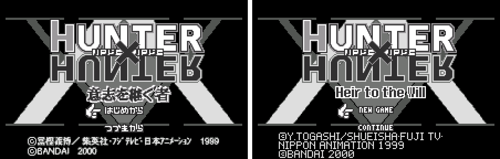

2. The opening story

   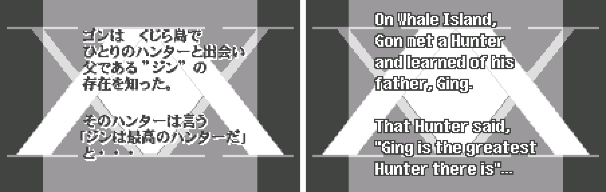

3. Dialogue at Dolle Harbor

   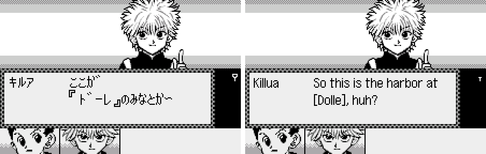

4. The field menu

   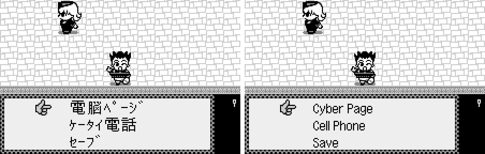

5. The phone

   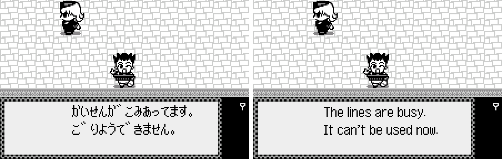

6. Majitani's reveal

   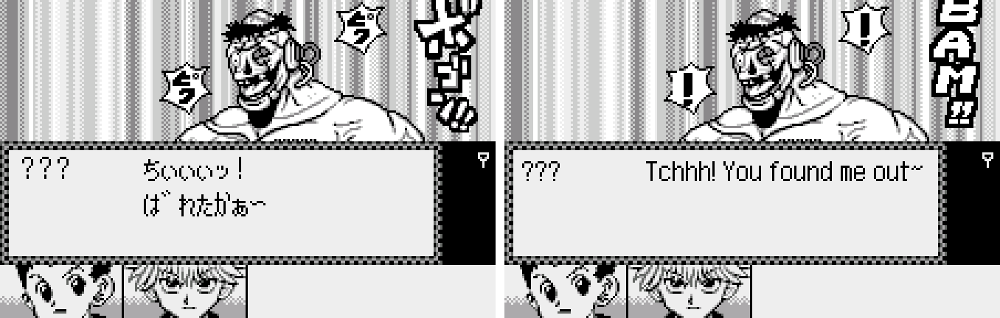

7. A battle

   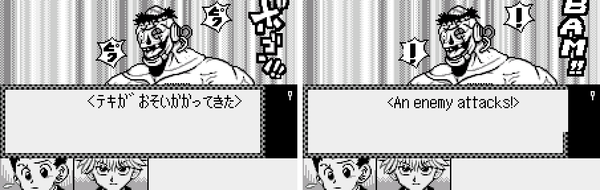

8. Turning the WonderSwan for the cyber page

   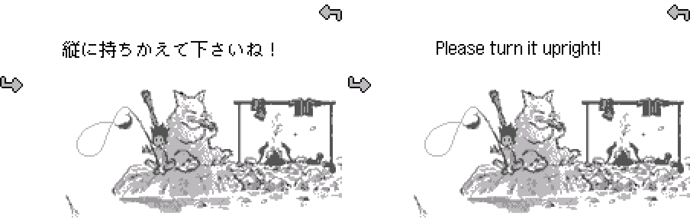

9. The cyber page

   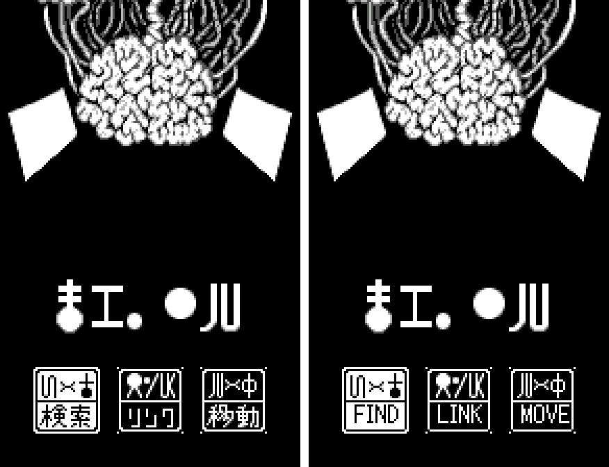

10. The encyclopedia's link list

   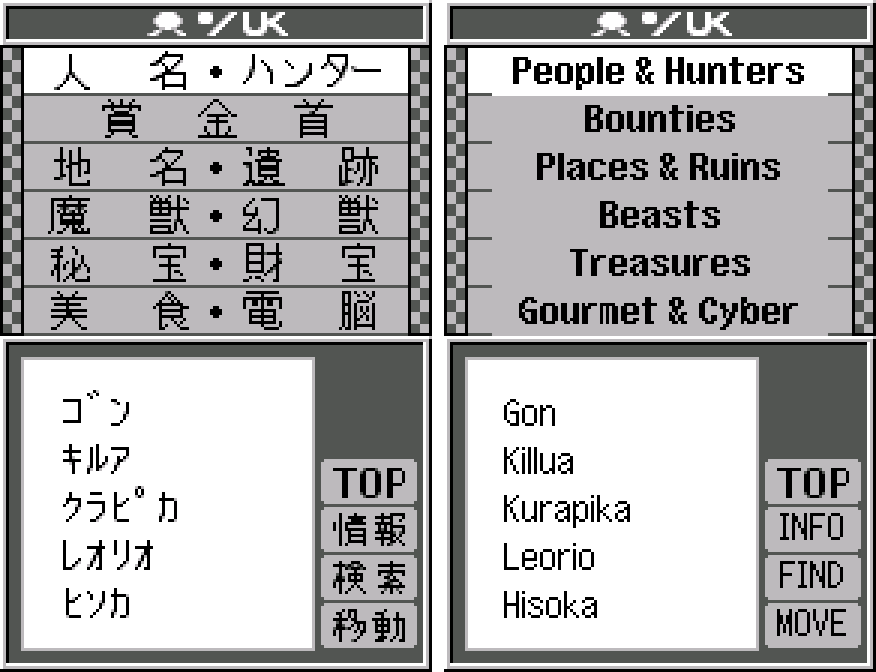

11. The move screen

   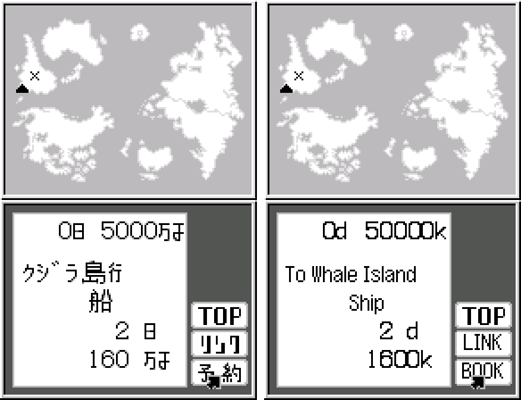

12. Mail

   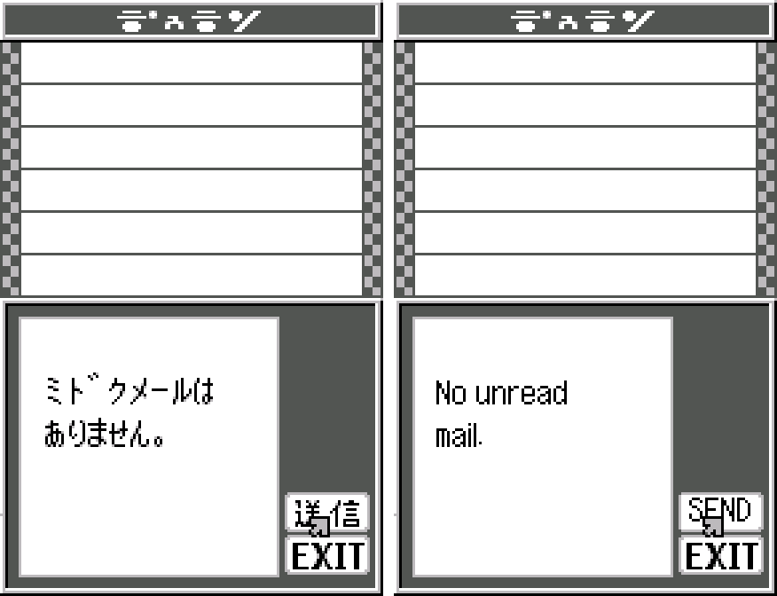

13. The save screen

   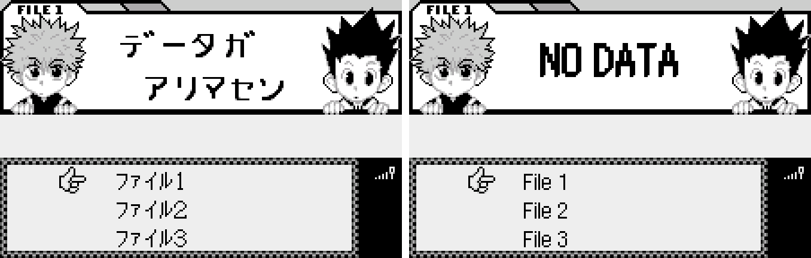

14. The ending caption

   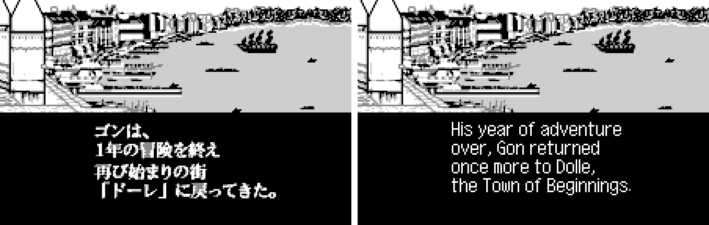

15. A letter at the ending

   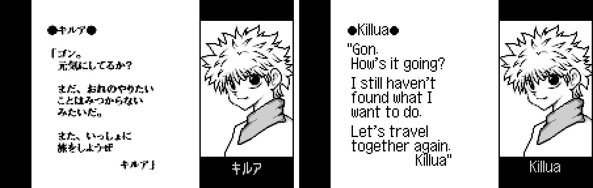

**How to patch**

Apply the BPS file to the Japanese ROM "Hunter X Hunter - Ishi o Tsugu Mono (Japan) (Rev 2)" (CRC32 70AA800E) with Floating IPS, beat or ROM Patcher JS: `hxh-ishi-en-1.1.bps`, the result should be CRC32 B05CECF4. The earlier revision (Rev 1, CRC32 BD6FC68A) isn't supported.

The English ROM is 8 MB (the original is 4 MB) because the translation needed more room: use an emulator or a flash cart that takes 64 Mbit WonderSwan ROMs. It's a WonderSwan (mono) game, so keep the .ws extension.

You must provide your own copy of the original Japanese game to apply it.

**Download:** `hxh-ishi-en-1.1.bps` on the [release page](https://github.com/PokemonGoDB/wonderswan-english-patches/releases/tag/hxh-ishi-v1.1).

**Known issues**

* It hasn't been played start to finish by a person. If you find leftover Japanese, cut text or a crash, please tell me where it happened.
* A scenario with Kite and Mito on Whale Island (173 messages) is translated, but no event in the game seems to start it; it may be unused.
* The Hunter script lines in the encyclopedia and on a few tablets stay in the original cipher (it encodes Japanese syllables).
* Some encyclopedia link titles are abbreviated (for example "Ph. Troupe") because the list has room for about nine letters; each entry gives the full name.

**Technical notes (for the curious)**

* The ROM was expanded to 8 MB. The game draws text with its own 8x16 font engine; a new proportional printer replaces its glyph loop, and about 376 KB of English text was relocated into the new space with the pointers updated.
* The encyclopedia search compares typed letters with a keyword stored in each entry; those were rewritten in English, and a check ties every bracketed story keyword to the same entry the Japanese does.
* Money is counted in units of 10,000 Jenny; the number fields use the game's own digit glyphs with small "k" and "d" units drawn to match.
* Pictures with text were redrawn on their own tiles; one used a striped background, rebuilt from the picture's own clean rows so the old lettering left no trace.

**A Note On My Justifications for AI Use**

I have been an avid fan of the Wonderswan system for a very long time now. It was actually a motivating factor for my various attempts to learn Japanese (which have all failed so far). I always wanted to explore the game catalog more, but the lack of English translations made it extremely difficult to do so. Here's the thing: There's a reason many of these games have not been translated yet. It's not just the fact that Japanese > English translation is difficult. There's also the fact that the original developers used all kinds of tricks and technical feats to make these games work. Most games do not have a searchable directory of text that you can just replace with English equivalents. While some are easier than others, translations for some of these would take not only an expert in Japanese > English translation, but also someone with vast game development and programming experience.

I say all that to say: I get why people are apprehensive about AI usage for this type of thing. However, these games have been around for a very long time now and most of them have still not received a translation. I (and others) have chosen to spend our time and money to utilize AI to translate the games and actually make them playable for the wider community. If you don't agree with that, that's completely fine. I am more than happy to remove any of my translations if better, human ran translations are released at a later date. We already decided to skip any games where someone is actively working on a manual translation. While nowhere near what a manual translation effort would be, I do spend a considerable amount of time trying to work through each game's translation. I stress over small details and try my best to make the right calls. And I've probably messed some stuff up, which is why I welcome feedback.

I'm just looking forward to digging through all of these games. It's a great time to be into Wonderswan games.
