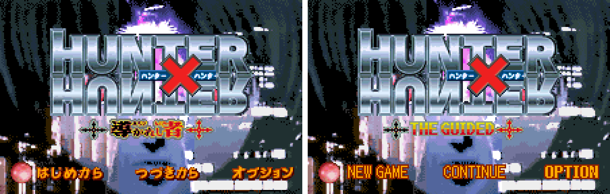
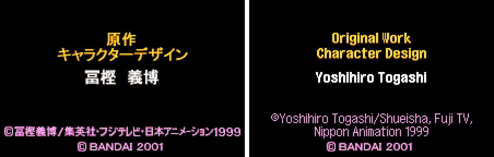
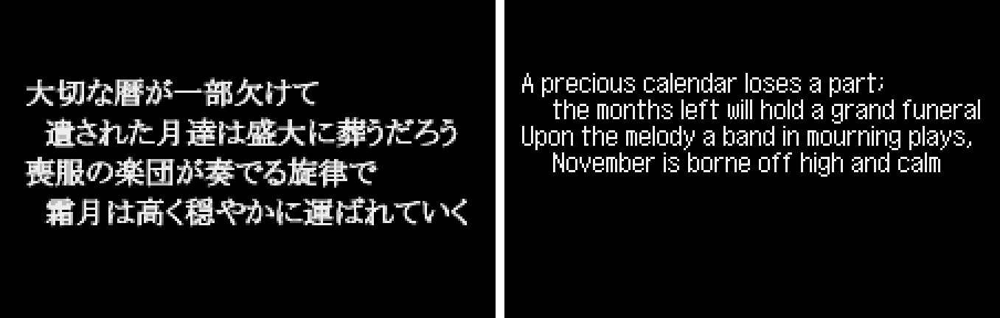
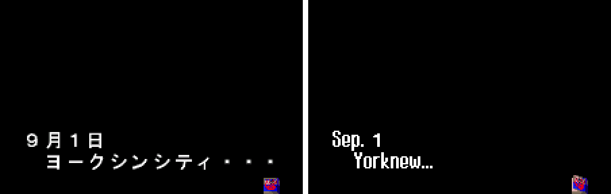
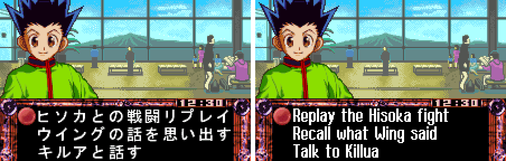
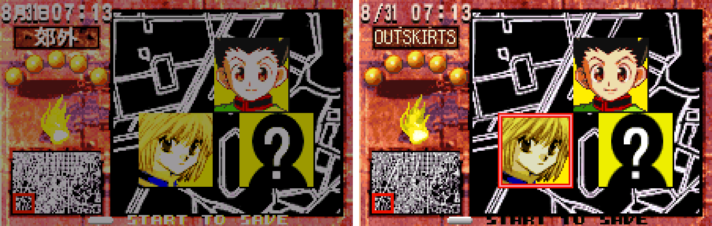
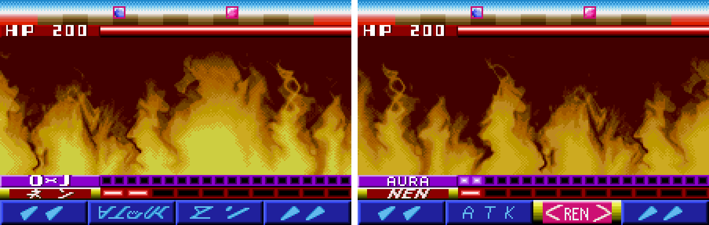
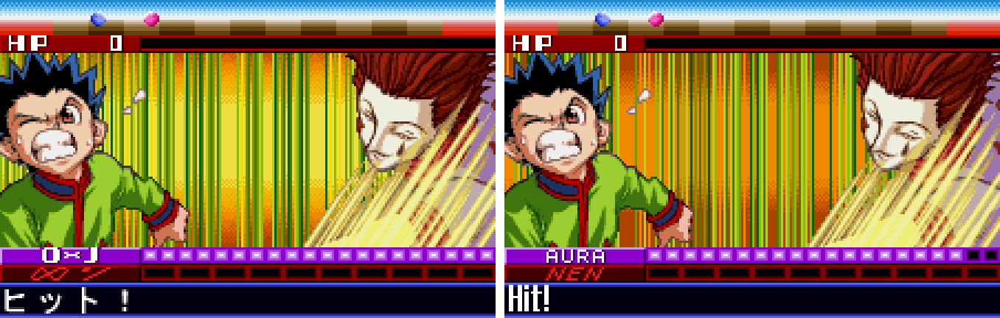
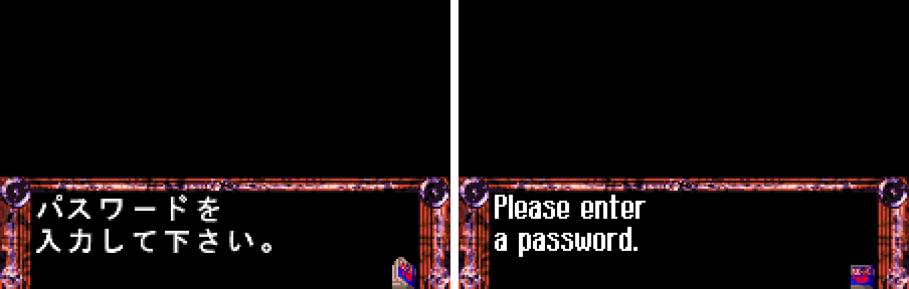
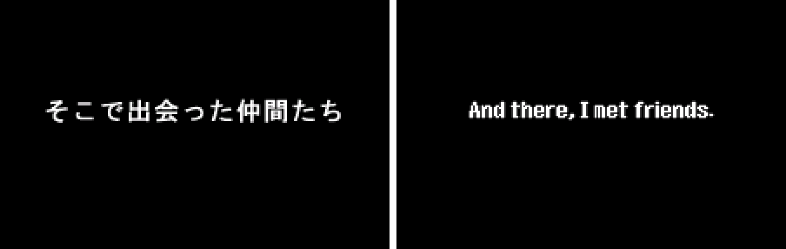

# Hunter x Hunter: Michibikareshi Mono (WonderSwan Color) - AI English translation patch v1.0

**Hunter x Hunter: Michibikareshi Mono** (ハンター×ハンター 導かれし者, "The Guided") is a story and investigation adventure for the WonderSwan Color, based on Yoshihiro Togashi's Hunter x Hunter (Bandai, 2001). It follows the Yorknew City arc: you move over a city map where the time of day matters, choose who to talk to and what to ask from command menus, fight the Phantom Troupe in a command battle, bid in the Cyber Auction and unlock a password bonus corner with mini games. It was released only in Japan. This patch translates all the text the game shows into English.

> **Please read:** this translation was made **with AI** (Claude), as a hobby project. A person (me) made every judgement call before release, but nobody on the project is a professional translator. I'm sharing it as it is for anyone who wants to play. Please **don't upload it to romhacking sites** (romhacking.net and the like). It may not be up to the standard of a real fan translation and it doesn't belong there.

**What's translated**

* **Everything the player reads:** all 2,172 messages (13,263 pages) the game can show: dialogue, the talk and map menus, the command battle's messages, item names and descriptions, the Cyber Auction, the password screens and the game's replies, the bonus corner with its mini games, save and load screens, the endings and the staff roll. Two dialogue blocks that the cartridge never displays were left as they are.
* **Text drawn as pictures:** the title and its menu (New Game, Continue, Option), the opening poems and captions, the credits, the district plates on the map, the battle bar (AURA, NEN and the command tabs), the arm-wrestle WIN / LOSE flash, the save screens' place names and the "Hold the console horizontally" prompts were redrawn in English in the original's style.
* **Names and terms** follow the official English *Hunter x Hunter* from Viz Media (Gon, Killua, Kurapika, Leorio, Hisoka, Nen, Ten, Zetsu, Ren, Hatsu). Names that exist only in this game are spelled as in the project's termbase. A few calls were mine to make and I made them: Chrollo is "the Boss" to the Troupe and Neon is "Miss Neon" to her guards, and 殺気 is "killing intent" everywhere.
* **Passwords:** the bonus corner is typed on a Latin letter and digit grid instead of the katakana grid, and the code words are in Latin letters (for example KEYON and ARMWRESTLING). The cyber-cafe and phone codes fit the game's 12-key entry field (TROUPE, TAKEUCHI). The password cheats the game already has (a point editor, 999 billion money, all keywords on) are part of the original game, so they are in this one patch; there is no separate cheat edition.
* **Letters:** the Japanese game draws every character as a fixed square; the English uses a variable-width font in the dialogue boxes (3 lines of up to 192 pixels), as tall as the original's kana wherever the box allows it, so lines are written to fit the box and some are shorter than the Japanese.
* **Kept on purpose (all answered by me):** the three painted Nen kanji that flash in battle (纏, 絶, 凝 and so on) are the original artwork and stay; the battle tabs read ATK, REN and FWD and some district plates have a shortened name, because the pictures give no more room.
* **Saves:** the patch does not change how the game saves. I did not compare a save made on the Japanese ROM with the patched game, so I can't promise it carries over.
* **Stays as it was:** screens that look the same in the original and the patch are not in the image list.

**One patch**

* `hxh-michibikareshi-mono-en-1.0`: the translation above, and nothing else. There is no developer menu in this game (I searched; see the technical notes), so there is no Debug Edition.

**How it was made: AI translation, independent checks, human decisions**

* Claude found the game's text format (16-bit character words in message streams, a fixed 16x16 font, pictures in one compressed format), wrote a story bible, a termbase and the English, redrew the picture text, and rebuilt the ROM with a variable-width letter engine added to the cartridge. The ROM stays 4 MiB, like the original.
* The final build (hxm9) went through the project's automated test run: 9 checks passed, 0 failed. It includes:
  * all 10,999 distinct pages of the translation drawn by the game's own message engine in the window type they really use and measured against the box: 0 flagged (19 password-compare messages are never displayed and were checked another way);
  * random-button walks from saved states with every drawn character logged: 606,756 English characters and 0 Japanese on 163 walks; the same check on the original sees Japanese characters and picture tiles, so it can see them;
  * a soak of 3,984,000 frames of random play from 16 states with no freeze, and the attract loop;
  * 229 captured screens in 26 of the 28 screen types of the game's inventory (the other two are listed below), 126 ending screens, and an alignment audit with 0 open flags (98 recorded exceptions, all looked at and accepted).
* Every judgement call that was mine to make was put on a decision page with pictures: 50 items, all answered by me.
* The English was read against the Japanese by independent read-only Claude reviewers, and the opcode tables that decide the password and compare checks were audited against the original.
* The main loop was played for real on the English build: the city map, talk menus, the Cyber Auction, a lost arm-wrestle and the GAME OVER card, and the shop.

**What was not seen on screen** (please report anything odd)

* **The result screen after winning the command battle against Hisoka.** No honest win was found (the scripted fight never lowered the enemy's HP); the arm-wrestle's WIN and LOSE flashes were seen.
* **The Cyber Auction's bid page.** The site pages, the buy list and the quit prompt were seen.
* **The endings played through honestly.** They were seen on a test ROM and by setting the game's state, with the staff roll and the "Fin" card.
* **Many pictures:** 425 of 628 picture resources were never loaded by any of the routes I replayed (mostly portrait animation frames and mini-game art).
* **The bonus-corner screens** have no Japanese partner to compare, so their alignment was judged on its own, and the mini games were seen only to their first screens.
* **Saves from the Japanese version** were not tested.
* **The game was not played from start to finish by a person**, and not on real hardware.

**Changelog**

* **v1.0**: first public release.

**Sources consulted**

* Japanese text: the WonderSwan Color ROM itself.
* English names and terms: the Viz Media English releases of Hunter x Hunter.
* The project's own notes on the game's text format (`games/hxh-michibikareshi-mono/TEXT-FORMAT.md`) and the QA run summaries.
* I searched for another English translation of this game on 2026-11-20 and found none (the claims board, web searches, cdromance, retrogametalk, GitHub). If a human translation is released, that one should be preferred.

**Images** (original on the left, English on the right)

1. Title screen (the subtitle "The Guided" and New Game / Continue / Option)

   

2. Credits ("Original Work, Character Design: Yoshihiro Togashi")

   

3. Opening poem

   

4. New game: "Sep. 1 Yorknew..."

   

5. Talk menu: "Replay the Hisoka fight / Recall what Wing said / Talk to Killua"

   

6. City map: "Outskirts" and the character portraits

   

7. Command battle: the battle bar (AURA, NEN, ATK, REN)

   

8. Battle message: "Hit!"

   

9. Password prompt: "Please enter a password."

   

10. Ending caption: "And there, I met friends."

   

**How to patch**

Apply the BPS file to the Japanese ROM **Hunter X Hunter - Michibikareshi Mono (Japan).wsc** (4,194,304 bytes, CRC32 `9402BCA9`, SHA-1 `BC591FC24D3F8E94B70503FD8B6A35FA58151139`) in your browser with the [Swan Revival patcher](https://swanrevival.com/patcher/), or with Floating IPS, beat or ROM Patcher JS. The result is 4,194,304 bytes, `hxh-michibikareshi-mono-en-1.0.bps`; the result should be CRC32 `49CAF0EF` (SHA-1 `3A81C10200E0083D413CABB5DD94765E73C7996D`).

It's a WonderSwan Color game, so keep the .wsc extension. You must provide your own copy of the original Japanese game to apply it. The patch only fits this dump (CRC32 `9402BCA9`); another revision is refused or gives a wrong result. No other revision is known.

**Download:** `hxh-michibikareshi-mono-en-1.0.bps` on the [release page](https://github.com/PokemonGoDB/wonderswan-english-patches/releases/tag/hxh-michibikareshi-mono-v1.0).

**Known issues**

* It was tested in an emulator, not on a real WonderSwan, and no person has played the whole game (see "What was not seen on screen"). If you find leftover Japanese, cut text or a crash, please tell me where it happened.
* In the one-line battle caption box the tails of g, j, p, q and y run over the frame's lower line (79 of 201 captions; nothing is cut), because the English capitals are as tall as the original's kana and the box has no room to spare.
* Two narrow `w` letters in ending captions and the tiny minimap glyph were not redrawn.
* Some lines are shorter than the Japanese because the box holds three lines of 192 pixels.
* The soak showed a 14-window stall in one battle state in a short run; the original shows the same with more random seeds, so I do not count it as a fault of the patch.
* Save states made in an emulator on the Japanese ROM do not carry over to the patched ROM.

**Technical notes (for the curious)**

* The text is stored as 16-bit little-endian words in message streams (glyph numbers below 0200h, control words above), described by 2,172 eight-byte descriptors in bank 36h, and drawn by one routine in the game. The patch hooks that routine in three places and adds a variable-width letter engine and a Latin font (13,093 bytes at ROM 0x35B3E0); a bit in the descriptor's bank byte marks an English message, stored as one byte per character, and the English text is repacked into the text banks, which have about 2.3 times the room of the Japanese glyph count.
* The pictures use one LZ codec; 628 picture streams are catalogued, and the ones that carried Japanese were redrawn and recompressed in place.
* I found no developer debug menu: a search of the text, the ROM's ASCII strings and the button routes I could trace turned up none. The only hidden content is the password bonus corner; its password table starts at ROM 0x36B70B.
* The BPS file is 896,967 bytes. Applying it to the original gives the tested build byte for byte (checked with the project's patcher), and the ROM stays 4 MiB.

**A Note On My Justifications for AI Use**

I have been an avid fan of the Wonderswan system for a very long time now. It was actually a motivating factor for my various attempts to learn Japanese (which have all failed so far). I always wanted to explore the game catalog more, but the lack of English translations made it extremely difficult to do so. Here's the thing: There's a reason many of these games have not been translated yet. It's not just the fact that Japanese > English translation is difficult. There's also the fact that the original developers used all kinds of tricks and technical feats to make these games work. Most games do not have a searchable directory of text that you can just replace with English equivalents. While some are easier than others, translations for some of these would take not only an expert in Japanese > English translation, but also someone with vast game development and programming experience.

I say all that to say: I get why people are apprehensive about AI usage for this type of thing. However, these games have been around for a very long time now and most of them have still not received a translation. I (and others) have chosen to spend our time and money to utilize AI to translate the games and actually make them playable for the wider community. If you don't agree with that, that's completely fine. I am more than happy to remove any of my translations if better, human ran translations are released at a later date. We already decided to skip any games where someone is actively working on a manual translation. While nowhere near what a manual translation effort would be, I do spend a considerable amount of time trying to work through each game's translation. I stress over small details and try my best to make the right calls. And I've probably messed some stuff up, which is why I welcome feedback.

I'm just looking forward to digging through all of these games. It's a great time to be into Wonderswan games.
