# Inuyasha: Fuuun Emaki (WonderSwan Color) - AI English translation patch v1.0

**Inuyasha: Fuuun Emaki** (犬夜叉 風雲絵巻) is a story-driven action-adventure for the WonderSwan Color, based on Rumiko Takahashi's Inuyasha (Bandai, 2002-07-27). You follow the story chapter by chapter over a map: portrait dialogue scenes, side-scrolling battles against demons, a skill board that grows between fights and save prompts. The title menu also offers a Versus mode and, after you have saved, 100 Fights. It was released only in Japan. This patch translates all the text the game shows into English.

> **Please read:** this translation was made **with AI** (Claude), as a hobby project. A person (me) made every judgement call before release, but nobody on the project is a professional translator. I'm sharing it as it is for anyone who wants to play. Please **don't upload it to romhacking sites** (romhacking.net and the like). It may not be up to the standard of a real fan translation and it doesn't belong there.

**What's translated**

* **Everything the player reads:** 3,484 story and interface messages (3,483 translated; one is empty): the dialogue and chapter scenes, skills, battle and board text, save prompts, the Versus mode, 100 Fights and the ending.
* **Text drawn as pictures:** the title subtitle and the "Press a button" prompt, the title menu (Story, Versus, 100 Fights), the battle banners (One Round, Begin!, Decided!, Victory, Defeat), the chapter headings (Chapter 1 to 8), the map plates, the status and rank labels, the Versus buttons and name plaques, the link messages and the copyright line were redrawn in English in the original's style.
* **Names and terms:** they follow the shared Inuyasha series bible of this project (`translation/inuyasha/INUYASHA-BIBLE.md`), which follows the Viz Media English releases and the English dub: Inuyasha (not "InuYasha"), Jewel shard (not "Shikon Shard"), old man Myoga for the flea who goes by 冥加じじい, plain Myoga when Kagome says his name. The same bible binds the project's two other Inuyasha games (Kagome no Sengoku Nikki and Kagome no Yume Nikki), so all three agree.
* **Letters:** the Japanese game draws every character as a fixed square; the English uses a variable-width font in the dialogue boxes (2 lines of up to 174 pixels), so lines are written to fit the box, and some are shorter than the Japanese.
* **Kept on purpose (all answered by me):** the staff roll names stay in kanji and kana; the rank orb 格 on the Versus screen is a single "R"; the title subtitle is the romaji "Fuuun Emaki" under the logo; "Chapter" on the chapter heading is a condensed, taller word, so it fits the original's space; the Versus name plaques are written one syllable per diamond (Inu / Ya / sha, Ko / ga, Ki / kyo, Ses / sho / maru, Na / ra / ku), because a name does not fit the plaque in one piece.
* **Saves:** the patch does not change how the game saves. I did not compare a save made on the Japanese ROM with the patched game, so I can't promise it carries over.
* **Stays as it was:** screens that look the same in the original and the patch are not in the image list.

**Two patches: Standard and Debug Edition**

* **Standard** (`inuyasha-fuuun-emaki-en-1.0`): the translation above, and nothing else. Play this one.
* **Debug Edition** (`inuyasha-fuuun-emaki-en-debug-1.0`): the same translation, but the cartridge **starts in the developers' test menu that is still on it** instead of the title screen (one byte of the reset vector is changed, and the checksum). The menu is already in English in the original game ("WonderSwan Color Test Program", with a date stamp of 2002-06-24). It is not meant for a first playthrough, because the game does not start on the title screen. What it gives you:
  * **Graphic Test:** a viewer for the player sprites, the enemies and three effect sets.
  * **Sound Test.**
  * **Normal Game Start:** pick a field (smp00 to smp10 and msam), then the enemy (zako or boss, from a list of enemy names), then a team option, and the game starts there.
  * **Battle Game Start:** pick a field and the player (inu, kouga, kikyou, seshou, naraku) and a team option, for a one-off battle.
  * **DebugFlag:** a number you change with X4 and X2; its bits are labelled slow, sound all off, 2P pad emu, invincible and max magic.
  * **Exit.**
  
  I saw the menu come up on the patched ROM and used the same route to reach battles for the checks. I did **not** work out what every field number does, or whether Normal Game Start gives a properly playable game with the story flags set. There is no way into this menu from the Japanese or the standard game, and it is not translated by the patch because it is already English. The screens look the same in both patches, so none are in the image list.

**How it was made: AI translation, independent checks, human decisions**

* Claude found the game's text format (16-bit character words in message streams, 22 groups, a master table in the ROM), wrote a story bible, a termbase and the English, drew the picture text, and rebuilt the ROM with a variable-width letter engine and the text moved into unused ROM space. The ROM stays 4 MiB, like the original.
* The final build (iyf12) went through the project's automated test run: 9 checks passed, 0 failed. It includes:
  * all 3,484 messages drawn by the game's own message engine and measured against the text box: 0 flagged, 0 not reached; every message in the patch has English and none holds Japanese characters;
  * 95 random-button walks from 91 saved states (427,503 frames) with every drawn character logged: 0 real Japanese text; the same run on the original sees 176 distinct Japanese strings, so the check can see Japanese;
  * a soak of 3,600,000 frames from 20 states with no flag, and the attract loop;
  * 89 screen pairs, original and English, compared one by one and an alignment audit of 105 screens (63 flagged rows, all looked at and accepted).
* Every judgement call that was mine to make was put on a decision page with pictures: 21 items in several rounds, all answered by me (the answers include the condensed "Chapter" heading, the syllable plaques and the Debug Edition).
* The English was read against the Japanese by independent read-only Claude reviewers, and a later pass applied the series bible across the whole text.
* The main loop was played for real on the English build: the first battles, the result board, a defeat, save and continue, the Versus select and 100 Fights.

**What was not seen on screen** (please report anything odd)

* **Chapters 2 to 8 and the real ending were not played for real.** They were reached with test-only patched scripts, so the maps, chapter headings and the staff roll were seen, but not the way you get there in play.
* **The level-up screen, boss battles and the contents of the Sound Test.**
* **Versus with a second console.** The link messages were seen, but not a real match with a partner. The Naraku and Sesshomaru name plaques and the other characters' status names were checked by forcing them to appear, not in a match.
* **A few banners** (for example the boss banner "Decided!") and some node events.
* **Save and continue was played, but a dump of the save memory was not compared.**
* **The game was not played from start to finish by a person**, and not on real hardware.

**Changelog**

* **v1.0**: first public release (standard and Debug Edition).

**Sources consulted**

* Japanese text: the WonderSwan Color ROM itself.
* English names and terms: the Viz Media English releases of Inuyasha and the English dub, through the project's Inuyasha series bible (`translation/inuyasha/INUYASHA-BIBLE.md`).
* The developers' menu was first pointed out by the Inuyasha: Fuuun Emaki page of The Cutting Room Floor (TCRF); I checked it on the ROM myself.
* The project's own notes on the game's text format (`games/inuyasha-fuuun-emaki/TEXT-FORMAT.md`) and the QA run summaries.
* I searched for another English translation of this game on 2026-11-20 and found none. If a human translation is released, that one should be preferred.

**Images** (original on the left, English on the right)

1. Title screen (subtitle "Fuuun Emaki" and "Press a button")

   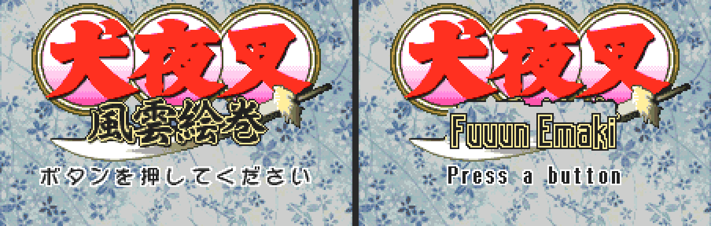

2. Title menu: Story, Versus, 100 Fights

   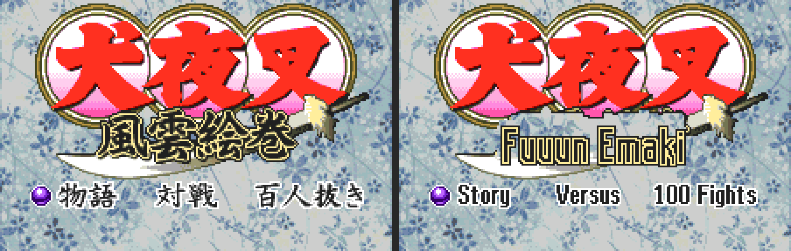

3. Dialogue: Inuyasha ("Damn it. The smell of blood won't go.")

   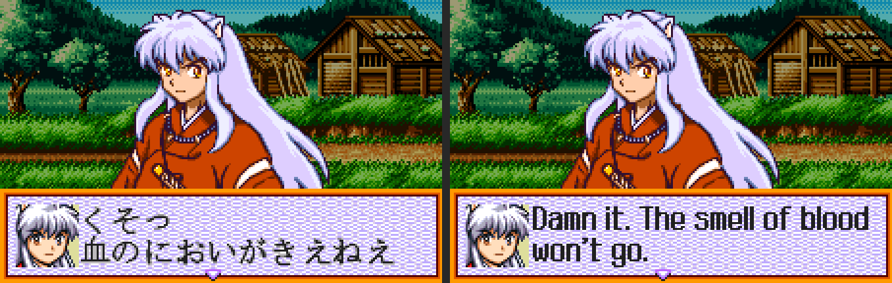

4. Dialogue: old man Myoga

   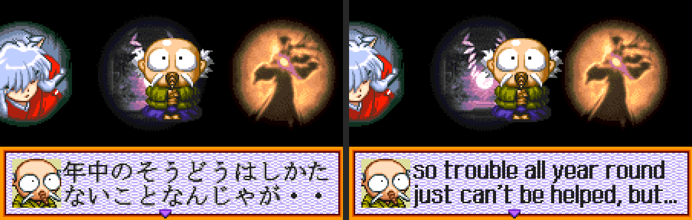

5. Dialogue: Kagome ("It's faint...")

   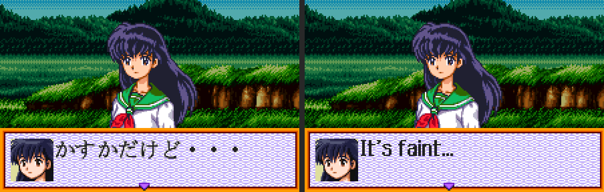

6. Chapter map: "Chapter 1" and the map plate "Mountains"

   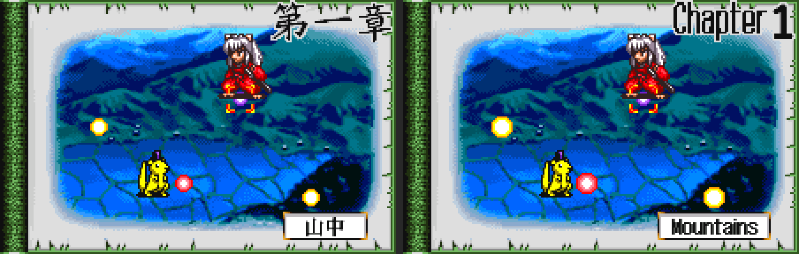

7. Skill board: Sacred Arrow (Cost 50, hits with a 1/4 chance)

   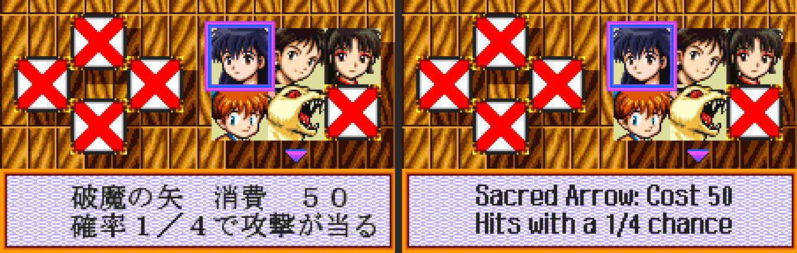

8. Status board: NEXT, SKL, HP, ATK, EXP

   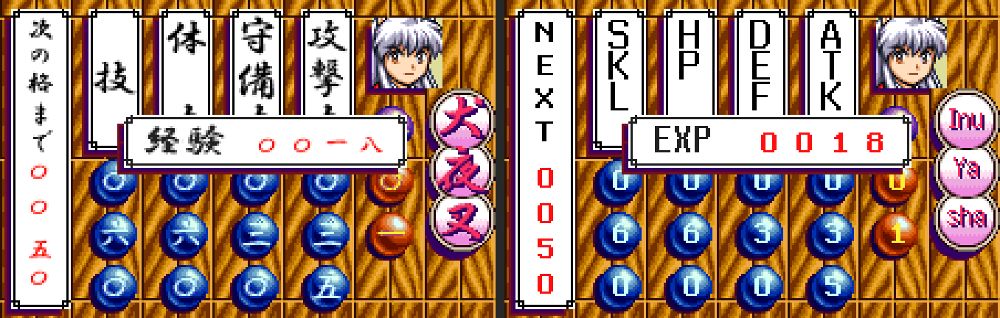

9. Battle pause: PAUSE, HP, SKL

   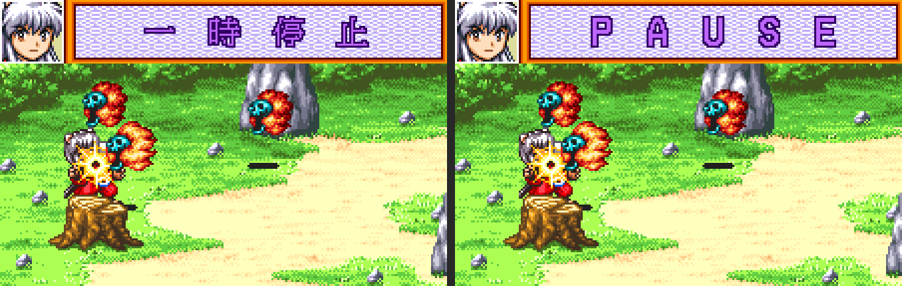

10. Battle banner: One Round

   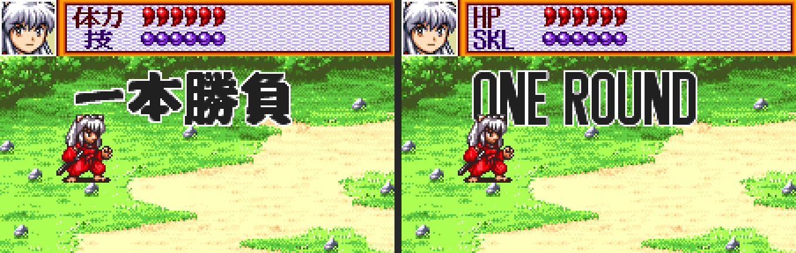

11. Battle banner: Defeat

   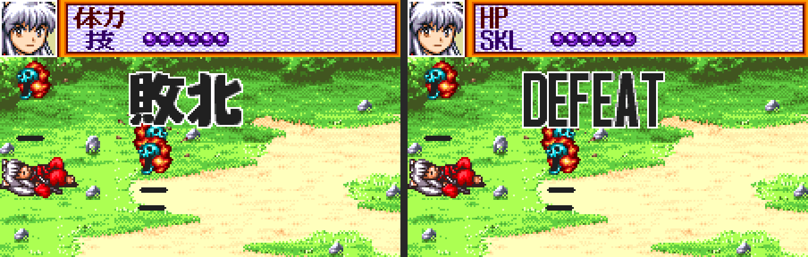

12. Versus select: OK, Team, Rank and the name plaque

   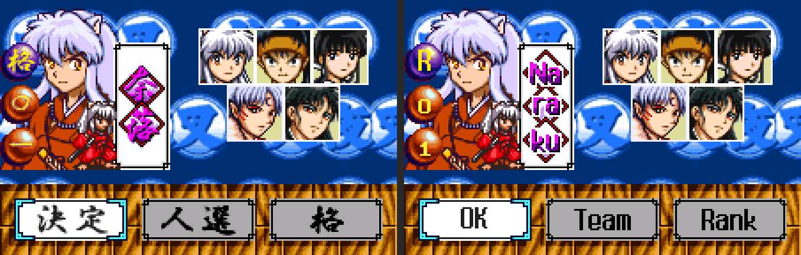

13. Staff roll (the English role, the Japanese names kept)

   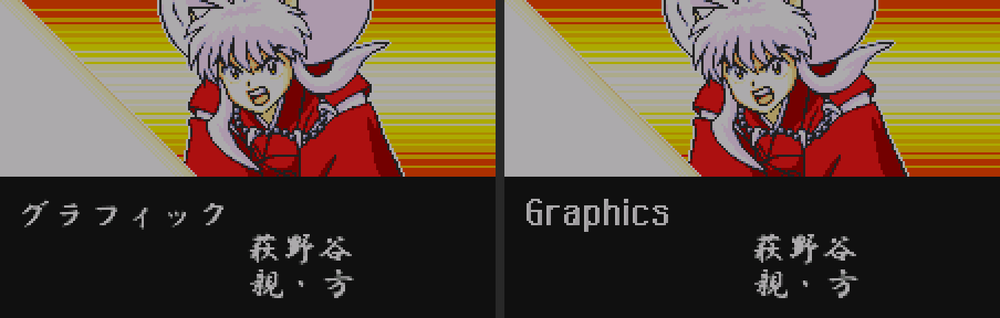

**How to patch**

Apply the BPS file to the Japanese ROM **Inuyasha - Fuuun Emaki (Japan).wsc** (4,194,304 bytes, CRC32 `3FF5791F`) in your browser with the [Swan Revival patcher](https://swanrevival.com/patcher/), or with Floating IPS, beat or ROM Patcher JS. The result is 4,194,304 bytes:

* Standard: `inuyasha-fuuun-emaki-en-1.0.bps`; the result should be CRC32 739FF4F7.
* Debug Edition: `inuyasha-fuuun-emaki-en-debug-1.0.bps`; the result should be CRC32 95E14D90.

It's a WonderSwan Color game, so keep the .wsc extension. You must provide your own copy of the original Japanese game to apply it. The patch only fits this dump (CRC32 `3FF5791F`); another revision is refused or gives a wrong result.

**Download:** `inuyasha-fuuun-emaki-en-1.0.bps`, `inuyasha-fuuun-emaki-en-debug-1.0.bps` on the [release page](https://github.com/PokemonGoDB/wonderswan-english-patches/releases/tag/inuyasha-fuuun-emaki-v1.0).

**Known issues**

* It was tested in an emulator, not on a real WonderSwan, and no person has played the whole game (see "What was not seen on screen"). If you find leftover Japanese, cut text or a crash, please tell me where it happened.
* Some lines are shorter than the Japanese because the box holds two lines of 174 pixels.
* The Versus name plaques read one syllable per diamond (Ses / sho / maru in smaller letters), and the rank orb is an "R".
* The staff roll names are still in Japanese, on purpose.
* Debug Edition: starts in the test menu, not on the title screen; I did not work out what every entry does (see above).
* Save states made in an emulator on the Japanese ROM do not carry over to the patched ROM.

**Technical notes (for the curious)**

* The text is stored as 16-bit character words in message streams (22 groups, 3,484 messages) addressed from a master table at ROM 0x300490. The patch repacks all groups into new banks and installs a small variable-width letter routine and a Latin font in ROM 0x3E0000-0x3EFFFF, hooked into the game's own text printer at 4000:4923.
* The cartridge has an unused developer test menu. It is reached by changing the reset vector's segment byte at ROM 0x3FFFF3 from FE to F0, which is all the Debug Edition does (plus the checksum). Nothing in the game jumps there in normal play (I did not search every code path, so that is the observation, not a proof).
* The BPS files are 478,970 bytes (standard) and 478,973 bytes (Debug Edition). Applying each to the original gives the tested build byte for byte (checked with the project's patcher), and the ROM stays 4 MiB with a corrected checksum.

**A Note On My Justifications for AI Use**

I have been an avid fan of the Wonderswan system for a very long time now. It was actually a motivating factor for my various attempts to learn Japanese (which have all failed so far). I always wanted to explore the game catalog more, but the lack of English translations made it extremely difficult to do so. Here's the thing: There's a reason many of these games have not been translated yet. It's not just the fact that Japanese > English translation is difficult. There's also the fact that the original developers used all kinds of tricks and technical feats to make these games work. Most games do not have a searchable directory of text that you can just replace with English equivalents. While some are easier than others, translations for some of these would take not only an expert in Japanese > English translation, but also someone with vast game development and programming experience.

I say all that to say: I get why people are apprehensive about AI usage for this type of thing. However, these games have been around for a very long time now and most of them have still not received a translation. I (and others) have chosen to spend our time and money to utilize AI to translate the games and actually make them playable for the wider community. If you don't agree with that, that's completely fine. I am more than happy to remove any of my translations if better, human ran translations are released at a later date. We already decided to skip any games where someone is actively working on a manual translation. While nowhere near what a manual translation effort would be, I do spend a considerable amount of time trying to work through each game's translation. I stress over small details and try my best to make the right calls. And I've probably messed some stuff up, which is why I welcome feedback.

I'm just looking forward to digging through all of these games. It's a great time to be into Wonderswan games.
