# Inuyasha: Kagome no Sengoku Nikki (WonderSwan Color) - AI English translation patch v1.0

**Inuyasha: Kagome no Sengoku Nikki** (犬夜叉 かごめの戦国日記, "Kagome's Feudal Diary") is a virtual-companion adventure for the WonderSwan Color, based on Rumiko Takahashi's Inuyasha (Bandai, 2001). It runs on the cartridge's real-time clock: you set the date and time, play a short opening (the shrine, the well, the Feudal Era, Inuyasha), and then live alongside him in a main loop with a clock at the top right, a caption saying what Inuyasha is doing right now and a command menu (Explore, Talk, Mini-Games, Go Home, Items, Inuyasha, Close). From there you can go home to Kagome's room (items, the forest, the diary). It was released only in Japan. This patch translates all the text the game shows into English.

> **Please read:** this translation was made **with AI** (Claude), as a hobby project. A person (me) made every judgement call before release, but nobody on the project is a professional translator. I'm sharing it as it is for anyone who wants to play. Please **don't upload it to romhacking sites** (romhacking.net and the like). It may not be up to the standard of a real fan translation and it doesn't belong there.

**What's translated**

* **Everything the player reads:** 19,901 messages plus 895 fixed strings (menus, prompts, item names, captions, the diary and talk topics). None of the English text holds a Japanese character.
* **A real English name entry:** the original's kana and kanji grid is replaced by one page of Latin letters (A-Z, a-z and a few marks, no digits) with room for 8 letters; the default name is "Kagome".
* **Text drawn as pictures:** the boot copyright line (the same rights holders and years, in three lines), the title subtitle and the "Press the START button!" prompt, the title menu, the clock screen (Please enter the current time, Yr / Mo / Day / Hr / Min, OK), the command, room and item buttons, the page headers, the status labels (Stamina, Trust, Stress), the explore compass, the mini-game banners and the "Sit!" callout were redrawn in English in the original's style.
* **Names and terms:** they follow the shared Inuyasha series bible of this project (`translation/inuyasha/INUYASHA-BIBLE.md`), which follows the Viz Media English releases and the English dub: Inuyasha, Kaede, Miroku, Sango, Shippo, Kikyo, Shikon Jewel, Buyo for the Higurashi cat. Kagome calls Kaede "Grandma Kaede" (my answer, shared with Fuuun Emaki), people who know the monk say "Miroku" (strangers say "Monk" or "Good monk"), and when Kagome says Myoga's name it is plain "Myoga", as in the dub. The same bible binds the project's two other Inuyasha games, so all three agree.
* **The pinky-swear song** (Kagome's ゆびきり) is the English rhyme "Cross my heart, hope to die, stick a needle in my eye", and Inuyasha's reaction was changed to answer it (my answer).
* **Letters:** the Japanese game draws every character as a fixed square; the English uses a variable-width font in the dialogue boxes (two lines of about 177 and 168 pixels), so lines are written to fit the box, and some are shorter than the Japanese.
* **Kept on purpose:**
  * **The title logo keeps its Japanese 犬夜叉 lettering** exactly as the original draws it (my choice). Only the subtitle under it, "Kagome's Feudal Diary", is English.
  * One unreferenced strip of "clock B" button art stays Japanese in the ROM; no screen of the game draws it.
* **Saves:** the game keeps its state in the cartridge's save memory and the patch does not change how it saves. I did not compare a save made on the Japanese ROM with the patched game, so I can't promise it carries over.
* **Stays as it was:** screens that look the same in the original and the patch are not in the image list.

**Two patches: Standard and Debug Edition**

* **Standard** (`inuyasha-kagome-no-sengoku-nikki-en-1.0`): the translation above, and nothing else. Play this one.
* **Debug Edition** (`inuyasha-kagome-no-sengoku-nikki-en-debug-1.0`): the same translation, plus the game's own **unused developer menu**, which opens right after you set the clock (one byte that chooses which script runs after the clock is changed, a three-line menu box is added so the third entry and the cursor are visible, and the checksum is fixed). Nothing in the normal game calls this menu. It is not meant for a first playthrough. What it gives you:
  * **Battle:** Yura A and Yura B.
  * **Game:** View scenarios (the Canon and Original rumour lists, epilogues and the main-story chapter lists), Event picture mode (138 event scenes), Sound mode (a caption per track) and View chibi characters (a sprite viewer), and Main game to start the normal game.
  * **Miscellaneous:** Get all items, Get all topics.

  I saw every branch of the menu on screen, on the Japanese and the patched ROM, and checked that none of the viewers draws Japanese. I paged through only the first 12 to 60 screens of each list, not every entry. Two flaws of the menu itself remain: sound captions and chapter labels are left-aligned. The menu is not part of the normal game, so the screens are not in the image list.

**How it was made: AI translation, independent checks, human decisions**

* Claude found the game's text format (Huffman-compressed 12x12 glyph streams in about ten text banks, decoded by the game's own routine), wrote a story bible, a termbase and the English, drew the picture text, and rebuilt the ROM with a variable-width letter engine and the text moved into new ROM space. The ROM grows from 2 MiB to 4 MiB.
* The final build (iys13) went through the project's automated test run: 10 of 10 checks passed. It includes:
  * all 19,901 messages drawn by the game's own message engine and measured against the text box: 0 flagged;
  * 144 random-button walks from saved states (289,770 drawn glyphs logged): no Japanese text drawn; the same check on the Japanese original flags kana, so it can see Japanese;
  * a soak of 2,070,000 frames from 23 states with no flag, the attract loop and a sweep of 699 inventory screens, plus an alignment audit of the screens;
  * the 69 screens that changed in the last build compared one by one against the previous one (69 of 69 passed).
* Every judgement call that was mine to make was put on a decision page with pictures: 24 items in four rounds, all answered by me (the answers include the title logo, the copyright picture, the names, the song and the Debug Edition).
* The English was read against the Japanese by independent read-only Claude reviewers, and a later pass applied the series bible across the whole text.
* The main loop was played for real on an earlier build (iys6e), from name entry to the first day.

**What was not seen on screen** (please report anything odd)

* **Affection levels above 1 and later story days.** I have no save from a long play. The status screen was seen at "1-star level" ("Frankly, you are not on his radar") and not beyond.
* **No ending or credits in real play.** The staff roll and the developer viewers were seen on test ROMs only.
* **Rare clock events.**
* **The "Sit!" callout** was seen only through the developer scenario viewer.
* **The items Mom's Packed Lunch, Broken Buddha and Steamed Yam** appear in no capture, and the Persimmon Seeds item and its messages were checked as text only.
* **Ten Myoga lines** were checked by the dialogue sweep in the real text box, not on a played screen.
* **The game was not played from start to finish by a person**, and not on real hardware.

**Changelog**

* **v1.0**: first public release (standard and Debug Edition).

**Sources consulted**

* Japanese text: the WonderSwan Color ROM itself.
* English names and terms: the Viz Media English releases of Inuyasha and the English dub, through the project's Inuyasha series bible (`translation/inuyasha/INUYASHA-BIBLE.md`).
* The project's own notes on the game's text format (`games/inuyasha-kagome-no-sengoku-nikki/TEXT-FORMAT.md`) and the QA run summaries.
* I searched for another English translation of this game on 2026-11-20 (web searches in English and Japanese, the cdromance and retrogametalk listings) and found none. It is not the same game as the 2003 Game Boy Advance board game 犬夜叉 〜かごめの戦国日記〜 (Takara). If a human translation is released, that one should be preferred.

**Images** (original on the left, English on the right)

1. Title screen (original logo, English subtitle "Kagome's Feudal Diary" and "Press the START button!")

   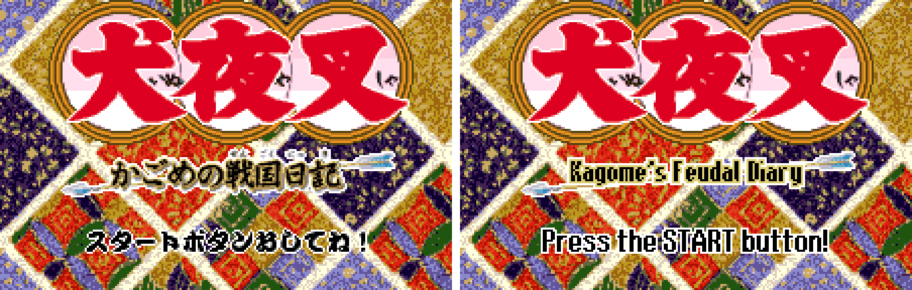

2. Boot copyright line in English

   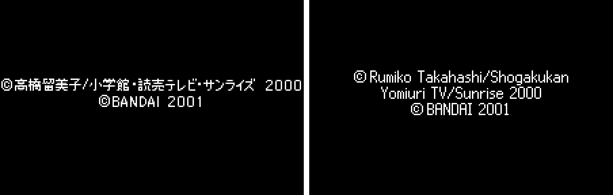

3. Title menu: New Game, Continue

   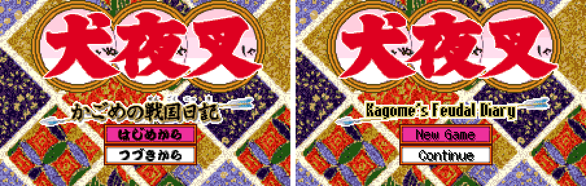

4. Clock screen: "Please enter the current time." with Yr / Mo / Day / Hr / Min and OK

   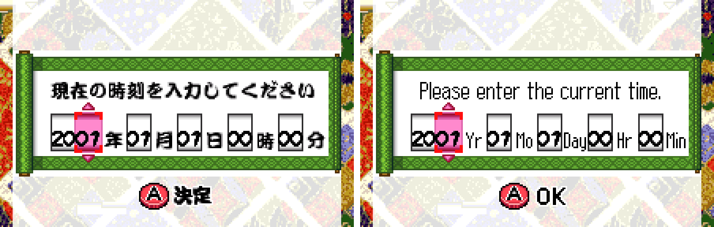

5. Forest with the caption "Inuyasha is swinging his claws around"

   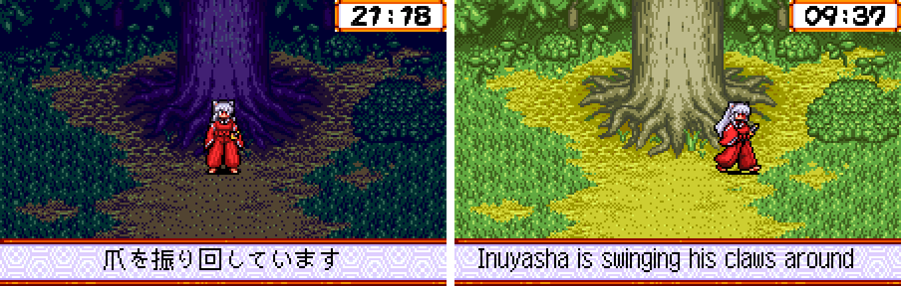

6. Town dialogue: "Sis! Have you seen Buyo?"

   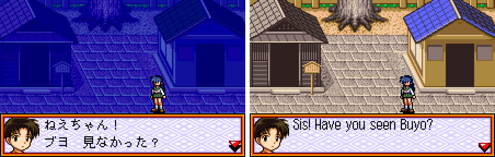

7. Command menu: Explore, Talk, Mini-Games, Go Home, Items, Inuyasha, Close

   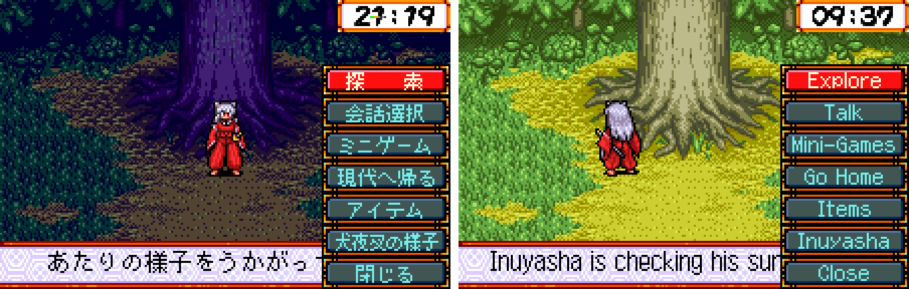

8. Status screen: "Inuyasha's Condition" (Stamina, Trust, Stress)

   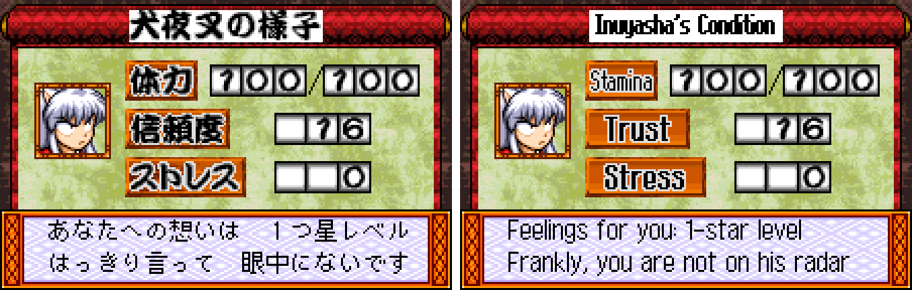

9. Room menu: Items, To Forest, Diary, Quit Game

   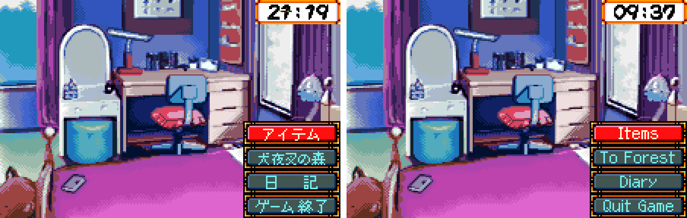

10. Diary page

   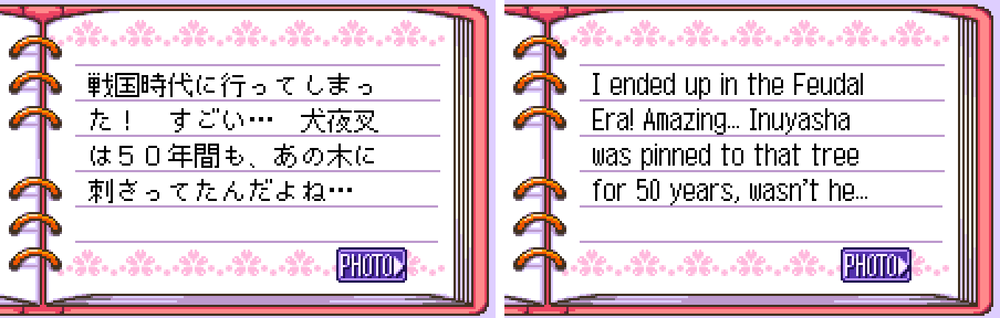

11. Item list

   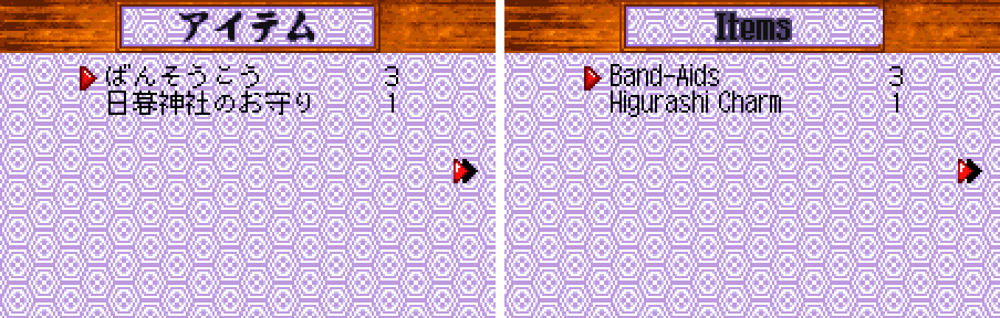

On the field screens (5, 6, 7 and 9) the original was captured at night and the English version in daylight: the game colours the field by the console's clock, so this is the original behaviour, not a change by the patch.

**How to patch**

Apply the BPS file to the Japanese ROM **Inuyasha - Kagome no Sengoku Nikki (Japan).wsc** (2,097,152 bytes, CRC32 `0C23D551`, SHA-1 `B4FBEA1A2C50D8566685F72820B360AF4B54F82F`) in your browser with the [Swan Revival patcher](https://swanrevival.com/patcher/), or with Floating IPS, beat or ROM Patcher JS. The result is 4,194,304 bytes:

* Standard: `inuyasha-kagome-no-sengoku-nikki-en-1.0.bps`; the result should be CRC32 B25E410B (SHA-1 `B156084890146912700F81E44642F27607F7583D`).
* Debug Edition: `inuyasha-kagome-no-sengoku-nikki-en-debug-1.0.bps`; the result should be CRC32 1209B679 (SHA-1 `3F295F1396D7157DB783DAE90C35FD3F4B9DDFEC`).

It's a WonderSwan Color game, so keep the .wsc extension. You must provide your own copy of the original Japanese game to apply it. The patch only fits this dump (CRC32 `0C23D551`); another revision is refused or gives a wrong result.

**Download:** `inuyasha-kagome-no-sengoku-nikki-en-1.0.bps`, `inuyasha-kagome-no-sengoku-nikki-en-debug-1.0.bps` on the [release page](https://github.com/PokemonGoDB/wonderswan-english-patches/releases/tag/inuyasha-kagome-no-sengoku-nikki-v1.0).

**Known issues**

* It was tested in an emulator, not on a real WonderSwan, and no person has played the whole game (see "What was not seen on screen"). If you find leftover Japanese, cut text or a crash, please tell me where it happened.
* Some lines are shorter than the Japanese because the box holds two lines of about 177 and 168 pixels.
* Some picture lettering is smaller than the original's, where the English would not fit the original's space at the original's size (the title ribbon, the clock units and the status header, for example; the project's `qa/font-size.json` lists each place).
* The title logo is Japanese on purpose, and one unused strip of clock-button art stays Japanese.
* The Japanese game's name entry accepted four characters; the English one takes eight letters and has no digits.
* Debug Edition: the developer menu is not part of the normal game; sound captions and chapter labels in it are left-aligned (see above).
* Save states made in an emulator on the Japanese ROM do not carry over to the patched ROM.

**Technical notes (for the curious)**

* The text is Huffman-compressed (decoder at E9AA:27D3 (segment:offset), table at ROM 0x1F8D84) and drawn with a 12x12 font in JIS order. The patch rebuilds the message banks, installs a variable-width letter routine and a Latin font in new ROM space, and relocates the fixed strings and the name entry.
* The developer menu is script 5 (ROM 0xE185C in the original). The Debug Edition changes one byte, 01 to 05, at 0x2E17CE of the 4 MiB image, plus the menu-box change and the footer checksum.
* The BPS files are 804,993 bytes (standard) and 805,127 bytes (Debug Edition). Applying each to the original gives the tested build byte for byte (checked with the project's patcher, `ws-patch verify`), and the ROM is 4 MiB with a corrected checksum.

**A Note On My Justifications for AI Use**

I have been an avid fan of the Wonderswan system for a very long time now. It was actually a motivating factor for my various attempts to learn Japanese (which have all failed so far). I always wanted to explore the game catalog more, but the lack of English translations made it extremely difficult to do so. Here's the thing: There's a reason many of these games have not been translated yet. It's not just the fact that Japanese > English translation is difficult. There's also the fact that the original developers used all kinds of tricks and technical feats to make these games work. Most games do not have a searchable directory of text that you can just replace with English equivalents. While some are easier than others, translations for some of these would take not only an expert in Japanese > English translation, but also someone with vast game development and programming experience.

I say all that to say: I get why people are apprehensive about AI usage for this type of thing. However, these games have been around for a very long time now and most of them have still not received a translation. I (and others) have chosen to spend our time and money to utilize AI to translate the games and actually make them playable for the wider community. If you don't agree with that, that's completely fine. I am more than happy to remove any of my translations if better, human ran translations are released at a later date. We already decided to skip any games where someone is actively working on a manual translation. While nowhere near what a manual translation effort would be, I do spend a considerable amount of time trying to work through each game's translation. I stress over small details and try my best to make the right calls. And I've probably messed some stuff up, which is why I welcome feedback.

I'm just looking forward to digging through all of these games. It's a great time to be into Wonderswan games.
