# Inuyasha: Kagome no Yume Nikki (WonderSwan Color) - AI English translation patch v1.0

**Inuyasha: Kagome no Yume Nikki** (犬夜叉 かごめの夢日記, "Kagome's Dream Diary") is a raising game for the WonderSwan Color, based on Rumiko Takahashi's Inuyasha (Bandai, 2002). Kagome looks after Inuyasha in a dream: the game runs over 15 days of 6 time slots each, you choose where to go on a map, meet visitors and villagers, give Inuyasha things, and read the results in a dream diary and a status card. A Memory Box (思い出箱) on the title menu keeps a "Daily Life Guide" of what you have seen. It was released only in Japan. This patch translates all the text the game shows into English and lets you type your name with Latin letters.

> **Please read:** this translation was made **with AI** (Claude), as a hobby project. A person (me) made every judgement call before release, but nobody on the project is a professional translator. I'm sharing it as it is for anyone who wants to play. Please **don't upload it to romhacking sites** (romhacking.net and the like). It may not be up to the standard of a real fan translation and it doesn't belong there.

**What's translated**

* **Everything the player reads:** the opening and the dream scenes, the village events, the diary (events, schedule, status), the command menu, the status card, the item list and item notices, the explore map and its prompts, the mini-games' instructions that can be reached, and the staff roll. The project's checks drew 17,262 text strings with the game's own text drawing, with 0 Japanese characters left in them.
* **Text drawn as pictures:** the subtitle under the title logo, the title menu (New Game, Continue, Memory Box), the command buttons, the diary pages and popups, the "Moving" and "Saving" screens, the "Save complete" screen, the map compass and the Memory Box screens were redrawn in English in the original's style. The subtitle is redrawn by hand on the original's wallpaper and reads "Kagome's Dream Diary". **The title logo keeps its Japanese 犬夜叉 lettering** exactly as the original draws it (my choice, as in the other two Inuyasha games).
* **Latin-letter name entry:** the kana grid is replaced by a grid of letters: capitals A to Z, lowercase a to z (the "abc" button switches), digits and `. - ' ! ? &`. A name can have up to 8 letters (the original allowed four kana), the default name is Kagome, and the game prints it exactly as you typed it. This was my decision, approved before release.
* **Names and terms:** they follow the shared Inuyasha series bible of this project (`translation/inuyasha/INUYASHA-BIBLE.md`), which follows the Viz Media English releases and the English dub. The same bible binds all three Inuyasha games of the project: Inuyasha: Fuuun Emaki and Kagome no Sengoku Nikki are already released with it. So here Miroku is "Miroku" to Sango, Kagome and anyone who knows him, only Miroku says "Lady <name>" to the player, Kagome says "Grandma Kaede", "Totosai" and plain "Myoga", the charm is the "Higurashi Charm", "Sit!" is for おすわり, and it is "Inuyasha" and "Jewel shard". The one Japanese honorific kept is "Sensei" for the gang's hired swordsman.
* **Item and place names:** the gift items have English joke names (the diary lines that explain each pun were rebuilt to match), the villages are translated (Seaside, Mountain, Marsh), and the four ending counters are Passion, Honesty, Trust and Hope, with the "Hope Crystal" family of key items.
* **Content kept as written (all answered by me):** Hayate's fake-wedding gag, Kamatari's okama jokes, the mother who tried to drown herself and her baby, and Kagome being offered sake.
* **Letters:** the English uses a variable-width font with capitals as tall as the original's kana (11 px) and about 32 letters per line. Where it could not be as large as the original (the title-menu buttons are 9 px against 11, the status title is smaller) it is listed in the project's font notes.
* **Stays as it was:** the developer text in the ROM (a sound and BGM test and a parameter check at 0x0EE750) is not translated, and 13 placeholder messages of the mini-games (they show "Mini-game message 06" and so on) remain, because I could not find where the game uses them. Screens that look the same in the original and the patch are not in the image list.
* **Saves:** the patch does not change how the game saves. I did not compare a save made on the Japanese ROM with the patched game, so I can't promise it carries over.

**Standard edition only**

There is **no Debug Edition** for this game. The ROM holds a developer list (event pictures, backgrounds, a sound test and a parameter check) but I could not find how the game reaches it: no button combination at power-on or on the title screen opened it (20 button holds at power-on and 13 combinations on the title screen were tried), so I have nothing to offer. I also did not search the game's code for every screen nothing points to.

**How it was made: AI translation, independent checks, human decisions**

* Claude found the game's text format, wrote a story bible, a termbase and the English, drew the picture text, and rebuilt the ROM with a variable-width letter engine and a Latin name-entry grid. The cartridge image grows from 4 MiB to 8 MiB: the new text and code take the first half and the original stays in the second.
* The final build (iyy15) went through the project's automated test run: 11 checks passed, 0 failed. It includes:
  * every one of the 17,262 strings drawn by the game's own text drawing with the widest name (eight W): 0 Japanese, 0 over the edge, 0 line flags;
  * a detector for Japanese text drawn at run time, with a control run on the original so that the check is known to see Japanese;
  * the attract loop, the ending scenes, a 40-row inventory of screens (original and English side by side) and an alignment audit;
  * a soak of 3,060,000 frames.
* Nine independent read-only Claude reviewers read every unique pair of Japanese and English strings: 1 error, 12 defects and about 30 nits, which were fixed in one batch (43 strings).
* Every judgement call that was mine to make was put on a decision page with pictures: 19 items (3 of them were settled by my earlier answers on the other Inuyasha games), all answered by me. The answers include the content kept as written, "Marsh Village", the joke item names and the developer menu.
* The main loop was played on the English build with real button presses from the name entry through days 1 to 4: saving (the "Save complete" screen), reset, Continue, the status card, the diary and the Memory Box. About 296 different dialogue boxes of days 2 to 4 were sampled: no Japanese, no clipping, no freeze.

**What was not seen on screen** (please report anything odd)

* **The endings were reached by setting the day counter, not by playing to day 15.** The endings with the numbers 0x168 and 0x170 were not seen on the English build at all. Another ending and the staff roll were seen on the English build, through the game's own day loop with that poke.
* **16 of the 30 village events were not seen by play.** The text of all of them was drawn by the checks, but not reached on a real route.
* **The "勝負" (contest) banner's trigger**, and a few item routes (S19, S21, S23, S24, S37 and S38 of the project's screen list were only partly seen).
* **The widest name (8 letters) on a real dialogue line.** The widest name was tried in the checks; its width on a dialogue line follows from the letter widths, not from a screenshot.
* **20 address-form lines** (how someone addresses Kagome or Inuyasha) were judged from context, because the speaker could not be seen.
* **The 13 placeholder messages of the mini-games**: I don't know if the game ever shows them.
* **Diary pages of days 1 to 3 after a reload, and the Memory Box entries:** all entries were still locked after day 3.
* **A replay of the played loop from power-on**, and the game was **not played from start to finish by a person**, nor on **real hardware or a real 8 MiB cartridge**.

**Changelog**

* **v1.0**: first public release.

**Sources consulted**

* Japanese text: the WonderSwan Color ROM itself.
* English names and terms: the Viz Media English releases of Inuyasha and the English dub, through the project's Inuyasha series bible (`translation/inuyasha/INUYASHA-BIBLE.md`).
* The project's own notes on the game's text format (`games/inuyasha-kagome-no-yume-nikki/TEXT-FORMAT.md`) and the QA run summaries.
* I searched for another English translation of this game on 2026-11-20 and found none. If a human translation is released, that one should be preferred.

**Images** (original on the left, English on the right)

1. Title screen: the original 犬夜叉 logo kept, the English subtitle "Kagome's Dream Diary" and "PRESS START!"

   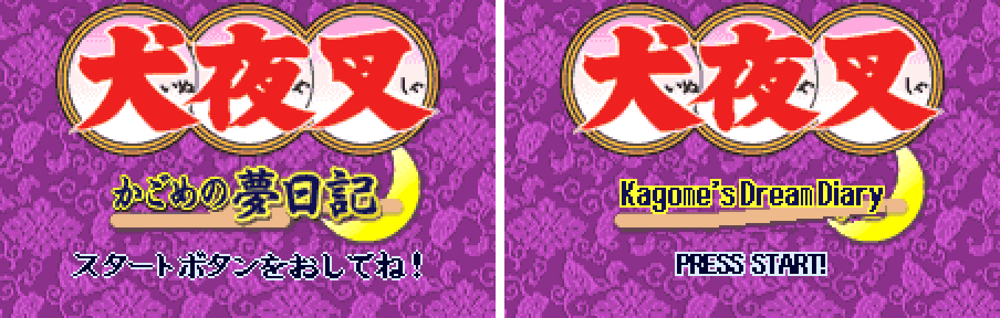

2. Name entry: the kana grid and the Latin-letter grid (the default name Kagome, buttons Delete, abc, OK)

   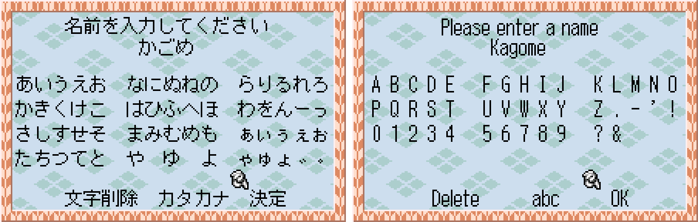

3. Name entry: the question "Is this OK?" (Yes, No) with a one-letter name

   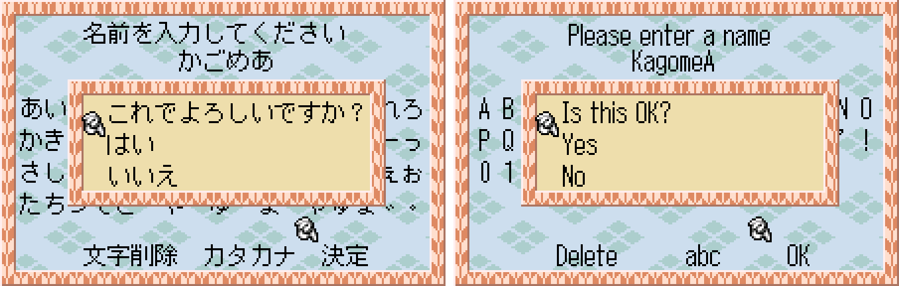

4. Dialogue: Kagome in the forest at night ("Hey, Inuyasha? ...Huh?")

   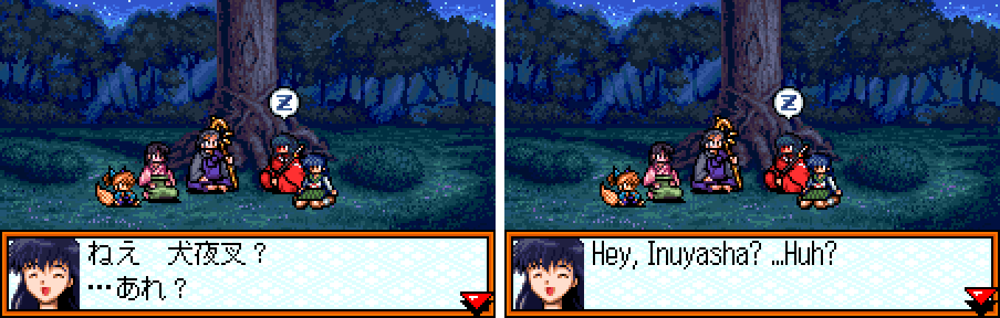

5. Dialogue: Kagome in a village ("Hello.")

   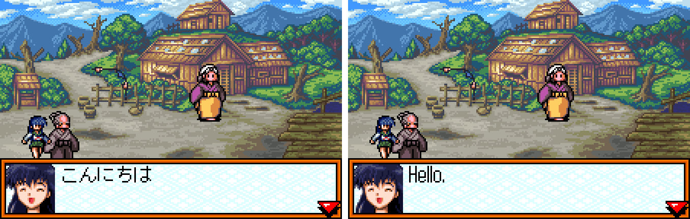

6. Status card: Inuyasha's Status (Stamina, Motivation, Attack, Defense and two mood lines)

   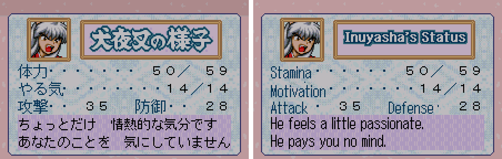

7. Dream Diary menu: Events, Schedule, Status

   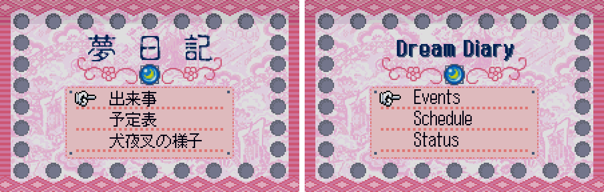

8. Diary page: Day 1, AM

   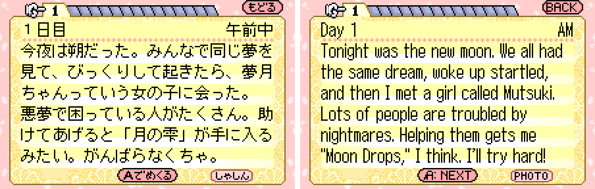

9. Item list: the Items scroll with "Weasel Fan"

   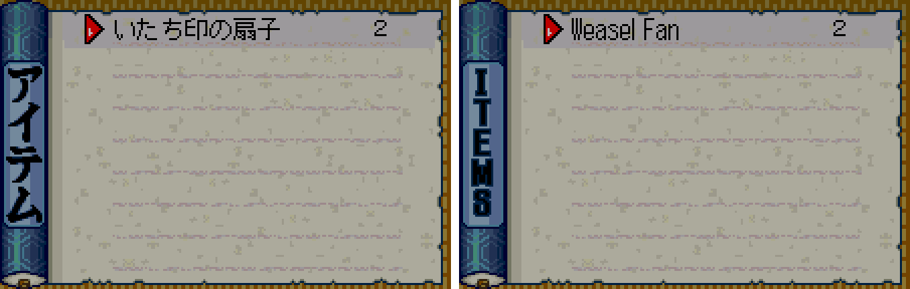

10. Explore map: the prompt "Go to Kaede's Village?"

   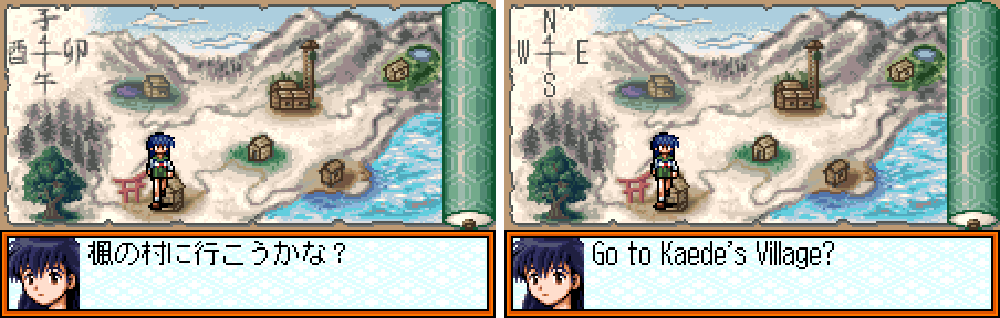

11. Title menu with a save: Continue and Memory Box

   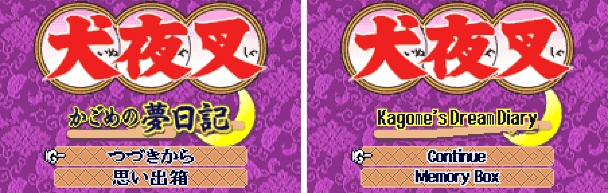

12. Memory Box: "Daily Life Guide"

   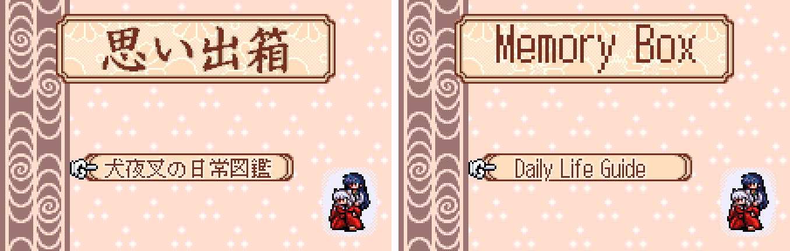

13. Daily Life Guide: the grid of numbered entries and the Back button

   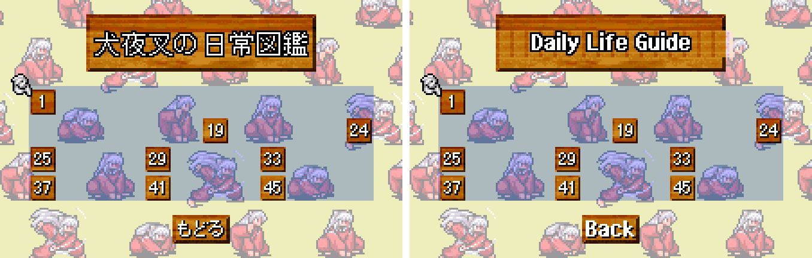

14. Mini-game introduction: "VS. KOZUE / Which One's Real?" and the instructions

   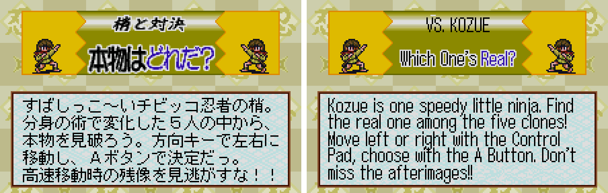

**How to patch**

Apply the BPS file to the Japanese ROM **Inuyasha - Kagome no Yume Nikki (Japan).wsc** (4,194,304 bytes, CRC32 `44453234`) in your browser with the [Swan Revival patcher](https://swanrevival.com/patcher/), or with Floating IPS, beat or ROM Patcher JS. The result is **8,388,608 bytes (8 MiB)**:

* `inuyasha-kagome-no-yume-nikki-en-1.0.bps`; the result should be CRC32 82518E21.

It's a WonderSwan Color game, so keep the .wsc extension. You need an emulator or flash cartridge that accepts an 8 MiB WonderSwan Color image. You must provide your own copy of the original Japanese game to apply it. The patch only fits this dump (CRC32 `44453234`); another revision is refused or gives a wrong result.

**Download:** `inuyasha-kagome-no-yume-nikki-en-1.0.bps` on the [release page](https://github.com/PokemonGoDB/wonderswan-english-patches/releases/tag/inuyasha-kagome-no-yume-nikki-v1.0).

**Known issues**

* It was tested in an emulator, not on a real WonderSwan, and no person has played the whole game (see "What was not seen on screen"). If you find leftover Japanese, cut text or a crash, please tell me where it happened.
* The result is an 8 MiB image. I did not test it on a real cartridge.
* 13 mini-game placeholder messages read "Mini-game message NN"; I don't know if the game shows them.
* The developer text (sound test, parameter check) stays Japanese.
* The title logo (犬夜叉) stays Japanese on purpose; only the subtitle under it is English.
* The title-menu buttons and the status title are drawn in smaller letters than the original's (9 px against 11 for the buttons).
* Save states made in an emulator on the Japanese ROM do not load on the patched 8 MiB ROM.

**Technical notes (for the curious)**

* The BPS file is 1,601,334 bytes. Applying it to the original gives the tested build (iyy15) byte for byte (checked with the project's patcher); the result is 8,388,608 bytes, with the footer's size byte set to 8 MiB.
* The new half of the image holds the English text, a variable-width letter routine and the Latin font; the original 4 MiB is kept as the second half. The game's own message tables and drawing code read the new text.
* The name-entry grid is text drawn by code, not a picture; the project's notes on it are in `games/inuyasha-kagome-no-yume-nikki/notes/name-entry-latin.md`.

**A Note On My Justifications for AI Use**

I have been an avid fan of the Wonderswan system for a very long time now. It was actually a motivating factor for my various attempts to learn Japanese (which have all failed so far). I always wanted to explore the game catalog more, but the lack of English translations made it extremely difficult to do so. Here's the thing: There's a reason many of these games have not been translated yet. It's not just the fact that Japanese > English translation is difficult. There's also the fact that the original developers used all kinds of tricks and technical feats to make these games work. Most games do not have a searchable directory of text that you can just replace with English equivalents. While some are easier than others, translations for some of these would take not only an expert in Japanese > English translation, but also someone with vast game development and programming experience.

I say all that to say: I get why people are apprehensive about AI usage for this type of thing. However, these games have been around for a very long time now and most of them have still not received a translation. I (and others) have chosen to spend our time and money to utilize AI to translate the games and actually make them playable for the wider community. If you don't agree with that, that's completely fine. I am more than happy to remove any of my translations if better, human ran translations are released at a later date. We already decided to skip any games where someone is actively working on a manual translation. While nowhere near what a manual translation effort would be, I do spend a considerable amount of time trying to work through each game's translation. I stress over small details and try my best to make the right calls. And I've probably messed some stuff up, which is why I welcome feedback.

I'm just looking forward to digging through all of these games. It's a great time to be into Wonderswan games.
