# Ganso Jajamaru-kun (WonderSwan) - AI English translation patch v1.0 (+ Stage Select edition)

**Ganso Jajamaru-kun** (元祖じゃじゃ丸くん, "the original Jajamaru-kun") is Jaleco's 1999 remake of the 1985 Famicom game Ninja JaJaMaru-kun, for the original (monochrome) WonderSwan, released only in Japan. The ninja JaJaMaru sets out to rescue Princess Sakura from Namazu Dayu across 25 scenes in five chapters, each with four stages of yokai to defeat with your shuriken and then a boss. Each stage holds one of Princess Sakura's cherry-blossom petals; only with all four of a chapter's petals does the map let you face its boss. The giant frog Gama Pakkun is on the title screen and in the ending.

The game has no text engine: every Japanese word is a picture. This patch redraws all of them in English.

> **Please read:** this translation was made **with AI** (Claude), as a hobby project. A person (me) made every judgement call before release, but nobody on the project is a professional translator. I'm sharing it as it is for anyone who wants to play. Please **don't upload it to romhacking sites** (romhacking.net and the like). It may not be up to the standard of a real fan translation and it doesn't belong there.

**What's translated**

* **Title logo:** GANSO in a tilted black badge (as 元祖 is), JAJAMARU in the original's bubble lettering, and a small KUN.
* **Chapter scrolls** on the map: HILL VILLAGE, GRAVEYARD, CASTLE TOWN, GIANT SHIP, ANCIENT TOMB.
* **Enemy introductions** before every stage (20) and **boss introductions** (5): the name and 登場 become, for example, "OYUKI / APPEARS!", set sideways to read top to bottom in the original's vertical columns.
* **Continue screen:** CONTINUE / YES / NO.
* **The ending's 完:** THE END.
* Already in English in the original and left alone: PUSH START, the copyright, the HUD (SCORE, TIME, PAUSE), BONUS, SCENE n START and GAME OVER. The opening and the cutscenes have no words.

Names: the series' characters use their official English spellings from Ninja JaJaMaru: The Great Yokai Battle +Hell (2023): Oyuki, Kurobee, Kakutan, Onigiri, Karakassa, Hedobon and Pinbo, with JaJaMaru, Princess Sakura, Gama Pakkun and Namazu Dayu. The WonderSwan-only yokai are romanized as English yokai books do: Yakubyogami, Noppera, Chochin, Nekomata, Higuruma, Kappa, Maomei, Unibozu, Daruma, Yukinko, Nuppeppo and Dotchin, and 謎の八面体 is the Mysterious Octahedron. The bosses keep their puns: **Grooming** (毛づくろい, a huge furry beast), **Orb Dangler** (タマダラシ, a bunch of dangling spirit orbs), **Pestmaru** (おじゃ丸, from ojama, "a nuisance", plus the -maru of JaJaMaru), **Fireball Daruma** (火ダルマ, a daruma in flames) and **Namazu Dayu**.

**The Stage Select edition**

The developers left a stage select in the game that nothing in the original can reach. The Stage Select edition (`jajamaru-en-special-1.0.bps`) puts it on the title screen:

* **Opening it:** the title shows START and STAGE SELECT in place of PUSH START. Left/Right (or Up/Down) move the arrow; START opens the game or the stage select.
* **Using it:** STAGE 01-25 picks the scene and PLAYER 01-99 the lives (Up/Down choose the line, Left/Right change the number); START goes to that scene's map.
* **Limits:** starting there skips the opening. Choosing a boss scene (05, 10, 15, 20, 25) goes straight to the princess scene and the boss; starting in the middle of a chapter, the boss still needs the petals of all four of its stages, so the map sends you back to the stages you skipped. Everything else is the standard patch.

**How it was made: AI translation, independent checks, human decisions**

* Claude found and redrew every Japanese picture from the ROM and did all the hacking: new title tiles, per-chapter scroll titles loaded when the map starts, sprite text that keeps the original's sprite counts, recompressed boss pictures.
* A separate, independent Claude reviewer checked every name, word and screen against the Japanese; its findings were verified and fixed.
* On screen: every screen with words was captured on the original and the English ROM side by side; the whole game (all 25 scenes, the five bosses and the ending) was replayed on both ROMs from every stage, and no Japanese text reached the screen's memory in the English build; the title's demo loop was left alone for four cycles on both; every text was measured for centring and clearance against the original; I also played the first stage in the emulator through lost lives, the continue screen and a stage clear.
* The judgement calls were listed with the Japanese, a literal reading and the options, and I decided all 17 by hand over two rounds: the logo, the sideways captions and their centring, every name, the chapter titles, THE END, and the Stage Select edition.

**Changelog**

* **v1.0**: first release.

**Sources consulted**

* Japanese text: the WonderSwan ROM itself (all of it is in pictures).
* Official English names: Ninja JaJaMaru: The Great Yokai Battle +Hell (Steam achievements; Giant Bomb's character list; reviews), the Wii Virtual Console listing of Ninja JaJaMaru-kun, Ninja JaJaMaru: Retro Collection.
* Lettering: a bold pixel alphabet drawn for this patch.

**Images** (original on the left, English on the right)

1. Title screen

   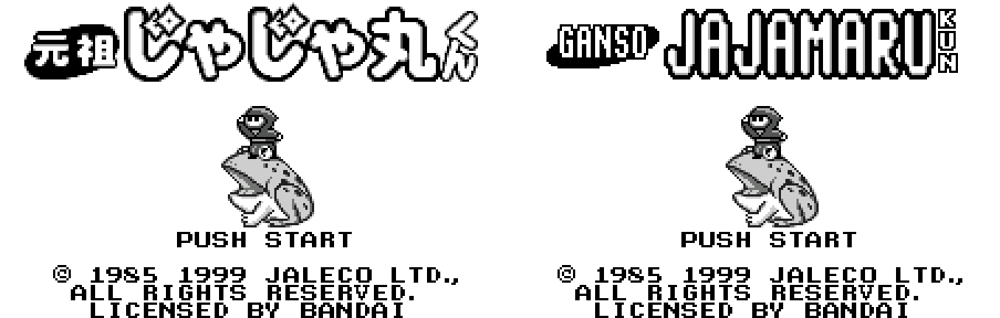

2. Map: Hill Village

   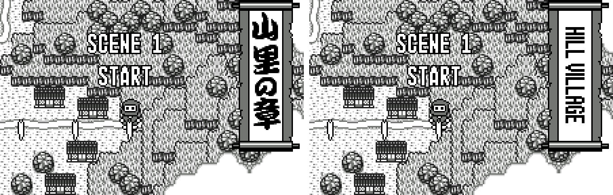

3. Map: Castle Town

   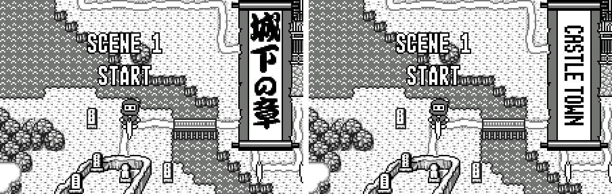

4. Enemy introduction: Oyuki

   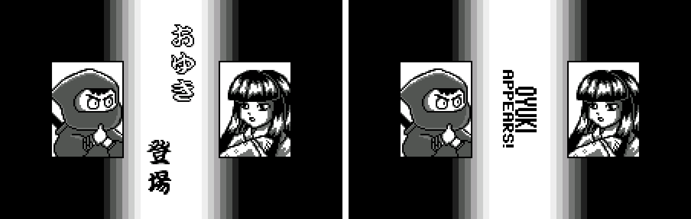

5. Enemy introduction: Yakubyogami

   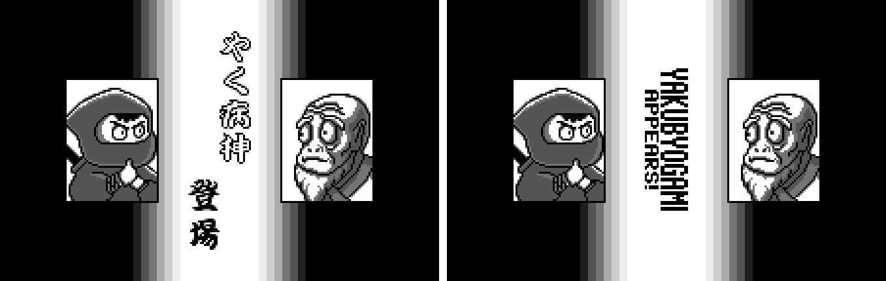

6. Enemy introduction: Mysterious Octahedron

   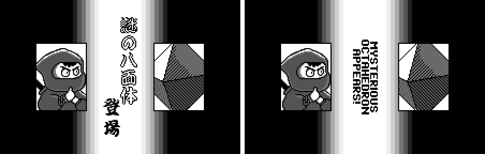

7. Boss introduction: Grooming

   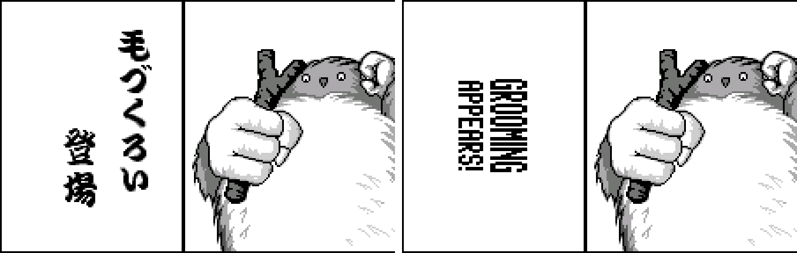

8. Boss introduction: Namazu Dayu

   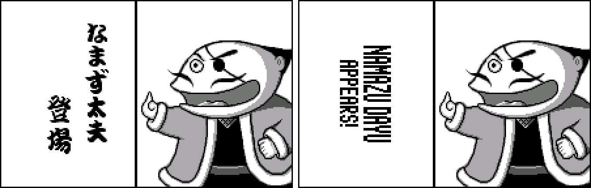

9. Continue

   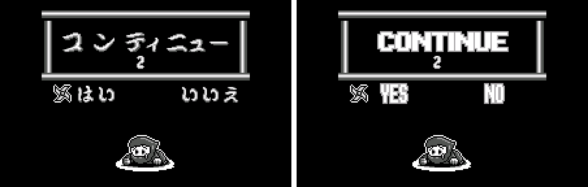

10. The End

   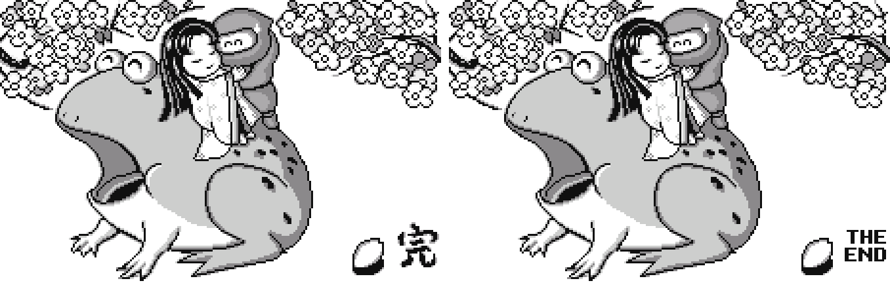

11. Stage Select edition: the title menu

   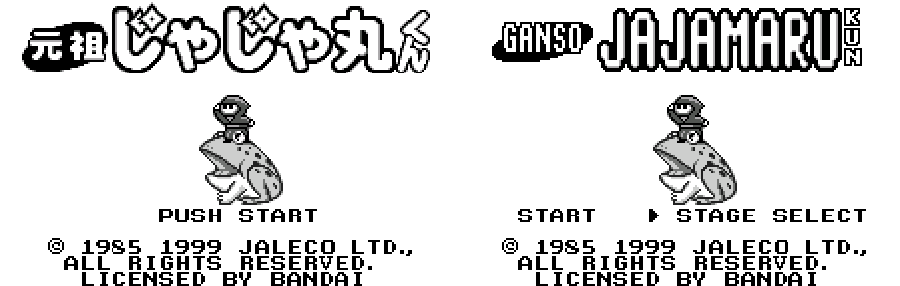

**How to patch**

Apply one of the BPS files to the Japanese ROM "Ganso Jajamaru-kun (Japan)" (CRC32 A193458C) with Floating IPS, beat or ROM Patcher JS:

* Standard: `jajamaru-en-1.0.bps`, the result should be CRC32 5B68EAFE.
* Stage Select edition (START / STAGE SELECT on the title): `jajamaru-en-special-1.0.bps`, the result should be CRC32 3A10EC60.

The ROM keeps its size (512 KB). It's a WonderSwan (mono) game, so keep the .ws extension.

You must provide your own copy of the original Japanese game to apply it.

**Download:** `jajamaru-en-1.0.bps`, `jajamaru-en-special-1.0.bps` on the [release page](https://github.com/PokemonGoDB/wonderswan-english-patches/releases/tag/jajamaru-v1.0).

**Known issues**

* It hasn't been played start to finish by a person. If you find leftover Japanese or anything broken, please tell me where it happened.
* Two decorations in the stage scenery are kept as they are: a circled crest on shop curtains (chapter 3) and marks on hanging sacks (scenes 2-3).
* The scene-17 enemy's name is written マオメイ or マナメイ (the picture can be read either way); it's MAOMEI here.

**Technical notes (for the curious)**

* Every Japanese word was tiles in a background map or sprites built from metasprite records. The map screen already uses 118 of the WonderSwan's 128 sprites, so the chapter scroll is rebuilt with exactly the original's sprite pieces, and each chapter's title tiles are copied in when the map starts.
* The enemy introductions already use all 128 sprites; the names reuse the original's pieces, moved to centre the English.
* The boss introductions first show only the name through a screen window; the window's edge now follows each English name. The boss pictures are LZSS-compressed and were recompressed in place.
* The Stage Select menu keeps its state in the title screen's own map (which cell holds the arrow), so it claims no memory.

**A Note On My Justifications for AI Use**

I have been an avid fan of the Wonderswan system for a very long time now. It was actually a motivating factor for my various attempts to learn Japanese (which have all failed so far). I always wanted to explore the game catalog more, but the lack of English translations made it extremely difficult to do so. Here's the thing: There's a reason many of these games have not been translated yet. It's not just the fact that Japanese > English translation is difficult. There's also the fact that the original developers used all kinds of tricks and technical feats to make these games work. Most games do not have a searchable directory of text that you can just replace with English equivalents. While some are easier than others, translations for some of these would take not only an expert in Japanese > English translation, but also someone with vast game development and programming experience.

I say all that to say: I get why people are apprehensive about AI usage for this type of thing. However, these games have been around for a very long time now and most of them have still not received a translation. I (and others) have chosen to spend our time and money to utilize AI to translate the games and actually make them playable for the wider community. If you don't agree with that, that's completely fine. I am more than happy to remove any of my translations if better, human ran translations are released at a later date. We already decided to skip any games where someone is actively working on a manual translation. While nowhere near what a manual translation effort would be, I do spend a considerable amount of time trying to work through each game's translation. I stress over small details and try my best to make the right calls. And I've probably messed some stuff up, which is why I welcome feedback.

I'm just looking forward to digging through all of these games. It's a great time to be into Wonderswan games.
