# From TV Animation One Piece: Mezase Kaizoku Ou! (WonderSwan) - AI English translation patch v1.0

**From TV Animation One Piece: Mezase Kaizoku Ou!** (From TV animation ワンピース めざせ海賊王!, "Aim to be King of the Pirates!") is Bandai's 2000 One Piece game for the original (monochrome) WonderSwan, released only in Japan. It is a board game on the sea: you lay route cards to sail Luffy's ship across each chapter's map, recruit crewmates, fight the villains of the early story (Alvida, Morgan, Buggy, Kuro, Krieg, Arlong) and pick up items and treasure on the way, over six chapters from Romance Dawn to Loguetown plus an Extra stage. Up to four players can share one WonderSwan in the multiplayer board game, and there is a Strongest Pirate Tournament (build a three-member crew and fight the CPU crews), Carddass Hyper Battle (a card game for 2-4 players with the system turned sideways), three mini-games (the Baratie eating contest, a cannon battle against the Marines, and Mihawk), and link-cable crew trading. This patch translates it into English.

> **Please read:** this translation was made **with AI** (Claude), as a hobby project. A person (me) made every judgement call before release, but nobody on the project is a professional translator. I'm sharing it as it is for anyone who wants to play. Please **don't upload it to romhacking sites** (romhacking.net and the like). It may not be up to the standard of a real fan translation and it doesn't belong there.

**What's translated**

* The whole story (about 3,100 text boxes over the seven chapters and the Extra stage), the chapter cards, every board event, item, crewmate and battle message.
* Every menu and mode: the board game's commands, Info, Items and Crew screens, multiplayer setup and turns, the Strongest Pirate Tournament (crews, members, jobs, stats, battles), Carddass Hyper Battle (rules, decks, all 56 cards and their effects), the three mini-games, Settings and Extras.
* All the words drawn as pictures: the title subtitle (BECOME THE PIRATE KING!), MODE SELECT and the mode bubbles, screen headings, buttons, plates, banners (DIG IN!, TIME UP!, OPEN FIRE!), the Carddass bubbles and the tournament logo.
* Name entry has English pages (capitals, lower case, digits and symbols); names keep the original four-character limit.
* Kept as they are: the chapter-clear banner "Congratulation!", which was already in English in the original, and the English staff roll.

**Names and terms**

Characters, places and attacks use the official English names from the VIZ manga and the English anime (Gum-Gum Pistol, Three-Sword Style, Pirate Hunter Zoro, the Baratie, Cocoyashi Village, Carnival Tricks...), checked against the One Piece Wiki. The tournament's opponent crews are translated (Rookie Pirates, Animal Pirates...), and their members and the default player names keep the game's own names, romanized (Kuroyuki, Nomutaka, Gissy, Kazu...).

**How it was made: AI translation, independent checks, human decisions**

* Claude translated everything directly from the Japanese in the ROM and did all the hacking: a variable-width font, a 2 MB ROM, English name entry and about 90 redrawn pictures.
* A separate, independent Claude reviewer checked the whole game against the Japanese; its findings were verified and fixed.
* On screen: every text box of the story played through the game's own boxes with every character the game drew logged (no Japanese left), every page of the script drawn on screen, a whole tournament, a four-player eating contest, Carddass battles and the chapter clear played, the attract mode watched from power-on, and every screen compared with the Japanese, enlarged, for centring and spacing.
* Link play was tested by linking two emulated WonderSwans, English with English and English with Japanese.
* The judgement calls (names, terms, abbreviations, pictures) were listed with the Japanese, a literal reading and the options, and I decided each one by hand over six rounds.

**Link play**

Trading a crew over the link cable (Settings > Send Personal Data on one system, Player Setup > "Bring a crew over the link" on the other) works between the English patch and Japanese cartridges in both directions: only the crew record crosses the cable, and the receiving player names the crew on their own system.

**Changelog**

* **v1.0**: first release.

**Sources consulted**

* Japanese text: the WonderSwan ROM itself.
* Official English names: the VIZ manga and the English anime, as recorded on the One Piece Wiki.
* Font: the public-domain Shinonome 12-dot font (proportional widths) for text, bold styles of it for picture labels.

**Images** (original on the left, English on the right)

1. Title screen

   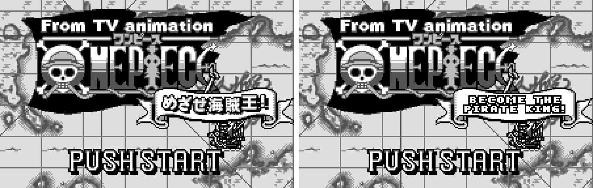

2. The intro

   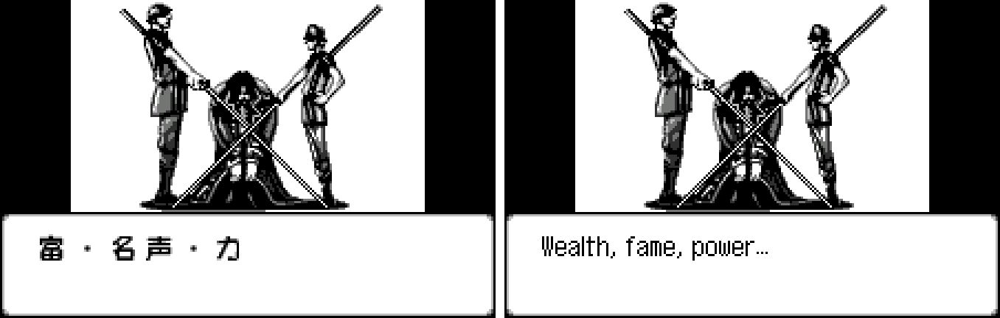

3. Mode select

   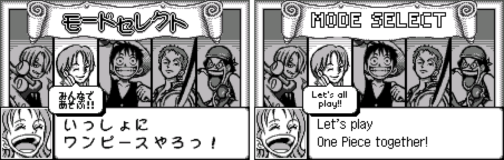

4. Stage select

   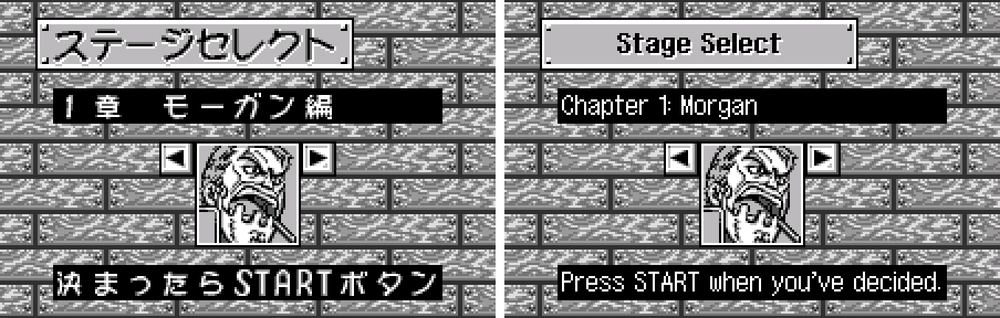

5. A chapter card

   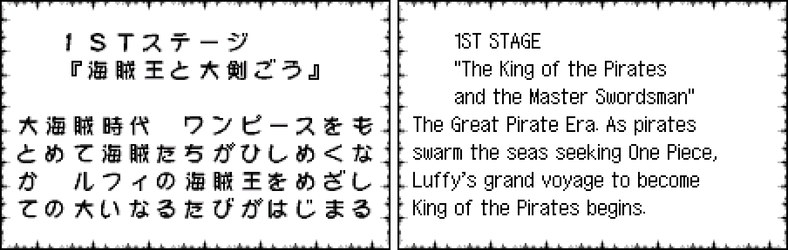

6. Items

   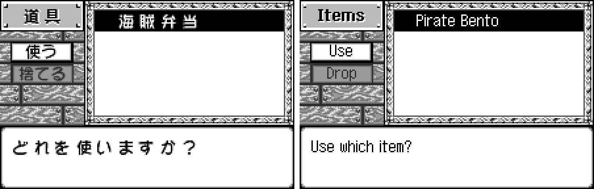

7. Character status

   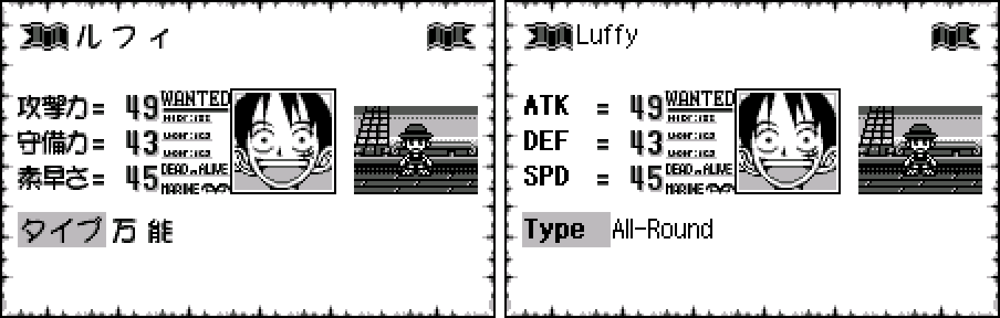

8. Settings

   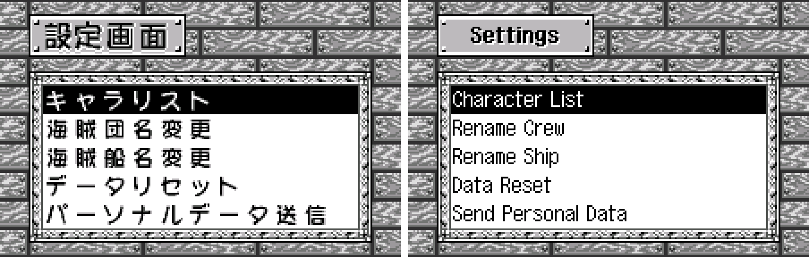

9. Multiplayer setup

   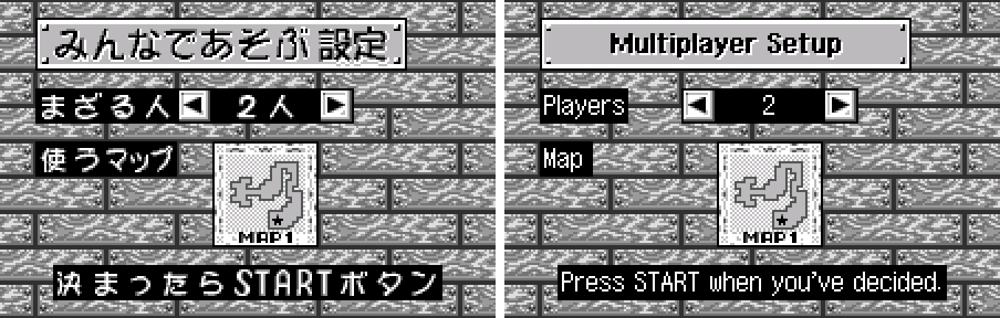

10. Multiplayer: deciding the turn order

   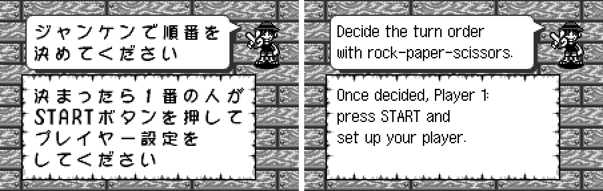

11. Strongest Pirate Tournament

   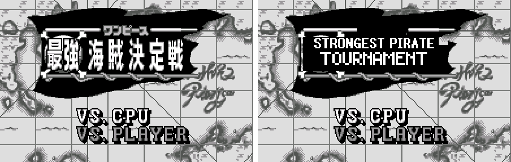

12. A tournament battle

   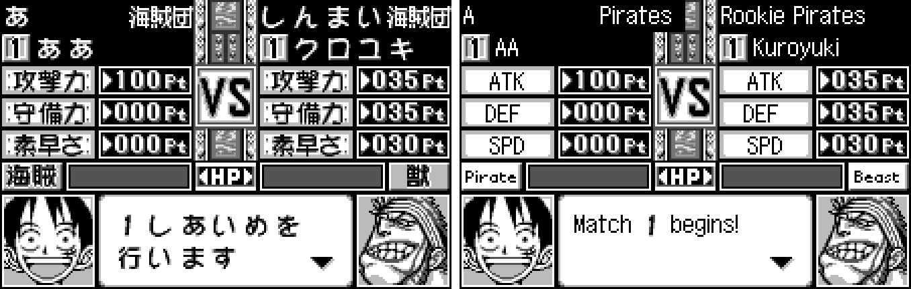

13. Carddass Hyper Battle: title

   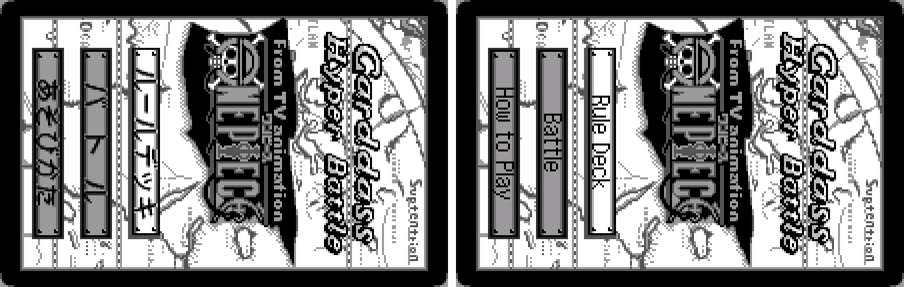

14. Carddass: Rule Deck

   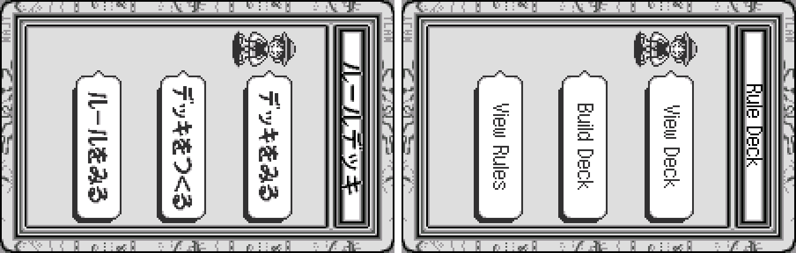

15. Carddass: How to Play

   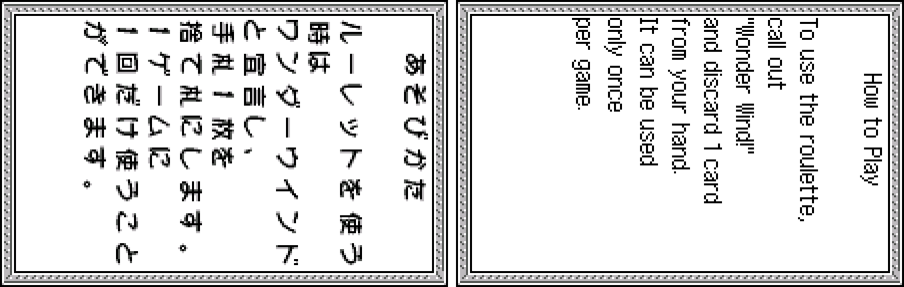

16. Extras

   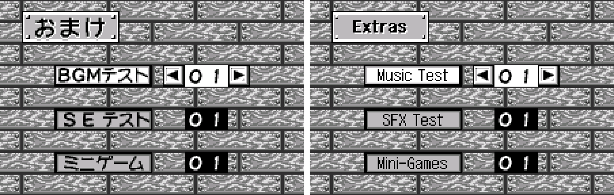

17. Eating contest

   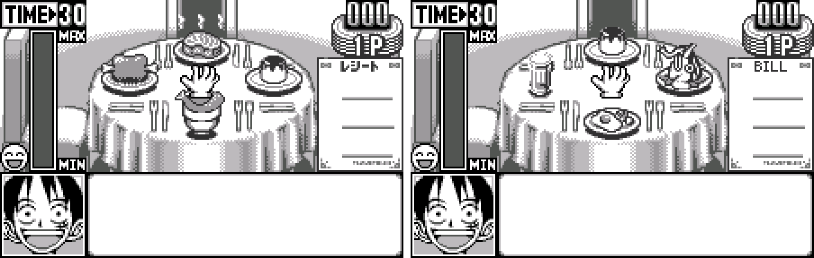

18. Mihawk mini-game

   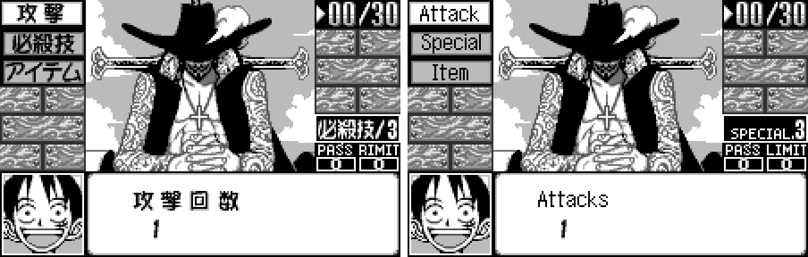

19. Chapter clear

   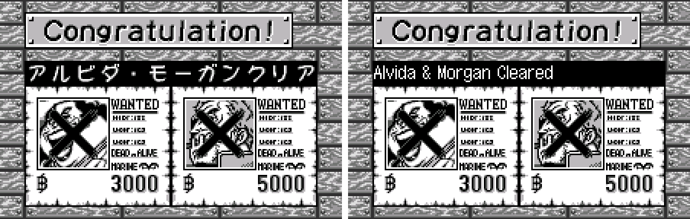

20. Link cable

   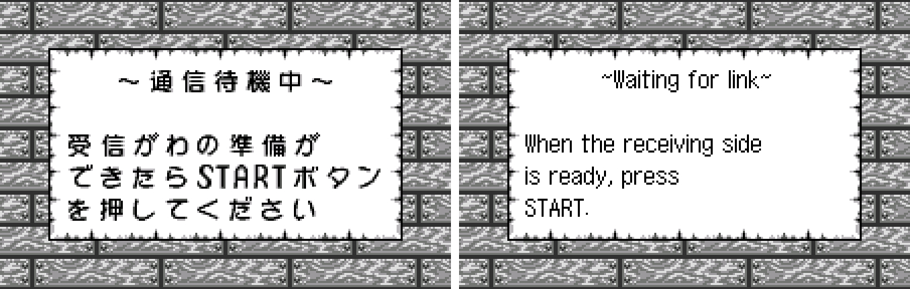

**How to patch**

Apply `kaizoku-ou-en-1.0.bps` to the Japanese ROM "From TV Animation One Piece - Mezase Kaizoku Ou! (Japan)" (CRC32 F2E362B8) in your browser with the [Swan Revival patcher](https://swanrevival.com/patcher/), or with Floating IPS, beat or ROM Patcher JS. The result should be CRC32 30F6CAAF.

The patched ROM is **2 MB** (the original is 1 MB): the English needs more room, so the patch doubles the ROM. It's a WonderSwan (mono) game, so keep the .ws extension.

You must provide your own copy of the original Japanese game to apply it.

**Download:** `kaizoku-ou-en-1.0.bps` on the [release page](https://github.com/PokemonGoDB/wonderswan-english-patches/releases/tag/kaizoku-ou-v1.0).

**Known issues**

* It hasn't been played start to finish by a person. If you find leftover Japanese, cut text or a crash, please tell me where it happened.
* Link play was tested between two emulated systems, not on real hardware.
* The mini-games' rules pages (shown in the board game's versions of the mini-games) were checked in a test display, not in their own box.

**Technical notes (for the curious)**

* The game prints every character into its own 16x16 cell. The patch adds a variable-width renderer that packs English letters by their pixel width into the same tiles, in all three orientations (horizontal and both sideways Carddass screens), and draws fast enough for screens the game redraws every other frame.
* The ROM is expanded from 1 MB to 2 MB: the game moves to the upper half and the English script goes in the lower half.
* Names the game copies into fixed four-character fields (tournament members, CPU crews) use single codes that expand to whole words.
* About 90 words drawn as pictures are redrawn in their tile sets; where the original shares tiles between two pictures (two mode-select bubbles, the roulette reactions, two Extras buttons), one of them gets its own tiles.

**A Note On My Justifications for AI Use**

I have been an avid fan of the Wonderswan system for a very long time now. It was actually a motivating factor for my various attempts to learn Japanese (which have all failed so far). I always wanted to explore the game catalog more, but the lack of English translations made it extremely difficult to do so. Here's the thing: There's a reason many of these games have not been translated yet. It's not just the fact that Japanese > English translation is difficult. There's also the fact that the original developers used all kinds of tricks and technical feats to make these games work. Most games do not have a searchable directory of text that you can just replace with English equivalents. While some are easier than others, translations for some of these would take not only an expert in Japanese > English translation, but also someone with vast game development and programming experience.

I say all that to say: I get why people are apprehensive about AI usage for this type of thing. However, these games have been around for a very long time now and most of them have still not received a translation. I (and others) have chosen to spend our time and money to utilize AI to translate the games and actually make them playable for the wider community. If you don't agree with that, that's completely fine. I am more than happy to remove any of my translations if better, human ran translations are released at a later date. We already decided to skip any games where someone is actively working on a manual translation. While nowhere near what a manual translation effort would be, I do spend a considerable amount of time trying to work through each game's translation. I stress over small details and try my best to make the right calls. And I've probably messed some stuff up, which is why I welcome feedback.

I'm just looking forward to digging through all of these games. It's a great time to be into Wonderswan games.
