# Kiss Yori... Seaside Serenade (WonderSwan) - AI English translation patch v1.0

**Kiss Yori... Seaside Serenade** (KISSより... Seaside Serenade) is a summer dating adventure for the WonderSwan, made by KID under Bandai's licence (1999) from the Saturn original. You play a boy in a seaside town over about 42 summer days: you pick where to go on the town map, take evening shifts at the manager's shop, talk to the four heroines (Chihiro Asaoka, Chieri Sugita, Kanna Yamazaki and Miku Hayasaka), phone them, ask them out on dates and get one of the endings on August 31. It was released only in Japan. This patch translates all the text the game shows into English.

> **Please read:** this translation was made **with AI** (Claude), as a hobby project. A person (me) made every judgement call before release, but nobody on the project is a professional translator. I'm sharing it as it is for anyone who wants to play. Please **don't upload it to romhacking sites** (romhacking.net and the like). It may not be up to the standard of a real fan translation and it doesn't belong there.

**What's translated**

* **Everything the player reads:** 12,401 messages: the opening, the part-time job and shop scenes, every place on the map, the Real-Time Talk conversations, phone calls, dates, the endings and the staff roll, and every menu. The SOUND TEST song titles and the ALBUM picture captions are in English too.
* **Text drawn as pictures:** the title's subtitle, the room menu, the conversation tabs, the name-entry buttons and banners, the date bar (weekday and time of day), the four heroines' opening name plates, the shift-planning pieces, the SOUND and ALBUM labels and the "done" badge were redrawn in English in the original's style.
* **Your name:** the name entry is now a Latin letter grid instead of the kana grid, so your name shows as English letters inside the English text. The name is 5 letters + 5 letters (the original's 5 + 5 kana), and the default is the placeholder "Hirai Keita". A typed name is drawn one letter per 12-pixel cell, so it looks spaced out on the save list and in the name line.
* **Names and terms:** the heroines are in Western order without honorifics. Miku's dog is Rickson (the Japanese is the katakana spelling of the fighter Rickson Gracie, famous in Japan in 1999), the hero's friend 雷 is Ikazuchi (the reading on ja.wikipedia), and the coastal spot 海の套, whose last character the game's font does not show clearly, is "Umi Island" (my best reading). The surname readings of three heroines are not confirmed by the game. The staff names in the credits are in Western order, with readings guessed from the kanji.
* **Letters:** the Japanese game draws every character in a fixed 12-pixel cell, 18 to a line. The English uses a variable-width font in the same three-line, 216-pixel boxes (capitals and digits 10 pixels high like the game's own Latin letters, lowercase 7), so lines hold 35 to 44 letters.
* **Kept on purpose (all answered by me):** the toned-down "lovers' leap" for the bystander's double-suicide shout, Chieri's fling / flan mix-up, the fan-service teasing at full strength, the fish puns kept literal, the parody names (Bokemon, Rapid, Una City and so on), the heart logo's より... as the original lettering, and "Hello, Manager" at the shop (the Japanese greeting is used in evening shifts too). The date bar and map clock are in capitals (MORNING, DAY, EVENING, MIDNIGHT) and the settings screen reads "Norm" because the pictures leave no room.
* **Left in Japanese:** 104 developer-only messages (a debug viewer; no player ever reaches them).
* **Saves:** the game saves as before. A save made on the Japanese ROM was not tested with the patch, and the Japanese name is kana, so start a new game.
* **Stays as it was:** screens that look the same in the original and the patch are not in the image list.

**One patch**

* `kiss-yori-seaside-serenade-en-1.0`: the translation above, and nothing else. The game has a developer flag and byte viewer, but no retail route leads to it (see the technical notes), so there is no Debug Edition. SOUND TEST and ALBUM unlock after the game is cleared, as in the original.

**How it was made: AI translation, independent checks, human decisions**

* Claude found the game's text format (messages stored with a one-byte control code set, a fixed 12-pixel kana font, pictures in the game's own format), wrote a story bible, a termbase of 153 entries and the English, redrew the picture text, and rebuilt the ROM with a variable-width letter engine and a redirect for the longer English text added to the cartridge. The image grows from 2 MiB to 4 MiB because the English does not fit in the free space of the original.
* The final build (ksy10) went through the project's automated test run: 11 checks passed, 0 failed. It includes:
  * 12,401 text messages drawn by the game's own renderer with the widest possible player name and measured against the box, with English ink kept at least one pixel column short of the screen's right edge: 0 flagged;
  * random-button walks from 40 saved states, 722,400 frames in all, with every drawn character logged: 0 Japanese characters or picture tiles; the same check on the original sees them, so it can see them;
  * a soak of 2,400,000 frames of random play from 40 states with no freeze, and the full attract loop captured on both ROMs;
  * 257 pairs of original and English screens, the changed ones reviewed enlarged side by side (the last re-check looked at 252 changed screens, none clipped at the edge), and an alignment audit.
* Every judgement call that was mine to make was put on a decision page with pictures: 20 items, all answered by me.
* The English was read against the Japanese by an independent read-only Claude reviewer (47 fixes and their siblings were applied), and a mechanics audit covered name inserts, widths, name compares and the save limits.
* The main loop was played for real on the English build: the opening, ten places on the map, day by day to 8/31, evening shifts, the phone, a date, a Real-Time Talk conversation, Chihiro's scene and her bad ending, and the SOUND TEST and ALBUM (52 pictures equal to the original).
* While playing I found and fixed a real fault: after a message was redirected, a picture decode left the wrong bank selected, and 11 of the 52 ALBUM pictures came out as noise.

**What was not seen on screen** (please report anything odd)

* **An honest source of a girl's phone number.** A call was placed after two test pokes.
* **The bad endings of Chieri, Kanna and Miku** by honest play (shown by a test poke), and **the other endings by play**: five were reached by setting the game's state, and the 8/31 ending was reached by play.
* **The staff roll past 9,000 frames**, and 12 name-display messages that contain no text.
* **A save written while a message was typing.**
* **Saves from the Japanese version** were not tested.
* **The game was not played from start to finish by a person**, and not on real hardware (see the known issues).

**Changelog**

* **v1.0**: first public release.

**Sources consulted**

* Japanese text: the WonderSwan ROM itself.
* Heroine names, the friend's reading and the Saturn original's facts: ja.wikipedia (KISSより..., fetched 2026-11-24).
* The project's own notes on the game's text format (`games/kiss-yori-seaside-serenade/TEXT-FORMAT.md`) and the QA run summaries.
* I searched for another English translation of this game on 2026-11-24 and found none (the claims board and web searches in English and Japanese). If a human translation is released, that one should be preferred.

**Images** (original on the left, English on the right)

1. Title screen (the subtitle "Seaside Serenade")

   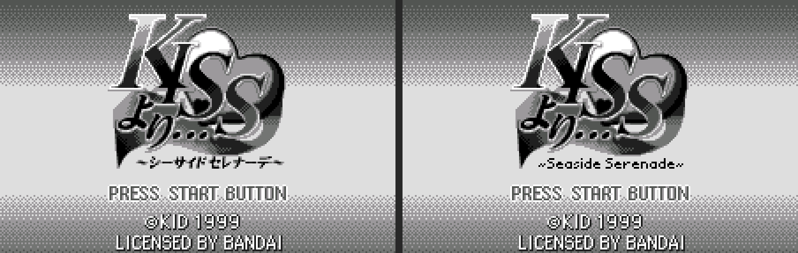

2. Name entry (the Latin letter grid)

   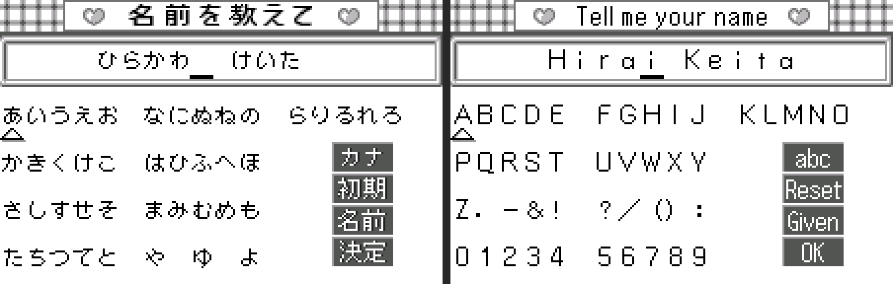

3. Profile card

   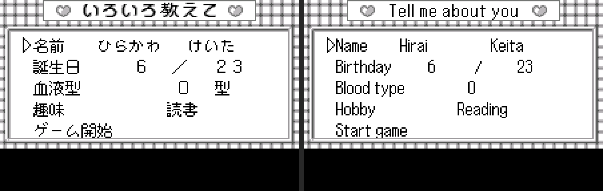

4. The music question

   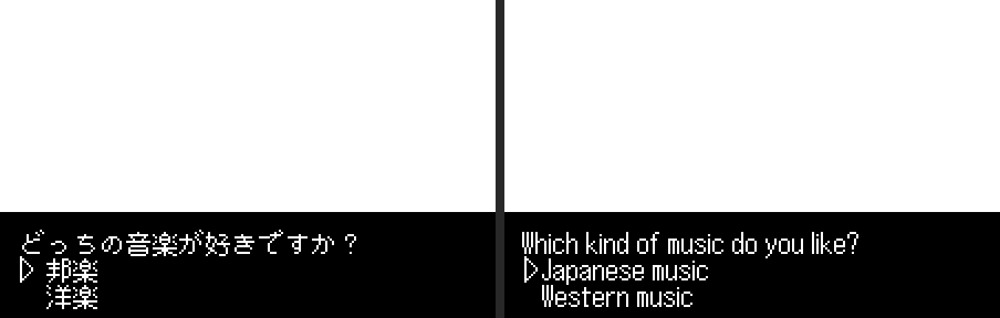

5. Opening story

   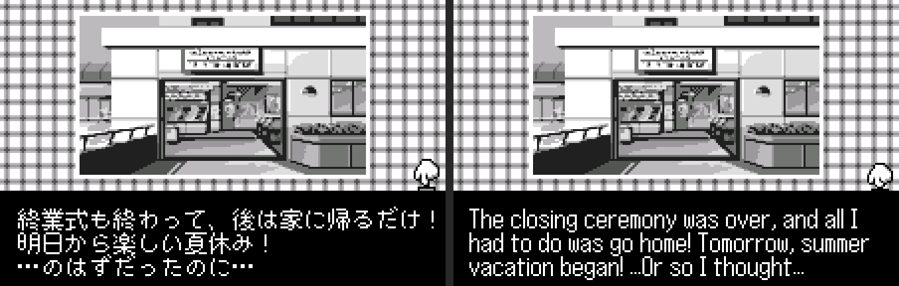

6. Room menu

   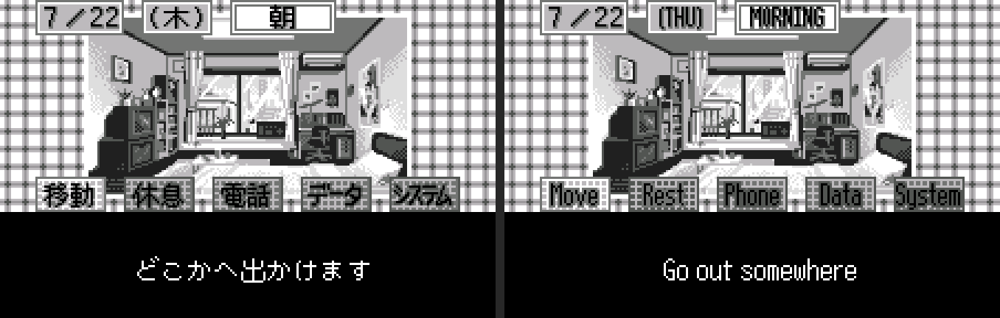

7. Town map

   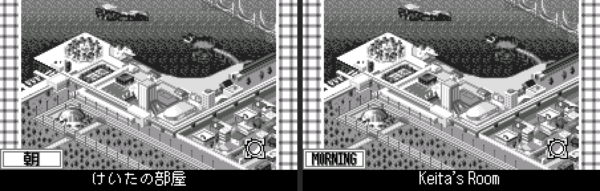

8. A place on the map

   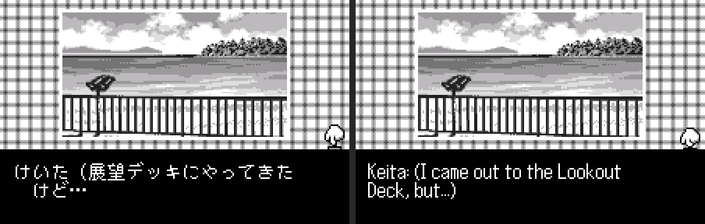

9. A heroine's data page

   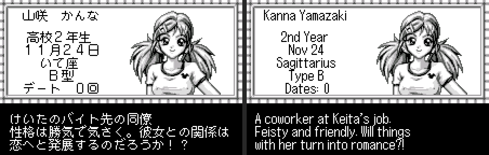

10. Weekly plan

   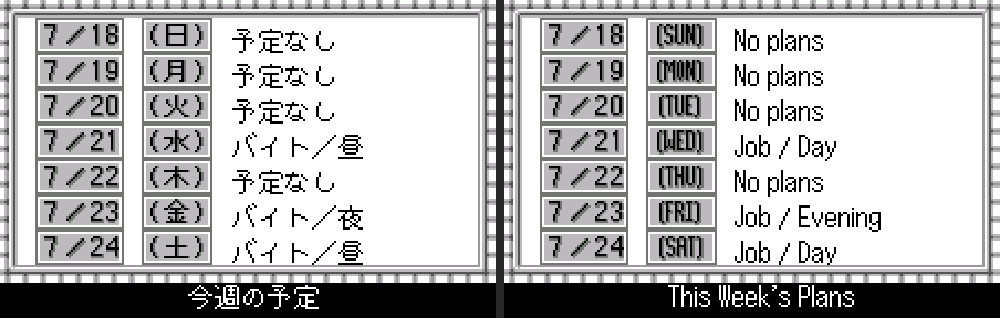

11. Load list

   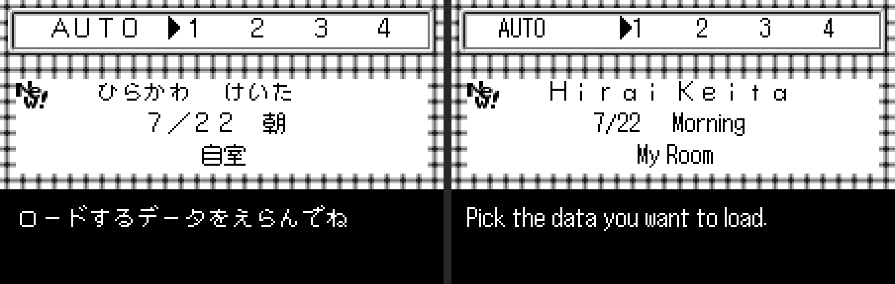

12. Config screen

   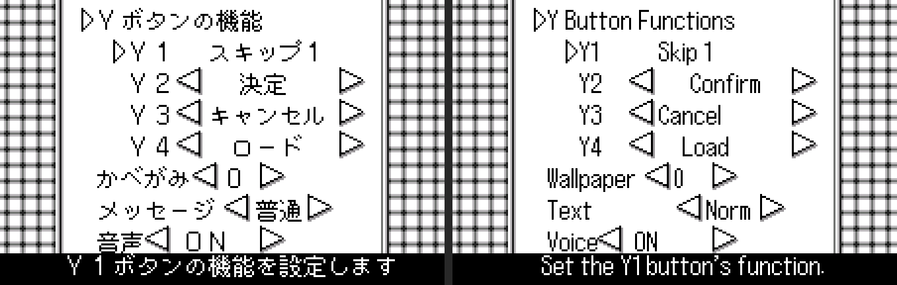

13. System menu

   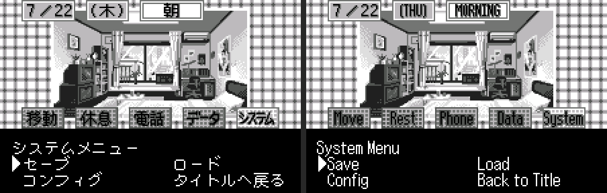

**How to patch**

Apply the BPS file to the Japanese ROM **Kiss Yori... - Seaside Serenade (Japan).ws** (2,097,152 bytes, CRC32 `3B4C60C6`, SHA-1 `9EF89B6FE68C5A06D34344E8C783EC24114AD959`) in your browser with the [Swan Revival patcher](https://swanrevival.com/patcher/), or with Floating IPS, beat or ROM Patcher JS. The BPS is `kiss-yori-seaside-serenade-en-1.0.bps` (853,794 bytes). The result is **4,194,304 bytes** (the patch makes the ROM twice as big), and it should be CRC32 `4F253095` (SHA-1 `D71D51EF5815CA13C2821859141F62B542F4E6E9`).

It's a monochrome WonderSwan game, so keep the .ws extension. You must provide your own copy of the original Japanese game to apply it. The patch only fits this dump (CRC32 `3B4C60C6`); another revision is refused or gives a wrong result. No other revision is known. Emulators and cartridge mappers that take a 4 MiB image should work; see the known issues for hardware.

**Download:** `kiss-yori-seaside-serenade-en-1.0.bps` on the [release page](https://github.com/PokemonGoDB/wonderswan-english-patches/releases/tag/kiss-yori-seaside-serenade-v1.0).

**Known issues**

* It was tested in an emulator, not on a real WonderSwan, and no person has played the whole game (see "What was not seen on screen"). The 4 MiB image on a 32 Mbit cartridge and the reset stub in the last bank were not tried on hardware or a flash cart. If you find leftover Japanese, cut text or a crash, please tell me where it happened.
* A typed name is spaced out (one letter per 12-pixel cell) on the save list, the profile page and where the hero is called by name.
* Some descenders (g, j, p, q, y) touch the line below in rare mixed lines, and the settings screen's "Norm" and the capitals-only date bar are shortened to fit the pictures.
* The heart logo's より... stays in the original lettering.
* Save states made in an emulator on the Japanese ROM do not carry over to the patched ROM.

**Technical notes (for the curious)**

* The messages are byte streams with a one-byte control set; the patch adds a redirect opcode (FD) that points a message at English text stored in the larger image, plus a variable-width Latin renderer and font (the 4 MiB image also corrects 39 voice-table bank bytes). The name entry, date bar and a few pictures are replaced by redrawn English ones.
* There is a developer flag and byte viewer in script A835 of the game, but I found no button route that reaches it; it only shows with a RAM poke, so I did not make a Debug Edition. The 104 developer-only messages stay Japanese.
* The SOUND TEST and ALBUM unlock with the "game cleared" flag (flag 0x179).
* The BPS file is 853,794 bytes. Applying it to the original gives the tested build byte for byte (checked with the project's patcher).

**A Note On My Justifications for AI Use**

I have been an avid fan of the Wonderswan system for a very long time now. It was actually a motivating factor for my various attempts to learn Japanese (which have all failed so far). I always wanted to explore the game catalog more, but the lack of English translations made it extremely difficult to do so. Here's the thing: There's a reason many of these games have not been translated yet. It's not just the fact that Japanese > English translation is difficult. There's also the fact that the original developers used all kinds of tricks and technical feats to make these games work. Most games do not have a searchable directory of text that you can just replace with English equivalents. While some are easier than others, translations for some of these would take not only an expert in Japanese > English translation, but also someone with vast game development and programming experience.

I say all that to say: I get why people are apprehensive about AI usage for this type of thing. However, these games have been around for a very long time now and most of them have still not received a translation. I (and others) have chosen to spend our time and money to utilize AI to translate the games and actually make them playable for the wider community. If you don't agree with that, that's completely fine. I am more than happy to remove any of my translations if better, human ran translations are released at a later date. We already decided to skip any games where someone is actively working on a manual translation. While nowhere near what a manual translation effort would be, I do spend a considerable amount of time trying to work through each game's translation. I stress over small details and try my best to make the right calls. And I've probably messed some stuff up, which is why I welcome feedback.

I'm just looking forward to digging through all of these games. It's a great time to be into Wonderswan games.
