# Langrisser Millennium WS: The Last Century (WonderSwan) - AI English translation patch v1.0

**Langrisser Millennium WS: The Last Century** (ラングリッサーミレニアムWS THE LAST CENTURY) is a tactical RPG for the original (monochrome) WonderSwan, made by NCS and released by Masaya/Bandai in Japan in 2000. Zion, a boy from a frontier ranch, is drawn into a war between the Neo-Empire, the Federation and the Mithra Church over the legacy of the lost super-civilization Suluktan: an ark, the Archangel and the Archdemon. Hire mercenaries for your commanders, place them, and fight 8 common scenarios, then one of two routes of 9 with their own endings, plus two hidden joke stages. This patch translates it into English.

This is a release of **wakabayashy's Langrisser Millennium WS English translation project**, which I have been helping with. See Credits below.

> **Please read:** this translation was made **with AI** (Claude), as a hobby project. A person (me) made every judgement call before release, but nobody on the project is a professional translator. I'm sharing it as it is for anyone who wants to play. Please **don't upload it to romhacking sites** (romhacking.net and the like). It may not be up to the standard of a real fan translation and it doesn't belong there.

**What's translated**

* Everything with text: the prologue captions, the title and its menus, the opening and the birthday quiz, all 29 scenarios on both routes (with the hidden X1 and X2 stages), every story and battle line, the scenario title cards, introductions and victory/defeat conditions.
* The preparation screens (mercenaries, items and the shop, equipment, placement, save and load), the battle map (status bar, commands, unit info, magic list, class data, messages), level ups and class changes, the results, all four endings and the staff roll.
* Item, spell and troop descriptions, with every stat as in the original.
* The English uses three fonts, chosen screen by screen: a medium font for most text, a taller one on the unit info screen and in the prologue captions, and a compact one in the battle command menu; the number-heavy screens use small digits.

**Credits**

* **Translation:** [wakabayashy](https://github.com/wakabayashy/Langrisser-Millennium-WS-English) and team. The English translation of this game is their project, and full credit for it goes to them.
* **Play testing:** altaihero and Last_Seraph.
* **Assistance:** this project (me, with Claude) helped with the text engine and fonts, the revision of the script and the automated testing described below.

**Names and terms**

Names follow the official English Langrisser releases where the cast appears there (Langrisser Mobile; the Langrisser I & II remake): Zion, Tiana, Lukhmaan, Alia, Ilia, Shem, Macaera, Abishai. Several scenario titles are the Japanese titles of films and use the English film titles ("A Better Tomorrow", "The Fugitive", "The Young Lions", "Forbidden Games"). The joke item ワセリン ("Vaseline") in the hidden stages is "Baby Oil".

**Saves**

The patch doesn't change the save format: saves work with both the Japanese and the English version, so you can patch in the middle of a game and keep playing.

**How it was made: AI translation, independent checks, human decisions**

* The translation is wakabayashy's team's project. To assist it, Claude extracted the script from the game's own script bytecode, wrote a story bible and a binding termbase, and worked through the English in passes with their English beside every line: a draft, a review against the Japanese by a different agent, a verified polish pass, and a harmonizing pass for consistency. It also did the hacking: a new proportional text engine with three fonts that draws into the original's tiles, page breaks that wait like the original's, and the layout changes some screens needed.
* A separate, independent review by six Claude reviewers read all 1,435 texts against the Japanese; its findings were verified and fixed.
* On screen: every text in the game was drawn by the game's own renderer with the widest names and numbers and every character logged (nothing Japanese, nothing past its box); random walks from 118 save states across the whole game and from power-on looked for any Japanese reaching the screen (none, in 2.7 million frames; the same check finds it at once on the original); the attract loop from power-on; all four endings and the staff roll; and every screen (over 1,300 of them) compared side by side with the original for alignment, then fixed.
* The judgement calls (names, the jokes, departures from the literal text, the fonts, a few layouts) were listed with the Japanese and the options, and I decided all 53 by hand over four rounds.

**Test Stage edition**

`langrisser-millennium-en-teststage-1.0.bps` is the standard patch plus the developers' unused test stage ("SCENARIO 00 'Millennium'": "This stage is a test stage. Defeat Zardaf."). **On the title menu, hold any Y button and choose Start**: the opening and the quiz play first, then the test stage begins. Winning it continues the game at scenario 4; losing returns to the title. Everything else is the standard patch.

**What was not seen on screen** (please report anything odd)

* Not seen in this project's testing: a battle command menu without Heal, the save/load failure messages, and the "X1"/"X2" labels on save slots.
* This project's own checks were automated and ran in an emulator; the human play testing is altaihero's and Last_Seraph's. Nothing was tested on real hardware.

**Changelog**

* **v1.0**: first public release.

**Sources consulted**

* Japanese text: the WonderSwan ROM itself.
* English text: wakabayashy's team's translation, read from their build.
* Names: Langrisser Mobile, the Langrisser I & II remake (NIS America) and langrisser.wiki.
* Lettering: fonts derived from Shinonome (public domain).

**Images** (original on the left, English on the right)

1. Title screen

   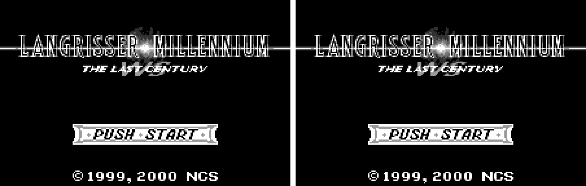

2. The prologue

   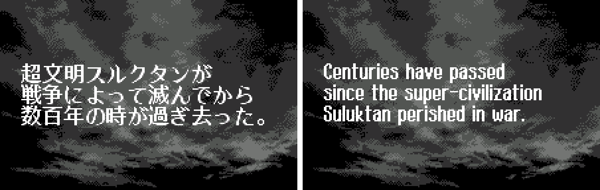

3. A scenario title card

   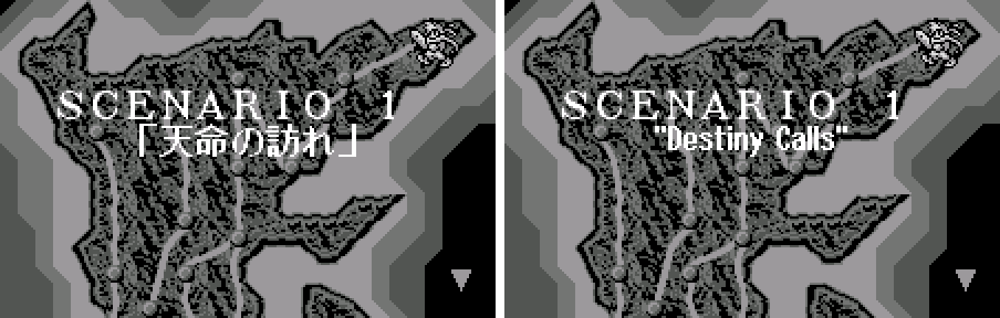

4. Story dialogue

   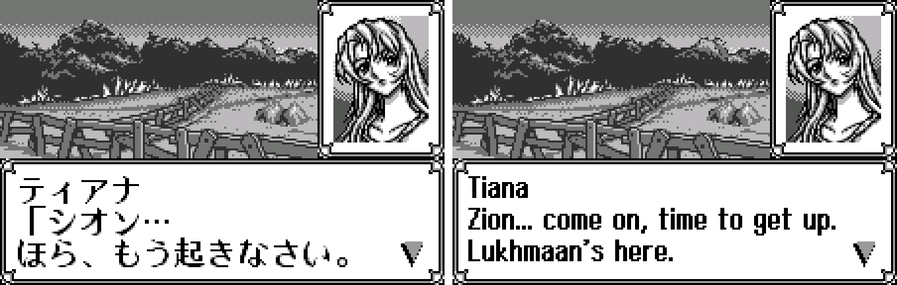

5. The preparation menu

   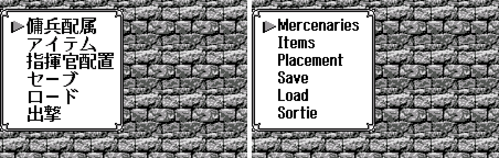

6. The shop

   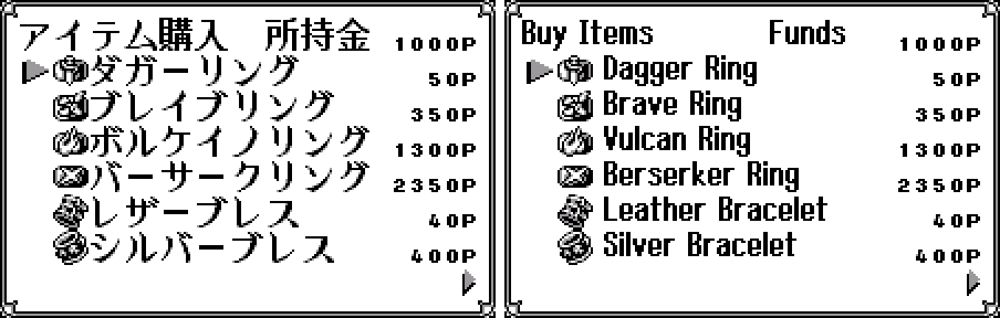

7. Battle commands

   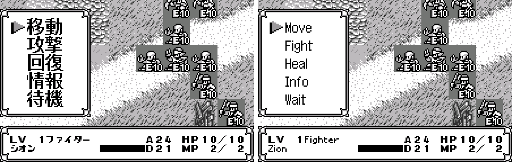

8. Unit info

   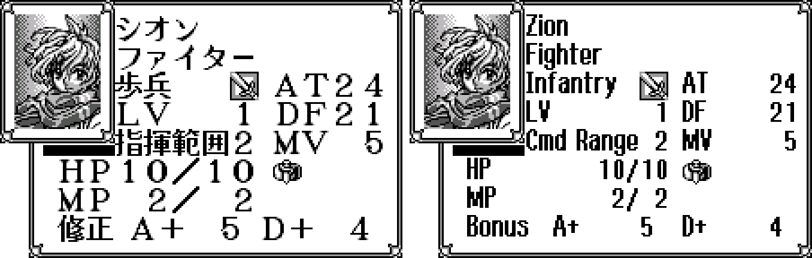

9. The magic list

   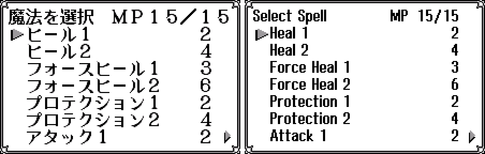

10. A battle

   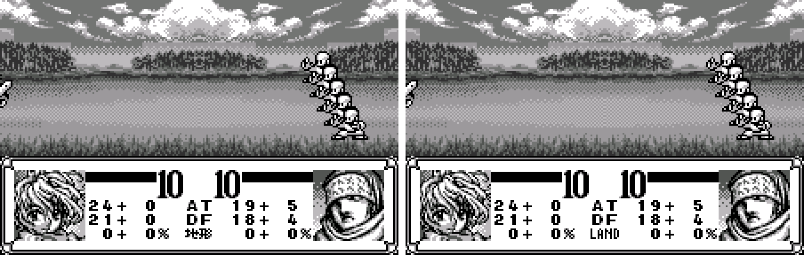

11. The staff roll

   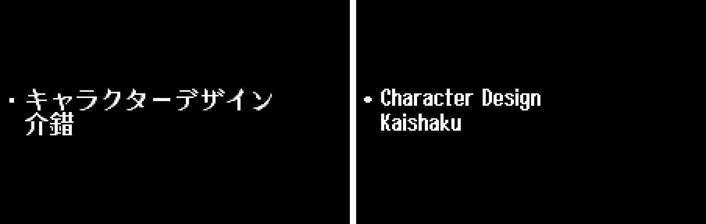

**How to patch**

Apply `langrisser-millennium-en-1.0.bps` (or the Test Stage edition, `langrisser-millennium-en-teststage-1.0.bps`) to the Japanese ROM **Langrisser Millennium WS - The Last Century (Japan).ws** (1,048,576 bytes, CRC32 `9E0854E2`) in your browser with the [Swan Revival patcher](https://swanrevival.com/patcher/), or with Floating IPS, beat or ROM Patcher JS. The result should be 1,048,576 bytes with CRC32 `66242FE6` (Test Stage edition `527761BF`). It's a monochrome WonderSwan game, so keep the .ws extension. You must provide your own copy of the original Japanese game to apply it.

**Download:** [v1.0](https://github.com/PokemonGoDB/wonderswan-english-patches/releases/tag/langrisser-millennium-v1.0)

**Known issues**

* If you find leftover Japanese, cut text or a crash, please tell me where it happened.
* The screens listed above under "What was not seen on screen" were checked only in the text and the code.
* It was tested in an emulator only, not on a real WonderSwan.
* The treasure-map picture in one route B ending keeps its drawn lettering ("BEOW…").
* In the branch where Macaera has died, Zion still thanks "Shem, Macaera" before the last battle, exactly as the Japanese does.

**Technical notes (for the curious)**

* The original draws 16x16 characters from a fixed font. The English engine draws proportional letters pixel by pixel into tiles it allocates as it goes, with a control byte selecting one of three fonts per string; banners keep the original's full-width letters.
* Some fixed-place strings needed wider fields or moved tiles; each move was checked with write watches on video memory over every screen that shows it.

**A Note On My Justifications for AI Use**

I have been an avid fan of the Wonderswan system for a very long time now. It was actually a motivating factor for my various attempts to learn Japanese (which have all failed so far). I always wanted to explore the game catalog more, but the lack of English translations made it extremely difficult to do so. Here's the thing: There's a reason many of these games have not been translated yet. It's not just the fact that Japanese > English translation is difficult. There's also the fact that the original developers used all kinds of tricks and technical feats to make these games work. Most games do not have a searchable directory of text that you can just replace with English equivalents. While some are easier than others, translations for some of these would take not only an expert in Japanese > English translation, but also someone with vast game development and programming experience.

I say all that to say: I get why people are apprehensive about AI usage for this type of thing. However, these games have been around for a very long time now and most of them have still not received a translation. I (and others) have chosen to spend our time and money to utilize AI to translate the games and actually make them playable for the wider community. If you don't agree with that, that's completely fine. I am more than happy to remove any of my translations if better, human ran translations are released at a later date. We already decided to skip any games where someone is actively working on a manual translation. While nowhere near what a manual translation effort would be, I do spend a considerable amount of time trying to work through each game's translation. I stress over small details and try my best to make the right calls. And I've probably messed some stuff up, which is why I welcome feedback.

I'm just looking forward to digging through all of these games. It's a great time to be into Wonderswan games.
