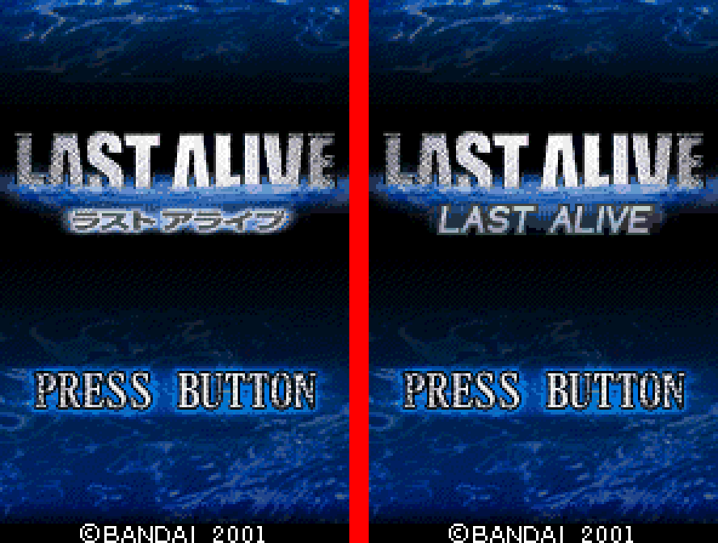
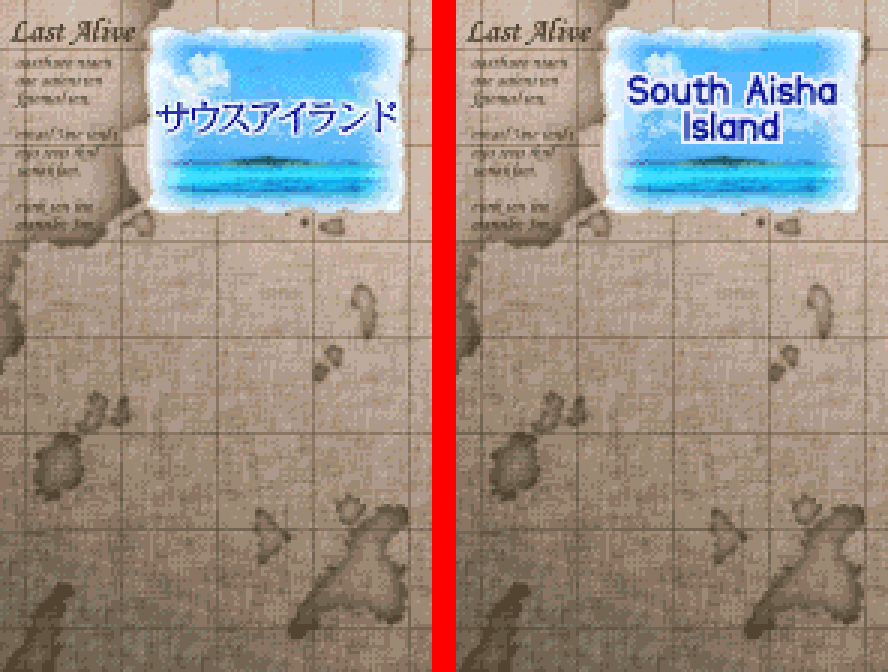
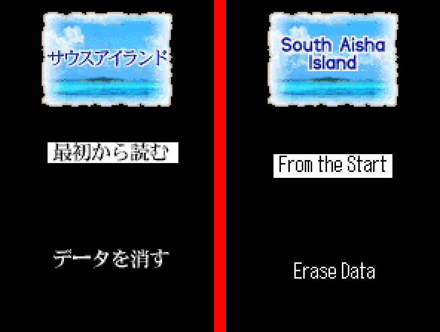
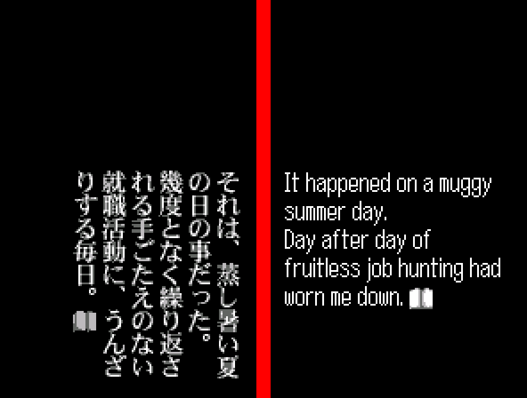
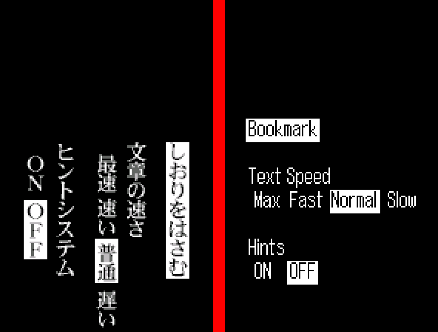
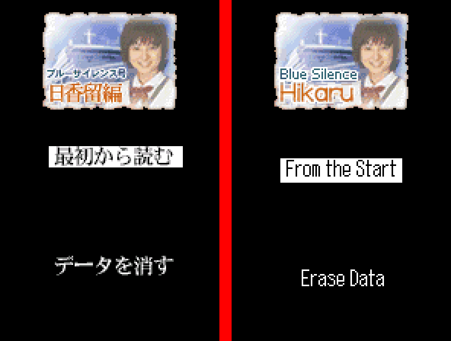
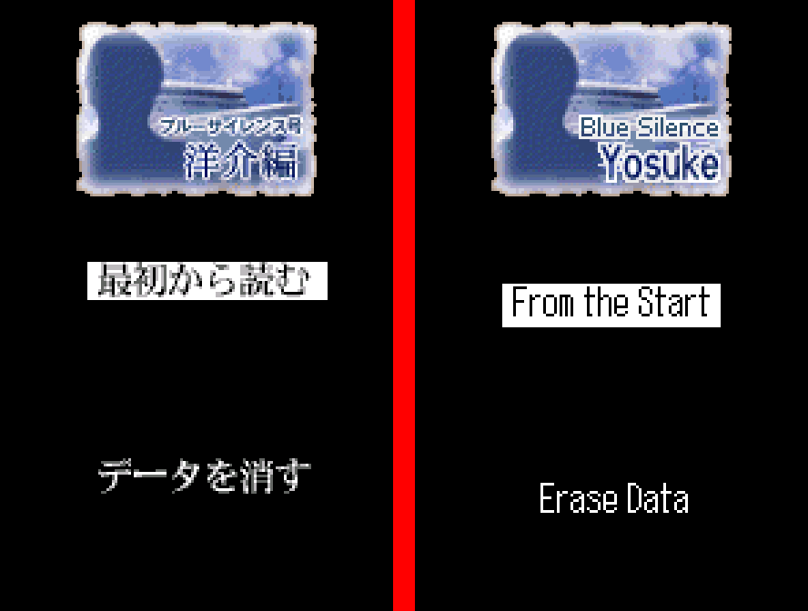
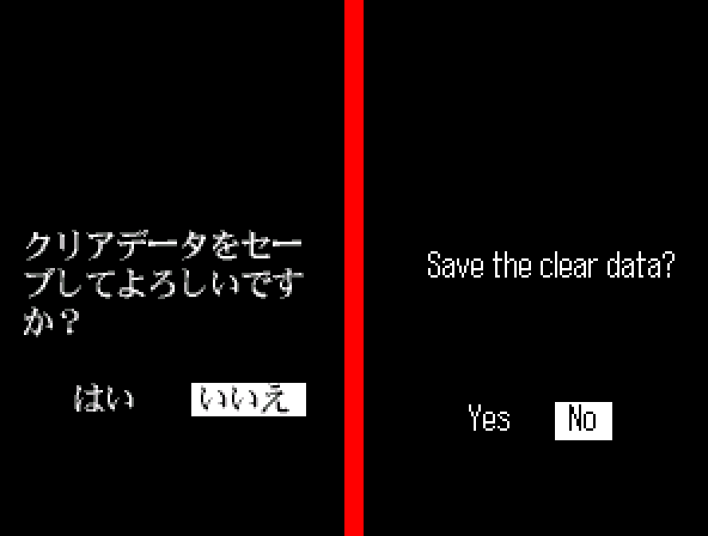
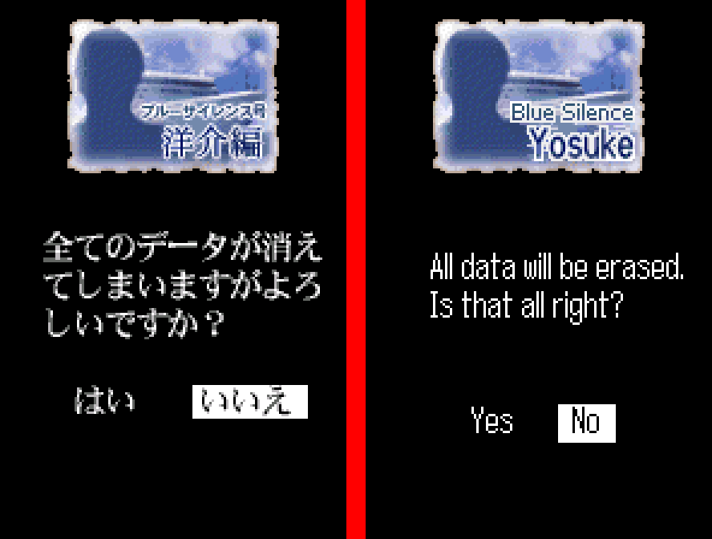

# Last Alive (WonderSwan Color) - AI English translation patch v1.0

**Last Alive** (ラスト アライブ) is a horror adventure in the form of a photo novel for the WonderSwan Color, published by Bandai on 26 July 2001 and played with the console held upright. Japanese tourists on the luxury liner Blue Silence are caught in a typhoon and a seajacking by island separatists. You read the story page by page, choose at the branch points and either survive or die. There are two scenarios, Yosuke's (a job-hunting graduate) and Hikaru's (a high-school girl on a school trip), and the story is told with photographs of the cast. It was released only in Japan. This patch translates the whole script and redraws the pictures that carry lettering.

> **Please read:** this translation was made **with AI** (Claude), as a hobby project. A person (me) made every judgement call before release, but nobody on the project is a professional translator. I'm sharing it as it is for anyone who wants to play. Please **don't upload it to romhacking sites** (romhacking.net and the like). It may not be up to the standard of a real fan translation and it doesn't belong there.

**Content note:** the game has gunshot, strangling and drowning deaths, a character burning a terrorist, a leering character and a separatist grievance against a company. The English keeps all of it at the strength of the Japanese, neither softer nor harsher, including the innuendo.

**What's translated**

* **The whole script of both scenarios:** 6,624 text units (about 237,000 Japanese characters), the choices, the title and in-game menus, the prompts, the staff credits and the cast list. The game's own text engine is kept; a variable-width English renderer replaces the kana drawing. The ROM grows from 4 MiB to 8 MiB to hold the English, and its header is updated.
* **Pictures redrawn in English in the original style:** the title subtitle, the island card (South Aisha Island), both scenario cards (Blue Silence: Hikaru and Yosuke) and the story pictures that carry words: the handwritten note, the newspaper, the deck plans, the magazine cover and the door plate. The AIR MAIL envelope was already English. Several pictures use a shorter wording than the Japanese where the full text did not fit, for example ENGINE for ENGINE ROOM on the door plate, DECK PLANS, and TERRORISM and EXCLUSIVE REPORT! on the magazine cover.
* **Names and terms:** the characters, places and the ship follow one termbase (Western name order, given name first); the wording choices were put to me on a decision page with pictures and I approved all 19 items as recommended.
* **Letter size:** English letters are smaller than the Japanese ones: capitals 11 px and lowercase 8 px, against 12 to 13 px for the kanji. A 12 px face would push 545 story pages over the 7-line page, and the game cannot scroll.
* **Kept as in the original:** the English follows the Japanese script, including a few apparent slips in it, which I chose not to correct. Takami calls Hikaru "Amano!" in a few lines where a parallel scene has "Hikaru!"; a few lines have no stated speaker or an odd one; and in scene 17F.056.00, right after Yosuke shouts "Let's stop the bombs", the next line has him say "No. It's too dangerous. Let's get out." and Hisanori presses him anyway.
* **No special edition:** I found no debug menu or stage select in the ROM, and the WonderGate row on the title menu does nothing, so this release has one patch.

**How it was made: AI translation, independent checks, human decisions**

* Claude worked out how the cartridge stores its text (a glyph-index stream with its own 16x16 font), wrote the English, redrew the pictures and rebuilt the ROM.
* The final build (la8b) went through a full automated run of 12 checks, all 12 passed: among them the static check of every text unit, a sweep of every string in its real box, a runtime detector that found no Japanese on the English build (the same detector finds kana on the original), an alignment audit, 143 screens of a ledger reviewed one by one, and a soak with random button presses that raised no flag.
* A scripted reader went through both scenarios to the staff credits on build la6d, and the English pages were read by eye on samples. Build la8b changed only line wording, the page positions of 26 timed choices and the pictures; those were checked on la8b.
* A separate read-only Claude review compared the whole script with the Japanese in seven reads: 96 proposals, 80 applied, 16 rejected after checking.

**What was not seen on screen** (please report anything odd)

* **No human playtest.** The game was checked by scripted routes, an automatic reader and forced states, on an emulator only. It has not been played from start to finish by a person, and not on real hardware or a flash cartridge. The 8 MiB image with this cartridge's save type has not been tried on hardware.
* **Saves:** bookmarks and clear data are kept in the cartridge EEPROM in the same layout as the Japanese version, so they are expected to carry over, but I checked them only inside one emulator run, not across restarts. A bookmark made in the Japanese version stores a text position that may not line up with the English text, so start the English version fresh.
* **Title rows Continue, Another Story and Bonus** (they appear only after the game sets flags I could not set by playing), the extras mode and its menu, and the warning for a monochrome WonderSwan were not seen.
* **Endings:** the two scenarios read to the staff credits cover six endings. The endings of the 14 other scenario slots were not seen, and neither was the page after No on the clear-data prompt that says the data was not reflected.
* **The story pages that carry five of the redrawn pictures** (the handwritten note, the newspaper, the deck plans, the magazine cover and the door plate) were not reached by normal play; the pictures themselves were seen on screen through a test copy. The speed and hint submenus were seen only inline on the in-game menu.

**Changelog**

* **v1.0**: first public release.

**Sources consulted**

* Japanese text: the WonderSwan Color ROM itself.
* Names and terms: the game's own text and the project's notes; there is no official English release. I searched for another English translation of this game on 2026-11-26 (the claims board, English and Japanese web searches, the cdromance and retrogametalk lists): none found. If a human translation is released, that one should be preferred.

**Images** (original on the left, English on the right)

1. Title screen: the Japanese katakana subtitle under the logo becomes LAST ALIVE; PRESS BUTTON and the Bandai copyright line are the game's own

   

2. The island card on the map screen: South Aisha Island

   

3. Title menu: From the Start and Erase Data under the island card

   

4. The first page of Yosuke's scenario, in the English text engine instead of the vertical Japanese columns

   

5. The in-game menu: Bookmark, Text Speed (Max, Fast, Normal, Slow) and Hints (ON, OFF)

   

6. Scenario card: Blue Silence: Hikaru, with From the Start and Erase Data

   

7. Scenario card: Blue Silence: Yosuke, with From the Start and Erase Data

   

8. Prompt: Save the clear data? Yes / No

   

9. Prompt: All data will be erased. Is that all right? Yes / No

   

**How to patch**

Apply the BPS file to the Japanese ROM **Last Alive (Japan).wsc** (4,194,304 bytes, CRC32 `DA4479BF`) in your browser with the [Swan Revival patcher](https://swanrevival.com/patcher/), or with Floating IPS, beat or ROM Patcher JS. The result is 8,388,608 bytes (8 MiB, larger than the original):

* `last-alive-en-1.0.bps`; the result should be CRC32 B52EAA1A.

It's a WonderSwan Color game, so keep the .wsc extension. You must provide your own copy of the original Japanese game to apply it. The patch only fits this dump (CRC32 `DA4479BF`); another revision is refused or gives a wrong result.

**Download:** `last-alive-en-1.0.bps` on the [release page](https://github.com/PokemonGoDB/wonderswan-english-patches/releases/tag/last-alive-v1.0).

**Known issues**

* It hasn't been played start to finish by a person (see "What was not seen on screen"). If you find leftover Japanese or anything broken, please tell me where it happened.
* English letters are 2 px shorter than the Japanese ones (see "What's translated"), and some text pages have different line breaks than the Japanese: for example the Yes/No boxes keep the Japanese position of the text column.
* On the scenario-select picture, the two small bands for the Hikaru and Yosuke scenarios read only "SILENCE" ("Blue Silence" does not fit in 33 px). The scenario cards seen in images 6 and 7 read "Blue Silence".
* The story contains the slips listed under "Kept as in the original"; they are in the Japanese too.

**Credits:** Translation and hacking: Claude (Anthropic) for the WonderSwan Translation Project.

**A Note On My Justifications for AI Use**

I have been an avid fan of the Wonderswan system for a very long time now. It was actually a motivating factor for my various attempts to learn Japanese (which have all failed so far). I always wanted to explore the game catalog more, but the lack of English translations made it extremely difficult to do so. Here's the thing: There's a reason many of these games have not been translated yet. It's not just the fact that Japanese > English translation is difficult. There's also the fact that the original developers used all kinds of tricks and technical feats to make these games work. Most games do not have a searchable directory of text that you can just replace with English equivalents. While some are easier than others, translations for some of these would take not only an expert in Japanese > English translation, but also someone with vast game development and programming experience.

I say all that to say: I get why people are apprehensive about AI usage for this type of thing. However, these games have been around for a very long time now and most of them have still not received a translation. I (and others) have chosen to spend our time and money to utilize AI to translate the games and actually make them playable for the wider community. If you don't agree with that, that's completely fine. I am more than happy to remove any of my translations if better, human ran translations are released at a later date. We already decided to skip any games where someone is actively working on a manual translation. While nowhere near what a manual translation effort would be, I do spend a considerable amount of time trying to work through each game's translation. I stress over small details and try my best to make the right calls. And I've probably messed some stuff up, which is why I welcome feedback.

I'm just looking forward to digging through all of these games. It's a great time to be into Wonderswan games.
