# Last Stand (WonderSwan) - AI English translation patch v1.0

**Last Stand** (ラストスタンド) is a strategy RPG for the mono WonderSwan, published by Bandai in Japan in 1999. A prince, a princess and their old butler Oblight have not aged in hundreds of years, until the demi-beasts of the world turn violent and the old protection of the land, Kruse's Protection, begins to fail. You name your heroes, form them into teams led by Masters, and each month deploy teams on the map to march on a country; the side-view battles then play out on their own, and between battles you train, scout and tutor your heroes and read what became of them. This patch translates all the text the game shows into English.

> **Please read:** this translation was made **with AI** (Claude), as a hobby project. A person (me) made every judgement call before release, but nobody on the project is a professional translator. I'm sharing it as it is for anyone who wants to play. Please **don't upload it to romhacking sites** (romhacking.net and the like). It may not be up to the standard of a real fan translation and it doesn't belong there.

**What's translated**

* **The story:** the opening, the campfire scenes, the hall dialogue where the heroes join, the captions and every scene that follows. The test run drew all 2,606 story boxes of the script on screen and found no problem. The English needs more boxes than the Japanese in places (432 extra boxes), and the ending has 77 pages against 67 in Japanese.
* **Every menu and screen:** name entry, the title menu, Continue and the save screens, every command menu, panel, help line, prompt and report, the map and the country names, the hero and Master information panels, the Tutor, Scout and Teams screens, and the battle and battle-report text. The text table holds 2,844 strings: 2,745 are translated, 9 are left alone on purpose, 90 are blank, none are missing and none still hold Japanese.
* **The staff credits**, in English job titles with the names in Japanese order (family name first).
* **Pictures with text** (menu buttons, banners, map lettering, the calendar plate) were redrawn in English in the original's style. The big banner words 進軍 and 任命式 are MARCH and PROMOTION.
* **Names and terms:** no official English exists for this game, so the names are my reading of the katakana. The player-named defaults are Alec (prince), Reilly (princess) and the four heroes Glad, Shinan, Regza and Mitt (you can type your own; names hold 6 letters, as in the original). The cast includes Oblight, Regina, Dezil, Shaiban, Forus, Kurane, Rowa (the hero king) and the brothers Minau and Rauri Kruse. 亜獣 are "demi-beasts", the lost 「クルゼの護り」 is "Kruse's Protection", and the 14 training courses and 25 hero classes are in plain English words. The 58 monster names are at most 8 letters.
* **Letters:** the English uses the same letter height as the original's kana and its own half-width letter shapes, but drawn with a variable-width renderer, so about 29 letters fit one dialogue line instead of 20. The letters g, j, p, q and y were redrawn with tails that go below the line (see Technical notes).
* **Words shortened to fit:** a few words are shorter than the Japanese because the original's boxes are fixed: some buttons (Promo, Assign, Flee, Party, School...), six school names (Still, Grind, Vigor, Trance, Rigor, Swift), a few country names kept to 6 letters (W.Rowa, E.Rowa, RamRon, Valkri, Kisnor, Gelhst, Katsva), "Injured" for the status bar, and the calendar plate "Yr1200 M 3".
* **Style:** American spelling, honorifics dropped, "!?" (not "?!") throughout, a plain voice for reports and help lines, and heroes are "they" where either sex can be shown.

**Two patches: Standard and Debug Edition**

* **Standard** (`last-stand-en-1.0`): the translation above, and nothing else. Play this one.
* **Debug Edition** (`last-stand-en-debug-1.0`): the same translation, plus a way into the developers' menu that is still on the cartridge. At **PUSH START BUTTON, hold Y1 and Y3 together (the top and bottom buttons of the Y pad) and press START**; keep them held for about half a second, until the screen changes to **Debug Settings**. The menu has five entries (UP and DOWN move, A chooses, B backs out of a list): **Done** goes back to the title (press START again for New Game / Continue as usual); **Start Chapter** lists chapters 1 to 7, the last battle and the ending, but **choosing one changes nothing** (nothing in the game reads the choice, in the Japanese cartridge too, so New Game still starts at the campfire); **Enemy Strength** (Normal / Weak) and **Music** (On / Off) are switches the game's code does read, but I did not play with them to see the effect; **Sound Test** has five pages of music tracks and then the sound effects SE00 to SE55 five at a time, **Next Page** goes on and wraps round, and A plays an entry (I checked that the screen stays alive, not how it sounds). The Sound Test has **no way out**: reset the console (the game's own soft reset is Y2 + Y4 + START). The labels are in English; the track names are my guesses from the Japanese (Rowa Castle, Ruins, Fort, Fortress City, Kurane, Regina Castle, Dezil Castle, Battle 1-3, Victory, Excavation 1-3, Door Opens, Final Boss, Ending), and the numbered tracks 201 to 209 are numbers in the original. It is a tool for the curious, not a way to play. Apart from the hold-and-START hook, the two patches are the same game. It was tested in an emulator only: every entry was opened and the lists paged through, not played.

**How it was made: AI translation, independent checks, human decisions**

* Claude read the game's script and interface format out of the ROM, wrote a story bible and a termbase, translated the game in passes, and did the hacking: a rebuilt text and menu layer with a variable-width letter renderer, and the redrawn picture labels.
* Four separate reviewer passes read all 2,655 strings against the Japanese. They found 42 points, with no omissions or inventions: 9 of meaning or term and the rest voice, consistency and typos. All 42 were decided: 39 were accepted as proposed, 1 with different wording, and 2 were left conditional.
* Every judgement call that was mine to make was put on a decision page with pictures: 22 items in three rounds, and I answered all of them. Round 1 had 14 items (12 approved; the letter-tails concern, which I raised as items 1 and 3, was redone), round 2 had 7 (6 approved, 1 approved with a question about the left edge of the "None" field, which was fixed) and round 3 had 1. Among them: the default hero names Glad, Shinan, Regza and Mitt, MARCH and PROMOTION, "Kruse's Protection", the credits in Japanese name order, keeping the shortened button words, and the redrawn letter tails.
* The final build (ls12) went through a full automated test run of 9 checks, about 49 minutes of emulated play on 2 ROMs, and all 9 passed:
  * the text table (above), checked against the translation file and a strict rebuild with 0 problems;
  * every script box (2,606) and 613 interface strings drawn on screen with the widest names, with no findings;
  * 100 random-play walks (3,998,401 frames) found no Japanese on the English build; the same walks on the original found Japanese (696,880 kana letter draws), so the check can see it;
  * the no-input title loop (122 distinct screens, a 101 second period) compared with the original, and the endings and credits compared with the original (reached through the developers' debug menu);
  * 48 screens from a screen inventory captured on both ROMs and compared, and an alignment audit of the same 48 screens: 41 flagged spots, each judged and recorded with its reason, 0 new;
  * a soak test of 5,400,000 frames (12 saved states, 3 seeds each) found no freeze.
* The game was also played by hand in an emulator from power-on on earlier builds: the opening and name entry, the hall, several months of the map, months 9 to 12 and the year-end promotion, the training spot and its battle, a won march battle, fleeing, empty lists, Save and Continue, a lost battle, the Tutor and Scout panels. The last build was checked by the full automated run and by reading the screens that changed (the Tutor and Scout "None" fields), not by playing it again.

**What was not seen on screen** (please report anything odd)

* **Nobody has played the whole game.** The hand play covered the first area up to about the turn of year 1201; later areas and maps were not reached.
* **Endings:** the ending and credits were reached through the developers' debug menu, on both ROMs, not by honest play, and were compared page by page. An ending reached by playing is not seen.
* **Not reached:** the Mount Rowa report as a box (its caption was seen on the map), the Tutor and Scout lists with no heroes, link play, six help lines whose screens were not reached (they pass the fit check), and 12 interface strings that the sweep did not draw. No shop or options screen was found anywhere in the game.
* **Test-only help:** several screens (the hall, the endings) were reached from saved states or the debug test ROM, never in a patch.
* **What the checks cannot see:** the detector looks for Japanese letters and picture tiles; picture text was checked by screenshot and by eye.
* **Not on real hardware.** Only an emulator was used.

**Changelog**

* **v1.0**: first public release (2026-11-19).
* **v1.0, Debug Edition added** (2026-11-20): a second patch with a way into the developers' menu; the standard patch is unchanged.

**Sources consulted**

* Japanese text and graphics: the WonderSwan ROM itself.
* English names and terms: none exist for this game. The names are Hepburn-style readings of the katakana, with the game's own English where it has some (BANDAI 1999); each is in the project's termbase with its reason. Some are close calls (Reilly or Reiri, Oblight or Obright); the staff-name readings are not verified.
* Release data: the title screen shows (c) BANDAI 1999; listings found by web search give Soft Machine as developer and April or May 1999 (the sources disagree).
* The project's own notes on the game's text format and story, and the QA run summaries.
* I searched for another English translation of this game on 2026-11-18 (a web search, the WonderSwan claims board and the gametranslate.us translations page) and again on 2026-11-19 and found none. If a human translation is released, that one should be preferred.

**Images** (original on the left, English on the right)

1. Title screen

   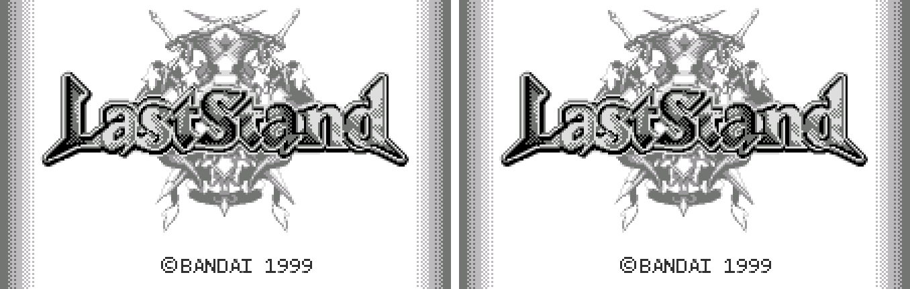

2. Title menu

   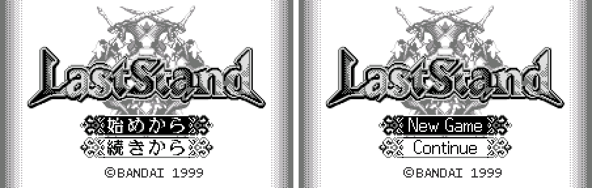

3. A story scene at the campfire

   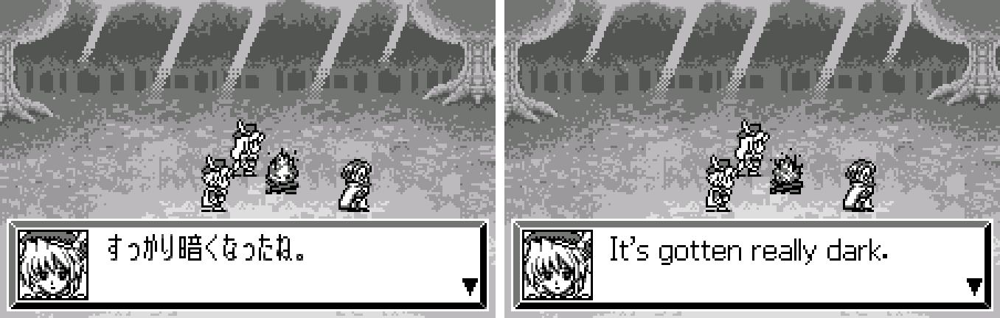

4. Name entry

   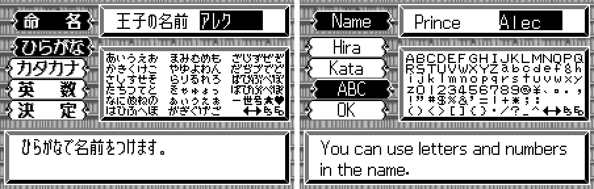

5. The map screen's command menu

   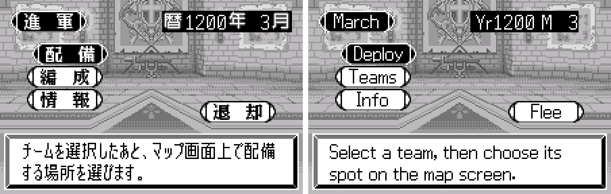

6. Choosing a country to march on

   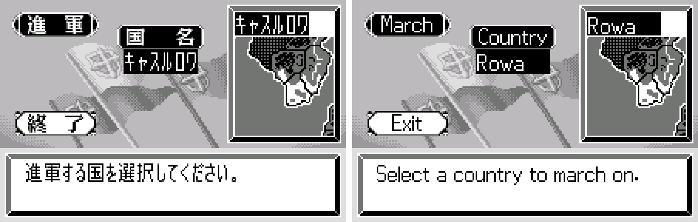

7. Confirming the march

   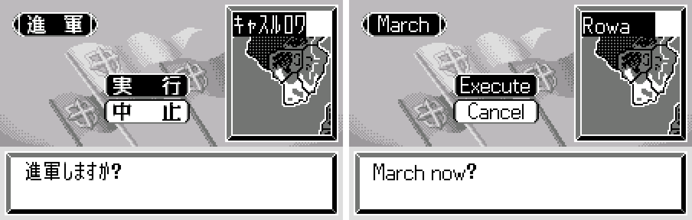

8. A hero's status panel

   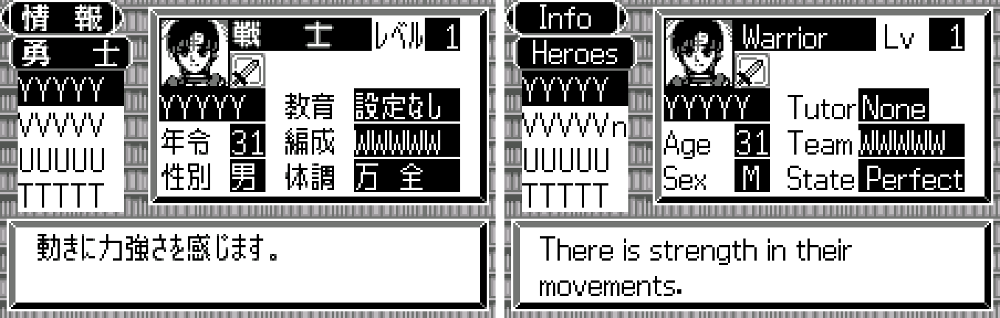

9. A battle

   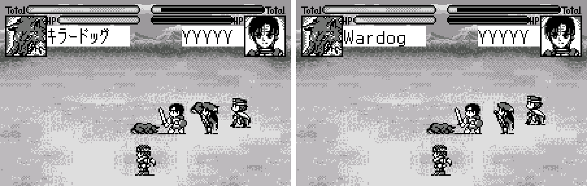

10. The report on a hero after a battle

   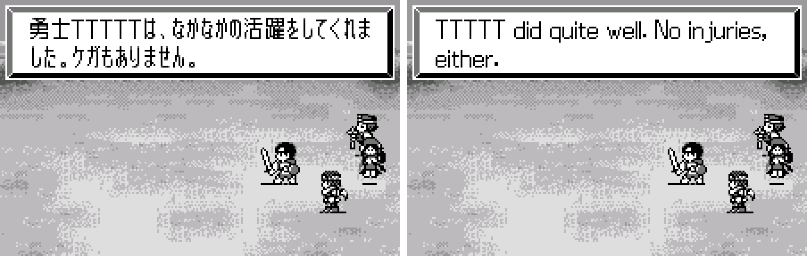

11. The save screen

   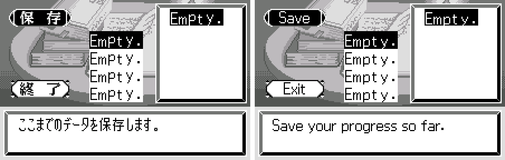

Debug Edition only (the original's developer menu, opened by the same hold-and-START route, on the left):

12. Debug Settings, the developers' menu

   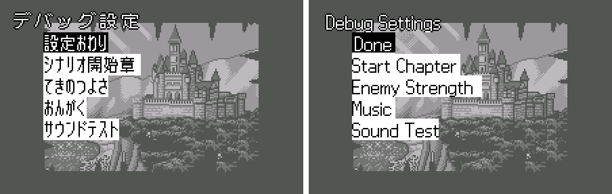

13. Sound Test, page 1

   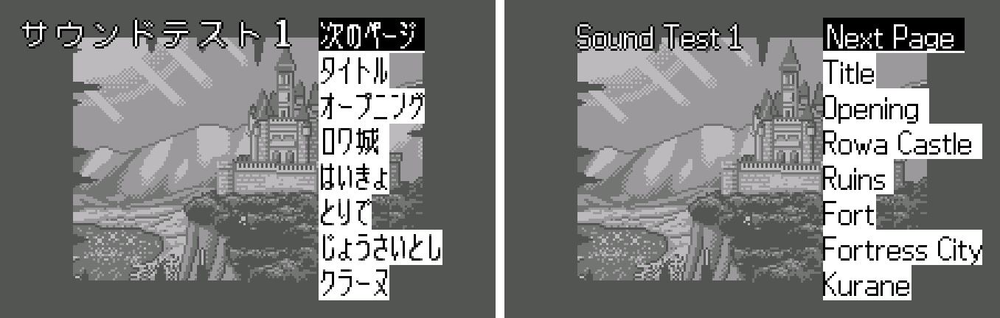

14. The Start Chapter list (cut off at the bottom in both versions)

   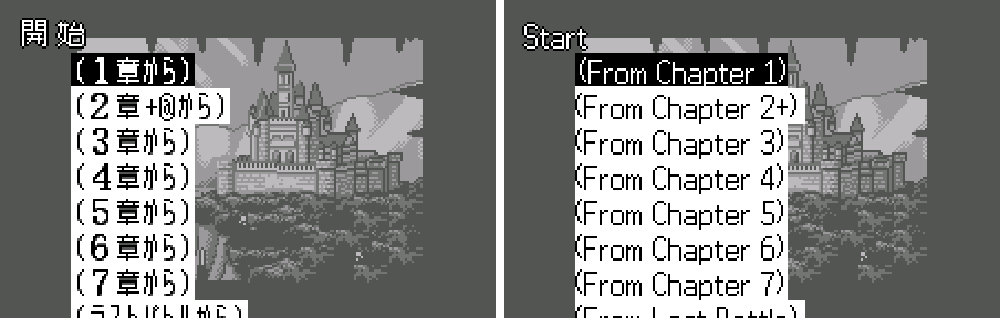

**How to patch**

Apply the BPS file to the Japanese ROM **Last Stand (Japan).ws** (2,097,152 bytes, CRC32 `CCCAF8A1`) in your browser with the [Swan Revival patcher](https://swanrevival.com/patcher/), or with Floating IPS, beat or ROM Patcher JS. The result is 2,097,152 bytes:

* Standard: `last-stand-en-1.0.bps`; the result should be CRC32 FC293A2E.
* Debug Edition: `last-stand-en-debug-1.0.bps`; the result should be CRC32 71B36CE0 (also 2,097,152 bytes).

It's a WonderSwan game, so keep the .ws extension. You must provide your own copy of the original Japanese game to apply it.

**Download:** `last-stand-en-1.0.bps`, `last-stand-en-debug-1.0.bps` on the [release page](https://github.com/PokemonGoDB/wonderswan-english-patches/releases/tag/last-stand-v1.0).

**Known issues**

* It was tested in an emulator, not on a real WonderSwan, and no person has played the whole game (see "What was not seen on screen"). If you find leftover Japanese, cut text or a crash, please tell me where it happened.
* Some pictures above show names typed in for the checks (YYYYY, TTTTT, WWWWW and so on): the hero panel (8), the battle (9) and the battle report (10). The name entry (4) shows the default name Alec. A name stray like "VVVVVn" is the default name showing after a five-letter typed one; the original does the same.
* The shortened words listed under "What's translated" are shortened on purpose. Reports and help lines that had to fit two lines are worded shorter than the Japanese, and the title captions 侵 and 攻 read "INVA-" and "SION".
* The country names are 6 letters at most where the game stores them in a fixed slot, and the calendar reads "Yr1200 M 3" because the digits sit at fixed places.
* On the hero info screen the team name (for example WWWW) touches the left edge of its black field. The game draws it with its own fixed routine, exactly as the Japanese original does. The Tutor and Scout "None" was moved 2 pixels in after my feedback.
* The Tutor and Scout labels are one or two letters (Tu, Tm, Sc), like the original's one-kanji labels.
* The staff credits' name readings are not verified.
* The footer checksum of the patched ROM was not recomputed (it is the original's). Emulators ignore it.
* Save states made in an emulator on the Japanese ROM do not carry over to the patched ROM.
* Debug Edition: Start Chapter does nothing (as in the Japanese game); its last two rows (Last Battle, Ending) lie below the bottom edge of the screen, so the cursor disappears there; the label "(From Chapter 2+)" copies a garbled label of the Japanese menu; in the Sound Test, a letter fragment can remain to the right of an entry after the cursor leaves it (the next entry's first letter; the Japanese version is clean); the Sound Test cannot be left except by resetting; the hold has to last about half a second.

**Technical notes (for the curious)**

* The ROM keeps its size (2 MiB). The English script and interface text are rebuilt into the ROM's existing free space, and the game's tables point at them.
* The game has a text engine for kana only. The patch adds a variable-width renderer: one byte per letter, each letter as wide as its ink plus one pixel, and word wrap in pixels in dialogue and help lines. It keeps 8 pen slots (where the last letter ended, per text context) so that menus drawn in several parts do not leave gaps, and the first letter of the hero info fields starts 2 pixels in.
* The letters g, j, p, q and y were redrawn in their own slots of the half-width font: the round part sits on the same line as a, d, o and u, and the tail drops two rows below the line. On button plates the tail is one row, and the name-entry grid keeps its own small font.
* Some Japanese was written into the code itself (the date plate on the month change, the empty-list messages); those words were found and rewritten there.
* The checks are scripts that drive an emulator, take screenshots of every screen and compare the English build with the original. The standard BPS file is 171,356 bytes; applying it to the original gives the tested build byte for byte, checked with an independent patch applier.
* The cartridge has an unused developer debug menu (デバッグ設定, "debug settings"). Its chapter option does nothing, and the usable parts are a sound test and an enemy strength switch. The standard patch leaves it alone and adds no way into it. The Debug Edition adds one hook in the boot loop (the instruction run right after the title script returns, at `2000:0085`, now calls a 40-byte routine placed in unused ROM at `0x12FF00`): when Y1 and Y3 are held it starts the menu's event script (script 4, translated in the standard patch too), runs the title script again, and carries on. Every other byte equals the standard patch's result (checked: 48 bytes differ). The Debug Edition patch file is 171,412 bytes.

**A Note On My Justifications for AI Use**

I have been an avid fan of the Wonderswan system for a very long time now. It was actually a motivating factor for my various attempts to learn Japanese (which have all failed so far). I always wanted to explore the game catalog more, but the lack of English translations made it extremely difficult to do so. Here's the thing: There's a reason many of these games have not been translated yet. It's not just the fact that Japanese > English translation is difficult. There's also the fact that the original developers used all kinds of tricks and technical feats to make these games work. Most games do not have a searchable directory of text that you can just replace with English equivalents. While some are easier than others, translations for some of these would take not only an expert in Japanese > English translation, but also someone with vast game development and programming experience.

I say all that to say: I get why people are apprehensive about AI usage for this type of thing. However, these games have been around for a very long time now and most of them have still not received a translation. I (and others) have chosen to spend our time and money to utilize AI to translate the games and actually make them playable for the wider community. If you don't agree with that, that's completely fine. I am more than happy to remove any of my translations if better, human ran translations are released at a later date. We already decided to skip any games where someone is actively working on a manual translation. While nowhere near what a manual translation effort would be, I do spend a considerable amount of time trying to work through each game's translation. I stress over small details and try my best to make the right calls. And I've probably messed some stuff up, which is why I welcome feedback.

I'm just looking forward to digging through all of these games. It's a great time to be into Wonderswan games.
