# Lode Runner for WonderSwan (WonderSwan) - AI English translation patch v1.0 (+ Swan Revival Edition)

**Lode Runner for WonderSwan** is Banpresto's version of the classic dig-and-collect puzzle game, developed by Aisystem Tokyo and released only in Japan in 2000 for the original (monochrome) WonderSwan. You run, climb and dig holes to trap the guards while you collect every pile of gold. Story Mode follows a diver who finds a lost golden kingdom under the sea. There's also Select Mode, the original Lode Runner maps, a map editor with two save slots, map trading over the link cable (Data I/O), and DOWN LOAD, which fetched new stages through Bandai's Mobile WonderGate phone adapter.

This patch translates it into English.

> **Please read:** this translation was made **with AI** (Claude), as a hobby project. A person (me) made every judgement call before release, but nobody on the project is a professional translator. I'm sharing it as it is for anyone who wants to play. Please **don't upload it to romhacking sites** (romhacking.net and the like). It may not be up to the standard of a real fan translation and it doesn't belong there.

**What's translated**

* **Everything on screen:** the menus and prompts, the map editor, Data I/O, Option (viewing and deleting save data), the chapter tally, the phone-number keypad, and the WonderGate download screens with all 21 error messages. The game has no text font: every Japanese word is a picture, and the English is lettered into the same places.
* **Story:** all five chapters and the ending, for both heroes. The male hero (俺) is blunt and the female hero (わたし) softer. Which hero you get follows the owner's gender set in the WonderSwan's own settings, as in the original.
* **Title logo:** the katakana ロードランナー is replaced by an English LODE RUNNER, drawn in the style of the original lettering over the original rock art.
* **Left as it is:** the game's own English: the mode plates (STORY MODE, SELECT MODE, MAP EDIT, DATA I/O, DOWN LOAD, OPTION), STAGE CLEAR!, the HUD and the staff credits.

**Names and terms**

Chapter 2, 「ロマン」, is "Wonder": the loan word means adventure and awe here, not romance. The phone keypad's three keys are "Clr", "Done" and "Init", because each key is only 22 pixels wide. "DOWN LOAD" stays two words, as the game spells it on its own plate.

**Swan Revival Edition (optional)**

A second English patch adds stage sharing through the game's own WonderGate menu, for Swan Revival (swanrevival.com), the community's WonderGate revival:

* **Upload a Stage:** send a map from MAP 1 or MAP 2 with a title and, if you like, your name. The cartridge remembers the name. Stages are reviewed before they appear in the list.
* **Download a Stage:** a list of up to 40 player-made stages with their titles, authors and dates. The stage you pick opens in the map editor, as in the original.
* The title screen and an info screen say that this is an unofficial edition by Swan Revival, not made or endorsed by Banpresto or Bandai.

Gameplay, the map editor, Data I/O and the save format are unchanged: maps still trade over the link cable as before, and saves work in every version.

There is also a **Japanese-text** build of the edition: the original Japanese game with the same stage sharing, its new screens written in Japanese in the game's own lettering. It's for players who want the original game and only the new feature.

> **Note:** Upload and the new Download list need Swan Revival's stage-sharing service. Until it is live, they show the game's own "could not connect" errors. Everything else works offline.

**How it was made: AI translation, independent checks, human decisions**

* Claude found and rendered every picture in the ROM: 87 screen maps in 10 tile sets, plus the story script. It wrote the English, then lettered it into new tiles that the game loads alongside each screen.
* A separate, independent Claude reviewer read the whole game against the Japanese. Its 13 findings were checked and fixed. The Swan Revival Edition's screens had their own review (16 findings, fixed), and its Japanese text was reviewed by another separate agent (no meaning errors; its wording fixes were applied).
* On screen:
  * all 87 edited maps were drawn by the game's own code and matched the expected pictures;
  * 15 scripted tours (menus, story for both heroes, both endings, editor, Data I/O, DOWN LOAD, keypad, Option) and long random walks found no Japanese left on the English build;
  * 10 minutes of the attract mode were captured with no input;
  * the text alignment was measured on every screen.
* Link cable: the English cartridge traded maps with an original Japanese cartridge in both directions.
* Online: the WonderGate sessions were played for real against private copies of Swan Revival's server, on the original and patched ROMs. That covers the download, every upload result, the stage list, and the connection and server errors. The live server was not used for testing.
* The judgement calls (the logo, names, terms, the keypad labels, and for the edition its name, wording and protocol) were listed with the options, and I decided all of them by hand: 13 for the translation and 12 for the edition.

**Changelog**

* **v1.0**: first release, with the Swan Revival Edition (English and Japanese-text) 1.0.

**Sources consulted**

* Japanese text: the WonderSwan ROM itself.
* WonderGate behaviour: the game's code and Swan Revival's notes on this game.
* Lettering: Shinonome 12-dot (public domain) for the English text; the title logo is hand-drawn; the Japanese-text edition's new screens use the game's own lettering.

**Images** (1-9: original on the left, English on the right; 10-14: Swan Revival Edition, English on the left, Japanese-text on the right)

1. Title screen

   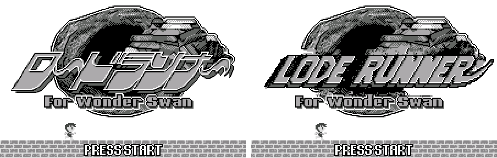

2. Main menu

   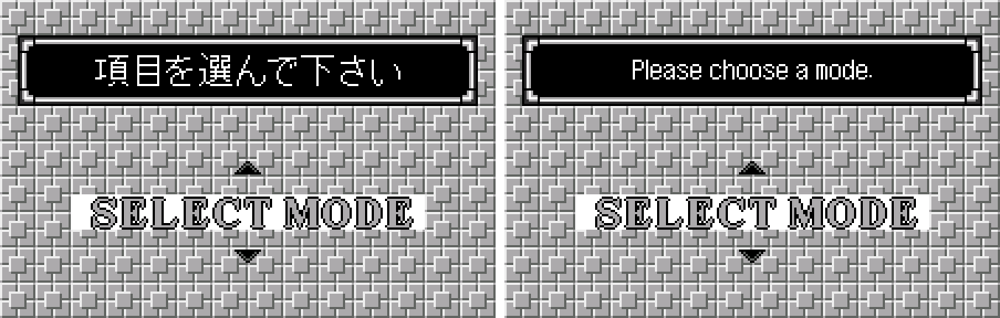

3. Story Mode

   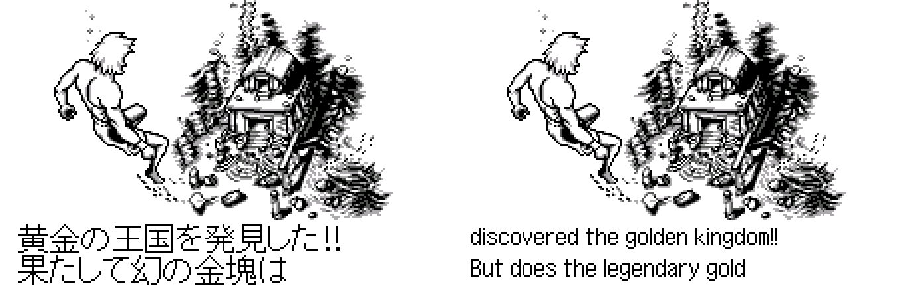

4. Map Edit

   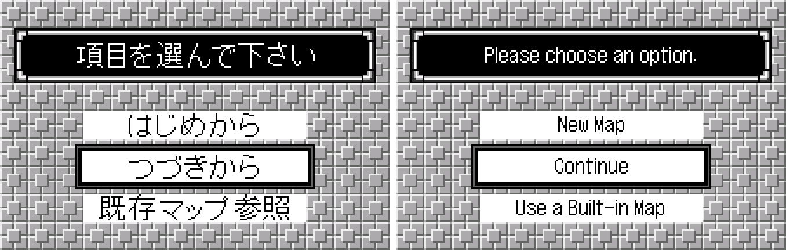

5. Map editor menu

   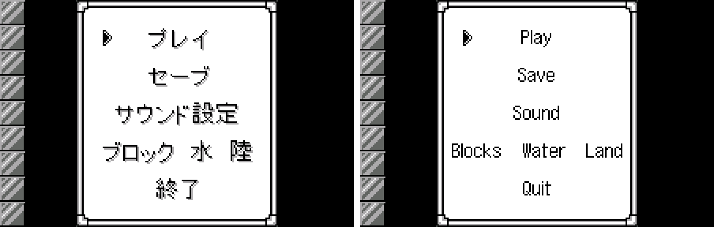

6. WonderGate: getting ready to connect

   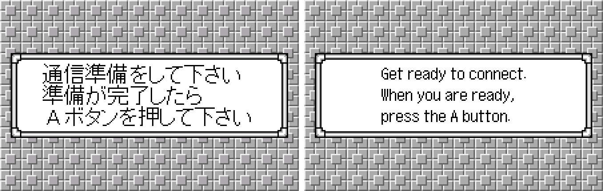

7. WonderGate: an error message

   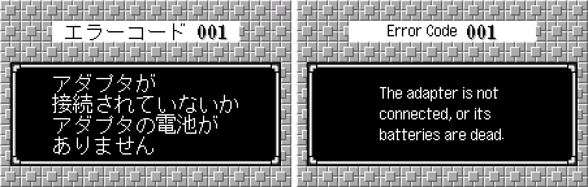

8. Phone number keypad

   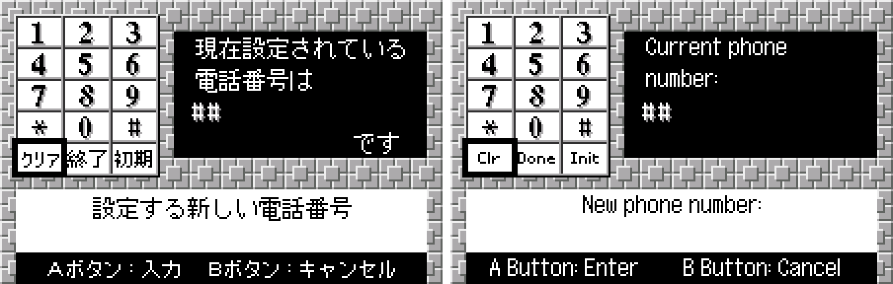

9. Ending

   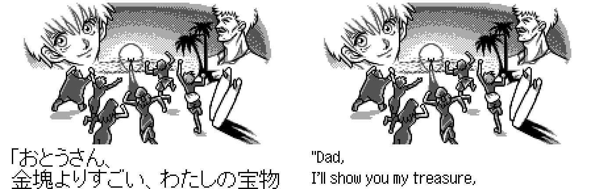

10. Swan Revival Edition: title screen

    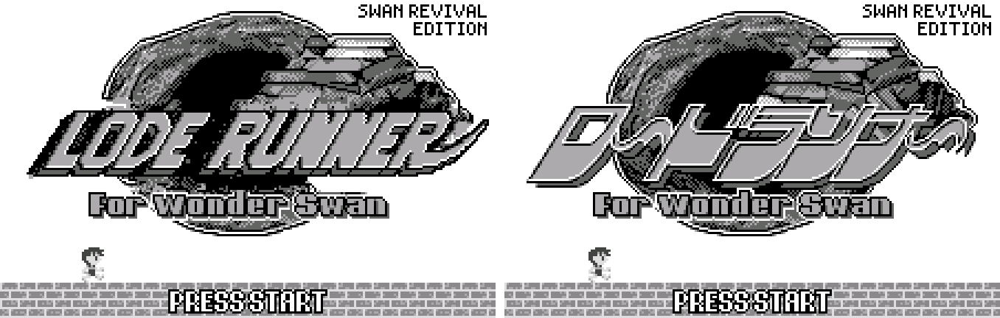

11. Swan Revival Edition: DOWN LOAD menu

    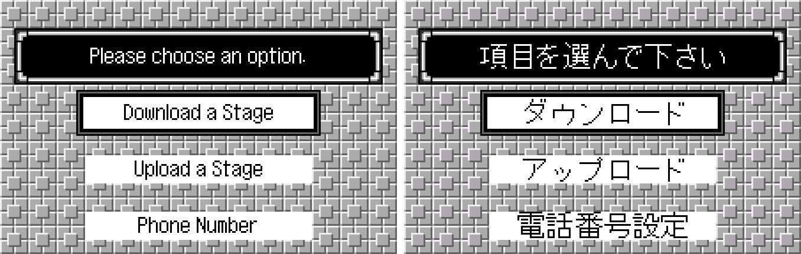

12. Swan Revival Edition: the stage list (test data)

    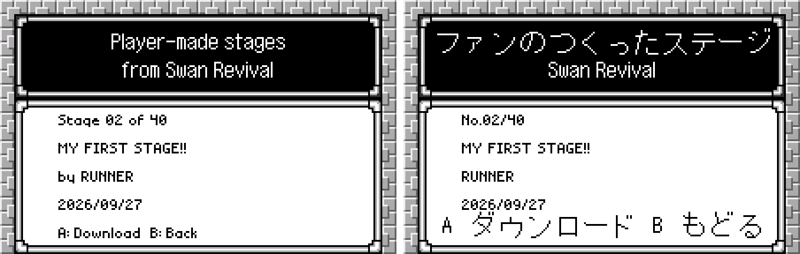

13. Swan Revival Edition: entering your name for an upload

    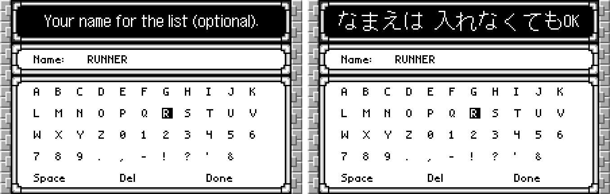

14. Swan Revival Edition: an upload sent (test server)

    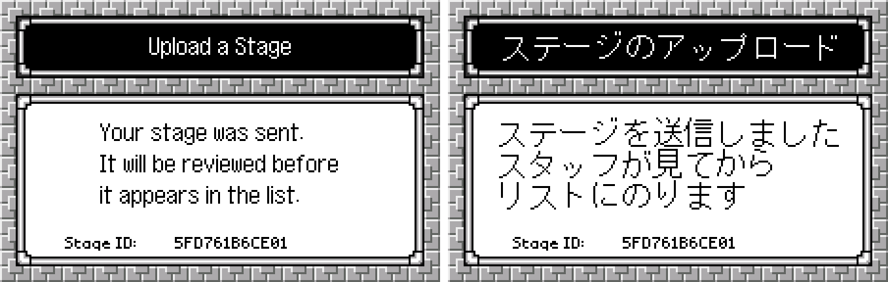

**How to patch**

Apply `lode-runner-en-1.0.bps` to the Japanese ROM "Lode Runner for WonderSwan (Japan)" (CRC32 E407CABF) in your browser with the [Swan Revival patcher](https://swanrevival.com/patcher/), or with Floating IPS, beat or ROM Patcher JS. The result should be CRC32 A88BABE0.

For the Swan Revival Edition, apply `lode-runner-se-en-1.0.bps` to the same Japanese ROM instead (CRC32 2EEB7D2A). For its Japanese-text build, apply `lode-runner-se-ja-1.0.bps` (CRC32 1425CEDE).

The patched ROM is 512 KB, the same size as the original. It's a WonderSwan (mono) game, so keep the .ws extension.

You must provide your own copy of the original Japanese game to apply it.

**Download:** `lode-runner-en-1.0.bps`, `lode-runner-se-en-1.0.bps` and `lode-runner-se-ja-1.0.bps` on the [release page](https://github.com/PokemonGoDB/wonderswan-english-patches/releases/tag/lode-runner-v1.0).

**Known issues**

* It hasn't been played start to finish by a person. If you find leftover Japanese or anything broken, please tell me where it happened.
* Bandai's download server closed long ago and its stages are lost. With the standard patch, DOWN LOAD reaches Swan Revival today but finds no stage list there (error 603).
* A few screens were checked only in a test viewer, not in a real session: "Receiving" and some adapter and phone errors.
* The Swan Revival Edition's sharing was tested against a private copy of the planned service, not the live one.
* The Japanese-text edition's new Japanese was written by AI and checked by an AI reviewer, not by a native speaker.

**Technical notes (for the curious)**

* All of the game's Japanese is compressed pictures: tile sets plus screen maps, with no font or text strings. The patch hooks the game's map copy routine, so each translated screen loads its own English tiles next to the original ones.
* The Swan Revival Edition adds about 4.4 KB of code. It reuses the game's own WonderGate routines (connect, send, receive, hang-up, error screens) for a new upload request and a richer stage list. The player's name is kept in EEPROM words the game never uses.
* The Japanese-text edition's new screens use 85 characters cut from the game's own lettering, so they match the original screens.

**A Note On My Justifications for AI Use**

I have been an avid fan of the Wonderswan system for a very long time now. It was actually a motivating factor for my various attempts to learn Japanese (which have all failed so far). I always wanted to explore the game catalog more, but the lack of English translations made it extremely difficult to do so. Here's the thing: There's a reason many of these games have not been translated yet. It's not just the fact that Japanese > English translation is difficult. There's also the fact that the original developers used all kinds of tricks and technical feats to make these games work. Most games do not have a searchable directory of text that you can just replace with English equivalents. While some are easier than others, translations for some of these would take not only an expert in Japanese > English translation, but also someone with vast game development and programming experience.

I say all that to say: I get why people are apprehensive about AI usage for this type of thing. However, these games have been around for a very long time now and most of them have still not received a translation. I (and others) have chosen to spend our time and money to utilize AI to translate the games and actually make them playable for the wider community. If you don't agree with that, that's completely fine. I am more than happy to remove any of my translations if better, human ran translations are released at a later date. We already decided to skip any games where someone is actively working on a manual translation. While nowhere near what a manual translation effort would be, I do spend a considerable amount of time trying to work through each game's translation. I stress over small details and try my best to make the right calls. And I've probably messed some stuff up, which is why I welcome feedback.

I'm just looking forward to digging through all of these games. It's a great time to be into Wonderswan games.
