# Medarot Perfect Edition (WonderSwan) - AI English translation patch v1.0 (Kabuto and Kuwagata versions)

**Medarot Perfect Edition** (メダロット パーフェクトエディション) is the WonderSwan version of Imagineer's robot-collecting RPG. The player builds a Medabot from a Medal and four parts (head, right arm, left arm, legs), fights "Robattles", and collects parts. It came out as two cartridges, **Kabuto Version** and **Kuwagata Version**, which differ in the starting Medal and in some of the story. This patch translates both into English.

> **Please read:** this translation was made **with AI** (Claude), as a hobby project. A person (me) made every judgement call before release, but nobody on the project is a professional translator. I'm sharing it as it is for anyone who wants to play. Please **don't upload it to romhacking sites** (romhacking.net and the like). It may not be up to the standard of a real fan translation and it doesn't belong there.

**Which patch do I need?** Pick your cartridge's version, then a name edition. There are four patches:

| Patch | For the ROM | Names |
| --- | --- | --- |
| `medarot-kabuto-en-1.0` | Kabuto Version (Japan) | English cartoon names: Medabot, Robattle, Medafighter, Rubberobo gang, Select Corps |
| `medarot-kabuto-en-fan-1.0` | Kabuto Version (Japan) | Fan names: Medarot, Robottle, Medarotter, RoboRobo, Select Force |
| `medarot-kuwagata-en-1.0` | Kuwagata Version (Japan) | English cartoon names |
| `medarot-kuwagata-en-fan-1.0` | Kuwagata Version (Japan) | Fan names |

The translation is the same in both name editions; only the names of the series' words differ. Each patch applies to a 1 MiB original ROM (CRC32 of the Kabuto original `12FB8B28`, of the Kuwagata original `2B40745D`) and makes a 2 MiB ROM.

| Patch | Result CRC32 |
| --- | --- |
| `medarot-kabuto-en-1.0` | `375E929E` |
| `medarot-kabuto-en-fan-1.0` | `D9CF3C8B` |
| `medarot-kuwagata-en-1.0` | `A10D783A` |
| `medarot-kuwagata-en-fan-1.0` | `2C14DE6F` |

**What's translated**

* **Everything the player reads:** the story, town and building dialogue, the Robattles (parts, attacks, results, the win and lose screens), the phone menu, Medabot, Medal and parts screens, shops, name entry, records and save, the link-cable menus and trade, the postcard pages, and the staff roll. The translation has 2,483 text units and all of them are covered; a check finds no untranslated text left in either ROM. One leftover message that the game's own scripts never show is listed as unreachable.
* **Redrawn pictures:** the WIN! / LOSE! banner, the title buttons (NEW GAME / CONTINUE), the PERFECT EDITION subtitle and the boot credit ("Original Story & Character Design / Rin Horuma") are drawn again in English in the original's style. The large katakana メダロット logo, the TM mark, the Comic BomBom logo and the original's own misspelling LISENCED BY BANDAI stay as they are.
* **Names with no fixed English form** were chosen from the English cartoon and the fan translations of other Medarot games; where a name has to be cut short for a fixed-width field (for example "Phenix" for Phoenix), the full name is used wherever the game has room.
* **Names can contain spaces:** the name-entry grid gets a visible space key (the little "=" key was dropped to make room), and player and Medabot names may now have spaces.
* **Item discard fix:** in the original, choosing No in the item "Discard?" prompt and pressing A still threw the item away. In this patch No + A cancels, like B.
* **The 1999 postcard campaign is over.** The three original postcard pages are translated faithfully. After them the game shows pages of our own, with a code to enter at swanrevival.com/medarot for a Swan Revival prize. It is not a prize from Imagineer or Bandai.
* **Staff roll:** names are given name first, in capitals. Five readings are confirmed against published sources; 45 are not (kana only, or the same kana as the romanised Medarot 1 and 3 rolls). The list is in the release notes.
* **Kept as the cartridge has it:** OPENNING MOVIE in the staff roll, and the battle command box's short words (Hit, Rush, Snipe, Cheer, Guard) where its field is five cells wide.
* **Sensitive content** is translated faithfully, not softened (part names such as Stalker and Thighs, some remarks about women, a few crude gags).
* **Saves:** the save format is unchanged, so a save should move between the Japanese and the English version of the same cartridge. This was not tested. Names with spaces or accented letters exist only in the English version.

**How it was made: AI translation, independent checks, human decisions**

* Claude worked out the game's text format, wrote the English for the game's text, and rebuilt the ROM with a variable-width font and a text renderer added to the cartridge, so that lines and names fit the original boxes.
* The final Kabuto build was put through a full automated test run of 11 checks, and all 11 passed:
  * all 1,671 field-dialogue messages were drawn by the game, one by one, with the widest player and Medabot names, and checked (no Japanese, nothing past the right edge, no box with too many lines); the battle messages and all 93 tile maps were checked the same way;
  * random-button walks of about 170,000 frames from five states drew no Japanese on the English build apart from the katakana title logo, which is kept (the same walks on the original find about 160 different Japanese screens, so the check can see it);
  * the full idle (attract) loop was captured with no input on both ROMs; the ending chain and the staff roll (122 of 122 lines) were checked on screen;
  * 2.88 million frames of soak tests from 16 saved states raised no flags;
  * the link menus and a whole trade were run on two linked emulators;
  * 1,265 screens were measured against the original by a program for alignment and letter size, and the screens it flagged were read enlarged, side by side with the original.
* The captured screens (1,363 in the final run) were also read by separate read-only Claude reviewers, who judged them against the original over several passes (about 1,040 different screens in an early pass, 454 in the last one); their findings were fixed or written down. All 44 decision items (names, wordings, pictures, short forms, the look) were listed with pictures and options, and I decided every one of them.
* The fan-names Kabuto patch passed the same 11 checks. The two Kuwagata patches passed the checks that draw every message, look for Japanese, capture the attract loop, the endings and the staff roll, and the soak test (13 states, 2.34 million frames). Three checks did not pass on Kuwagata: the screen capture run took about 715 screens but could not finish its late-game routes, because the test saves for those exist only for Kabuto; the link test was run on Kabuto only; and the alignment program flagged 8 Kuwagata screens that are not on its list of screens already read. Those 8 screens, the Medal page and the boot credit were then looked at on the Kuwagata build and showed nothing wrong. A check of tile codes also flags the three drawn skill names of the Medal page on the standard Kuwagata build; on screen they read correctly.

**What was not seen on screen** (please report anything odd)

* Medaforce animations, the Queen and Hero acting, the Robo-Robo Medal prompt, medal level-up, fortune slips, and the message for "no complete Medabot" in a natural state (it was shown once by setting one byte).
* The Nae and Iseki epilogues, the bedtime scene, the final battle and other late branches, and the middle rounds of the tournaments. The staff roll and one ending chain were seen on the Kabuto build.
* Link: the morph notice, the link battle end lines, the stakes acceptance and spaced names were not seen; the Kuwagata link menus were not run.
* Kuwagata: about 715 screens were captured against 1,363 for Kabuto. The late-game routes, the link menus and Medabot-name entry were not run on Kuwagata, and several Kuwagata test saves are Kabuto saves loaded into the Kuwagata game.
* The password entry screen was not found. The result of the special match was not seen. The record screens were not drawn one by one like the dialogue. The item and slot limits of a save were not checked. The Medal page's skill names were seen with one test Medal only. One place on the town map (Ninja Park) could not be reached at the point of the story the test saves are at.

**Changelog**

* **v1.0**: first public release.

**Sources consulted**

* Japanese text: the WonderSwan ROMs themselves.
* English names: the English dub of the series, and the fan translations of other Medarot games, for the two name editions.
* The project's own notes on the game's text format, story and terms, and the QA run summaries.

**Images** (original on the left, English on the right; standard names, Kabuto version)

1. Title screen

   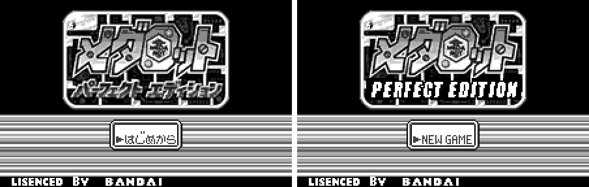

2. Boot credit

   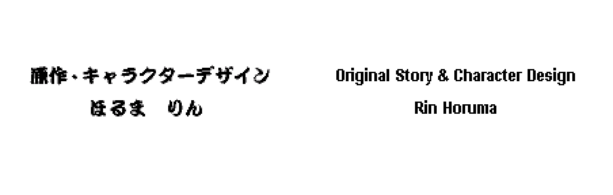

3. Name entry

   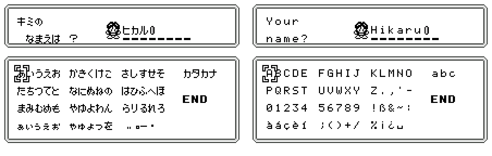

4. Tutorial (the two captures show different moments)

   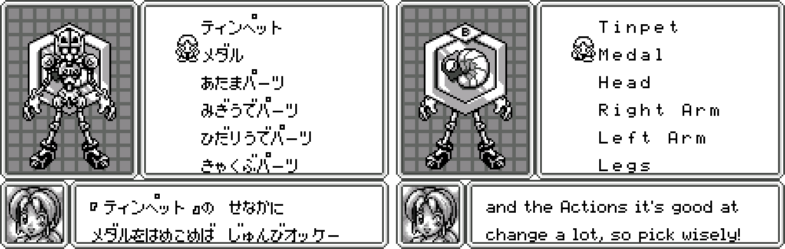

5. Dialogue in town

   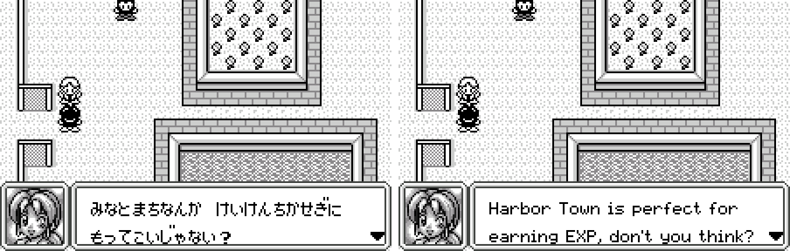

6. Phone menu

   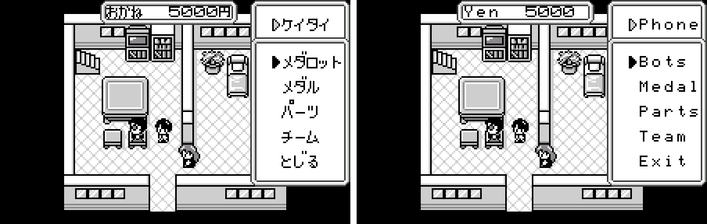

7. Medabot list

   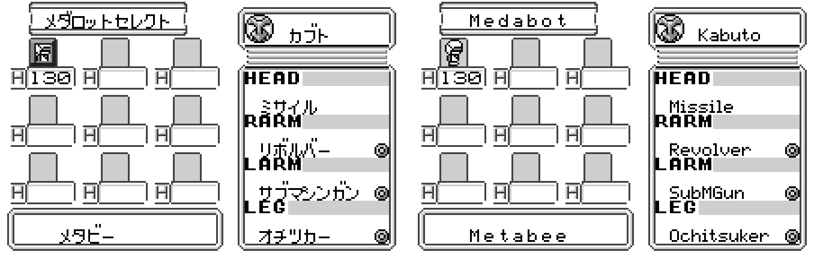

8. Medal page

   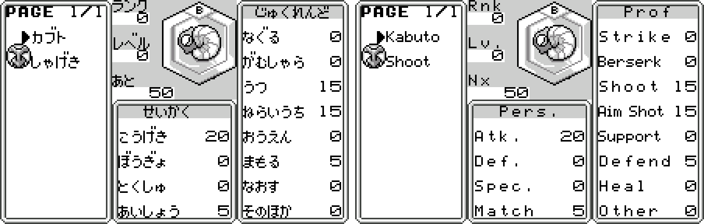

9. Parts collection

   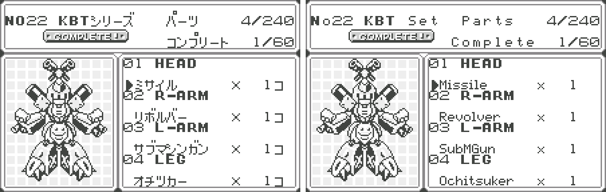

10. Shop

    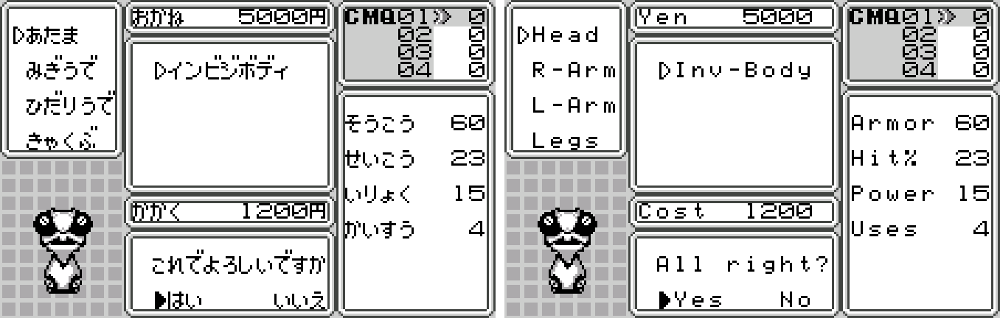

11. Records and save

    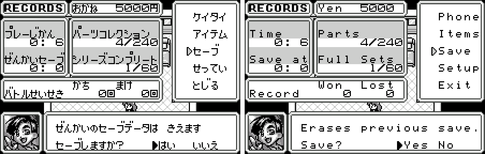

12. A Robattle (the two captures show different moments)

    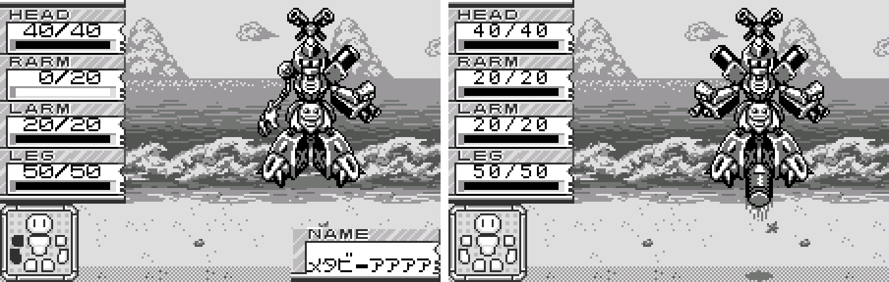

**How to patch**

Apply the BPS file for your cartridge to the matching Japanese ROM in your browser with the [Swan Revival patcher](https://swanrevival.com/patcher/), or with Floating IPS, beat or ROM Patcher JS:

* Kabuto Version (CRC32 12FB8B28): `medarot-kabuto-en-1.0.bps`, the result should be CRC32 375E929E. Fan names: `medarot-kabuto-en-fan-1.0.bps`, result D9CF3C8B.
* Kuwagata Version (CRC32 2B40745D): `medarot-kuwagata-en-1.0.bps`, the result should be CRC32 A10D783A. Fan names: `medarot-kuwagata-en-fan-1.0.bps`, result 2C14DE6F.

The patched ROM is 2 MB, twice the size of the original (1 MB). It's a monochrome WonderSwan game, so keep the .ws extension.

You must provide your own copy of the original Japanese game to apply it.

**Download:** the four BPS files on the [release page](https://github.com/PokemonGoDB/wonderswan-english-patches/releases/tag/medarot-v1.0).

**Known issues**

* It hasn't been played start to finish by a person. If you find leftover Japanese or anything broken, please tell me where it happened.
* The screens listed above under "What was not seen on screen" were checked only in the text and the code.
* The Kuwagata patches were tested less than the Kabuto ones (see above). They are built by the same code from the same translation.
* The battle command box shows short words (Hit, Rush, Snipe, Cheer, Guard) because its field is five cells wide, and the p of "Snipe" touches the box's bottom line.
* A few names are cut short where a field has a fixed width ("Phenix", "MusicTch", "Qual. Pass").
* 45 of the 50 staff-roll names are readings that could not be checked against a published source.
* Link play was tested only between two emulated consoles.
* It was tested in an emulator only, not on a real WonderSwan with a flash cartridge.
* Random button presses reach only part of the game, so the soak and Japanese-detection runs cover only what they reach.

**Technical notes (for the curious)**

* The game keeps its text as kana in fixed-width cells. The English uses a variable-width font and a renderer added to the cartridge, and names are drawn proportionally.
* The patch changes text, some picture tiles and code, and grows the ROM from 1 MB to 2 MB to hold them.

**A Note On My Justifications for AI Use**

I have been an avid fan of the Wonderswan system for a very long time now. It was actually a motivating factor for my various attempts to learn Japanese (which have all failed so far). I always wanted to explore the game catalog more, but the lack of English translations made it extremely difficult to do so. Here's the thing: There's a reason many of these games have not been translated yet. It's not just the fact that Japanese > English translation is difficult. There's also the fact that the original developers used all kinds of tricks and technical feats to make these games work. Most games do not have a searchable directory of text that you can just replace with English equivalents. While some are easier than others, translations for some of these would take not only an expert in Japanese > English translation, but also someone with vast game development and programming experience.

I say all that to say: I get why people are apprehensive about AI usage for this type of thing. However, these games have been around for a very long time now and most of them have still not received a translation. I (and others) have chosen to spend our time and money to utilize AI to translate the games and actually make them playable for the wider community. If you don't agree with that, that's completely fine. I am more than happy to remove any of my translations if better, human ran translations are released at a later date. We already decided to skip any games where someone is actively working on a manual translation. While nowhere near what a manual translation effort would be, I do spend a considerable amount of time trying to work through each game's translation. I stress over small details and try my best to make the right calls. And I've probably messed some stuff up, which is why I welcome feedback.

I'm just looking forward to digging through all of these games. It's a great time to be into Wonderswan games.
