# Mikeneko Holmes: Ghost Panic (WonderSwan Color) - AI English translation patch v1.0

**Mikeneko Holmes: Ghost Panic** (サウンドコミック 三毛猫ホームズ ゴーストパニック, "Sound Comic: Mikeneko Holmes, Ghost Panic") is a "sound comic" for the WonderSwan Color, published by Kobunsha with Mint Julep under a Bandai licence in 2001 and played with the console held upright. It is based on Jiro Akagawa's *Mikeneko Holmes* mystery series. Tokyo detective Yoshitaro Katayama, his sister Harumi, his junior Ishizu and the calico cat Holmes go to a castle hotel in Germany, where a crown is swapped for a fake, guests are murdered and the castle is cut off. You read the story page by page in speech balloons over comic panels, with sound effects, and choose at the branch points; the story branches into 11 endings. It was released only in Japan. This patch translates the whole script and redraws the pictures that carry lettering. It comes as two editions: the standard one, and a Debug edition that opens the developers' hidden DEBUG_MODE menu.

> **Please read:** this translation was made **with AI** (Claude), as a hobby project. A person (me) made every judgement call before release, but nobody on the project is a professional translator. I'm sharing it as it is for anyone who wants to play. Please **don't upload it to romhacking sites** (romhacking.net and the like). It may not be up to the standard of a real fan translation and it doesn't belong there.

**Content note:** the story has neo-Nazi villains (German policemen hunting Nazi treasure), menace to a character held by the villains, a legend of a victim tortured to death, the lynching of prisoners of war in a legend, stabbings, a collapsed-staircase death and a hit-and-run. The English keeps all of it at the strength of the Japanese, neither softer nor harsher. I was asked whether to soften it and approved keeping it as written.

**What's translated**

* **The whole story:** 1,535 text units: speech, shout and thought balloons, name plates, narration plates and the A/B choices. The Japanese text is drawn in vertical columns; the English is set horizontally in a new variable-width Latin font made for this patch, because the Japanese font has no Latin letters. The text is stored in free banks of the same 4 MiB cartridge, so the ROM does not grow.
* **The 27 sound-effect lettering families** (88 pictures: SCAMPER!, BOOOM! and so on) are redrawn in English in the original style.
* **Picture text redrawn:** the title logo (the katakana "Sound Comic" stays as the game's lettering on the box art only), the title menu rows, the disclaimer and intro pages, the route-map box, the manager-room sign and the staff credits.
* **Names and wording:** names are written given name first (Yoshitaro Katayama), the title is "Mikeneko Holmes: Ghost Panic", and Mount Brocken is "in southern Germany" exactly as the Japanese says (the real mountain is in northern Germany). The wording choices were put to me on a decision page with pictures, 23 items; I approved 21 as built and changed two.
* **The two changes I made:** the tourists' chant, which is "Namu Amida Butsu" in the Japanese, is "Lord preserve us... Lord preserve us..." in the English; and I asked for a slightly faster text speed, so the English types at two frames per letter (spaces are free; a held button still types at one frame per letter). I measured it on screen on 21 text units: the English units take about 94% of the Japanese units' time on average, but the longest balloons are slower (140 frames against 114 for the longest English balloon, 6 lines).
* **Saves:** the bookmark is kept in the cartridge's EEPROM, as in the Japanese version, and a bookmark made in the Japanese version resumes in the English one (checked in an emulator, not on real hardware). Erase it with X4+Y4 at power-on.

**Two patches: Standard and Debug edition**

* **Standard** (`mikeneko-holmes-ghost-panic-en-1.0`): the translation above, and nothing else. Play this one.
* **Debug edition** (`mikeneko-holmes-ghost-panic-en-debug-1.0`): the same translation, plus a small hook (110 bytes) that opens the developers' unused DEBUG_MODE menu. The menu is in the original ROM, but nothing in the original game calls it. In this edition, **hold B on the title screen** while the title picture waits for X3/X4, before you press either, and the menu opens. JUMP (K, a number, then A) starts the story at any of 1,219 listed script positions; SOUND plays the sound table; the F L G line does nothing; EXIT returns to the title. The labels are the developers' own English letters and codes, not chapter names. If B is not held the edition plays exactly like the standard one (240 of 240 screenshot checks over 4,800 idle frames were identical). It is for the curious, not for normal play.

**How it was made: AI translation, independent checks, human decisions**

* Claude worked out how the cartridge stores its text and graphics, wrote the English, redrew the picture text and rebuilt the ROM.
* The final build went through a full automated run of 11 checks, all 11 passed: the static check of all 1,535 text units, every unit drawn through the real renderer, a runtime detector over random walks from English route states that found no Japanese on the English build (the same detector finds Japanese glyphs on the original, so it can see them), the attract loop, all 11 endings (7 main, 4 short) reached from power-on by real play on both ROMs, an alignment audit and a soak with random button presses that raised no freeze. 846 captured screens were read by four reviewers (English and alignment), with no failures left open.
* An independent whole-game review compared the English with the Japanese (20 edits applied), and a separate check covered the mechanics of the text engine, the choices and the bookmark.
* The decision page with the 23 items was answered by me on 2026-11-27.

**What was not seen on screen** (please report anything odd)

* **No human playtest.** The game was checked by scripted routes in an emulator, not on real hardware or a flash cartridge.
* Some picture pairs were captured at different moments (fades, full-screen pages, half-typed English pages), so I could not compare them side by side; I read them separately.
* The sound-effect words were seen on a dedicated screen for 11 of the 27 families; the others were seen drawn in play but not captured as separate screens. 67 of the 104 listed picture frames were not reached by the test walks.
* Door plaques and the parchment were not separately identified, and some text drawn outside the game's normal text routine was not checked.
* The staff credits (seven pictures) were seen only by setting the game's state directly, not by reaching them at the end of a played route.
* **The Debug edition:** I checked JUMP to one position, SOUND and EXIT. SOUND was seen as a call to the game's sound routine; **I did not hear it**. The other 1,218 JUMP positions and every JUMP/EXIT combination were not checked.

**Changelog**

* **v1.0**: first public release (standard and Debug edition).

**Sources consulted**

* Japanese text: the WonderSwan Color ROM itself.
* Names and terms: the game's own text and the project's notes; the first Mikeneko Holmes novel is published in English as *A Game of Cat and Killer* (Jiro Akagawa, tr. Haydn Trowell, 2026), and the series name, "Mikeneko Holmes", and the detective's name, Yoshitaro Katayama, follow it. I searched for another English translation of this game on 2026-11-26 (the claims board, English web searches, the cdromance and retrogametalk lists): none found. If a human translation is released, that one should be preferred.

**Images** (original on the left, English on the right)

1. Title screen: the English logo MIKENEKO HOLMES GHOST PANIC and the Latin "SOUND COMIC"; the copyright line is the game's own

   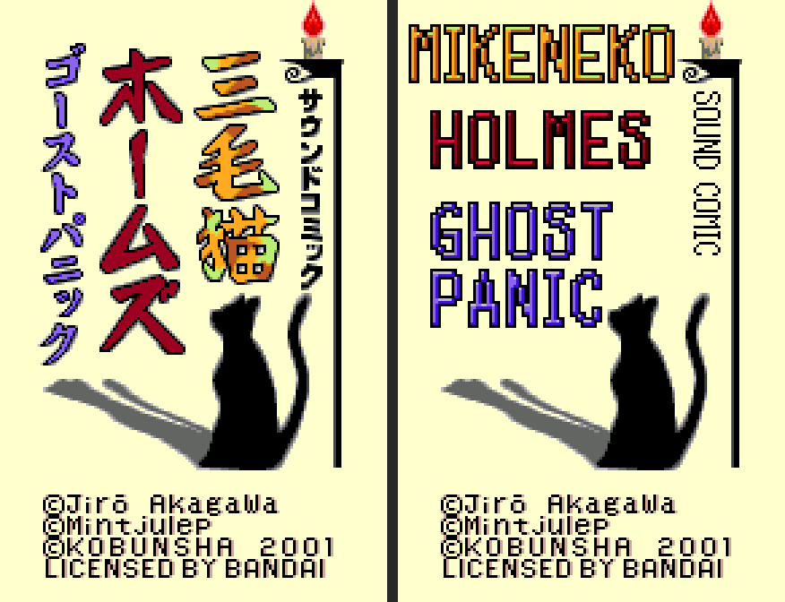

2. The disclaimer page: this story is a work of fiction

   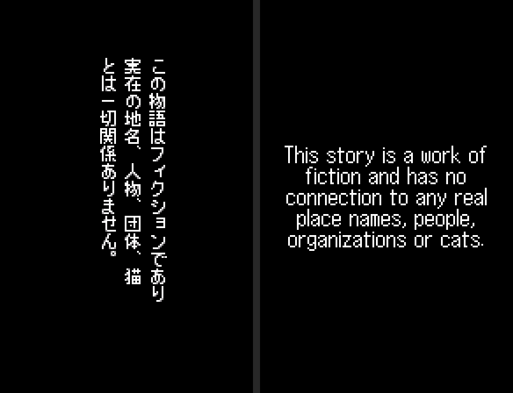

3. An intro page: Mount Brocken, in southern Germany

   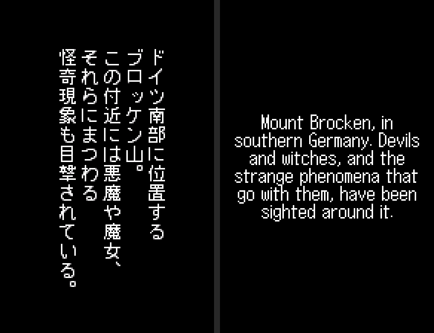

4. The title menu: Read from the start, Read from bookmark, Lupin's Photo Studio

   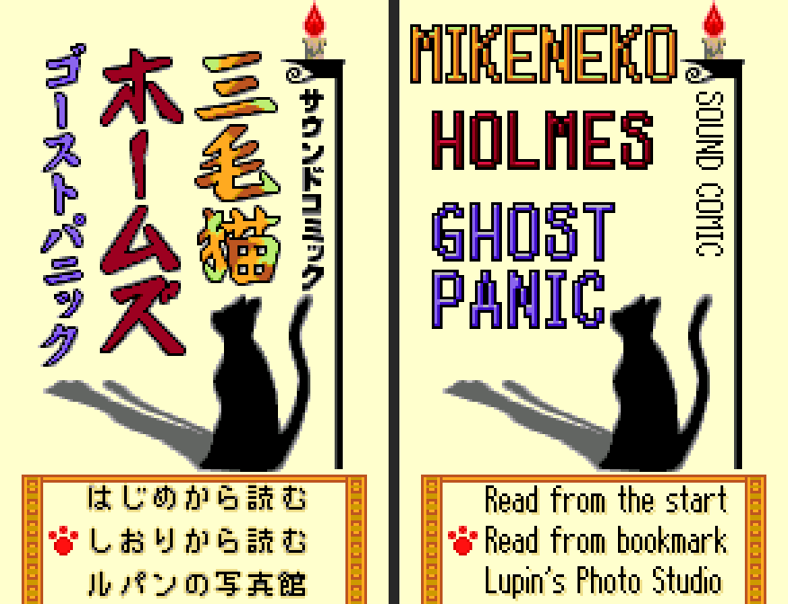

5. The first story page, a speech balloon: "Yikes... this place is creepy."

   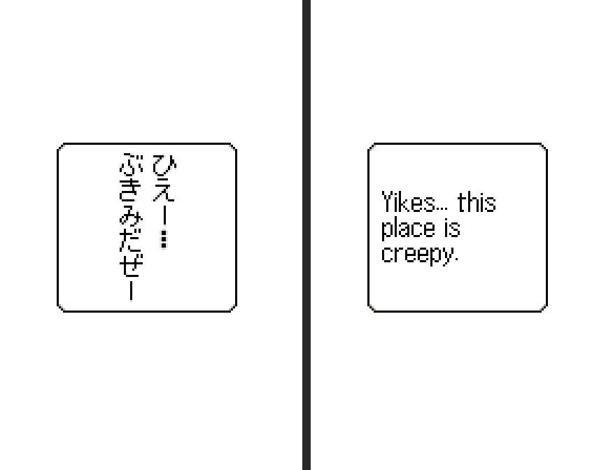

6. A story page: "...Is it just me, or does this feel ominous?"

   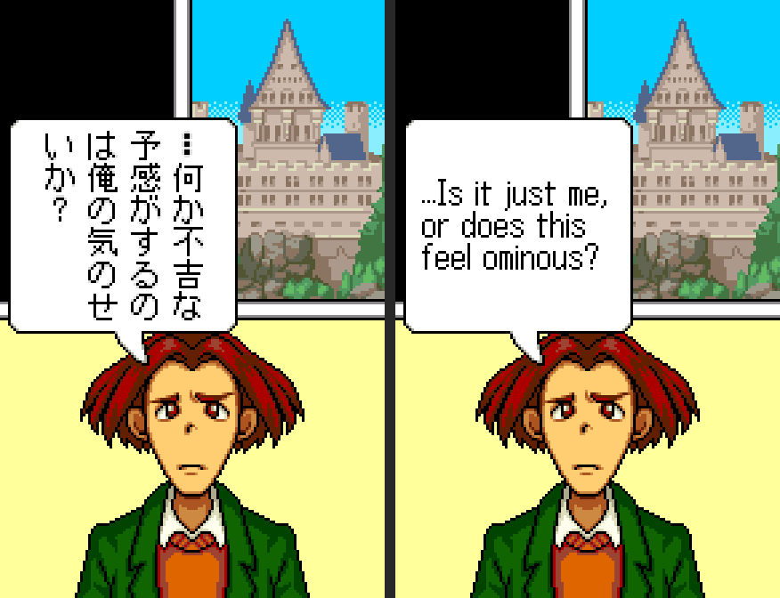

7. A speech balloon: "What are you on about? You coward."

   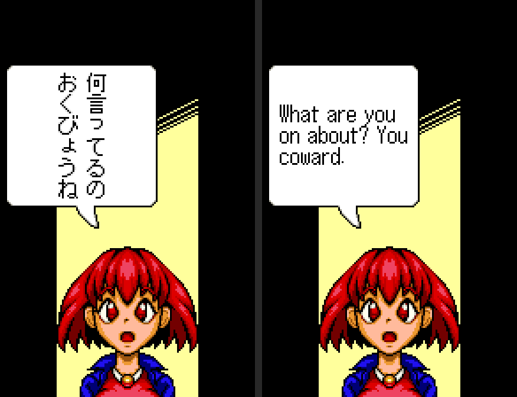

8. A shout balloon: "Whoa! A-a ghost?!"

   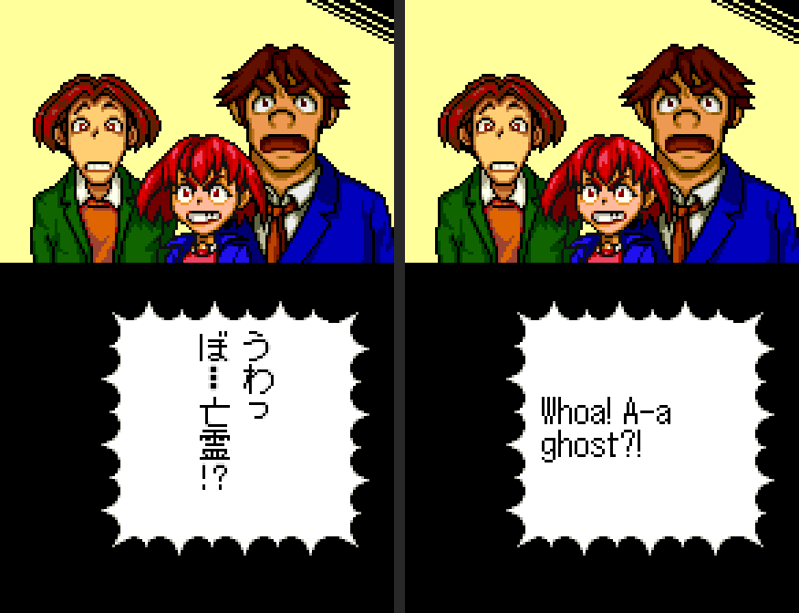

9. A balloon holding only an ellipsis, over a figure at a window

   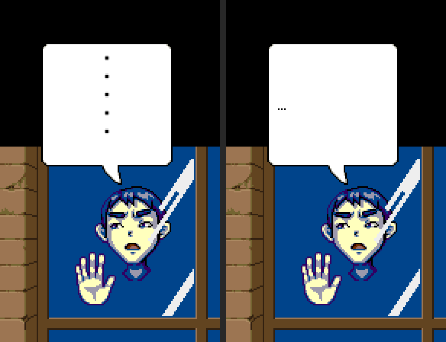

10. A name plate: Tokyo Metropolitan Police Homicide detective Yoshitaro Katayama

   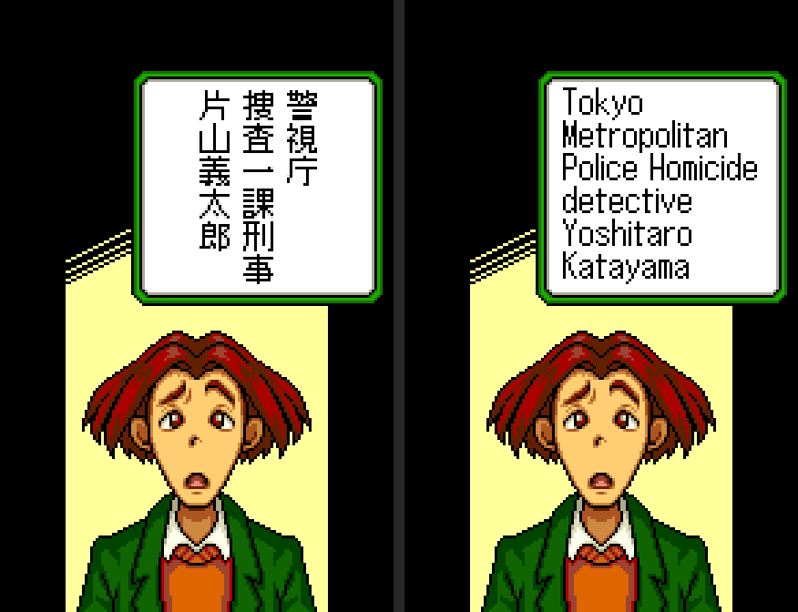

11. A narration plate: Katayama and Harumi's calico cat Holmes

   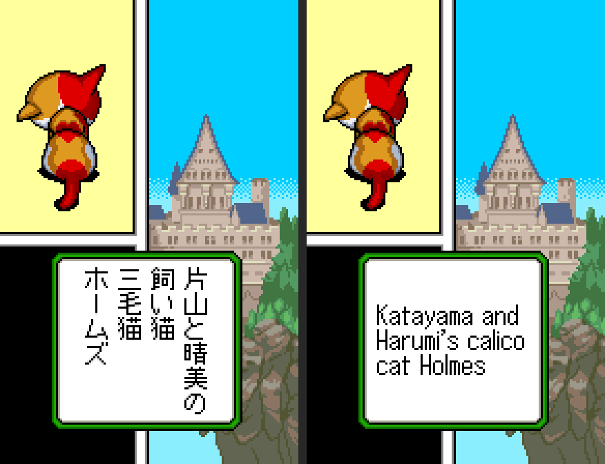

12. A sound-effect word: SCAMPER!

   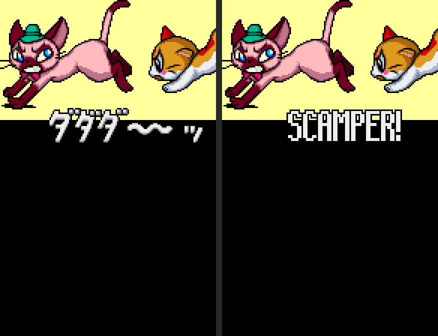

13. A sound-effect word: BOOOM!

   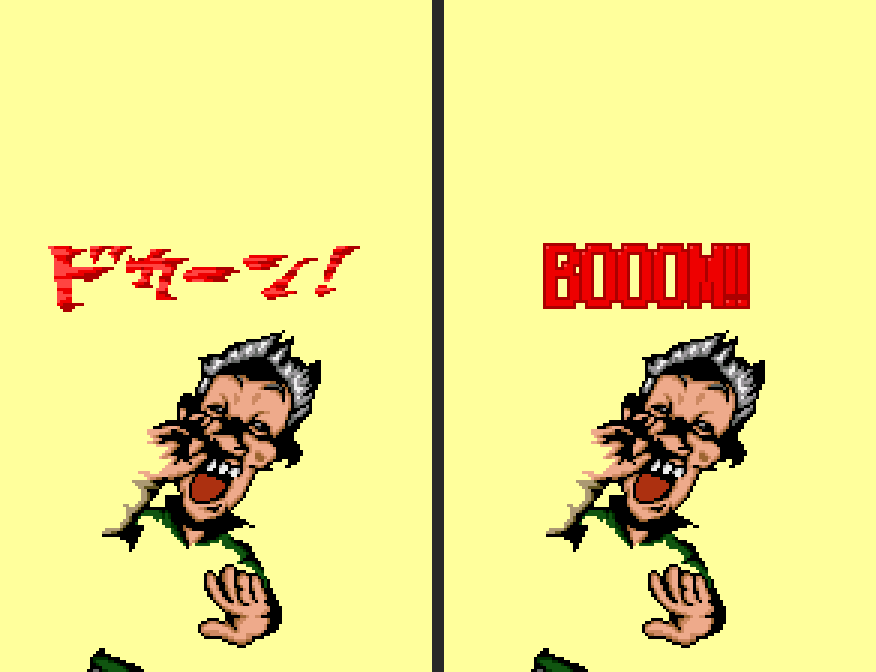

14. A choice: A: Follow Hanton's group

   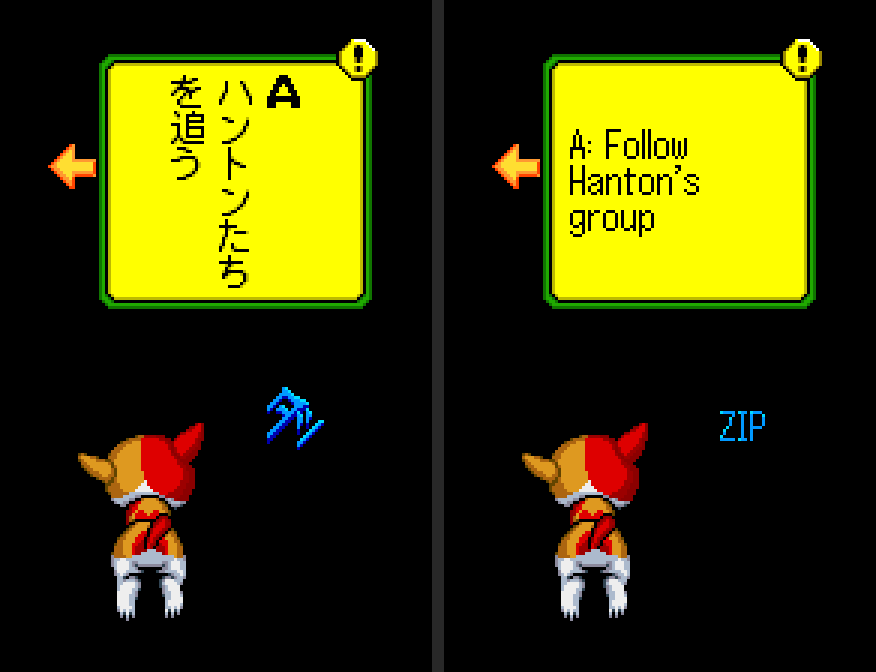

15. Debug edition only: the title, and the DEBUG_MODE menu (JUMP, SOUND, F L G, EXIT) opened by holding B

   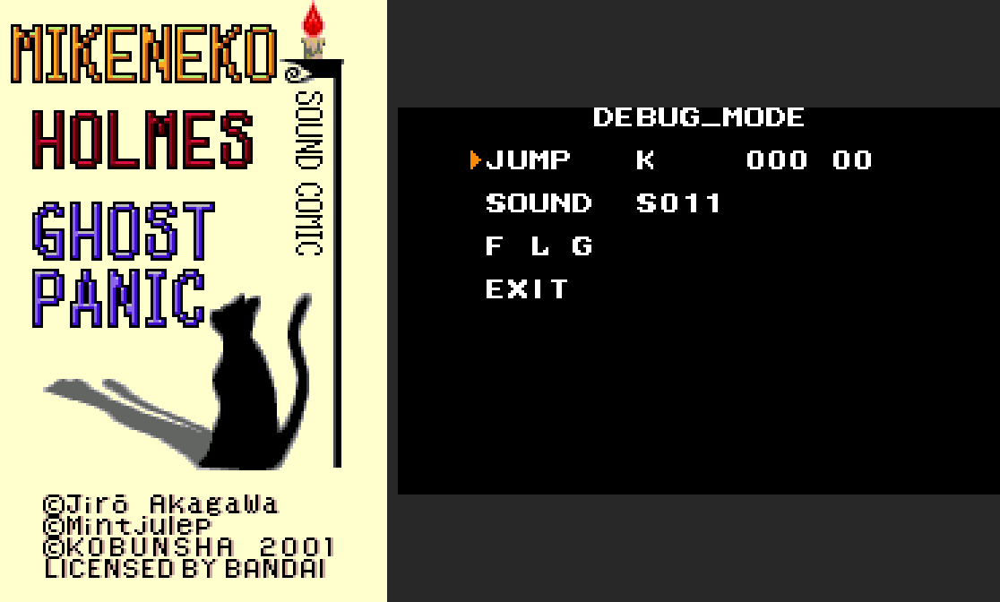

**How to patch**

Apply the BPS file to the Japanese ROM **Mikeneko Holmes - Ghost Panic (Japan).wsc** (4,194,304 bytes, CRC32 `D75EFFC2`) in your browser with the [Swan Revival patcher](https://swanrevival.com/patcher/), or with Floating IPS, beat or ROM Patcher JS. The result is 4,194,304 bytes:

* Standard: `mikeneko-holmes-ghost-panic-en-1.0.bps`; the result should be CRC32 C75A6FF5.
* Debug edition: `mikeneko-holmes-ghost-panic-en-debug-1.0.bps`; the result should be CRC32 96007859.

It's a WonderSwan Color game, so keep the .wsc extension. You must provide your own copy of the original Japanese game to apply it. The patch only fits this dump (CRC32 `D75EFFC2`); another revision is refused or gives a wrong result.

**Download:** `mikeneko-holmes-ghost-panic-en-1.0.bps`, `mikeneko-holmes-ghost-panic-en-debug-1.0.bps` on the [release page](https://github.com/PokemonGoDB/wonderswan-english-patches/releases/tag/mikeneko-holmes-ghost-panic-v1.0).

**Known issues**

* It hasn't been played start to finish by a person (see "What was not seen on screen"). If you find leftover Japanese or anything broken, please tell me where it happened.
* The English types a little faster than the Japanese on average, but the longest balloons take longer, because the English runs to more lines.
* A few sound-effect words (CREEP, SNIFF, MEEOW, RUSTLE, YEOW, GRAAH) are drawn with 1-pixel strokes, so they look thin next to the original's brush lettering (they are readable).
* The title menu's last row sits 1 pixel clear of the bottom edge of the screen (2 in the original).

**Credits:** Translation and hacking: Claude (Anthropic) for the WonderSwan Translation Project.

**A Note On My Justifications for AI Use**

I have been an avid fan of the Wonderswan system for a very long time now. It was actually a motivating factor for my various attempts to learn Japanese (which have all failed so far). I always wanted to explore the game catalog more, but the lack of English translations made it extremely difficult to do so. Here's the thing: There's a reason many of these games have not been translated yet. It's not just the fact that Japanese > English translation is difficult. There's also the fact that the original developers used all kinds of tricks and technical feats to make these games work. Most games do not have a searchable directory of text that you can just replace with English equivalents. While some are easier than others, translations for some of these would take not only an expert in Japanese > English translation, but also someone with vast game development and programming experience.

I say all that to say: I get why people are apprehensive about AI usage for this type of thing. However, these games have been around for a very long time now and most of them have still not received a translation. I (and others) have chosen to spend our time and money to utilize AI to translate the games and actually make them playable for the wider community. If you don't agree with that, that's completely fine. I am more than happy to remove any of my translations if better, human ran translations are released at a later date. We already decided to skip any games where someone is actively working on a manual translation. While nowhere near what a manual translation effort would be, I do spend a considerable amount of time trying to work through each game's translation. I stress over small details and try my best to make the right calls. And I've probably messed some stuff up, which is why I welcome feedback.

I'm just looking forward to digging through all of these games. It's a great time to be into Wonderswan games.
