# MobileWonderGate (WonderSwan) - AI English translation patch v1.0

**MobileWonderGate** (モバイルワンダーゲート) is the cartridge Bandai sold with the Mobile WonderGate adapter on 14 July 2000, for the original (monochrome) WonderSwan, only in Japan. The adapter put a WonderSwan online through an NTT DoCoMo mobile phone, and this cartridge is its toolkit: a web browser for DoCoMo's mopera service, an e-mail program with an address book, and a downloader for small games that then run from the main menu. Bandai's online services closed between 2001 and 2003, and mopera's dial-up service at the end of 2004. This patch translates the cartridge into English.

> **Please read:** this translation was made **with AI** (Claude), as a hobby project. A person (me) made every judgement call before release, but nobody on the project is a professional translator. I'm sharing it as it is for anyone who wants to play. Please **don't upload it to romhacking sites** (romhacking.net and the like). It may not be up to the standard of a real fan translation and it doesn't belong there.

**What's translated**

* The browser: toolbar labels, settings (images, text encoding, page width, image size, home page, dial-up number, connection settings), bookmarks, URL entry, forms, downloads and every status message.
* The mailer: inbox and outbox, reading (Subject, Date, From, To), writing, replying and forwarding, sending and receiving, mail settings and the automatic mail setup.
* The address book.
* The on-screen keyboard's labels and the kana-to-kanji conversion messages.
* Every connection, adapter, phone and mail error message.
* Already in English in the original and left alone: the logo, the menu pictures and the other lettering drawn as pictures.

**What stays Japanese**

* Web pages and mail. They come from the network, not the cartridge, so they appear exactly as the server sends them.
* The keyboard itself. It is how you type Japanese (kana, with kanji conversion); its mode labels are in English, and its ABC page types English.

**Going online**

The original services are long gone. Without an adapter, the cartridge shows its connection errors in English. Swan Revival (swanrevival.com), the community's WonderGate revival, has rebuilt servers for this cartridge's browser portal, mail (between WonderGate players only) and game downloads; see its site for how to connect and what is live. Its pages and mail are its own, in Japanese. The patch was tested against a private copy of Swan Revival's server: browsing, setting up a mail account, receiving and reading mail, replying and sending, and downloading and starting a game all work in English, and the cartridge's network traffic is the same as the Japanese original's.

**Names and terms**

* "WonderGate" is written as one word in sentences, as in Bandai's product name.
* A few labels are shortened to fit their boxes: "Subj." and "Addr." in the editor, four-letter keyboard labels (Hira, ABC, Sym, Norm, Kanj).
* The browser's 1画面 / 2画面 page-width setting is "Narrow" / "Wide", and 接続先設定 is "Connection".
* The two built-in bookmarks are "Get Games" and "DoCoMo text" (their addresses are unchanged).

**How it was made: AI translation, independent checks, human decisions**

* Claude translated everything directly from the Japanese in the ROM and did the hacking: about 290 strings in the compiled program, moved where the English needed room.
* A separate, independent Claude reviewer checked the whole program against the Japanese; its findings were verified and fixed.
* On screen: 119 scenes of the browser, mailer, address book and keyboard driven on both ROMs with every character the game drew logged (no Japanese left from the cartridge), every error made to appear, and real online sessions against the WonderGate revival. Every screen was also compared with the Japanese, enlarged, for centring and spacing.
* The judgement calls (abbreviations, wording, what stays Japanese) were listed with the Japanese, a literal reading and the options, and I decided each one by hand.

**Changelog**

* **v1.0**: first release.

**Sources consulted**

* Japanese text: the WonderSwan ROM itself.
* The adapter's protocol: the WonderSwan community's documentation (ws.nesdev.org) and the project's WonderGate revival.

**Images** (original on the left, English on the right)

1. Main menu (already English in the original)

   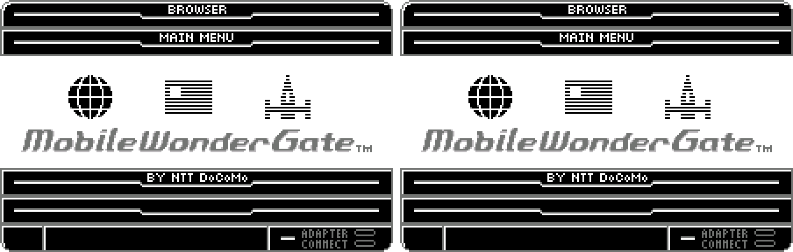

2. Browser toolbar

   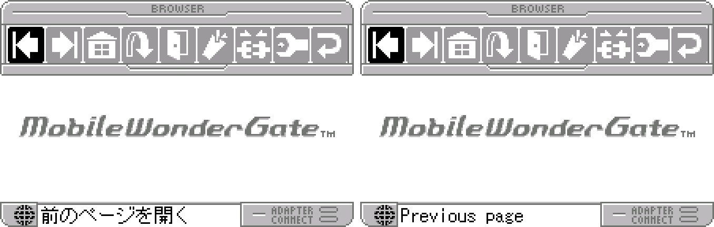

3. Loading a page

   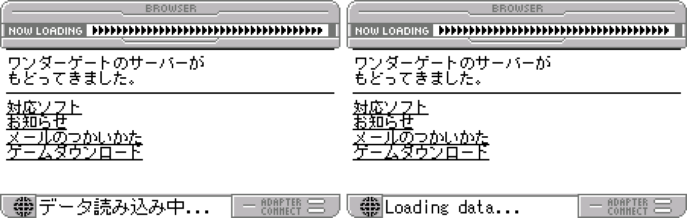

4. Browser settings

   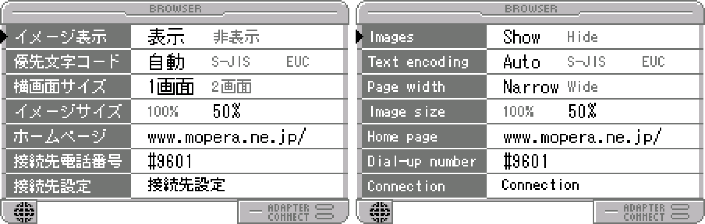

5. Bookmarks

   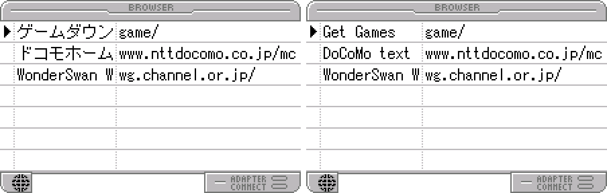

6. Automatic mail setup

   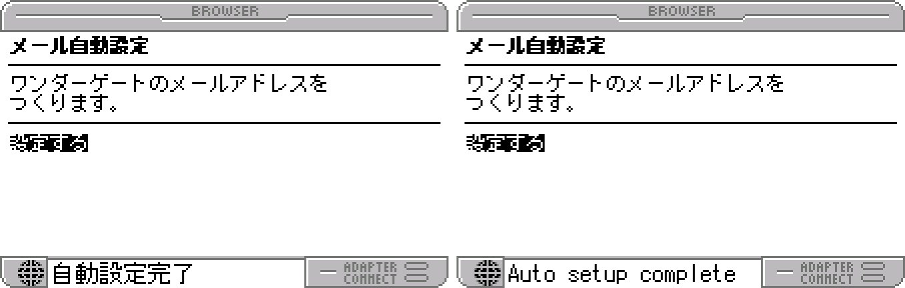

7. Mail settings

   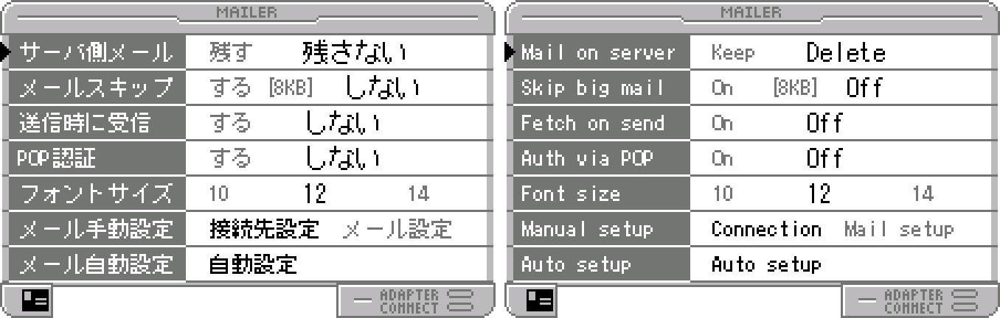

8. Getting new mail

   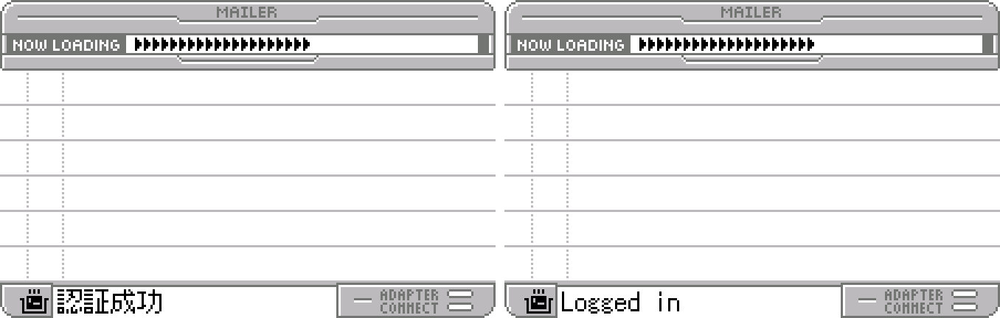

9. Reading a mail

   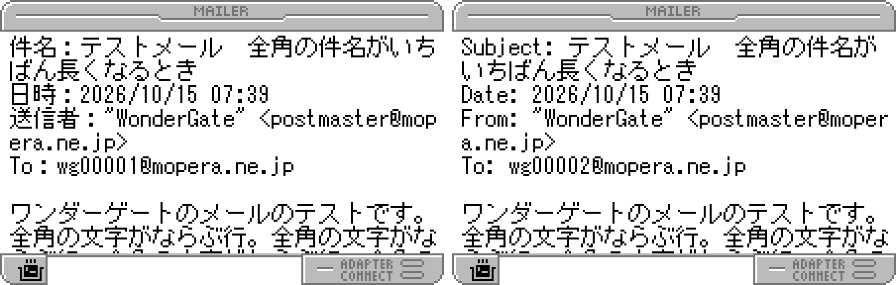

10. Writing a reply

   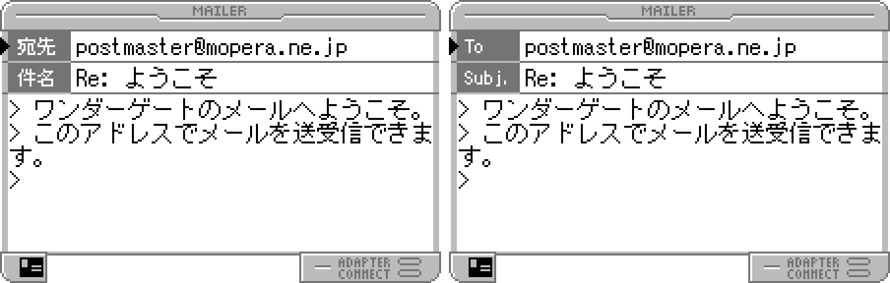

11. Mail sent

   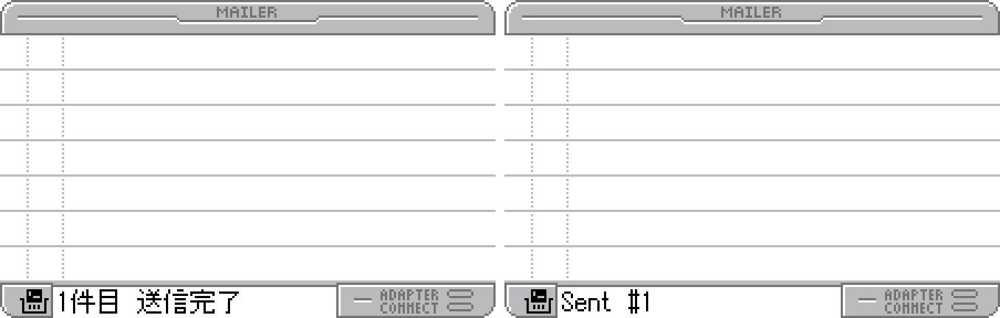

12. The keyboard

   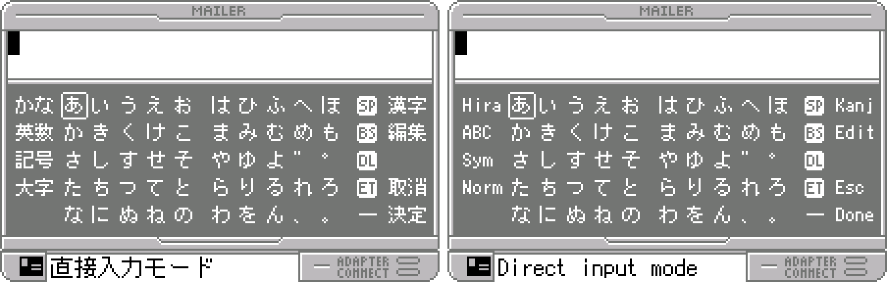

13. Kanji conversion

   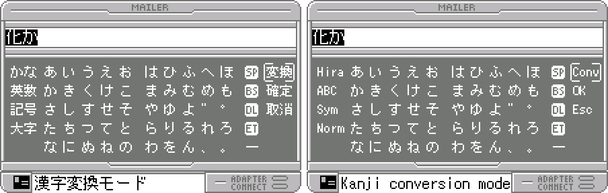

14. Address book

   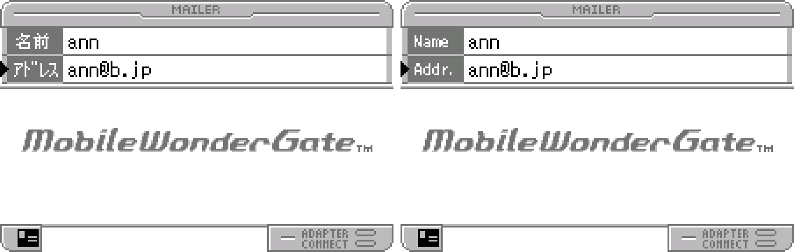

15. Game downloaded

   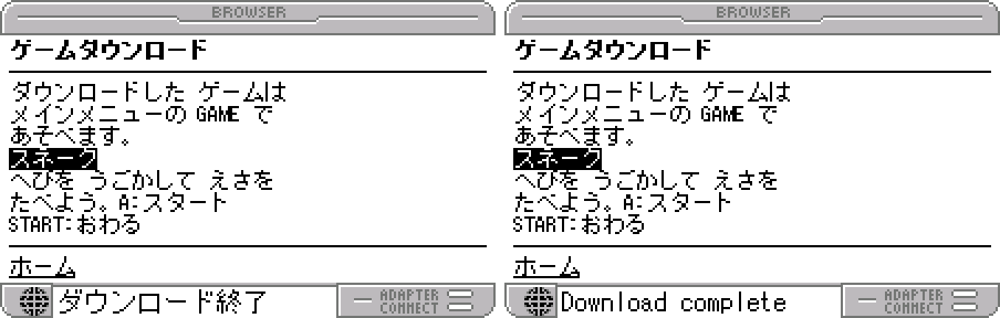

16. No response from the server

   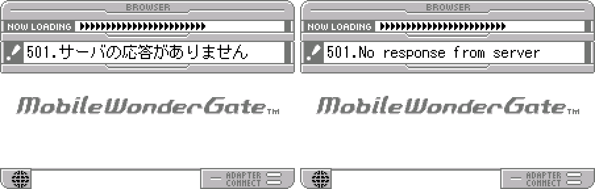

17. An adapter error

   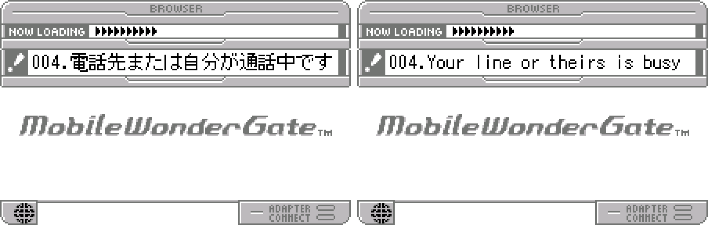

**How to patch**

Apply `mobile-wondergate-en-1.0.bps` to the Japanese ROM "MobileWonderGate (Japan)" (CRC32 80DE367D) with Floating IPS, beat or ROM Patcher JS. The result should be CRC32 6A88E21E. The patched ROM is the same size as the original (2 MB). It's a WonderSwan (mono) program, so keep the .ws extension.

You must provide your own copy of the original Japanese cartridge's ROM to apply it.

**Download:** `mobile-wondergate-en-1.0.bps` on the [release page](https://github.com/PokemonGoDB/wonderswan-english-patches/releases/tag/mobile-wondergate-v1.0).

**Known issues**

* It hasn't been used at length by a person or on real hardware. If you find leftover Japanese from the cartridge, cut text or a crash, please tell me where it happened.
* Three short messages were only checked in their box, because no test could make the cartridge show them: a mail's Reply-To line, "---The rest could not be shown---" (a mail too long to display) and "No room for more addresses".
* Web pages and mail stay Japanese (see above).

**Technical notes (for the curious)**

* The program is compiled C; its text is about 290 Shift-JIS strings next to the code, printed by one routine with the cartridge's own font, which already had half-width English letters. The patch writes the English in place or moves it to free space in the same code segment and rewrites every reference.
* Two keyboard frame positions are moved by one pixel so the selection box clears the English labels.
* Online testing used the project's WonderGate revival (a replacement adapter and servers) run privately: browser, mail setup, POP3 receive, SMTP send and a game download, on the original and the patched ROM, with identical traffic.

**A Note On My Justifications for AI Use**

I have been an avid fan of the Wonderswan system for a very long time now. It was actually a motivating factor for my various attempts to learn Japanese (which have all failed so far). I always wanted to explore the game catalog more, but the lack of English translations made it extremely difficult to do so. Here's the thing: There's a reason many of these games have not been translated yet. It's not just the fact that Japanese > English translation is difficult. There's also the fact that the original developers used all kinds of tricks and technical feats to make these games work. Most games do not have a searchable directory of text that you can just replace with English equivalents. While some are easier than others, translations for some of these would take not only an expert in Japanese > English translation, but also someone with vast game development and programming experience.

I say all that to say: I get why people are apprehensive about AI usage for this type of thing. However, these games have been around for a very long time now and most of them have still not received a translation. I (and others) have chosen to spend our time and money to utilize AI to translate the games and actually make them playable for the wider community. If you don't agree with that, that's completely fine. I am more than happy to remove any of my translations if better, human ran translations are released at a later date. We already decided to skip any games where someone is actively working on a manual translation. While nowhere near what a manual translation effort would be, I do spend a considerable amount of time trying to work through each game's translation. I stress over small details and try my best to make the right calls. And I've probably messed some stuff up, which is why I welcome feedback.

I'm just looking forward to digging through all of these games. It's a great time to be into Wonderswan games.
