# Naruto: Konoha Ninpouchou (WonderSwan Color) - AI English translation patch v1.0

**NARUTO -ナルト- 木ノ葉忍法帖** (Naruto: Konoha Ninpouchou, "Konoha Ninja Arts") is Bandai's 2003 WonderSwan Color RPG based on the anime. The game follows Naruto and Team 7 through the start of the story, from the Academy to the Land of Waves, with extra missions woven in between. Battles are fought with seals: the player picks seal cards, and certain combinations of seals make jutsu. This patch translates the whole game into English.

> **Please read:** this translation was made **with AI** (Claude), as a hobby project. A person (me) made every judgement call before release, but nobody on the project is a professional translator. I'm sharing it as it is for anyone who wants to play. Please **don't upload it to romhacking sites** (romhacking.net and the like). It may not be up to the standard of a real fan translation and it doesn't belong there.

**What you need:** the Japanese ROM of Naruto: Konoha Ninpouchou (4,194,304 bytes, CRC32 `71556E6A`). One patch applies to it and makes an **8 MiB** ROM (CRC32 `11D3625F`). There is also an optional second patch, a **Debug Menu** edition (see below).

**What's translated**

* **Everything the player reads:** the story and field dialogue (9,689 messages), the menus, battle text, names, seal and jutsu names and their descriptions, the credits and the intro pages.
* **Pictures that carried Japanese, redrawn in English:** the title plate (KONOHA NINJA ARTS) and the small NINPOUCHOU badge, the four title buttons (START, CONTINUE, VERSUS, LESSONS), the field-menu tabs, the seal pictures on the cards and in the battle command panel, the cast banners and big brush effects shown in battle, the intro pages, the place names on the village map, the save screen's quit prompt and the staff plates in the credits. The seal, banner, title and map lettering is drawn by hand in the original's brush style.
* **Seal words:** each seal is named by one short English word of at most four letters, the same on the card, in the battle panel and in text (for example 炎 is SEAR, 疲 is TIRE, 分 is TWIN, 乱 is DAZE, 忘 is FADE, 剣 is EDGE). These are our own short words for the painted kanji, because the pictures only have room for a word that short. The full list (kanji, then our word): 火 FIRE, 炎 SEAR, 水 RAIN, 渦 SPIN, 土 SOIL, 地 ROCK, 風 WIND, 嵐 GUST, 雷 BOLT, 轟 DIN, 変 SWAP, 分 TWIN, 治 HEAL, 色 SEXY, 寄 PACT, 掌 PALM, 鳥 BIRD, 乱 DAZE, 読 READ, 疲 TIRE, 時 TIME, 忘 FADE, 単 LONE, 縛 BIND, 再 REDO, 呪 HEX, 解 FREE, 封 LOCK, 法 RULE, 拳 FIST, 蹴 KICK, 剣 EDGE, 攻 HIT, 防 WALL, 瞑 ZEN, 速 RUSH, 隠 HIDE, 千 1000, 烈 GALE, 華 LILY, 裏 VEIL, 印 GRIT, 練 MOLD, 連 LINK, 強 BUFF, 数 LOTS, 癒 CURE, 薬 PILL, 草 HERB, 下 LOW, 中 MID, 上 TOP, 影 KAGE, 狐 FOX, 写 COPY, 白 WAN, 門 GATE, 牙 FANG, 蟲 BUGS, 似 APE, 倍 HUGE, 心 MIND, 内 SELF, 器 TOOL, 刀 CUT, 針 DART, 棒 POLE, 突 JAB, 呼 CALL, 喝 CRY, 捨 TOSS, 叫 YELL, 無 NONE.
* **Names and terms** follow the usage most English-speaking fans know: the English dub first, then the English manga, then the fan wiki (for example Fire Style, Team 7, Shadow Clone Jutsu, Believe it!). Each choice is listed in the project notes with its source.
* **Jutsu list:** names are shown in full, with (Ninjutsu) or (Taijutsu) on a second line.
* **A fix to the original:** in the scene where the team is surrounded by enemies, three of Naruto's lines (four messages, because one is stored twice) are shown under Sasuke's name plate in the Japanese game. In this patch they show Naruto's plate. Three more messages of that scene keep the original's plate ("Here they come!" twice, on Sasuke's plate, and a "Kakashi Senseeei!!" line on Kakashi's), because who speaks them is unclear in the Japanese.
* **Kept as the cartridge has it:** the Japanese licence line on the power-on screen (a legal notice), and the original's own digits and number tiles.
* **Credits** list the staff in Western order. The readings of the names are best guesses: no official English credit list was found.
* **Saves:** the save format is unchanged, so a save should move between the Japanese and English version. This was not tested.

**Debug Menu edition (optional):** `naruto-konoha-ninpouchou-en-debugmenu-1.0.bps` is the same translation with the cartridge's own developer menu switched on at power-on: a map with eight entries (stage and ending tests, a sound test). It is not for normal play, its own labels stay in Japanese, and it was only booted to its menu in the emulator.

**How it was made: AI translation, independent checks, human decisions**

* Claude worked out the game's text format, wrote the English for all of the text, drew the English lettering for the pictures, and rebuilt the ROM with a variable-width font and a text renderer added to the cartridge, so that lines and names fit the original boxes.
* The final build went through an automated test run of 10 checks, and all 10 passed:
  * all 9,689 English dialogue messages were drawn by the game in their real boxes and checked (nothing past the right edge, at most two lines, no Japanese drawn); 766 menu and battle table strings were read back and 698 of 768 listed strings were drawn in their own windows;
  * 98 random-button walks of 1,500 steps (147,000 steps) from 49 saved states drew no unexpected Japanese on the English build; the same walks on the original draw 50,675 Japanese glyphs, so the check can see it. The only Japanese it found are the labels of the developer menu, which cannot be reached in play;
  * the attract loop (40,000 frames with no button pressed) was captured on both ROMs, and the staff roll and ending (60 pages on each ROM) were captured through the developer menu;
  * 5.85 million frames of random-button soak tests from 25 saved states raised no freeze flags (and a damaged control copy was flagged, so the check can see a freeze);
  * 1,449 captured screens were measured against the original by a program for alignment; its 2,760 flag rows were settled by 618 listed exceptions (each with a reason and a decision item) and, for the other 2,142 flags, by passing reviewer verdicts on the 576 screens they sit on, recorded for the same pixels.
* The 1,548 captured screens in the project's review ledger were read, enlarged and beside the original, by separate read-only Claude reviewers over several passes (a screen whose pixels changed was read again), and the findings were fixed or written down. All 51 decision items (names, wordings, hand-drawn lettering, layout) were listed with pictures and options, and I answered every one of them.

**What was not seen on screen** (please report anything odd)

* Link and versus play was never reached: the versus slot screen accepts no slot without story progress, and no serial-port code ran. Real hardware, a link cable and flash cartridges were not tested; the 8 MiB image was only run in the project emulator.
* Story beyond the destination map in normal play was not played through: later chapters were seen only through the developer menu. The Academy, Castle Town and Land of Waves map pictures were seen only through a debug record swap, never in a story scene. The credits names are Western-order guesses.
* Menu and battle table text in its own window: the 22 battle-target strings and 49 names not drawn in a window were seen in test windows and by the message sweep only; some map-label, battle and debug strings were drawn with stand-in values.
* The hand-drawn lettering (the one-line seal words, vertical map names, cleaned title buttons and 72 px effects) was judged on enlarged sheets by reviewers; I did not look at it at 1x on a device. The versus seal menu, the 16 px seal glyphs 32 to 52 and a jutsu list with every row filled were never seen.
* The ending-3 face viewer of the developer menu prints literal `Place{S0} Face{S1}` readouts (developer menu only).
* No full playthrough by a person: the rest is covered by the checks above.

**Changelog**

* **v1.0**: first public release.

**Sources consulted**

* Japanese text: the WonderSwan ROM itself.
* English names: the English dub of the series, the English release of the manga, and the fan wiki, for jutsu, places and terms (listed in the project notes).
* The project's own notes on the game's text format, its story and terms, and the QA run summaries.

**Images** (original on the left, English on the right)

1. Title screen

   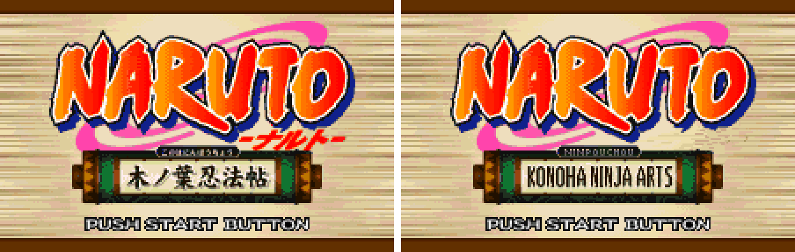

2. Title menu

   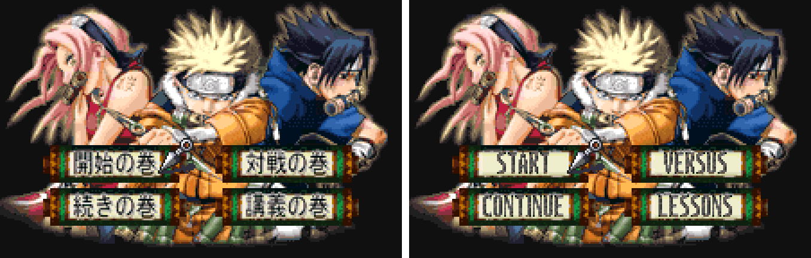

3. Village map

   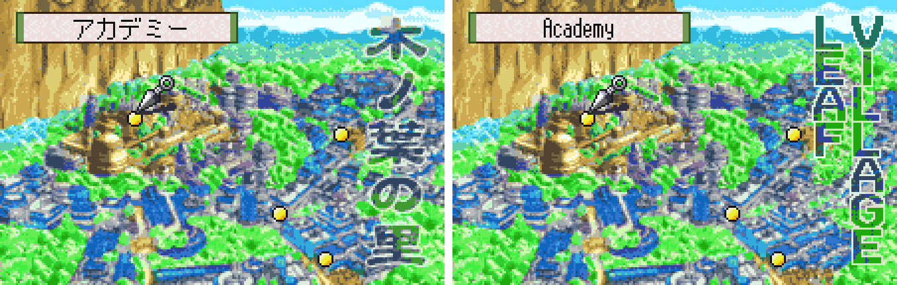

4. Dialogue with a name plate

   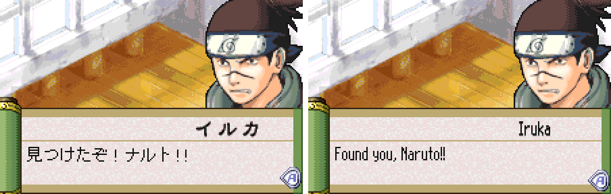

5. Dialogue with a portrait

   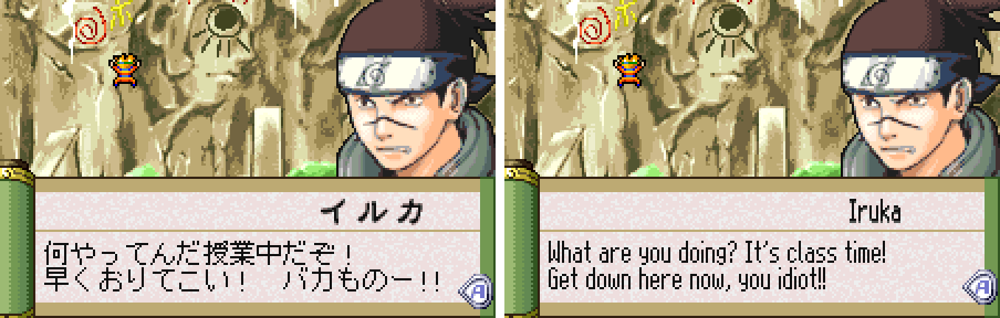

6. Field menu

   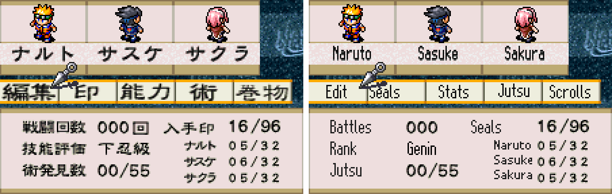

7. Stats page

   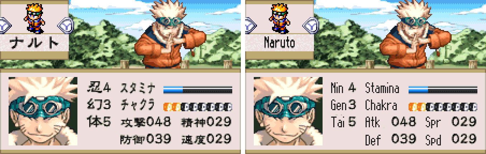

8. Scrolls

   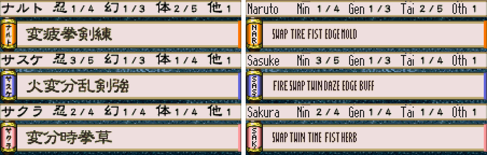

9. Seal grid

   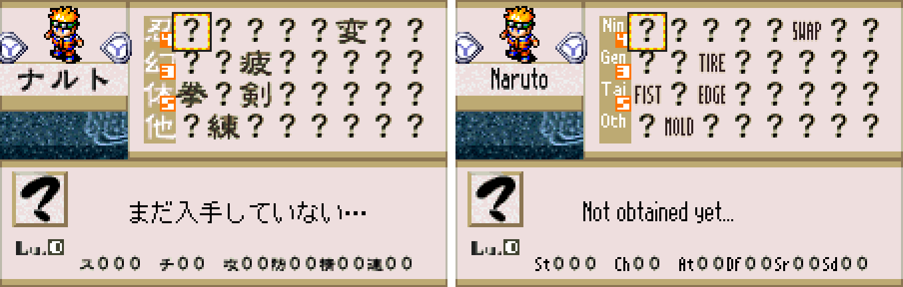

10. Seal card

    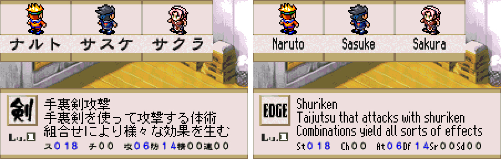

11. Battle: choosing seals

    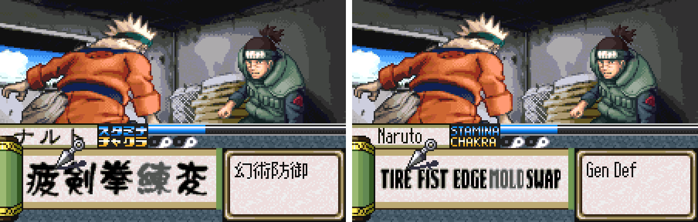

12. Battle message

    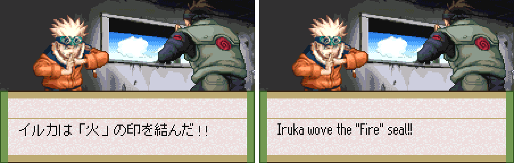

13. Jutsu list

    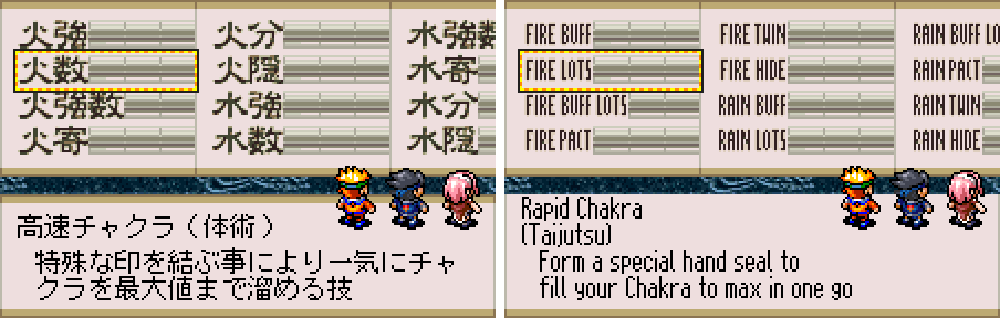

14. Save slots

    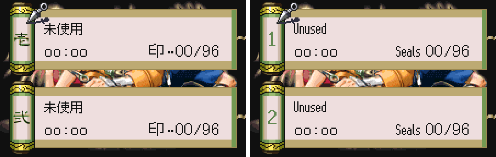

15. Staff credits

    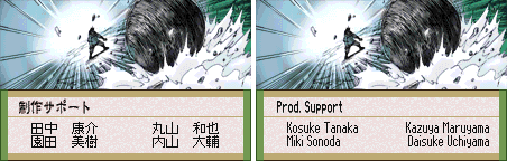

**How to patch**

Apply the BPS file to the Japanese ROM in your browser with the [Swan Revival patcher](https://swanrevival.com/patcher/), or with Floating IPS, beat or ROM Patcher JS:

* Standard: `naruto-konoha-ninpouchou-en-1.0.bps`; the Japanese ROM must have CRC32 71556E6A and the result should be CRC32 11D3625F.
* Debug Menu edition: `naruto-konoha-ninpouchou-en-debugmenu-1.0.bps`; the result should be CRC32 AABA651B.

The patched ROM is 8 MiB, twice the size of the original (4 MiB). It's a WonderSwan Color game, so keep the .wsc extension.

You must provide your own copy of the original Japanese game to apply it.

**Download:** `naruto-konoha-ninpouchou-en-1.0.bps` and `naruto-konoha-ninpouchou-en-debugmenu-1.0.bps` on the [release page](https://github.com/PokemonGoDB/wonderswan-english-patches/releases/tag/naruto-konoha-ninpouchou-v1.0).

**Known issues**

* It hasn't been played start to finish by a person. If you find leftover Japanese or anything broken, please tell me where it happened.
* The screens listed above under "What was not seen on screen" were checked only in the text and the code, or in test windows.
* English lettering is 10 px tall where the kanji are about 13 px (name plates, tabs, the title), and the village map names are smaller than the kanji (15 to 17 px against 23 to 30 px); no taller face fits.
* A few seal words are judgement calls (PACT, LILY, WAN, BUFF, and MID, which is one letter from MIND), and some narrow-letter words are 9 px tall against the 13 px kanji.
* Three messages of the ambush scene keep the original's name plate (see above).
* The credits names are best-guess Western-order readings.
* Link play was not tested, and it was tested in an emulator only, not on a real WonderSwan Color with a flash cartridge.
* Random button presses reach only part of the game, so the soak and Japanese-detection runs cover only what they reach.

**Technical notes (for the curious)**

* The game keeps its text as kana in a variable-length script. The English uses a variable-width font and a renderer added to the cartridge, and long messages are moved to new banks.
* The patch changes text, picture tiles and code, and grows the ROM from 4 MiB to 8 MiB to hold them; the original image stays as the upper half.
* The project notes with the text format are in the project repository (`games/naruto-konoha-ninpouchou/TEXT-FORMAT.md`).

**A Note On My Justifications for AI Use**

I have been an avid fan of the Wonderswan system for a very long time now. It was actually a motivating factor for my various attempts to learn Japanese (which have all failed so far). I always wanted to explore the game catalog more, but the lack of English translations made it extremely difficult to do so. Here's the thing: There's a reason many of these games have not been translated yet. It's not just the fact that Japanese > English translation is difficult. There's also the fact that the original developers used all kinds of tricks and technical feats to make these games work. Most games do not have a searchable directory of text that you can just replace with English equivalents. While some are easier than others, translations for some of these would take not only an expert in Japanese > English translation, but also someone with vast game development and programming experience.

I say all that to say: I get why people are apprehensive about AI usage for this type of thing. However, these games have been around for a very long time now and most of them have still not received a translation. I (and others) have chosen to spend our time and money to utilize AI to translate the games and actually make them playable for the wider community. If you don't agree with that, that's completely fine. I am more than happy to remove any of my translations if better, human ran translations are released at a later date. We already decided to skip any games where someone is actively working on a manual translation. While nowhere near what a manual translation effort would be, I do spend a considerable amount of time trying to work through each game's translation. I stress over small details and try my best to make the right calls. And I've probably messed some stuff up, which is why I welcome feedback.

I'm just looking forward to digging through all of these games. It's a great time to be into Wonderswan games.
