# From TV Animation One Piece: Niji no Shima Densetsu (WonderSwan Color) - AI English translation patch v1.0

**From TV Animation One Piece: Niji no Shima Densetsu** (From TV animation ワンピース 虹の島伝説, "Legend of Rainbow Island") is Bandai's 2001 One Piece RPG for the WonderSwan Color, released only in Japan. You play a new hero (DIAS by default), an orphaned 12-year-old street peddler in Loguetown who fights with a boomerang and wears his late father's pendant, the Proof of the Sea Folk. He joins the Straw Hats and Atori, a girl who carries the Proof of the King, to search for the legendary Rainbow Island. The voyage follows the manga through Reverse Mountain, Laboon and Whisky Peak (where Vivi and Karoo join), then sails on to the game's own islands: Silver Arrow, Royale Sun, Great Ground, Festa Circle and Rainbow Island itself. On the way you explore towns and islands, fight turn-based battles with a party of three, chat with the crew on deck to earn and engrave Marks of Friendship (the skills of the battle system), and check the wanted posters of the crews you run into. This patch translates it into English.

> **Please read:** this translation was made **with AI** (Claude), as a hobby project. A person (me) made every judgement call before release, but nobody on the project is a professional translator. I'm sharing it as it is for anyone who wants to play. Please **don't upload it to romhacking sites** (romhacking.net and the like). It may not be up to the standard of a real fan translation and it doesn't belong there.

**What's translated**

* The whole script, over 11,000 lines: the story over nine chapters, the opening narration, every town and island conversation, the crew's chats, battle tutorials and Quest Words, the ending and the epilogue.
* Every menu and screen: the Logbook (save) screens, name entry, the START menu, Stats, the move lists and move info, the Marks of Friendship screens, Battle Party, the sea chart, the wanted posters, the ranking board, all the battle screens and messages, GAME OVER and the staff credits (paced to the ending music as in the original).
* The pictures with words in them, redrawn by hand in the original style: the title logo's subtitle (Legend of Rainbow Island), the boot copyright notice, the sound-effect lettering (BOOM!!, WHAM!, SLASH!, SNAP!!, BAM!! and the rest), Sanji's COOK'S SOUL cut-in and THE END.
* Name entry has English letters; names are up to four capital letters, as in the original.

**Names and terms**

Characters, places and attacks use the official English names from the VIZ manga and the English anime (Zoro, Koby, Karoo, the Going Merry, Loguetown, the Marines, Gum-Gum Pistol, and Sanji's kicks under their French names: Collier Shoot, Mouton Shot...), checked against the One Piece Wiki and matching my other One Piece patches. Names that exist only in this game keep a faithful romanization of the game's own Japanese (Atori, Legas, Dokudamin...). The release notes in the game's folder list every place where the English differs from the original, such as the "Rainbow Island / Carrot Island" mishearing joke, which becomes "Rhubarb Island" so it still sounds like "Rainbow", and the original Japanese of the six "friendship words" the crewmates tell you.

**How it was made: AI translation, independent checks, human decisions**

* Claude translated and reviewed every line against the Japanese in the ROM, polished the wording, made repeated lines match, and did the hacking: an English font, an 8 MB ROM, English name entry and the redrawn pictures. (An earlier draft of this project used another AI; Claude re-reviewed all of it and about one line in five was corrected.)
* A separate, independent Claude reviewer checked the whole game against the Japanese; its findings were verified and fixed.
* On screen: every text box of the script drawn in the game's own boxes with every character the game drew logged (13,423 pages, no Japanese, nothing cut off); a random walk through menus, maps and dialogue looking for any Japanese that reached the screen (none); the attract mode watched from power-on; the ending and credits played to the end of the music; and every screen compared with the Japanese, enlarged, for centring and spacing.
* The judgement calls (names, terms, the wordplay, abbreviations, the redrawn pictures, the special edition) were listed with the Japanese, a literal reading and the options, and I decided all 26 by hand over four rounds.

**The special edition: the developers' debug mode**

The developers left a debug mode in the game that the retail cartridge always switches off at power-on. The special edition (`one-piece-niji-en-special-1.0.bps`) is the same English patch with it switched on:

* **Chapter select:** on the sea chart (at a new game or the start of a chapter), after the ship stops, press B. X1/X3 choose STAGE 01-09 and A starts that chapter.
* **In battle**, at a turn's command input: hold START and press Y1/Y3 to switch to another of the game's 81 battles; hold B and press A to win the battle at once (rewards and level-ups follow).
* **Viewers:** at PUSH START, hold B and press START for a map viewer (all 90 maps), or hold Y3 (Y-pad down) for a picture viewer (the 52 cut-in pictures). In the field, Y3 opens a flag editor and Y4 shows the blocked squares. Holding B during dialogue skips the letter-by-letter delay.
* **Limits:** it's the developers' leftover tool. The viewers are dead ends: reset to leave them. Holding B or Y3 at PUSH START sends you into a viewer, so don't hold them there if you want to play. The flag editor and chapter select use the developers' own abbreviations (SNCNT, EFLAG...), and the picture viewer includes one unused picture with a tiny Japanese tag. Changing flags or jumping chapters can put the game in states it was never meant to reach. Play the standard patch for the actual game.

**Changelog**

* **v1.0**: first release.

**Sources consulted**

* Japanese text: the WonderSwan Color ROM itself.
* Official English names: the VIZ manga and the English anime, as recorded on the One Piece Wiki.

**Images** (original on the left, English on the right)

1. Copyright notice at power-on

   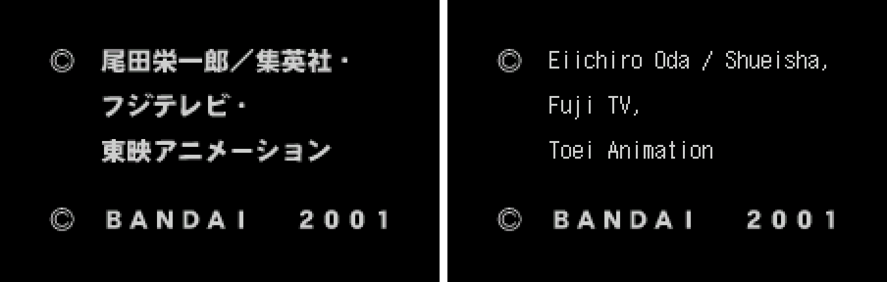

2. Title screen

   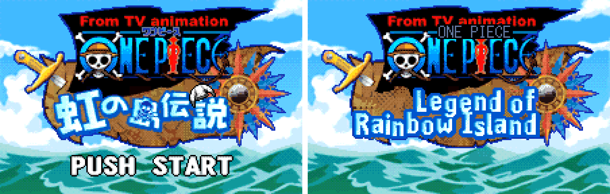

3. The opening narration

   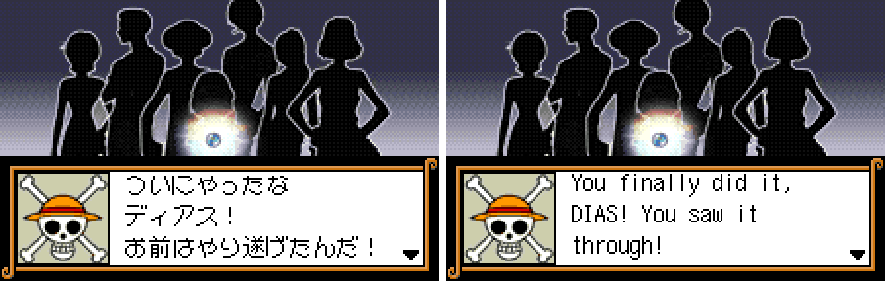

4. Name entry

   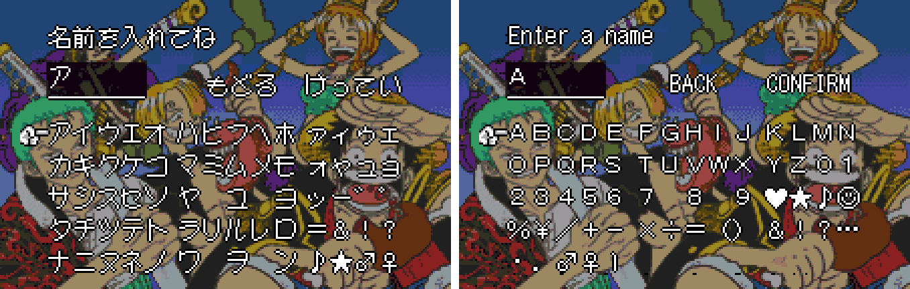

5. The first morning in Loguetown

   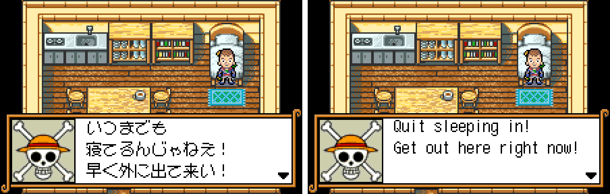

6. The START menu

   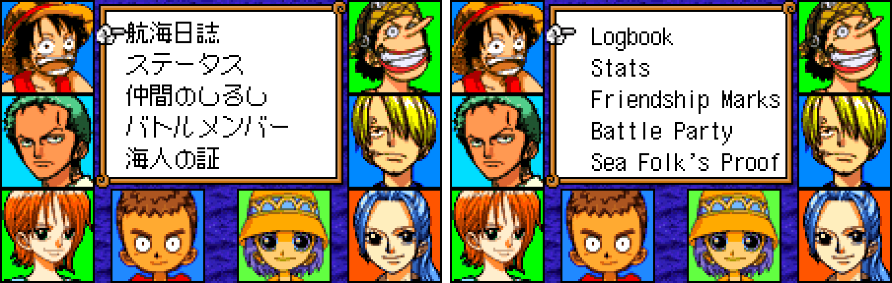

7. Stats

   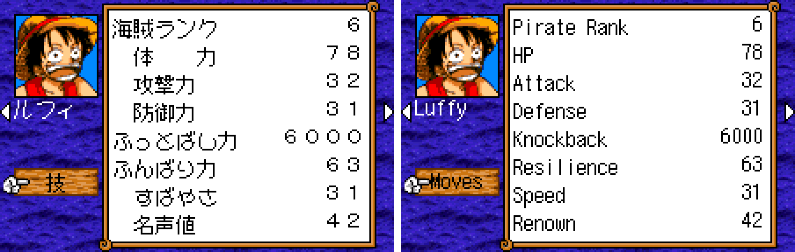

8. Marks of Friendship

   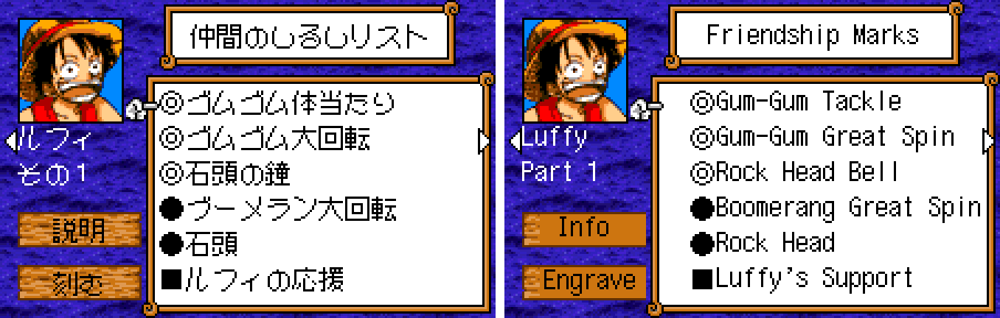

9. A wanted poster

   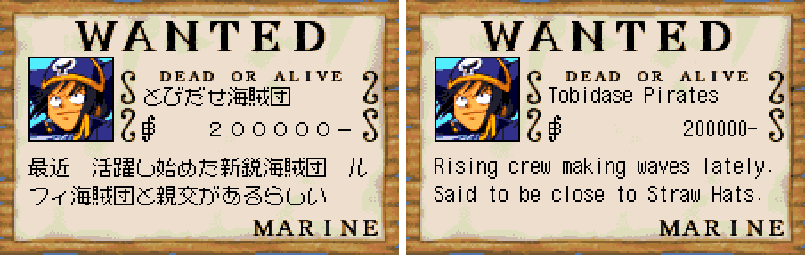

10. The sea chart

   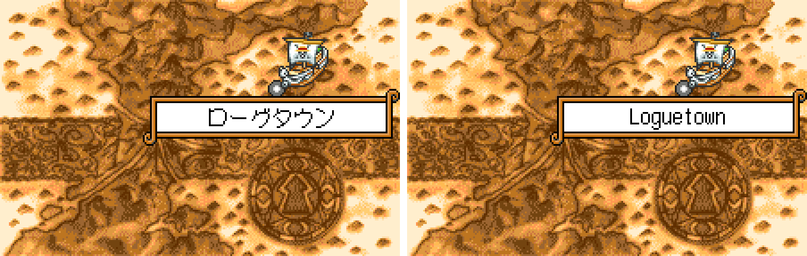

11. Crew talk on deck

   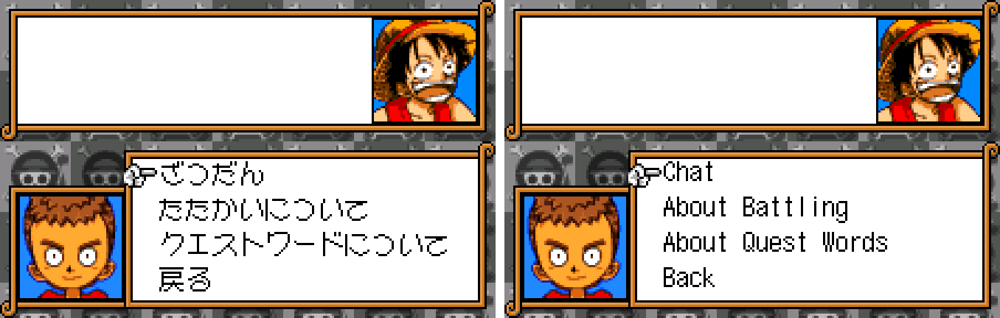

12. Crew talk: answering

   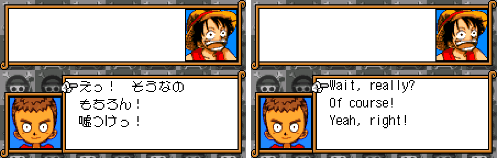

13. Battle commands

   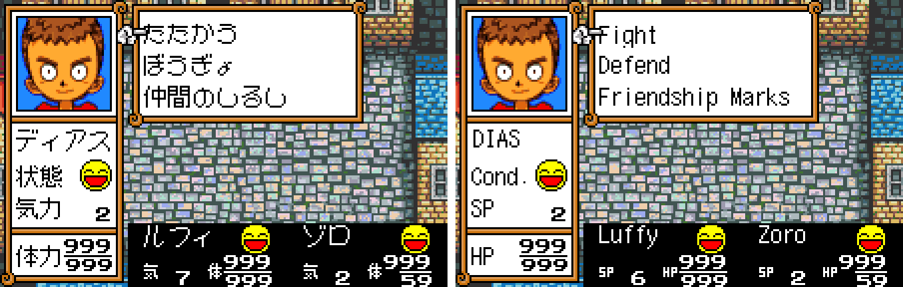

14. Battle: choosing a move

   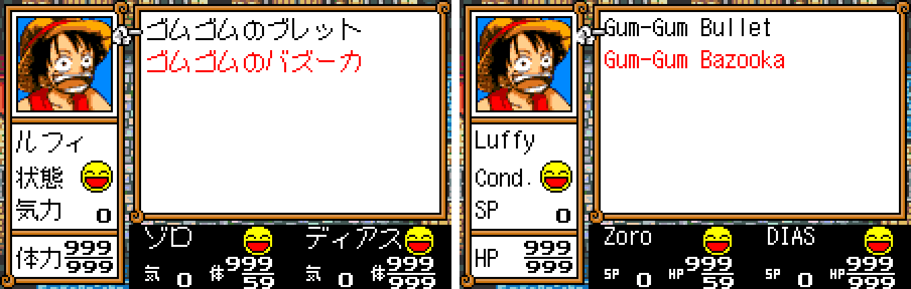

15. Move info

   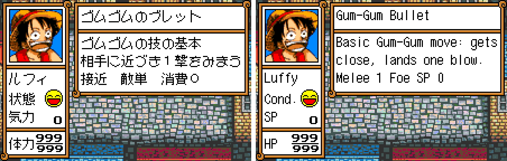

16. Sanji's cut-in

   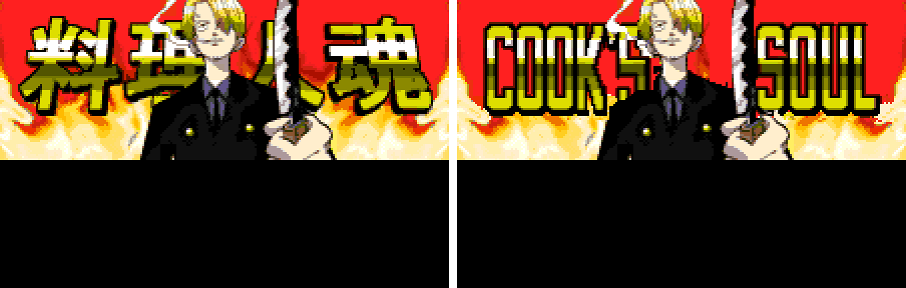

17. Choosing the battle party

   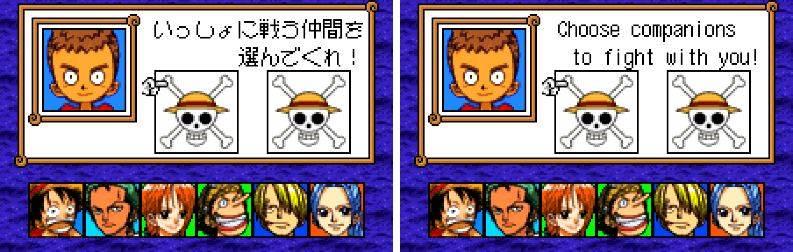

18. The Logbook (saving)

   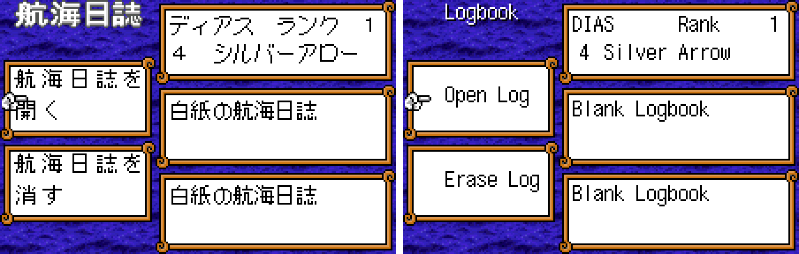

19. Credits

   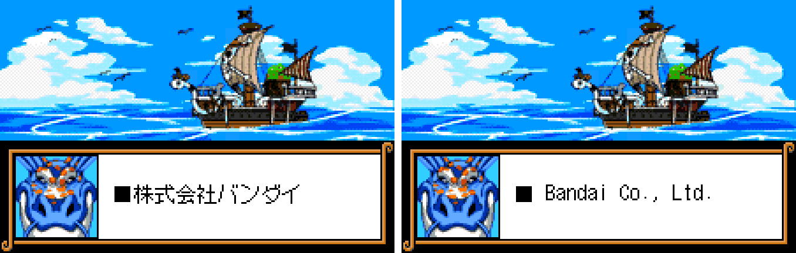

20. THE END

   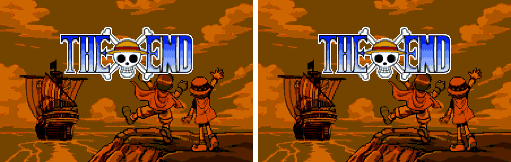

21. GAME OVER

   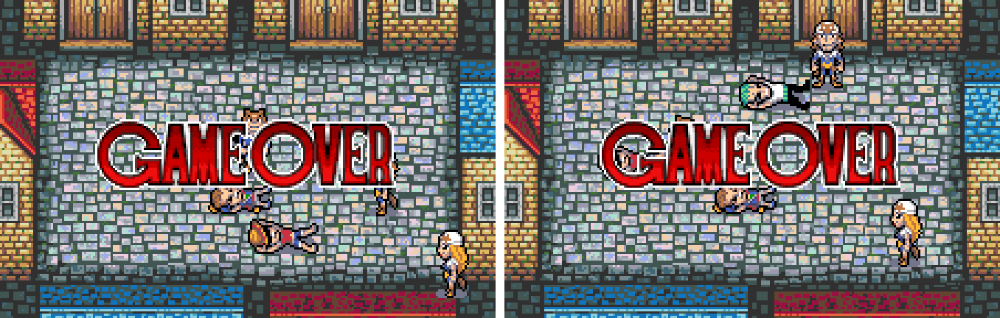

**How to patch**

Apply the BPS to the Japanese ROM "From TV Animation One Piece - Niji no Shima Densetsu (Japan)" (CRC32 427056C4) in your browser with the [Swan Revival patcher](https://swanrevival.com/patcher/), or with Floating IPS, beat or ROM Patcher JS:

* Standard: `one-piece-niji-en-1.0.bps`, the result should be CRC32 AD5D5163.
* Special edition (debug mode on): `one-piece-niji-en-special-1.0.bps`, the result should be CRC32 42912FF4.

The patched ROM is **8 MB** (the original is 4 MB): the English needs more room, so the patch doubles the ROM. Use an emulator or a flash cart that takes 64 Mbit WonderSwan Color ROMs. It's a WonderSwan Color game, so keep the .wsc extension.

You must provide your own copy of the original Japanese game to apply it.

**Download:** `one-piece-niji-en-1.0.bps`, `one-piece-niji-en-special-1.0.bps` on the [release page](https://github.com/PokemonGoDB/wonderswan-english-patches/releases/tag/one-piece-niji-v1.0).

**Known issues**

* It hasn't been played start to finish by a person, and it was tested on emulators, not on real hardware. If you find leftover Japanese, cut text or a crash, please tell me where it happened.
* A few things were checked without being seen in normal play: the final boss battle (its text was drawn in the game's own boxes and the screens around it were played), the Whisky Peak island map, the departure narration on the sea chart, and three sound-effect pictures (TWINKLE, SHOCK!, GA-BOOM!) and the healing bubble, which were redrawn and checked in their graphics but never caught on a frame.
* The screen a mono WonderSwan shows for this colour-only game was not tested.

**Technical notes (for the curious)**

* The game draws text as 12x12 kana and kanji. The patch adds narrow 6x12 letters, drawn in pairs so that two English letters fill each cell, which gives the English twice the room on every line.
* The ROM is expanded from 4 MB to 8 MB: the game runs from the upper half and the English font and script live in the lower half, and the game finds each line through a directory keyed by the original line's address, so the original pointer tables stay as they are.
* The pictures with words in them are stored either compressed or as plain tiles; the redrawn versions go back in the same form (recompressed in the game's own format where needed).
* The special edition differs from the standard patch in two boot bytes (which keep the debug flag on) and one routine that makes the debug battle select read each battle's text from its own chapter.

**A Note On My Justifications for AI Use**

I have been an avid fan of the Wonderswan system for a very long time now. It was actually a motivating factor for my various attempts to learn Japanese (which have all failed so far). I always wanted to explore the game catalog more, but the lack of English translations made it extremely difficult to do so. Here's the thing: There's a reason many of these games have not been translated yet. It's not just the fact that Japanese > English translation is difficult. There's also the fact that the original developers used all kinds of tricks and technical feats to make these games work. Most games do not have a searchable directory of text that you can just replace with English equivalents. While some are easier than others, translations for some of these would take not only an expert in Japanese > English translation, but also someone with vast game development and programming experience.

I say all that to say: I get why people are apprehensive about AI usage for this type of thing. However, these games have been around for a very long time now and most of them have still not received a translation. I (and others) have chosen to spend our time and money to utilize AI to translate the games and actually make them playable for the wider community. If you don't agree with that, that's completely fine. I am more than happy to remove any of my translations if better, human ran translations are released at a later date. We already decided to skip any games where someone is actively working on a manual translation. While nowhere near what a manual translation effort would be, I do spend a considerable amount of time trying to work through each game's translation. I stress over small details and try my best to make the right calls. And I've probably messed some stuff up, which is why I welcome feedback.

I'm just looking forward to digging through all of these games. It's a great time to be into Wonderswan games.
