# Pocket Fighter (WonderSwan) - AI English translation patch v1.0

**Pocket Fighter** is the WonderSwan version of Capcom's chibi fighting game (known in English as Super Gem Fighter Mini Mix), made for Bandai by Soft Machine and released only in Japan in April 2000 for the original (monochrome) WonderSwan. Twelve fighters from Street Fighter, Darkstalkers and Red Earth brawl, collect gems and level up their special moves; on top of the arcade-style story mode with an ending for every fighter, the WonderSwan version adds Point Battle, a 131-card collection with its own turn-based Card Battle mode and Card Gallery, link-cable play, and online features through Bandai's Mobile WonderGate phone adapter.

This patch translates it into English.

> **Please read:** this translation was made **with AI** (Claude), as a hobby project. A person (me) made every judgement call before release, but nobody on the project is a professional translator. I'm sharing it as it is for anyone who wants to play. Please **don't upload it to romhacking sites** (romhacking.net and the like). It may not be up to the standard of a real fan translation and it doesn't belong there.

**What's translated**

* **Story mode:** every opening, rival meeting and ending (36 scenes, 274 pages), and the conversations shown over the fight stages.
* **Fights:** all 193 win quotes and the CONTINUE? hints.
* **Cards:** the 131 card names (GET CARD and Point Battle), and every picture in Card Battle: the card plates and categories, the 77 move names, the comparison icons (INI / ATK / REC / EVA) and the link messages.
* **Menus drawn as pictures:** the title menu's CARD BATTLE and CARD GALLERY buttons (hand-drawn in the style of the game's own English menu lettering) and the Card Gallery name plates.
* **WonderGate:** every screen of the online service: the agreement, connection prompts and status, Customer ID, service and prepaid menus, the phone-number screens and buttons, rankings and download results, and all the error messages, including the numbers and amounts the game prints into them.
* Left as it is: the game's own English menus and staff roll, the katakana subtitle under the title logo, and the signs drawn in the stage art.

**Names and terms**

Characters and moves use Capcom's official English names: Hsien-Ko (and her sister Mei-Ling), Tessa and Akuma, including the name plates the cartridge lettered LEI-LEI, TABASA and GOUKI, which were redrawn from the game's own letters. Moves follow Capcom's current spellings (Hadoken, Shoryuken, Tatsumaki Senpukyaku). Game terms are the English release's: Gems, Mighty Combo, Flash Combo, Guard Crush.

**WonderGate: we don't charge for anything**

Pocket Fighter was made for Bandai's Mobile WonderGate, a paid online service that closed in 2001. The patch keeps its WonderGate screens as the game wrote them: the paid-service agreement, the prepaid-card menus, the fee lines ("This service costs 500 yen for 10 uses.") and the balance screens. Today these features work again through Swan Revival (swanrevival.com), the community's WonderGate revival, and **it is free**: no prepaid card, scratch code or payment is needed, and the service screens report it as free of charge. Through it the game uploads scores and downloads the national rankings, the digital cards and the Extra modes.

**Extras Unlocked edition**

A second patch opens the six modes of Option > Extra (Training Mode, Sound Test, Event Test, Reset Mode, Command List, Password Fighter) without a WonderGate download. Event Test plays every story scene and the staff roll. The standard patch leaves them locked, as the game does.

**How it was made: AI translation, independent checks, human decisions**

* Claude extracted every text table and rendered every graphic in the 2 MB ROM, and wrote the translation in passes: drafts, three review passes, a polish pass checked by a separate agent, and fixes for the space each screen has.
* A separate, independent Claude reviewer read the whole game against the Japanese; its 25 findings were verified and fixed.
* On screen: every text box was drawn in the real game box (every story page through the game's hidden Event Test menu, every win quote, hint, card name, Card Battle picture and WonderGate message); play-throughs of every mode found no Japanese tile on the English build (the same check finds it on the original); ten minutes of the attract demo were captured on both ROMs.
* Online: the WonderGate session was played for real against a private copy of Swan Revival's server on both the original and the English ROM (score upload, all five downloads, and a real connection error): the requests, the server's replies and the hang-up are the same on both. The live server was not used for testing.
* The judgement calls (names, terms, abbreviations, the paid-service text, the pictures) were listed with the Japanese, a literal reading and the options, and I decided all 22 by hand.

**Changelog**

* **v1.0**: first release.

**Sources consulted**

* Japanese text: the WonderSwan ROM itself.
* English names and terms: Super Gem Fighter Mini Mix and Capcom's current move lists (Capcom Fighting Collection, Street Fighter V).
* WonderGate behaviour: the game's code and Swan Revival's notes on this game.
* Lettering: Shinonome 12-dot (public domain) for the text; the name plates are built from the game's own letters; the title buttons and a few labels are hand-drawn.

**Images** (original on the left, English on the right)

1. Title menu: CARD BATTLE and CARD GALLERY buttons

   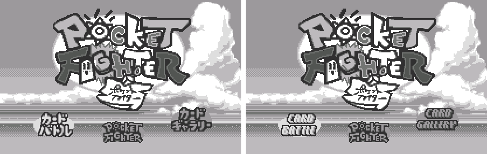

2. Story mode

   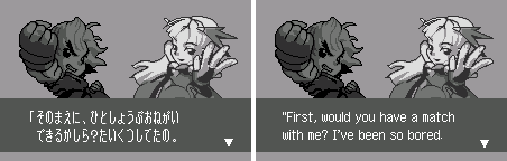

3. Win quote

   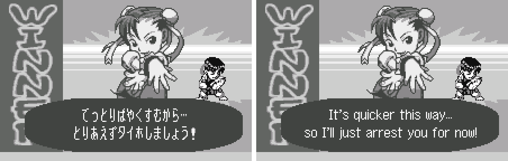

4. CONTINUE? hint

   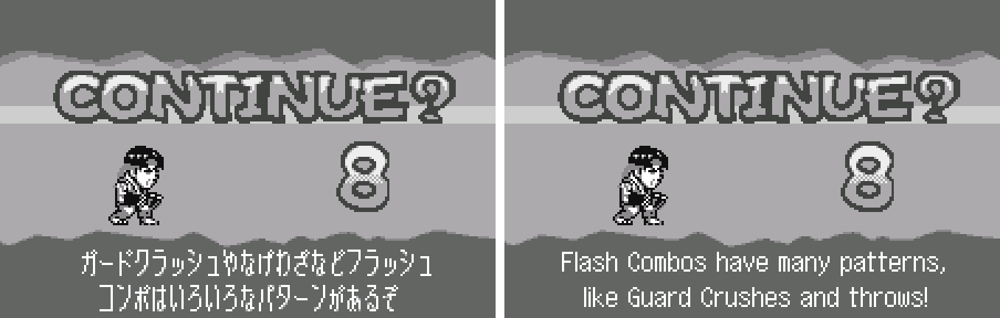

5. Card Battle: the hand and a card category

   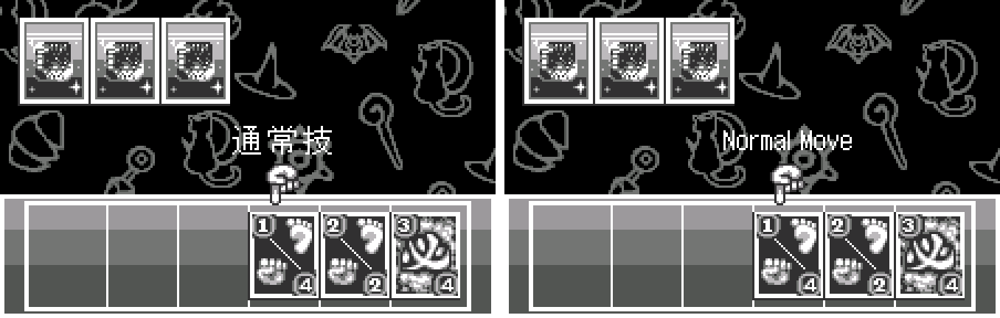

6. Card Battle: plate and move name

   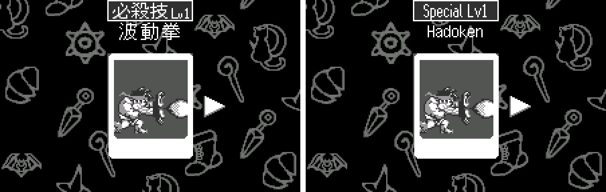

7. Card Gallery: Hsien-Ko's name plate (LEI-LEI in the original)

   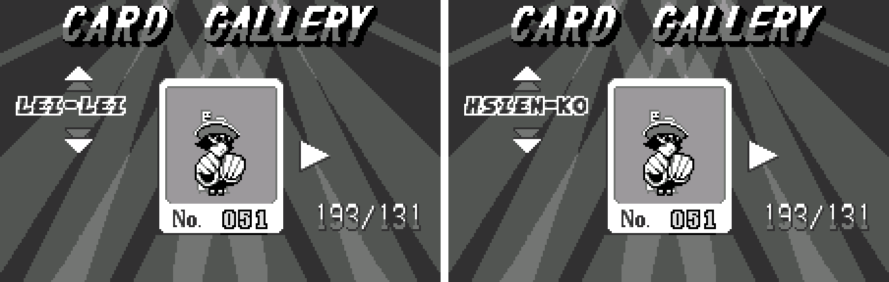

8. WonderGate: the paid-service agreement

   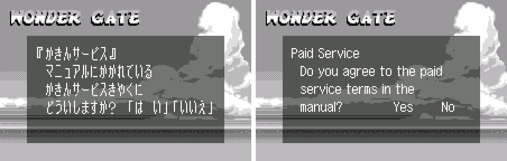

9. WonderGate: phone number screen and buttons

   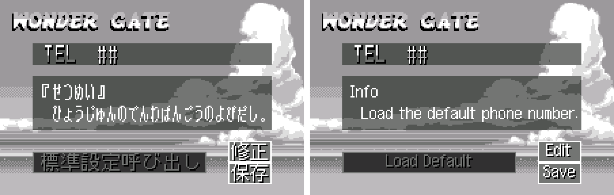

10. WonderGate: score upload result in a real session

   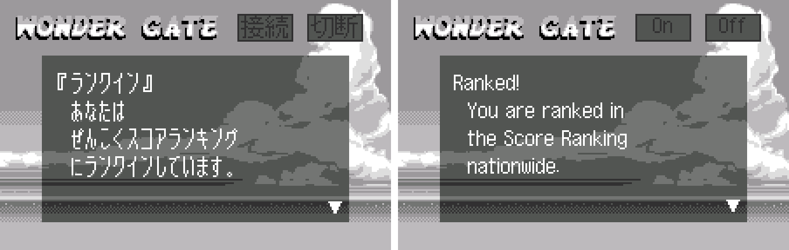

11. WonderGate: digital card download in a real session

   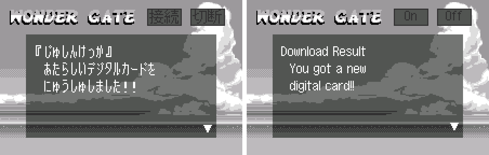

**How to patch**

Apply `pocket-fighter-en-1.0.bps` to the Japanese ROM "Pocket Fighter (Japan)" (CRC32 35361250) in your browser with the [Swan Revival patcher](https://swanrevival.com/patcher/), or with Floating IPS, beat or ROM Patcher JS. The result should be CRC32 A20ED743. For the Extras Unlocked edition, apply `pocket-fighter-en-extras-1.0.bps` instead (CRC32 624C7B55).

The patched ROM is 4 MB (the original is 2 MB). It's a WonderSwan (mono) game, so keep the .ws extension.

You must provide your own copy of the original Japanese game to apply it.

**Download:** `pocket-fighter-en-1.0.bps` and `pocket-fighter-en-extras-1.0.bps` on the [release page](https://github.com/PokemonGoDB/wonderswan-english-patches/releases/tag/pocket-fighter-v1.0).

**Known issues**

* It hasn't been played start to finish by a person. If you find leftover Japanese or anything broken, please tell me where it happened.
* Link-cable play (Card Battle link matches and card trading) is translated but couldn't be tested with a second unit.
* WonderGate screens the revival doesn't produce (fees, prepaid balances and top-ups, server-side error codes) were checked with test values, not real ones.
* The digital cards have no names in the game (in the Japanese too), so their name line stays empty.
* Saves made with the Japanese game keep their default record holders' initials (LEI and TBS); a new save shows HSK and TES.

**Technical notes (for the curious)**

* English is drawn with a proportional font: each line is pre-rendered into 8x16 cells at build time, and the game's own text routines draw the cells in place of Japanese characters.
* The story script, the WonderGate messages and the edited pictures were moved into a new 2 MB half of the ROM, which is why the patched ROM is 4 MB.
* Several limits had to be found on screen: hint and story pages that share sprite tiles with the fighters, a WonderGate window of 63 letter tiles, an 18-letter line for the amounts the server sends, and pictures that have only as many tiles as the screen leaves before the next one.
* The routine that prints WonderGate amounts printed Japanese units after the numbers; it was rewritten to print English.

**A Note On My Justifications for AI Use**

I have been an avid fan of the Wonderswan system for a very long time now. It was actually a motivating factor for my various attempts to learn Japanese (which have all failed so far). I always wanted to explore the game catalog more, but the lack of English translations made it extremely difficult to do so. Here's the thing: There's a reason many of these games have not been translated yet. It's not just the fact that Japanese > English translation is difficult. There's also the fact that the original developers used all kinds of tricks and technical feats to make these games work. Most games do not have a searchable directory of text that you can just replace with English equivalents. While some are easier than others, translations for some of these would take not only an expert in Japanese > English translation, but also someone with vast game development and programming experience.

I say all that to say: I get why people are apprehensive about AI usage for this type of thing. However, these games have been around for a very long time now and most of them have still not received a translation. I (and others) have chosen to spend our time and money to utilize AI to translate the games and actually make them playable for the wider community. If you don't agree with that, that's completely fine. I am more than happy to remove any of my translations if better, human ran translations are released at a later date. We already decided to skip any games where someone is actively working on a manual translation. While nowhere near what a manual translation effort would be, I do spend a considerable amount of time trying to work through each game's translation. I stress over small details and try my best to make the right calls. And I've probably messed some stuff up, which is why I welcome feedback.

I'm just looking forward to digging through all of these games. It's a great time to be into Wonderswan games.

