# Raku Jongg (WonderSwan Color) - AI English translation patch v1.0

**Raku Jongg** (落雀) is a falling-block puzzle played with mahjong tiles, from Enterbrain for the WonderSwan Color (Bandai, 2001). Tiles fall into a well, and you line up three or more of a kind, build sets and finish mahjong hands to score. In Story mode the broke Eggo enters a mahjong tournament for a 10 million yen prize, to buy his girlfriend Juliet a wedding dress, and beats five strange opponents across five acts. The game also has a rank test (Dan), a time attack, a versus mode for two consoles, a classroom that teaches the rules, and a national score ranking over Bandai's Mobile WonderGate. This patch translates all the text the game shows into English.

> **Please read:** this translation was made **with AI** (Claude), as a hobby project. A person (me) made every judgement call before release, but nobody on the project is a professional translator. I'm sharing it as it is for anyone who wants to play. Please **don't upload it to romhacking sites** (romhacking.net and the like). It may not be up to the standard of a real fan translation and it doesn't belong there.

**What's translated**

* **Everything the player reads:** the 154 text messages of the cartridge (story scenes, menus, prompts, result and ranking screens, the WonderGate messages and error numbers, and all 26 pages of the classroom lesson), plus about 5,000 tile patches that redraw the text drawn as pictures: the title buttons, the name-entry grid, the options captions, the round and result banners, the rank titles and result name plates, the shop sign, the draw label and the WonderGate keypad. The text catalog covers every message and none is left uncovered.
* **Names and terms:** no official English exists for this game, so the names are my choices, made with the project's termbase and confirmed on decision pages (11 items in three rounds, all answered). The cast became English puns: Eggo, Juliet, Smarmo, Kame (the turtle), Elephantom, Madame Butterfly and Samurai Afro, with a mystery voice called Mr. E. The game's own title is written Raku Jongg, as in its logo. Tile suits are Characters, Dots and Bamboo; the sets are sequence, triplet, quad and pair; the ranks are Kyu and Dan.
* **Choices made on the decision pages:** the prize stays "10 million yen"; Madame Butterfly's lines keep their edge ("filthy little piggy", and "What is this, S&M now?!"); the records menu is **My Bests**; the default player name is **Afro**; the lesson pages 4-8 keep their full text; the title buttons are written one word each, turned a quarter turn and read downwards like the Japanese (STORY, RANK, VS, CLASS, REC, SETUP; the locked button reads NO).
* **Letter size:** the story and menu text uses the original's 16-pixel cell, the lesson board its 8-pixel cell, and numbers keep the original's digits. Where a picture label could not hold letters as tall as the original's kana, the English is a little smaller (for example the options captions, 11 px against 14 px); every such place is listed in the project's font-size table.
* **Names you type:** the name grid is Latin letters, digits and punctuation, up to 8 characters.
* **Stays Japanese:** no Japanese was found on any screen the checks reached. One test-only scene (a one-player match table that nothing in the game ever starts) keeps its Japanese yaku and score labels.

**How it was made: AI translation, independent checks, human decisions**

* Claude worked out the game's text format (one game-specific glyph code set and two fonts), wrote the English, redrew the picture text, and rebuilt the ROM with a proportional 16-pixel renderer in unused ROM space so that lines and names fit the original boxes. The ROM stays 1 MiB, like the original.
* The final build (rj-en-draft14) went through a full automated test run, rj15a, of 9 checks, and all 9 passed:
  * every message of the catalog is translated, the picture patches are in place, and no byte changed outside the free ranges (checked against 57 saved states: no game read touched the changed areas);
  * 113 scenarios (the story scenes and all 26 classroom pages) were run in the emulator with every font call logged: 4,371 Latin 16x16 and 1,611 Latin 8x8 glyph calls, 0 Japanese, 0 flags (nothing past the right edge, no box with too many lines);
  * 99 random-button runs from saved states across the game (594,000 frames) drew no Japanese glyph and no kana tile on the English build; the same walks on the original drew 195 distinct Japanese codes in 31 states, so the check can see Japanese;
  * 38 screen-inventory rows were played from power-on on both ROMs and captured: 246 screens per ROM, each looked at beside the original, English and alignment, and the measured alignment audit's flagged rows were all looked at;
  * the attract loop (a full 34,530-frame period and its repeat), seven traced runs through the endings, the staff roll, name entry and the records menu (49 screens per ROM) and a soak of 2,772,000 frames from 32 saved states raised no flag.
* The English was read against the Japanese by an independent read-only Claude reviewer: 0 serious problems, 2 medium and 9 minor findings, all of which went into a fix batch (or are noted in the project's review file).
* Every decision that was mine to make was put on decision pages (11 items), with options and pictures, and I answered every one. Some of my answers changed the text; they are listed above.
* The mechanics were audited (name entry, lookups, widths, save limits): no text feeds a comparison, names are at most 8 characters, and the save code is unchanged.

**What was not seen on screen** (please report anything odd)

* **Versus mode needs a second console on a link cable.** It was run only with a fake partner in a test ROM; the "Player 1 / Player 2" result labels were seen by forcing the versus flag, not in a real link match.
* **Story acts after the first** were reached by writing the stage number into the console's memory, not by playing through them (the play bot cannot choose tiles). Promotions past 9 Kyu were checked from a rank set by test means; nothing in the game lowers your rank, so there is no demotion screen.
* **The result stamps** (Ron, Tsumo, riichi and miss) were raised by forcing the sprites, not by a hand of tiles; a draw result was seen for equal scores, but never from a wall that ran out of tiles.
* **WonderGate:** Bandai's service closed long ago. I played the real ranking session on both ROMs against a private copy of the project's WonderGate revival running on my own computer (3 requests answered `200 OK`, hang-up, all three public ranking boards), and the English build sends the same request as the original apart from the name. Not seen: a live server, a name typed on the grid and uploaded, and the other error numbers (they were shown with a test ROM). Nothing was ever sent to the live revival server.
* **The locked title mode (TIME)** was seen only by writing the unlock bit into memory.
* **Scores of 1,000,000 or more** skip the result screen on both ROMs, so the WIN and LOSE gaps were checked at 6 digits.
* **Not found on screen at all:** the sprite set 35 lettering and one text table that nothing calls (both unused by static evidence); some picture lists reached only through a pointer table.
* **The game was not played from start to finish by a person**, and not on real hardware.

**Changelog**

* **v1.0**: first public release.

**Sources consulted**

* Japanese text: the WonderSwan Color ROM itself.
* English names and terms: there is no official English release of this game. The project's termbase was built from the game's own text and a story bible written for the project; the mahjong terms are the established English ones. The names are my choices (see above).
* The game's WonderGate feature and release date (31 May 2001; Enterbrain, Naoki Sano) come from Bandai's WonderGate software page (archived 2003).
* The project's own notes on the game's text format (`games/raku-jongg/TEXT-FORMAT.md`) and the QA run summaries.
* I searched for another English translation of this game on 2026-11-19: the WonderSwan claims board, three web searches (English and Japanese titles, "fan translation", "english patch"), the cdromance and retrogametalk lists and gametranslate.us found no other English patch. If a human translation is released, that one should be preferred.

**Images** (original on the left, English on the right)

1. Title screen (the seven buttons are redrawn one word per line, read downwards; the logo stays; the seventh button is the locked one)

   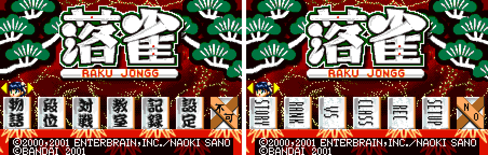

2. Story dialogue: the opponent's name and the text box are English (Elephantom speaking)

   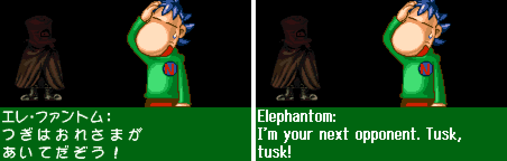

3. Story match in play: HUD labels in English (Dura, E Rd, 1P and the wind marks)

   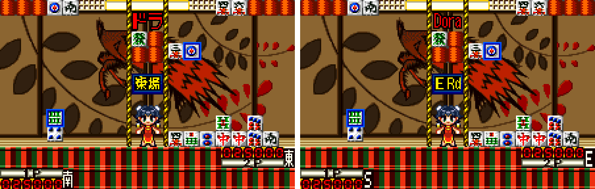

4. Dealer decision at the start of a match: 'Who Deals?', 'Begin!' and the Player 1 / Dealer East plate

   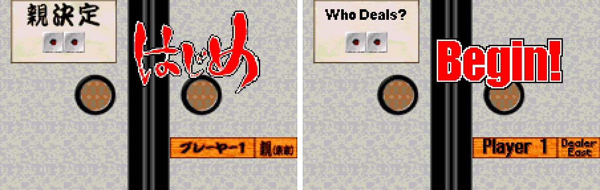

5. Result screen after a won match: WIN / LOSE labels and the two name plates (Eggo, Smarmo) in English

   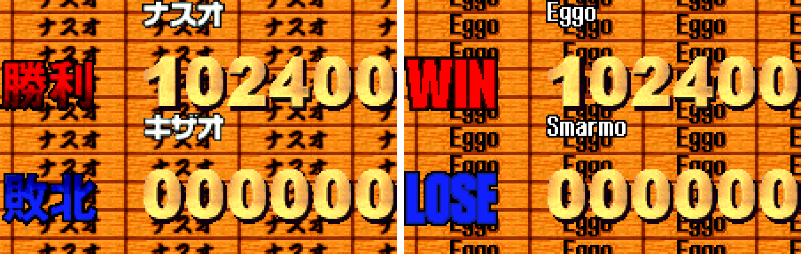

6. Result screen after a lost match: LOSE / WIN labels and the opponent plate (Smarmo) in English

   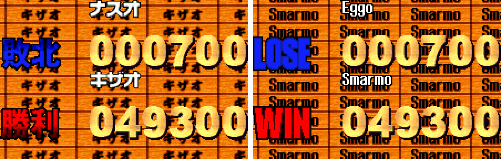

7. Rank test panel: 'Rank Test', '10 Kyu', 'To next rank' and 'Score' in English

   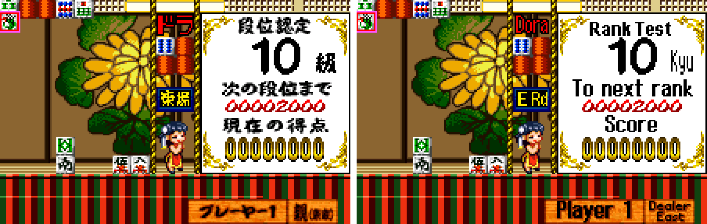

8. My Bests, Story Mode Score board: title, 'pl.', 'pts' and 'stg' in English, default name Afro

   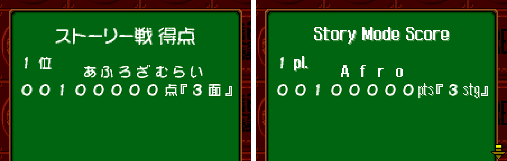

9. Name entry for a new record: 'New Record', 'Time' and the letter grid are English

   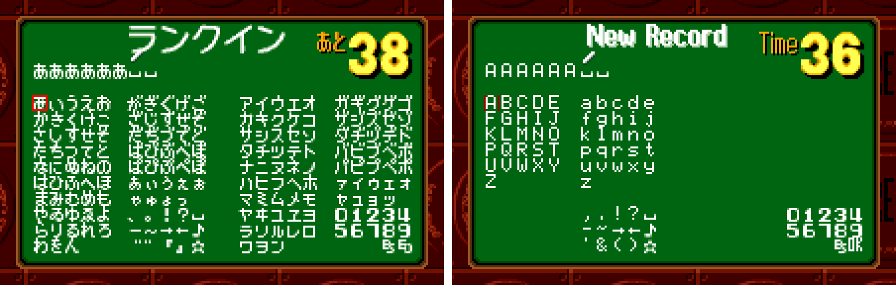

10. Classroom lesson page: the blackboard text is English ('These are Dots. They also run 1 to 9.')

   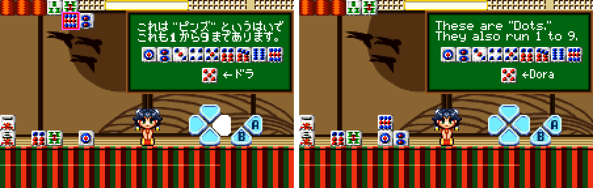

11. WonderGate telephone screen: keypad buttons OK / Del / Quit and the title in English

   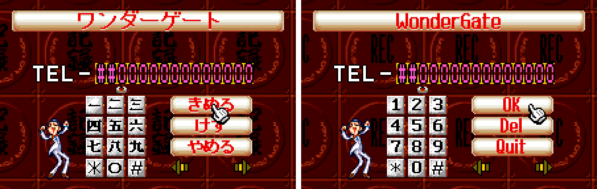

12. WonderGate result: 'Story Mode rank: 3 pl. Congrats!' and the Rank Test and Time Attack lines

   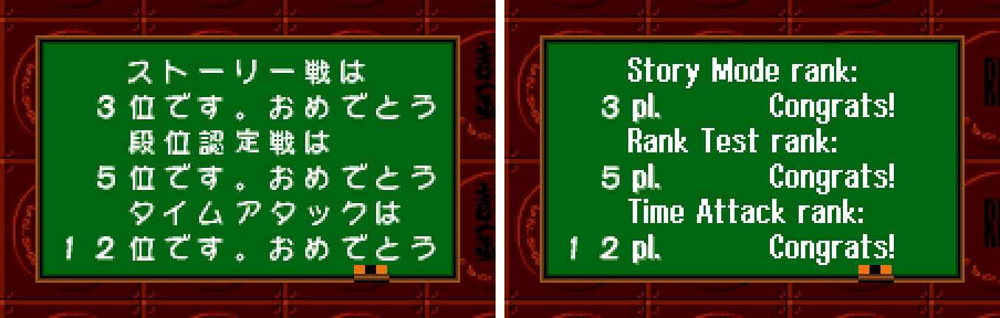

**How to patch**

Apply the BPS file to the Japanese ROM **Raku Jongg (Japan).wsc** (1,048,576 bytes, CRC32 `FE4FF701`) in your browser with the [Swan Revival patcher](https://swanrevival.com/patcher/), or with Floating IPS, beat or ROM Patcher JS.

* Standard: `raku-jongg-en-1.0.bps`; the result should be CRC32 4C72E4EF (1,048,576 bytes).

It's a WonderSwan Color game, so keep the .wsc extension. You must provide your own copy of the original Japanese game to apply it. The patch only fits this dump (CRC32 `FE4FF701`); another revision is refused or gives a wrong result.

**Download:** `raku-jongg-en-1.0.bps` on the [release page](https://github.com/PokemonGoDB/wonderswan-english-patches/releases/tag/raku-jongg-v1.0).

**Known issues**

* It hasn't been played start to finish by a person (see "What was not seen on screen"). If you find leftover Japanese or anything broken, please tell me where it happened.
* The dealer plates on the play screen read "Dealer East" and "Non-dealer"; the Japanese also names the seat of the non-dealer (子 南家), which does not fit the plate.
* Several picture labels are a little smaller than the original's kana (listed above; the options captions, the continue banner, the rank panel heading and the chain sprite are the clearest cases).
* The rank on the records board reads "10Kyu" without a space, while "6 Kyu" has one: the field is two cells wide.
* A save whose player name was typed in kana shows its name codes as odd Latin letters, and the old default name (あふろざむらい) shows the same way; a new game starts with the name Afro. I did not test loading a Japanese save into the patched ROM, so start a new save to be safe.
* In the squash animation of a focused title button, RANK, CLASS and SETUP show a few noisy pixels (two frames share the same tiles).
* The game header still says the console is "mono" although the cartridge runs in colour, as the original does.
* Save states made in an emulator on the Japanese ROM do not carry over to the patched ROM.
* It was tested in an emulator only, not on a real WonderSwan.

**Technical notes (for the curious)**

* The game keeps 154 messages in 22 count-plus-pointer tables, written in one game-specific glyph code set (digits, small kana, hiragana, katakana, about 70 kanji and pre-drawn speaker names) with opcodes for print, wait, clear and newline, and two uncompressed 4-bit fonts: 8x8 for the classroom and 16x16 for story and menus. The text is not Shift-JIS.
* The patch hooks the two font routines (`5000:E7D4` and `4000:E52B`) to draw Latin letters proportionally, repacks the messages in free ROM, redraws the picture text in place (title buttons, grid, banners, plates and the keypad), and rewrites the default name. The ROM stays 1 MiB.
* The game has no debug menu or stage select (I searched for one).
* The BPS file is 112,172 bytes. Applying it to the original gives the tested build byte for byte (checked). The patch is for this one dump only.

**A Note On My Justifications for AI Use**

I have been an avid fan of the Wonderswan system for a very long time now. It was actually a motivating factor for my various attempts to learn Japanese (which have all failed so far). I always wanted to explore the game catalog more, but the lack of English translations made it extremely difficult to do so. Here's the thing: There's a reason many of these games have not been translated yet. It's not just the fact that Japanese > English translation is difficult. There's also the fact that the original developers used all kinds of tricks and technical feats to make these games work. Most games do not have a searchable directory of text that you can just replace with English equivalents. While some are easier than others, translations for some of these would take not only an expert in Japanese > English translation, but also someone with vast game development and programming experience.

I say all that to say: I get why people are apprehensive about AI usage for this type of thing. However, these games have been around for a very long time now and most of them have still not received a translation. I (and others) have chosen to spend our time and money to utilize AI to translate the games and actually make them playable for the wider community. If you don't agree with that, that's completely fine. I am more than happy to remove any of my translations if better, human ran translations are released at a later date. We already decided to skip any games where someone is actively working on a manual translation. While nowhere near what a manual translation effort would be, I do spend a considerable amount of time trying to work through each game's translation. I stress over small details and try my best to make the right calls. And I've probably messed some stuff up, which is why I welcome feedback.

I'm just looking forward to digging through all of these games. It's a great time to be into Wonderswan games.
