# Ring Infinity (WonderSwan) - AI English translation patch v1.1

**Ring Infinity** (リング∞) is a horror sound novel for the WonderSwan, made by MeGAS and released by Bandai with Kadokawa Shoten in Japan in 2000. It continues Koji Suzuki's *Ring*: in the year 2000, Sadako Yamamura's curse spreads again through a videotape passed around a high school, a cursed web page born when that tape reached the Internet, and a nightmare that spreads by being told. Each page shows a photograph above a few lines of prose; read, make the choices (some of them against the clock), and follow three linked stories to their endings, then around the loop that gives the game its ∞. This patch translates it into English.

> **Please read:** this translation was made **with AI** (Claude), as a hobby project. A person (me) made every judgement call before release, but nobody on the project is a professional translator. I'm sharing it as it is for anyone who wants to play. Please **don't upload it to romhacking sites** (romhacking.net and the like). It may not be up to the standard of a real fan translation and it doesn't belong there.

**What's translated**

* The whole script: every page of narration and dialogue (over 4,200 pages) and every choice of the three stories (the main story, Arisawa's story and the Oshima story), with all their endings.
* Nishio's additional scenario and the 31 mails from a fellow player, both delivered over WonderGate in 2000 but stored on the cartridge.
* The title menu, the Yes/No prompts, the save and erase screens, the settings and bookmark menu, the staff credits, and every WonderGate screen.
* The pictures with words in them, redrawn in their original style: the cursed video's message and the nightmare's words, the web page, the mail program and the note on screen, the sound-effect lettering, the copyright line on the title, and the signs, book spines and printed pages in the photographs (redrawn by hand as pixel art).
* English text is written left to right in the original's text box instead of the vertical Japanese columns, and types at the original's pace.

**Names and terms**

Names from the novels follow the English edition of *Ring* (Vertical, translated by Robert B. Rohmer and Glynne Walley): Sadako Yamamura, Shizuko Yamamura, Dr. Heihachiro Ikuma. Japanese names are romanized without long-vowel marks, and Japanese specifics stay where they belong to the setting. The Oshima dialect's spell in the video is rendered as an English verse. The horror is kept as frightening as the original.

**How it was made: AI translation, independent checks, human decisions**

* Claude extracted the script from the ROM's own bytecode, wrote a story bible and a binding termbase, and translated it in passes: a draft, a review against the Japanese by a different agent, a polish pass for consistency across the whole game. It also did the hacking: a new text engine that draws a proportional English font horizontally into the vertical text box, with choices, mails and credits, and the redrawn pictures.
* A separate, independent Claude reviewer read the whole game against the Japanese; its findings were verified and fixed.
* On screen: every scene of the script was read to its end in the game's own text box with every character logged (679 scenes, 4,263 pages: no Japanese, nothing cut off); all 31 mails were read page by page; a random walk through menus, stories, mail and settings looked for any Japanese that reached the screen (none; the same check finds it at once on a build with the Japanese script); the credits after an ending; every redrawn picture seen in the game; and the menus compared with the Japanese, enlarged, for placement.
* Online: the WonderGate check-in was played for real against a private copy of Swan Revival's server on both the original and the English ROM: the request, the reply and the hang-up are the same on both, a mail arrives, and after the main story the additional scenario unlocks. The failure message was checked with the server unreachable.
* The judgement calls (names, the darker content, the redrawn signs and the cursed video, departures from the literal text) were listed with the Japanese and the options, and I decided all 27 by hand over three rounds.

**WonderGate**

In 2000 the game's WonderGate option connected to Bandai's server to receive mails from a fictional fellow player and, after the main story, Nishio's additional scenario. Bandai's server closed long ago; the feature works again through Swan Revival (swanrevival.com), the community's WonderGate revival: each connection brings the next mail, and a connection after the main story unlocks the additional scenario.

**Special edition**

`ring-infinity-en-special-1.1.bps` puts Read Mail and Read Extra Scenario on the title menu from the start, so the additional scenario and all 31 mails can be read without connecting. Everything else is the standard patch.

**Changelog**

* **v1.1**: fixed a few small translation errors.
* **v1.0**: first release.

**Sources consulted**

* Japanese text: the WonderSwan ROM itself.
* Names: Koji Suzuki's *Ring* in Vertical's English edition.
* WonderGate behaviour: the game's code and Swan Revival's notes on this game.
* Lettering: a 12-dot proportional font derived from Shinonome (public domain) for the text; the signs and pictures were drawn by hand or built from the game's own pixel font.

**Images** (original on the left, English on the right)

1. Title screen

   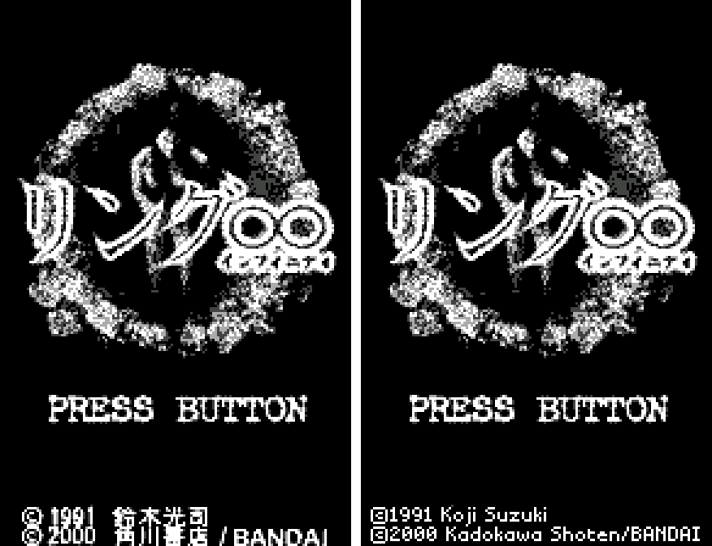

2. Title menu

   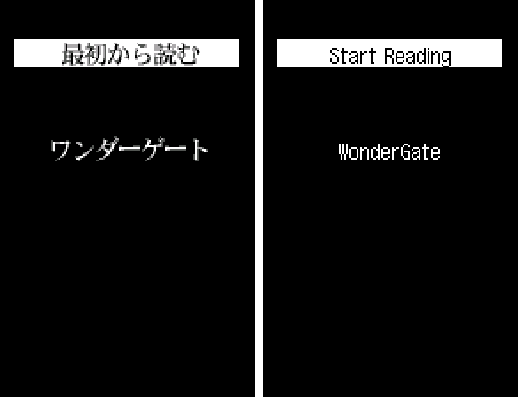

3. The opening page

   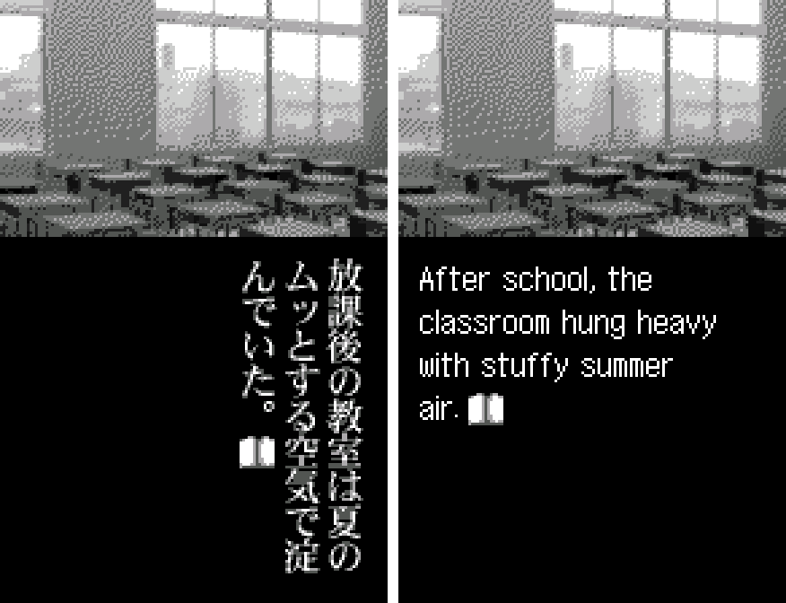

4. A story page (the sign is redrawn too)

   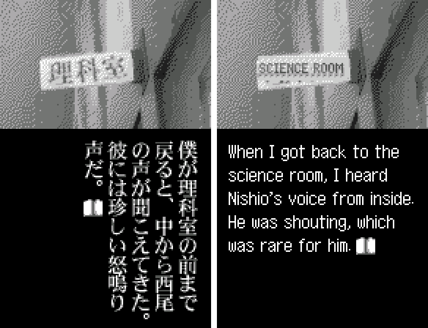

5. A choice

   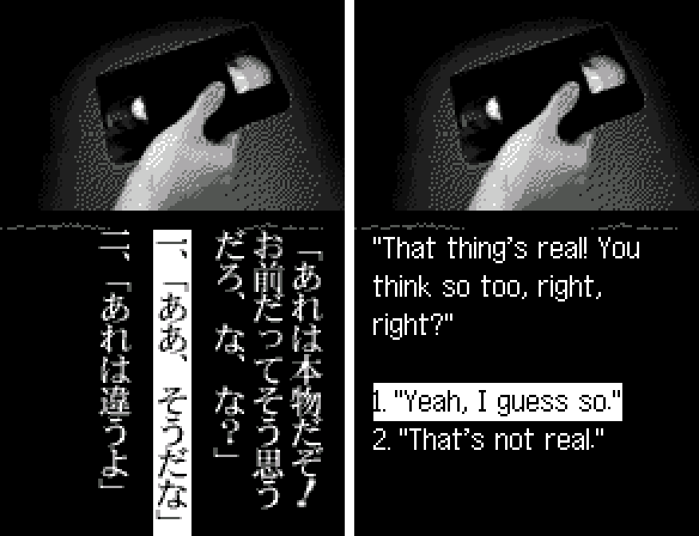

6. The cursed web page

   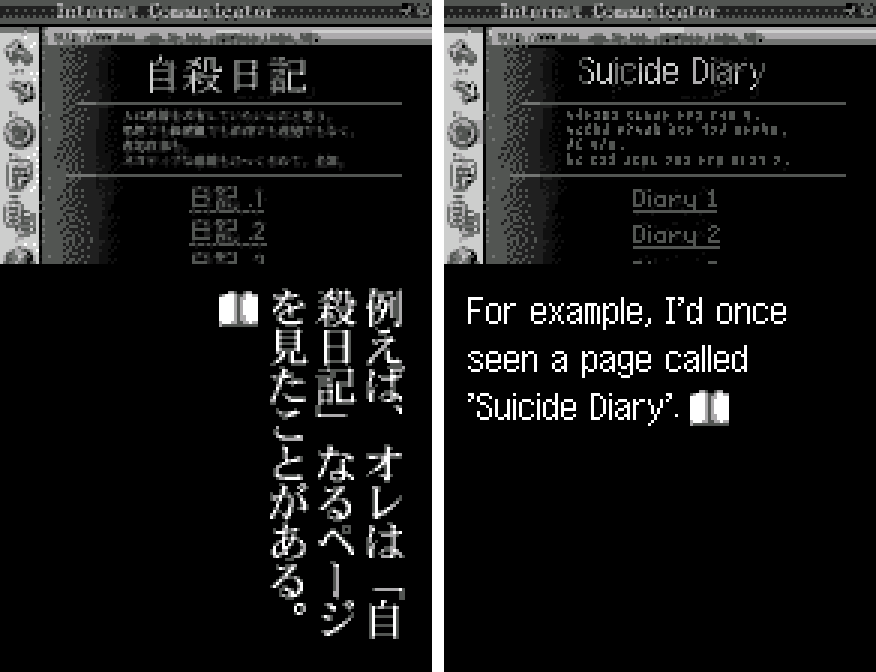

7. The cursed video's message

   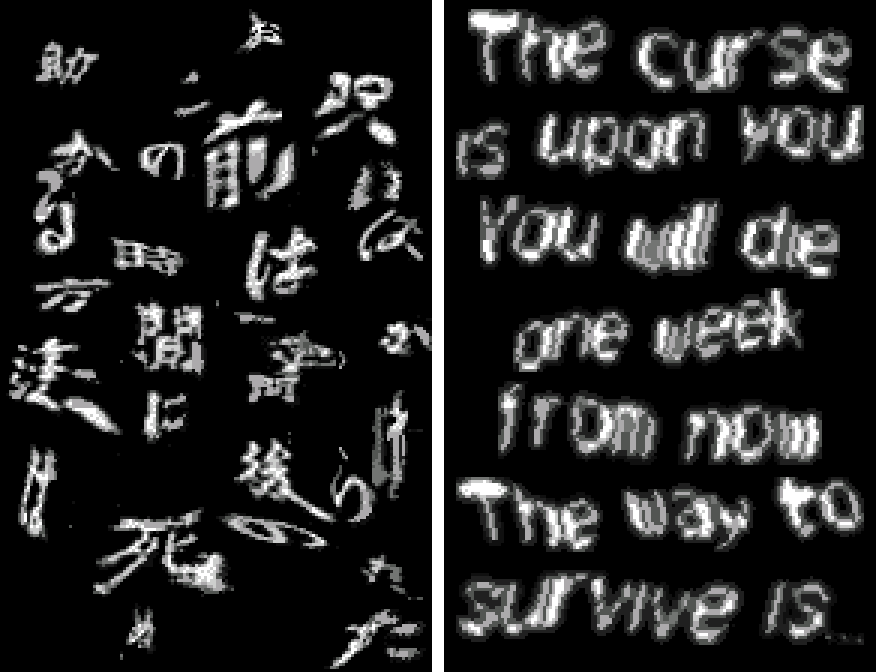

8. Mail on a computer screen

   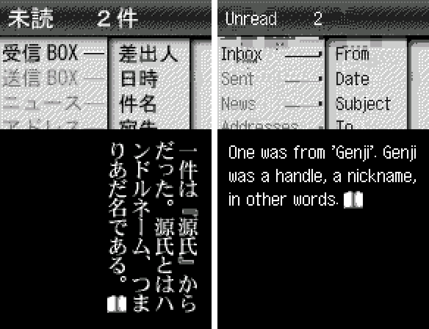

9. Settings and bookmark

   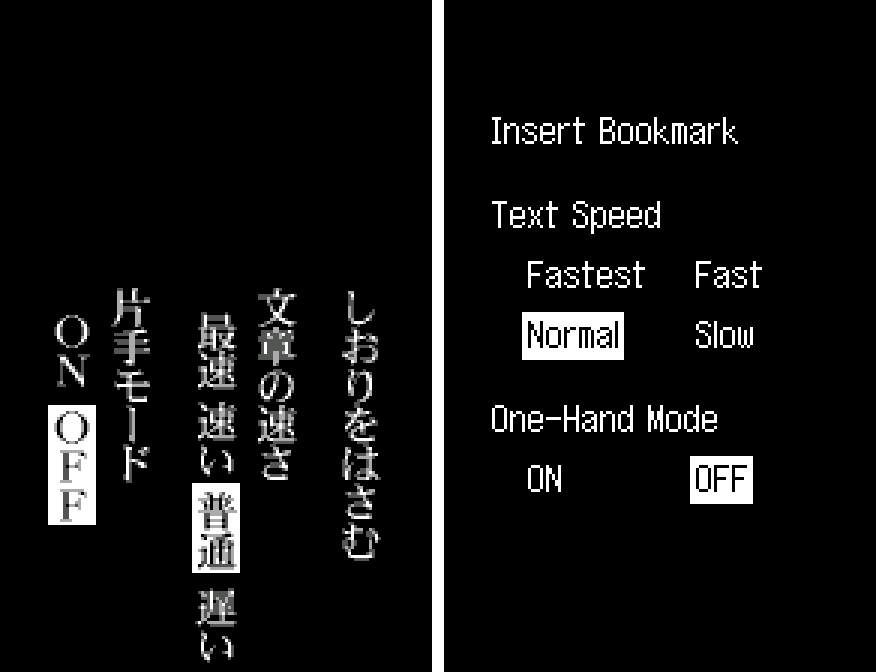

10. A player's mail

   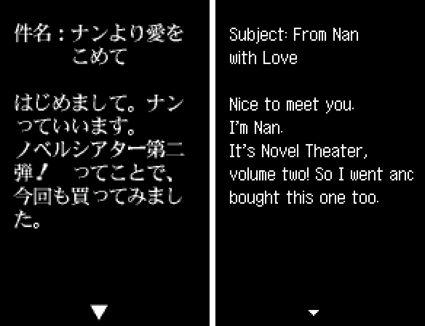

11. Staff credits

   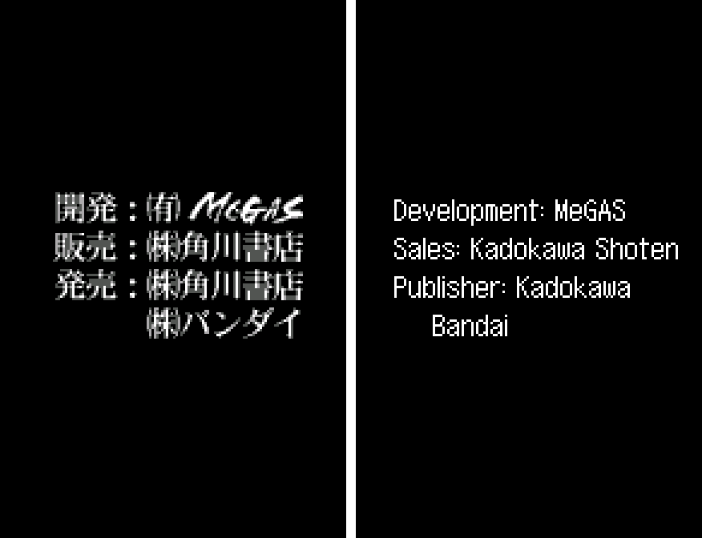

12. WonderGate with Swan Revival: a mail arrives

   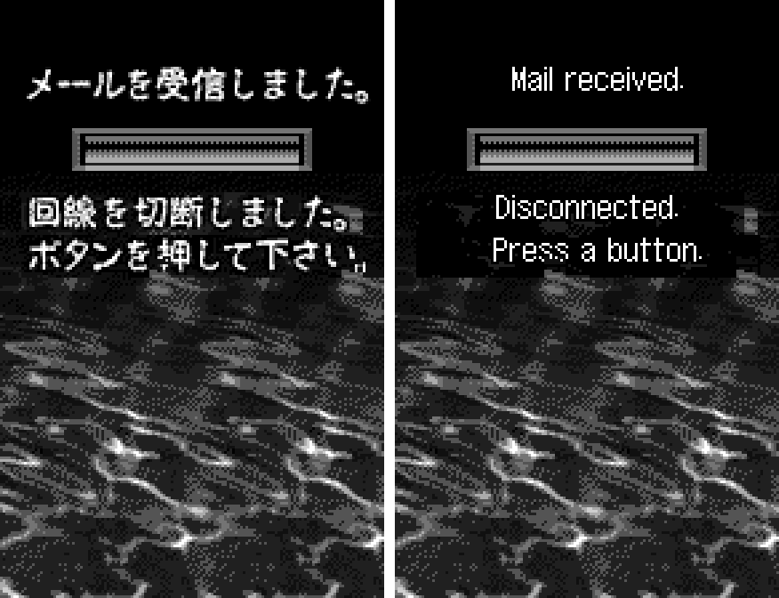

13. After a connection: Read Mail and Read Extra Scenario

   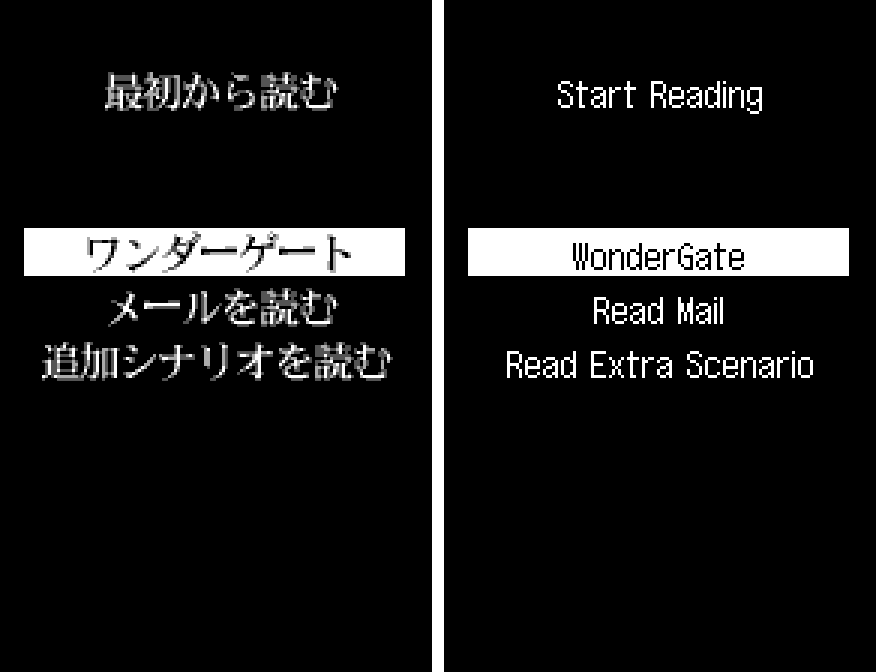

**How to patch**

Apply `ring-infinity-en-1.1.bps` (or the special edition, `ring-infinity-en-special-1.1.bps`) to the Japanese ROM "Ring Infinity (Japan)" (CRC32 14ADBD4B) in your browser with the [Swan Revival patcher](https://swanrevival.com/patcher/), or with Floating IPS, beat or ROM Patcher JS. The result should be CRC32 3E655169 (special edition BC3C951B).

The patched ROM is 8 MB (the original is 4 MB): the English text and pictures go in the added half. It's a WonderSwan game, so keep the .ws extension.

You must provide your own copy of the original Japanese game to apply it.

**Download:** `ring-infinity-en-1.1.bps` and `ring-infinity-en-special-1.1.bps` on the [release page](https://github.com/PokemonGoDB/wonderswan-english-patches/releases/tag/ring-infinity-v1.1).

**Known issues**

* It hasn't been played start to finish by a person, and it was tested on emulators, not on real hardware. If you find leftover Japanese, cut text or a crash, please tell me where it happened.
* As the cursed video's message cuts out, one frame (about 1/75 s) shows only the brightest parts of the English letters where the original shows nearly whole characters: the English message is longer than the space the game uses for its bright strokes.
* The text speed setting "Fast" is about 25% slower than the original's "Fast"; Fastest, Normal and Slow match the original.
* The WonderGate message "There was no new data." was checked only as a picture: a connection to Swan Revival always brings something.
* The sound-effect pictures (a snap and a scream) were checked through the game's own picture loader in a test build, not in their scenes, whose animations depend on story progress.

**Technical notes (for the curious)**

* The original draws vertical columns of 16x16 characters. The English engine draws a 12-row proportional font pixel by pixel into tiles it allocates as it goes, in horizontal lines inside the same text box; choices, mails, credits and menus go through it too.
* The ROM is expanded to 8 MB with the original in the upper half; the rebuilt scripts and the redrawn pictures go in the lower half, and the game's resource table points at them.
* The redrawn pictures keep the original's layering: the cursed video's letters are a dim map with bright strokes as sprites, as in the original, so they fade in the same way.

**A Note On My Justifications for AI Use**

I have been an avid fan of the Wonderswan system for a very long time now. It was actually a motivating factor for my various attempts to learn Japanese (which have all failed so far). I always wanted to explore the game catalog more, but the lack of English translations made it extremely difficult to do so. Here's the thing: There's a reason many of these games have not been translated yet. It's not just the fact that Japanese > English translation is difficult. There's also the fact that the original developers used all kinds of tricks and technical feats to make these games work. Most games do not have a searchable directory of text that you can just replace with English equivalents. While some are easier than others, translations for some of these would take not only an expert in Japanese > English translation, but also someone with vast game development and programming experience.

I say all that to say: I get why people are apprehensive about AI usage for this type of thing. However, these games have been around for a very long time now and most of them have still not received a translation. I (and others) have chosen to spend our time and money to utilize AI to translate the games and actually make them playable for the wider community. If you don't agree with that, that's completely fine. I am more than happy to remove any of my translations if better, human ran translations are released at a later date. We already decided to skip any games where someone is actively working on a manual translation. While nowhere near what a manual translation effort would be, I do spend a considerable amount of time trying to work through each game's translation. I stress over small details and try my best to make the right calls. And I've probably messed some stuff up, which is why I welcome feedback.

I'm just looking forward to digging through all of these games. It's a great time to be into Wonderswan games.
