# RUN=DIM - Return to Earth (WonderSwan Color) - AI English translation patch v1.0

**RUN=DIM - Return to Earth** (ランディム) is a horizontal mecha shooter from Digital Dream for the WonderSwan Color (2002, licensed by Bandai). You pilot the new mecha RUN=DIM for Green Frontier, an environmental group, through six stages against an enemy organisation that dumps nuclear waste, and between stages the story is told in pages of text over background pictures, with two young pilots, Kazuto and Kanna, and their commander. This patch translates all the text the game shows into English.

> **Please read:** this translation was made **with AI** (Claude), as a hobby project. A person (me) made every judgement call before release, but nobody on the project is a professional translator. I'm sharing it as it is for anyone who wants to play. Please **don't upload it to romhacking sites** (romhacking.net and the like). It may not be up to the standard of a real fan translation and it doesn't belong there.

**What's translated**

* **Everything the player reads:** the story intro, the dialogue and narration before each of the six stages (97 pages in all), both pilot profile pages, the two ending pages, the special-weapon cut-in and the six stage cards. The game's text holds 198 records and all of them are covered. The staff roll, GAME RESULTS, RANKING, CONTINUE and the HUD were already English in the original and are unchanged.
* **Pictures with text** were redrawn in English: the big title logo (the katakana ランディム is now RUN=DIM, also in the dimmed copy behind the staff roll) and the six stage card subtitles (1 Hellfire Firefighter, 2 Rotten Roots, 3 Cry at Dawn, 4 Into the Storm, 5 The Arctic Secret Base, 6 Return to Earth).
* **Names and terms:** no official English exists for this game, so the names are my reading of the katakana: Kazuto, Kanna, Green Frontier, Ultra Cannon. The enemy organisation (ジーザス in Japanese) is **JESAS**: a web search gives it as short for Japan Established Security Army for Space, and I went with that. The game itself never explains the name.
* **Speaker names** are in capitals: KAZUTO, KANNA, CMDR (the commander), OFFCR (the officer) and STAFF (the researcher). The name field is only 6 letters wide, so COMMANDER and OFFICER cannot be written whole; in the text the pilots still say "Commander!".
* **Letter size:** story text uses the same 8x8 cell as the original's kana, with 7 px capitals and 5 px lowercase. Numbers keep the original's own digits. A line holds 19 letters in dialogue and 25 in the intro and the endings, so some speeches take more boxes than in Japanese (53 of the 97 dialogue pages have a different number of lines than the Japanese).
* **Profile pages:** Kazuto's page reads "Rank:2nd Lt", "Age: 14", a shortened "Nature" paragraph and "Hobby: Music (rock)". Kanna's page reads "Hobby: Airsoft"; her karaoke is dropped (see Known issues).
* **Ending:** the second ending page is five lines instead of four, so that the full sentence fits; the ending's code was changed to draw the fifth line.
* **Stage 4:** the Japanese writes the digits 11 for the month; the English says "November".

**How it was made: AI translation, independent checks, human decisions**

* Claude worked out the game's text format, wrote the English, and rebuilt the ROM with a new English letter set and changed text routines, so that lines fit the original boxes. The ROM grows from 2 MiB to 4 MiB to make room.
* The English of the 97 text units was drafted by three Claude passes, edited by two other Claude passes, and then checked by one more; of its 11 proposals 6 were accepted and 5 rejected. A separate Claude reviewer then read all 97 units against the Japanese and found 0 wrong, 3 that lost nuance (fixed), 1 awkward and 8 nits.
* The final build (rd9) went through a full automated test run of 9 checks, and all 9 passed:
  * every one of the 195 text runs of the original is translated (33 Latin staff names are left alone, 5 are proven noise, none is unhandled), and all 97 units are drawn by the game from the new text, with no kana code and nothing past the right edge;
  * random-button walks from 31 saved states (62 runs, 373,010 frames) found no Japanese on the English build; the same walks on the original found Japanese in 62 of 62 runs, so the check can see it;
  * 18 ending, GAME RESULTS, ranking and staff-roll states were run on and showed no Japanese;
  * 189 screens were captured on both ROMs, English beside the original, and read;
  * a measured alignment audit flagged 34 rows; the kinds of rows had been read in earlier runs, and the 30 screens changed by the last round were read again, with none failing;
  * a soak test of 4,860,000 frames from 27 saved states (2 seeds each) found no freeze.
* Every decision that was mine to make was put on a decision page, 11 items in all (speaker name layout, letter size, JESAS, the stage 5 caption, the title logo, stage card lettering, the profile lines, the ending page, "November"), with pictures, and I answered every one of them: 7 approved as built, 4 changed (JESAS, "Hobby: Airsoft", "Rank: 2nd Lt" and the five-line ending page), and the build was redone with my answers.

**What was not seen on screen** (please report anything odd)

* **Real play stopped at the stage 2 boss.** Claude played in the emulator from the title through the intro, stage 1 and its boss and the stage 2 card and dialogue, then died on the stage 2 boss, used CONTINUE, saw GAME OVER and RANKING, and watched the staff roll; no defect was found. Stages 3 to 6, bosses 2 to 6, the ending and the ranking after a cleared run were not played by hand. A saved-state tour reached all of them and the automated checks found no Japanese, but those screens were seen as captures, not by playing.
* **That hands-on play was done on an earlier build** (the one before the last changes: JESAS, the profile lines and the five-line ending page). The final build was checked by the full automated run and by reading the screens that changed, not by playing it again.
* **Test-only help:** stages 2 to 6, the bosses and the endings were reached from saved states whose game values were edited in the test tool (stage number, lives), never in a patch. The ending screens were seen that way, ending pages 1 and 2 included.
* **Not seen:** the results counters showed 0 in every run, on the original too, so I do not know whether they count up; pause only dims the screen (no text); the game has no options, password or save-link screens. A test run on stage 6 froze once and I could not explain it; the soak test of the final build found no freeze.
* **One spot not caught on a capture:** a diagonal contact between two lines on ending page 1 ("destroyed." over "bid") was not on any captured screen. One intro capture was taken mid-scroll.
* **What the checks cannot see:** the detector knows 243 Japanese tile types and does not see Japanese picture text other than the title logo, so the stage cards and other pictures were checked by screenshot; the staff roll's routine is untouched and its credits are Latin.
* **Not on real hardware.** Only an emulator was used; the 4 MiB layout is untested on a cartridge or a real WonderSwan.

**Changelog**

* **v1.0**: first public release.

**Sources consulted**

* Japanese text: the WonderSwan ROM itself, which has no kanji (only hiragana and katakana, so a few readings are guesses).
* English names and terms: none exist for this game. The names are Hepburn readings of the katakana and the game's own English (the title, "Digital Dream", the Latin staff credits, "RETURN TO EARTH"); each is in the project's termbase with its reason.
* The expansion JESAS = Japan Established Security Army for Space is my own reading from a web search; the game does not state it.
* The project's own notes on the game's text format and story, and the QA run summaries.
* I searched for another English translation of this game on 2026-11-19: the WonderSwan claims board, a web search and the gametranslate.us translations page found no English patch for the WonderSwan Color game. A Dreamcast game in the same series, RUN=DIM (released in English as Black Soul), has a fan translation; it is a different game. If a human translation is released, that one should be preferred.

**Images** (original on the left, English on the right)

1. Title screen (the big logo redrawn as RUN=DIM)

   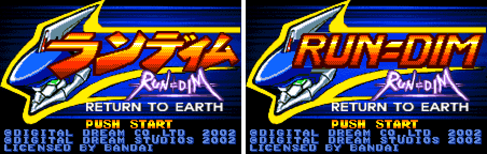

2. The last page of the story intro (Green Frontier sets out to foil JESAS's plot)

   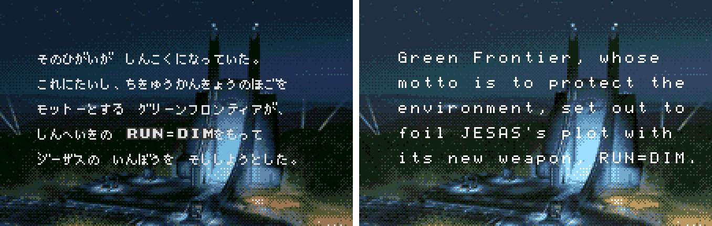

3. Pilot profile page (Kazuto: Rank, Age, Nature, Hobby)

   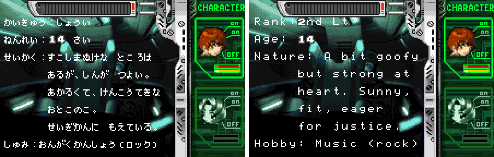

4. Stage 1 card ("Hellfire Firefighter")

   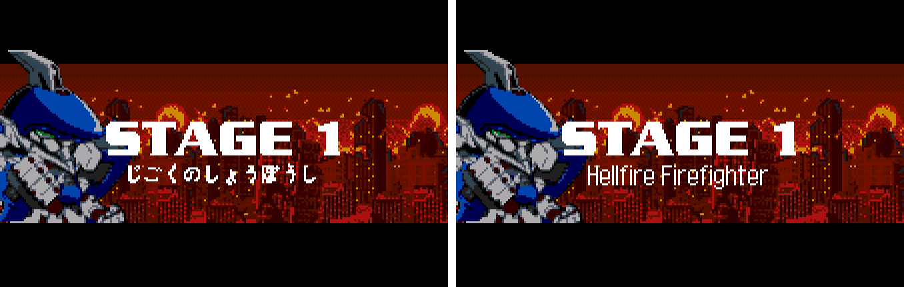

5. Stage 3 card ("Cry at Dawn")

   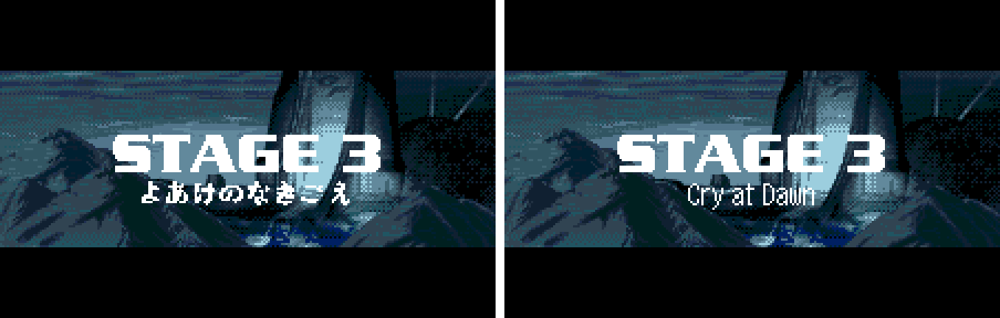

6. Command room: the commander on JESAS's menace

   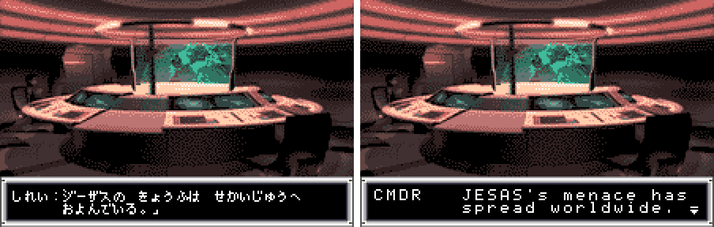

7. Base exterior: the commander reports JESAS's armored corps

   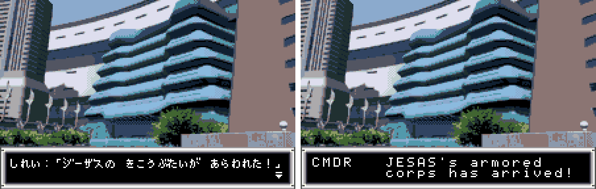

8. Desert scene: "It's November already" (stage 4)

   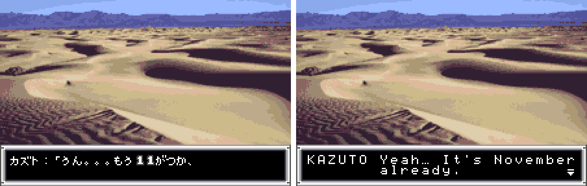

9. Narration box ("Dusk. The alarm bell rang at Green Frontier Base.")

   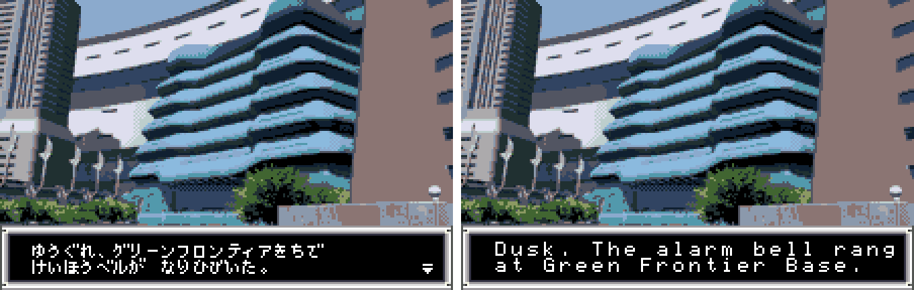

10. Special-weapon cut-in (Ultra Cannon)

   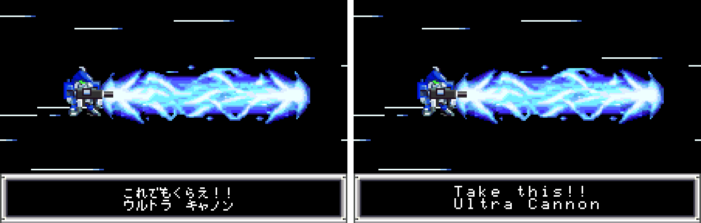

11. Ranking screen (already English in the original, unchanged)

   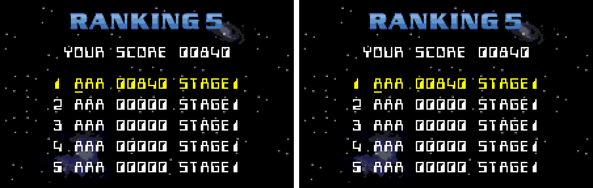

**How to patch**

Apply the BPS file to the Japanese ROM **RUN=DIM - Return to Earth (Japan).wsc** (2,097,152 bytes, CRC32 `15C4552E`) in your browser with the [Swan Revival patcher](https://swanrevival.com/patcher/), or with Floating IPS, beat or ROM Patcher JS. The result is 4,194,304 bytes (4 MiB, twice the original, because the English text and letters need new space):

* Standard: `run-dim-en-1.0.bps`; the result should be CRC32 29BFFB91.

It's a WonderSwan Color game, so keep the .wsc extension. You must provide your own copy of the original Japanese game to apply it.

**Download:** `run-dim-en-1.0.bps` on the [release page](https://github.com/PokemonGoDB/wonderswan-english-patches/releases/tag/run-dim-v1.0).

**Known issues**

* It hasn't been played start to finish by a person (see "What was not seen on screen"). If you find leftover Japanese or anything broken, please tell me where it happened.
* The rank line reads "Rank:2nd Lt": no space after the colon and no full stop. A bright patch of the background swallowed the full stop and made the "t" look like "Lv." when I tried the usual spelling. Fixing it would need an edit of the background picture; I did not do it.
* Kanna's profile says only "Hobby: Airsoft"; the Japanese also lists karaoke, which did not fit the line. Both pilots' "Nature" paragraphs are shortened to fit the 13 letters beside the CHARACTER frame (for example Kanna: "Competitive and tough. Sunny, funny. Takes on even boys head-on.").
* The stage 5 caption "Behind the Curtain" is a guess: the game writes ちょうまくのうら only in kana. The stage 5 card picture says "The Arctic Secret Base".
* The 25-letter intro lines end 2 to 4 px from the screen edge, and dialogue lines can be broken over more boxes than the Japanese. The profile text is close to the art: one "n" in Kanna's Nature text sits on a light streak of the background and reads weakly.
* Speaker names are abbreviated (CMDR, OFFCR, STAFF) and have no colon; the text starts one blank column after the name.
* Text scenes finish a few frames sooner than in the original, because the new text routine is shorter.
* The game header still says "mono" although the cartridge runs in colour, as the original does.
* Save states made in an emulator on the Japanese ROM do not carry over to the patched ROM.
* It was tested in an emulator only, not on a real WonderSwan.

**Technical notes (for the curious)**

* The game keeps 198 text records of 16-bit codes (hiragana and katakana, no kanji, no control codes) ending in a terminator, plus 33 Latin staff names. The story font is an 8x8, 4-bit tile set; the English letters replace the kana tiles.
* The patch expands the ROM to 4 MiB and puts the English text in a new bank, read through the game's window by two patched text routines. The dialogue page tables were rebuilt so a page can have as many lines as the English needs, and one key press less is needed on long pages.
* The ending code was changed to draw five lines on page 2 (the line count went from 11 to 12 and a new line table was added in space freed by the Japanese text).
* The title logo change touches 201 picture tiles; the six stage cards are re-encoded in all 8 zoom and rotate frames.
* The BPS file is 153,723 bytes. Applying it to the original gives the tested build byte for byte. The game has no debug menu (I searched for one).

**A Note On My Justifications for AI Use**

I have been an avid fan of the Wonderswan system for a very long time now. It was actually a motivating factor for my various attempts to learn Japanese (which have all failed so far). I always wanted to explore the game catalog more, but the lack of English translations made it extremely difficult to do so. Here's the thing: There's a reason many of these games have not been translated yet. It's not just the fact that Japanese > English translation is difficult. There's also the fact that the original developers used all kinds of tricks and technical feats to make these games work. Most games do not have a searchable directory of text that you can just replace with English equivalents. While some are easier than others, translations for some of these would take not only an expert in Japanese > English translation, but also someone with vast game development and programming experience.

I say all that to say: I get why people are apprehensive about AI usage for this type of thing. However, these games have been around for a very long time now and most of them have still not received a translation. I (and others) have chosen to spend our time and money to utilize AI to translate the games and actually make them playable for the wider community. If you don't agree with that, that's completely fine. I am more than happy to remove any of my translations if better, human ran translations are released at a later date. We already decided to skip any games where someone is actively working on a manual translation. While nowhere near what a manual translation effort would be, I do spend a considerable amount of time trying to work through each game's translation. I stress over small details and try my best to make the right calls. And I've probably messed some stuff up, which is why I welcome feedback.

I'm just looking forward to digging through all of these games. It's a great time to be into Wonderswan games.
