# Sennou Millennium (WonderSwan) - AI English translation patch v1.0 (+ special edition)

**Sennou Millennium** (線脳 MILLENNIUM) is Bandai's 2000 puzzle game for the original (monochrome) WonderSwan, played with the console held upright and released only in Japan. In its world, creatures of living energy called Senknow battle at the Senknow Stadium. You drop pieces of circuit-like line into a field and clear them by linking their lines, closing loops and setting off chains; in battle, every clear sends attack pieces onto your opponent's field, and your partner Senknow lends you a special move. It has a story mode against nine Senknow, Endless Link, Senknow-Do (400 set puzzles in four courses with ranks and certificates), two-player link-cable battles, and a hidden WonderGate mode that once sent scores to Bandai's online ranking.

This patch translates it into English.

> **Please read:** this translation was made **with AI** (Claude), as a hobby project. A person (me) made every judgement call before release, but nobody on the project is a professional translator. I'm sharing it as it is for anyone who wants to play. Please **don't upload it to romhacking sites** (romhacking.net and the like). It may not be up to the standard of a real fan translation and it doesn't belong there.

**What's translated**

* Every word in this game is a picture, and every one of them was redrawn: the mode menu, the story's opening and the opponents' introductions, partner select, the attack target menu, the results and records, the Senknow File cards, the battle banners (WIN! / LOSE), continue and game over, the ending and the staff credits.
* Senknow-Do: the poem that opens it, the course select, the puzzle screens and instructions, the rule pages, the PASS / FAIL stamps, the retry menu and the three certificates (rank, mastery and the Grand Sage's), with your name on them as in the original.
* Two-player link screens and the hidden WonderGate mode (Senknow Online): its menu, settings, connecting message, error messages and the ranking page.
* Lettering was drawn by hand in the original's styles: brush capitals for the course names (TRIAL, HEAT, FURY, PEAK), the stamps' rim lettering along the circle, the retry menu, a serif for the poem set in columns like the Japanese, and the reading SENKNOW under the title logo.
* Left as art: the 線脳 title logo (with the English reading under it) and the 線脳道 calligraphy and seal patterns of Senknow-Do.

Names: センノー is spelled **Senknow**, as the game itself spells it in its English lettering (SENKNOW STADIUM). The modes are **Endless Link**, **Fight Senknow**, **Senknow-Do**, **Link & Fight**, **Records** and **Senknow Online**; the Senknow-Do courses are **TRIAL**, **HEAT**, **FURY** and **PEAK**; ranks read "Dan 3, No. 7"; the stadium's manager is **Dr. Know**.

**The special edition**

The special edition (`sennou-millennium-en-special-1.0.bps`) is the standard patch plus:

* **Senknow Online** always on the mode menu. The original only shows it after holding A+B+Y1+Y4 at power-on. Bandai's server is long gone, so connecting ends in an error, but the menus and settings are there to see.
* **The developers' sound test:** on the title screen, hold **B** and press START. Choose a row and change its number with the pad, play a sound with X3 (the button you confirm menus with) and stop it with X4; EXIT returns to the mode menu.
* **The developers' opponent select:** on the title screen, hold **A** and press START. The list uses the developers' working names for the Senknow and their AI types (1:SPIDER (SHAKE) ... 9:BIL2000 (RANDOM)); pick one and Fight Senknow starts against that opponent (9 is the final boss), carrying on through the story from there.
* Nothing in the original reaches these two screens; they are leftover tools, plain and unpolished.

**How it was made: AI translation, independent checks, human decisions**

* Claude translated everything directly from the Japanese in the ROM and did all the hacking: the game's 152 compressed picture sets were decoded, 58 of them redrawn in English, and the screens' tile maps rewritten; a few code changes put numbers where English word order needs them.
* A separate, independent Claude reviewer checked the whole game against the Japanese, text and screenshots; its findings were verified and fixed.
* On screen: a scripted tour of every mode on the English build with a detector for leftover Japanese pictures (none found; the original ROM as control), the attract loop, the final boss, the ending and credits, all three certificates, the WonderGate screens, and side-by-side comparisons with the original for alignment.
* The judgement calls were listed with the Japanese and the options, and I decided all 18 by hand over three rounds; several pieces of lettering were redrawn until they matched the original's look.

**Changelog**

* **v1.0**: first release.

**Sources consulted**

* Japanese text: the WonderSwan ROM itself (no official English material exists; the game's own English lettering was followed).

**Images** (original on the left, English on the right)

1. Title screen

   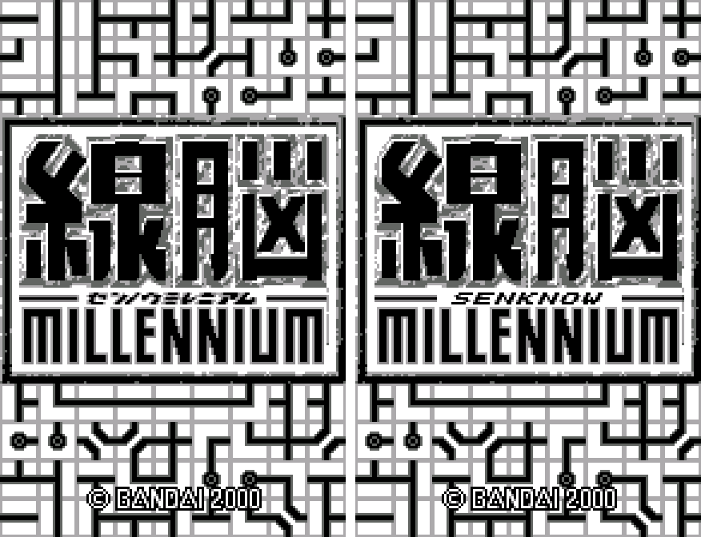

2. Mode menu

   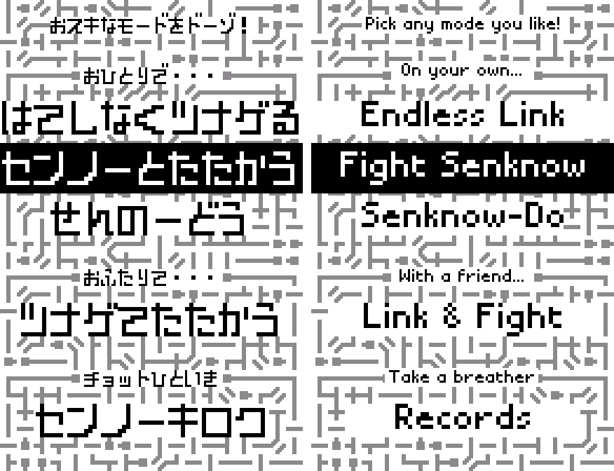

3. The story's opening

   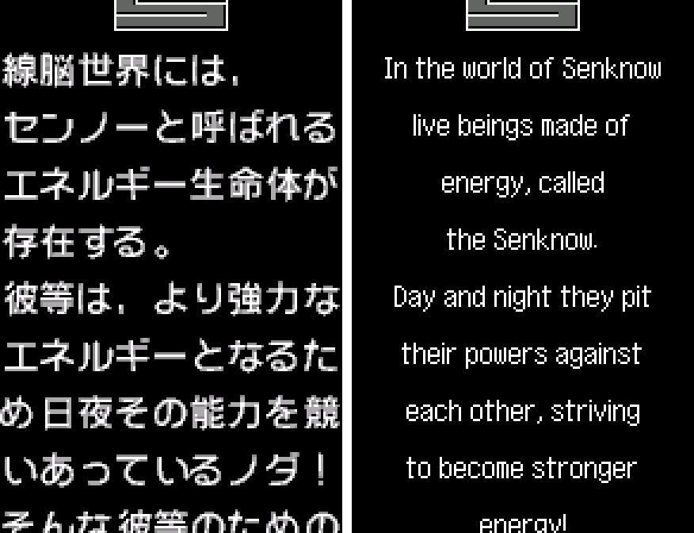

4. Choosing where attack pieces land

   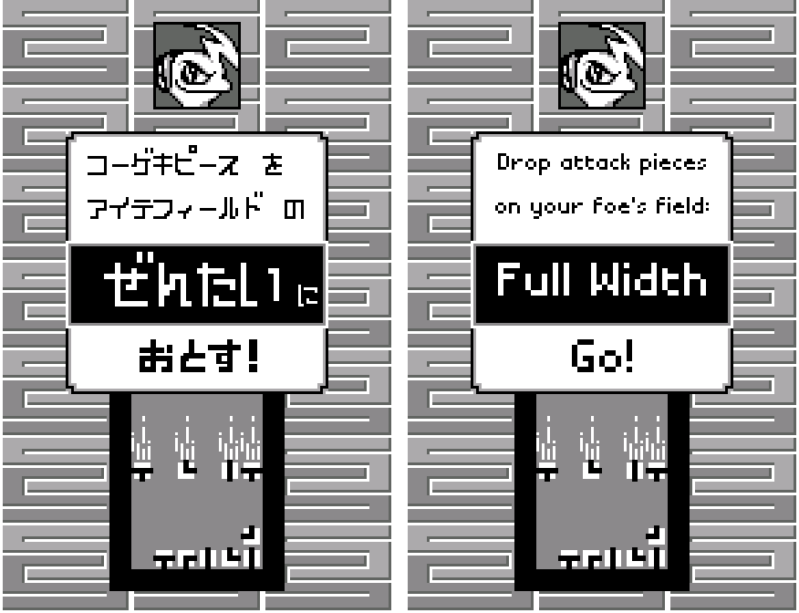

5. An opponent enters

   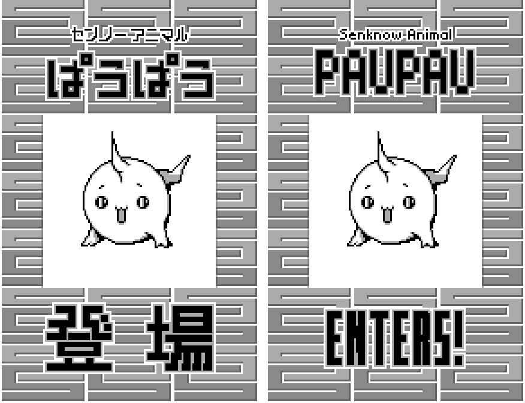

6. Winning a battle

   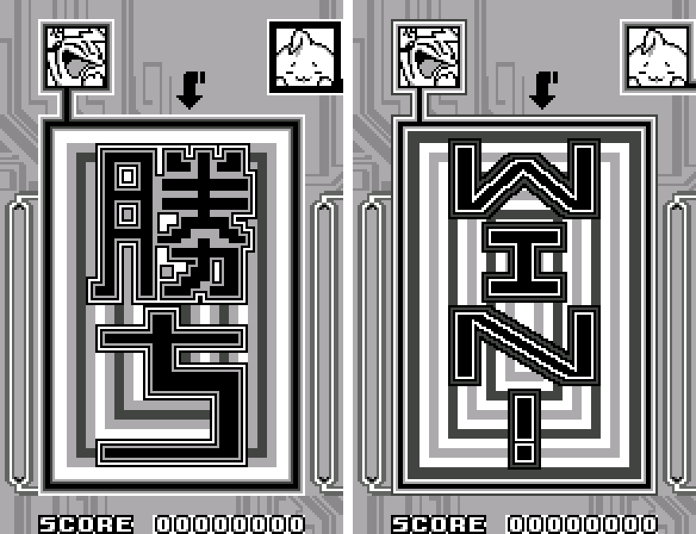

7. The Senknow-Do poem

   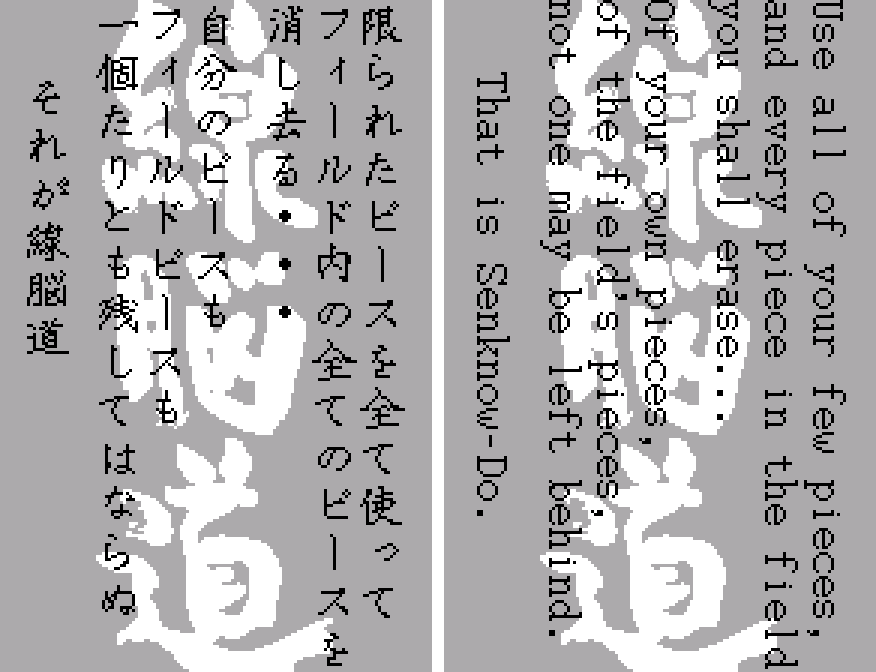

8. Senknow-Do course select

   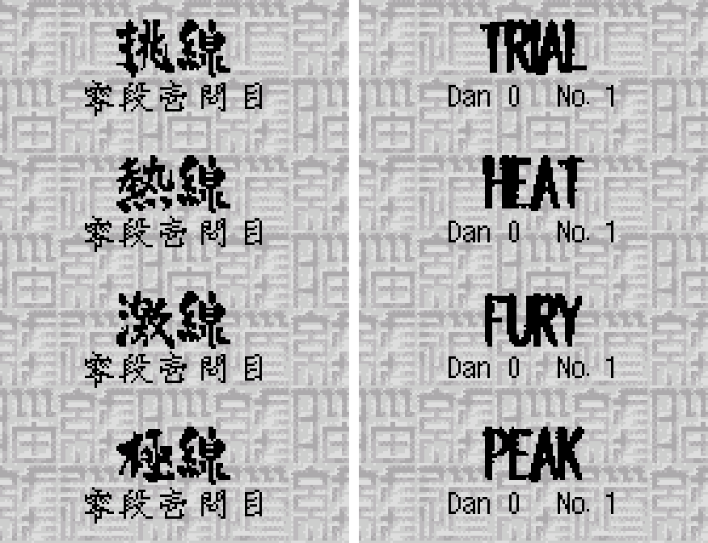

9. A Senknow-Do puzzle

   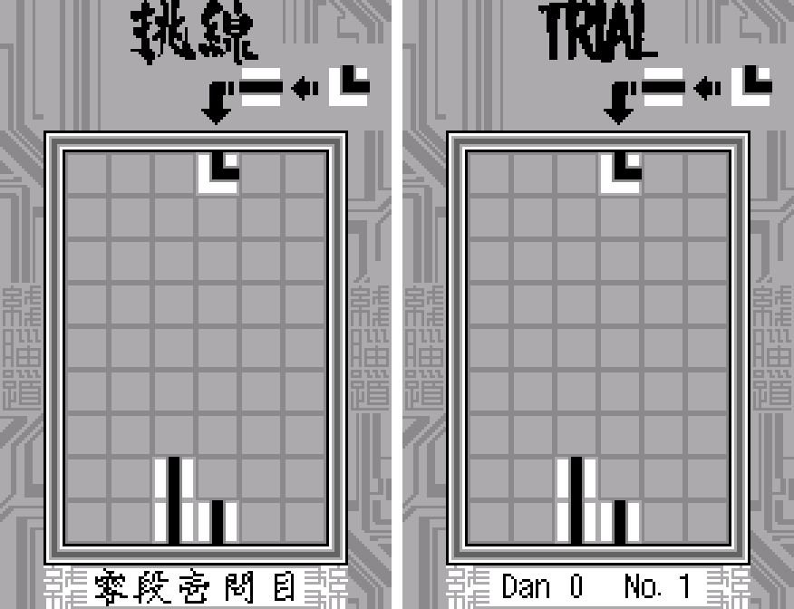

10. The PASS stamp

   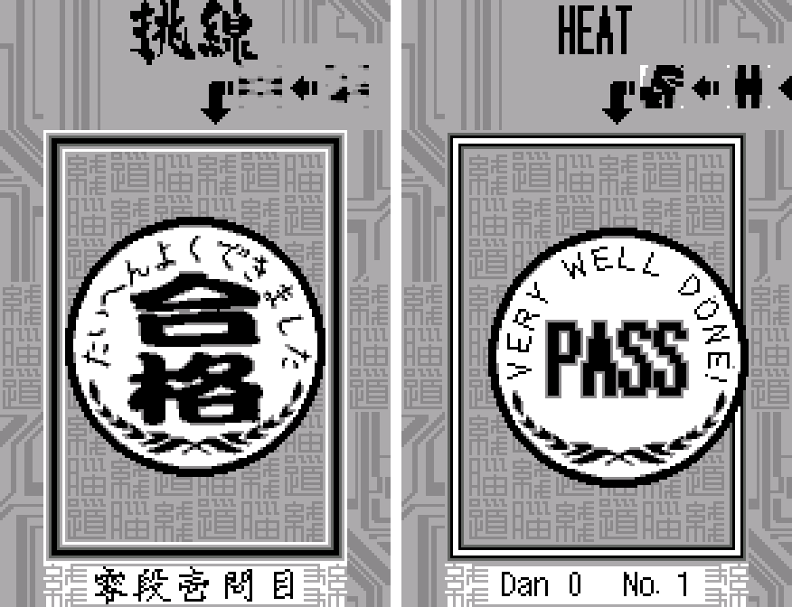

11. A rank certificate

   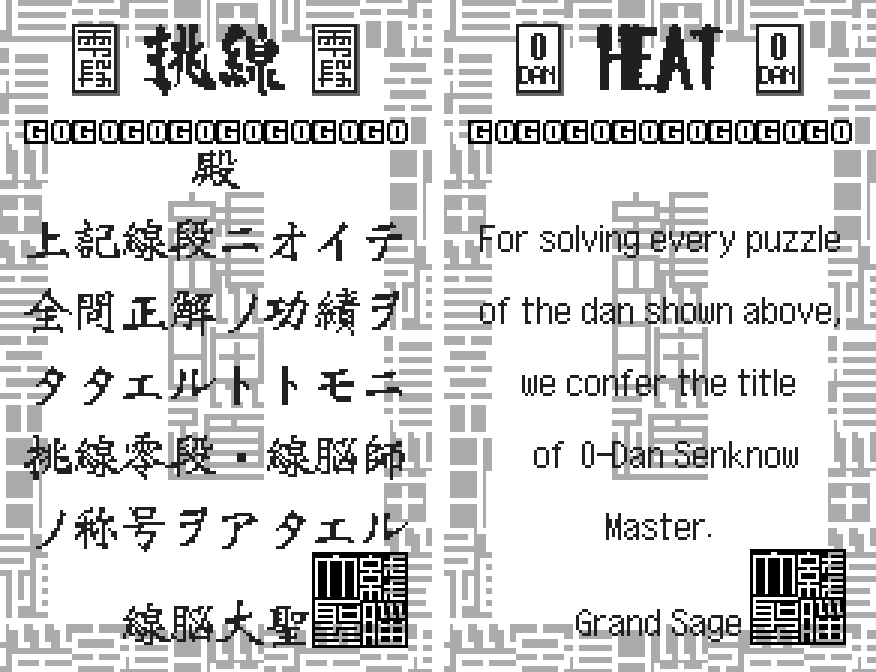

12. The retry menu

   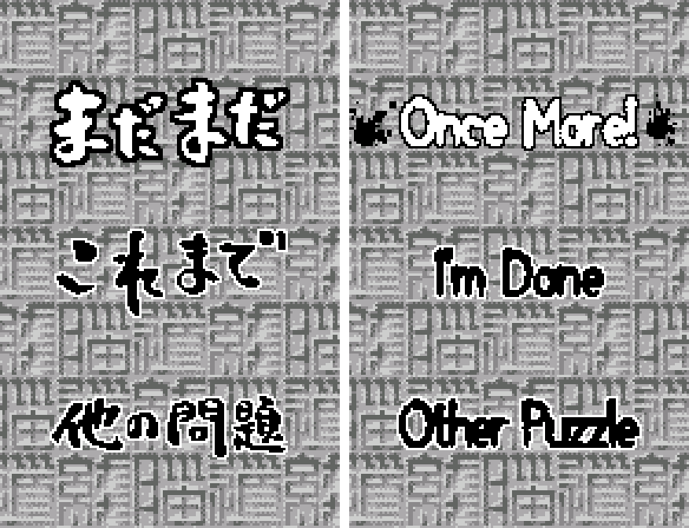

13. The FURY course's special rule

   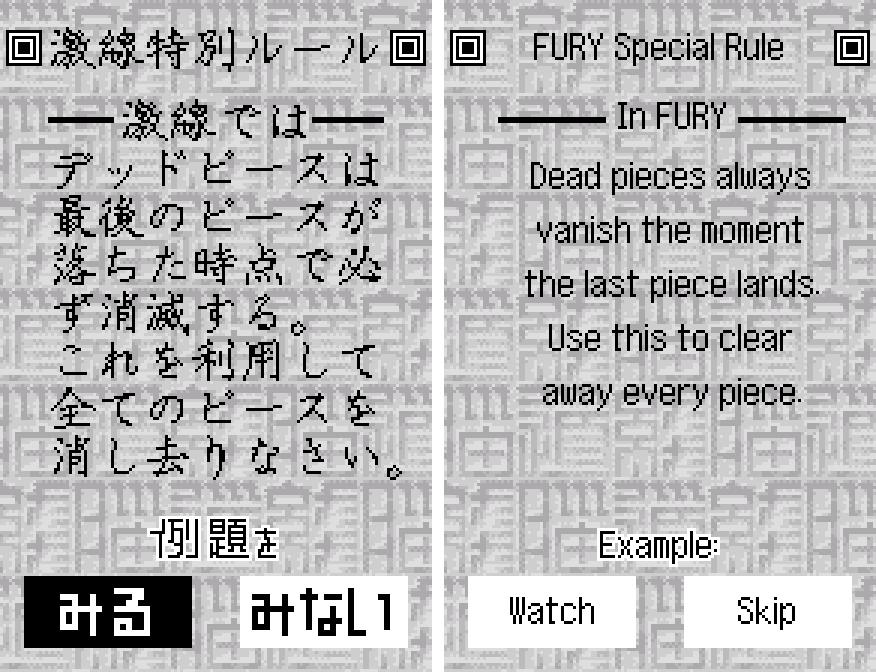

14. The ending

   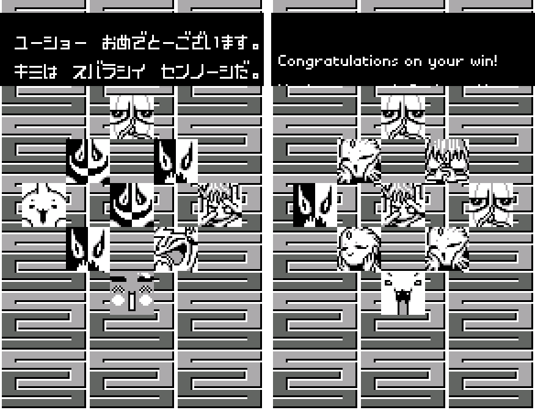

15. Senknow Online (the hidden WonderGate mode)

   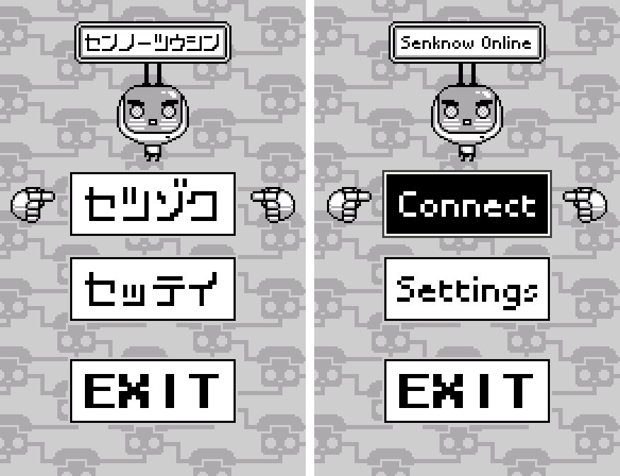

16. Special edition: the sound test and the opponent select

   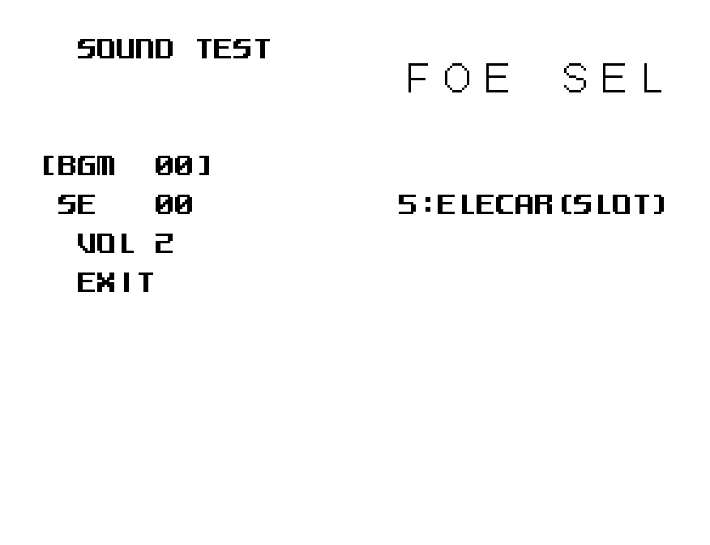

**How to patch**

Apply one of the BPS files to the Japanese ROM "Sennou Millennium (Japan)" (CRC32 301436AC) in your browser with the [Swan Revival patcher](https://swanrevival.com/patcher/), or with Floating IPS, beat or ROM Patcher JS:

* Standard: `sennou-millennium-en-1.0.bps`, the result should be CRC32 4883A851.
* Special edition: `sennou-millennium-en-special-1.0.bps`, the result should be CRC32 C6995751.

The English ROM is 2 MB (the original is 1 MB) because the redrawn pictures needed more room: use an emulator or a flash cart that takes 16 Mbit WonderSwan ROMs. It's a WonderSwan (mono) game, so keep the .ws extension.

You must provide your own copy of the original Japanese game to apply it.

**Download:** `sennou-millennium-en-1.0.bps`, `sennou-millennium-en-special-1.0.bps` on the [release page](https://github.com/PokemonGoDB/wonderswan-english-patches/releases/tag/sennou-millennium-v1.0).

**Known issues**

* It hasn't been played start to finish by a person. Wins, losses, certificates and the ending were reached in testing with forced results rather than by beating every opponent and all 400 puzzles. If you find leftover Japanese or anything broken, please tell me where it happened.
* WonderGate: Bandai's server no longer exists, so connecting ends in an error. Errors other than 001 (no adapter) and the ranking page were checked for fit but could not be seen with real replies.
* The small 線脳道 seals on the puzzle screens' wallpaper stay as art.

**Technical notes (for the curious)**

* The game keeps every screen as tile pictures in a compressed archive; there is no text engine. Each English label is lettered to the pixel at build time, cut into 8x8 tiles that reuse identical tiles where they can, and written into tiles only the Japanese used.
* Text-heavy screens (file cards, results, errors) needed more tiles than their picture set has free; a small hook loads an extra tile pack for those screens just before they are drawn, from the second megabyte the ROM was expanded to.
* The Senknow-Do poem scrolls in as columns that share one tile set with the calligraphy behind them; its English is set on a fixed 8-pixel grid so every letter reuses its tiles (58 new tiles instead of about 500).
* English word order ("Dan 0  No. 1" instead of 零段壱問目) meant moving the numbers: four separate routines draw that strip, and each was patched.

**A Note On My Justifications for AI Use**

I have been an avid fan of the Wonderswan system for a very long time now. It was actually a motivating factor for my various attempts to learn Japanese (which have all failed so far). I always wanted to explore the game catalog more, but the lack of English translations made it extremely difficult to do so. Here's the thing: There's a reason many of these games have not been translated yet. It's not just the fact that Japanese > English translation is difficult. There's also the fact that the original developers used all kinds of tricks and technical feats to make these games work. Most games do not have a searchable directory of text that you can just replace with English equivalents. While some are easier than others, translations for some of these would take not only an expert in Japanese > English translation, but also someone with vast game development and programming experience.

I say all that to say: I get why people are apprehensive about AI usage for this type of thing. However, these games have been around for a very long time now and most of them have still not received a translation. I (and others) have chosen to spend our time and money to utilize AI to translate the games and actually make them playable for the wider community. If you don't agree with that, that's completely fine. I am more than happy to remove any of my translations if better, human ran translations are released at a later date. We already decided to skip any games where someone is actively working on a manual translation. While nowhere near what a manual translation effort would be, I do spend a considerable amount of time trying to work through each game's translation. I stress over small details and try my best to make the right calls. And I've probably messed some stuff up, which is why I welcome feedback.

I'm just looking forward to digging through all of these games. It's a great time to be into Wonderswan games.
