# Sorobang (WonderSwan Color) - AI English translation patch v1.0

**Sorobang** (そろばんぐ) is an action puzzle game for the WonderSwan Color, made by Mechanic Arms and licensed by Bandai (2000). You play on a grid of coloured round pieces and bars, against a BLOCK count, a MISS gauge and a clock, in Time Attack and Endless modes, with a ranking table, a settings page and a link-cable versus mode. The console is held upright (portrait). It was released only in Japan. The game has no text engine: every word it shows is a picture in the cartridge, so this patch redraws those pictures as English lettering.

> **Please read:** this translation was made **with AI** (Claude), as a hobby project. A person (me) made every judgement call before release, but nobody on the project is a professional translator. I'm sharing it as it is for anyone who wants to play. Please **don't upload it to romhacking sites** (romhacking.net and the like). It may not be up to the standard of a real fan translation and it doesn't belong there.

**What's translated**

* **Every word the game shows**, redrawn as English pixel lettering in the style, size and colours of the original: the mode-select buttons, the settings page (headings, labels and values), RETRY? and GAME OVER, the ranking page and name entry, the level-up and TIME UP banners, the versus lobby and its link messages, and the staff roll. 42 blocks of Japanese lettering plus the lettering that is drawn as sprites were found and replaced.
* **Both graphics sets.** The game carries a colour set and a separate monochrome set (it uses the monochrome one when A+B is held at power-on); every word is patched in both.
* **The game's own Latin words stay as they are:** BLOCK, MISS, NEXT, SCORE, PUSH START, the copyright lines.
* **Choices made on the decision pages (8 items, all answered):** the mode names are TIME ATTACK, ENDLESS, RANKING, VERSUS and OPTIONS under the heading MODE SELECT (the original adds "mode" to three of them, which would not fit at full size); the settings headings are SETTINGS, LEVEL and SOUND; the labels are CONTROLS, BLOCK TYPE, ENDLESS MUSIC and SOUND TEST; the middle difficulty is MID, because NORMAL does not fit between the radio dots; the opponent's gauge in link play is FOE; the versus tally uses one letter, W / L / D, after each number, as the original uses one kanji; the staff names are spelled in Hepburn romanisation from the kana, family name first, as the original shows them (for example INOUE / KAZUHIKO).
* **Letter size:** English letters are as tall as the Japanese ones or taller everywhere (for example TIME UP! 14 px against 13, RETRY? 14 against 12); only the widths are smaller, because Latin letters are narrower than kana.
* **Saves:** only picture tiles, tile maps and sprite data change; there is no code change and no change to the save layout. A save from the Japanese version works, and the English version links with the Japanese one (tested on two linked emulators).

**How it was made: AI translation, independent checks, human decisions**

* Claude worked out how the cartridge stores its graphics (raw 2-bit tiles loaded by a script interpreter, two complete sets), wrote the English, drew the lettering and rebuilt the ROM. The ROM stays 1 MiB, like the original.
* The final build (srb8) went through a full automated run of 12 checks: 11 passed, 1 does not apply to this game, none failed. A soak of 2.04 million frames from saved states with random button presses raised no flag; the runtime Japanese detector found no Japanese on the English build; the alignment audit compared 46 original/English screen pairs; a ledger of 196 captured screens was reviewed one by one.
* A separate read-only Claude reviewer compared the English with the Japanese on the original screens: it found no wrong-meaning error on any screen, and its findings (staff names are 8 people with a role each, lettering weight, wording) were fixed or put to me.
* Before this release a defect was found in an earlier build (srb7): an English redraw overwrote a tile that the game's score digits share, so the digit 2 of the score drew wrongly on the name-entry screen. The final build fixes it, a new check for shared tiles was added to the build tests, and the score digits, ranking digits and counters are pixel-identical to the original on every captured screen.
* Every decision that was mine to make was put on a decision page with options and pictures; I approved all 8 items as recommended.

**What was not seen on screen** (please report anything odd)

* **TIME UP, the time bonus, a new first place on the ranking and the Lv. UP banner** were reached by writing to the emulator's memory (same code path as natural play), not by playing until they happened.
* **Versus** was seen only on two emulated consoles linked by a cable (original with original, English with original, English with English); the drawn-match picture was forced by a memory write (DRAW is the game's own Latin art, identical in both versions). It was not tried on real consoles.
* **Playing sounds in the settings' SOUND TEST** was not checked (the labels and numbers were).
* **Name entry alignment** was checked at 3x on the comparison sheets, not at higher zoom.
* In the emulator, the CONGRATULATIONS screen can show missing letters (C, N, P) when reached by a memory write; on a fresh load of the same state both the original and the English ROM draw every letter, so this is an emulator display artefact. The screen is the game's own Latin text.
* **The game was not played from start to finish by a person**, and not on real hardware. The rules of play are not fully understood beyond what the checks needed.

**Changelog**

* **v1.0**: first public release.

**Sources consulted**

* Japanese text: the WonderSwan Color ROM itself (all of it is picture art).
* The game's own Latin words (BLOCK, MISS, SCORE and so on) are kept as the game spells them; the staff names are readings of the kana, with no outside source.
* I searched for another English translation of this game on 2026-11-25 (the claims board, English and Japanese web searches, the cdromance and retrogametalk lists): none found. If a human translation is released, that one should be preferred.

**Images** (original on the left, English on the right)

1. Title screen: the vertical SOROBANG logo replaces the Japanese one; PUSH START and the copyright lines are the game's own Latin text

   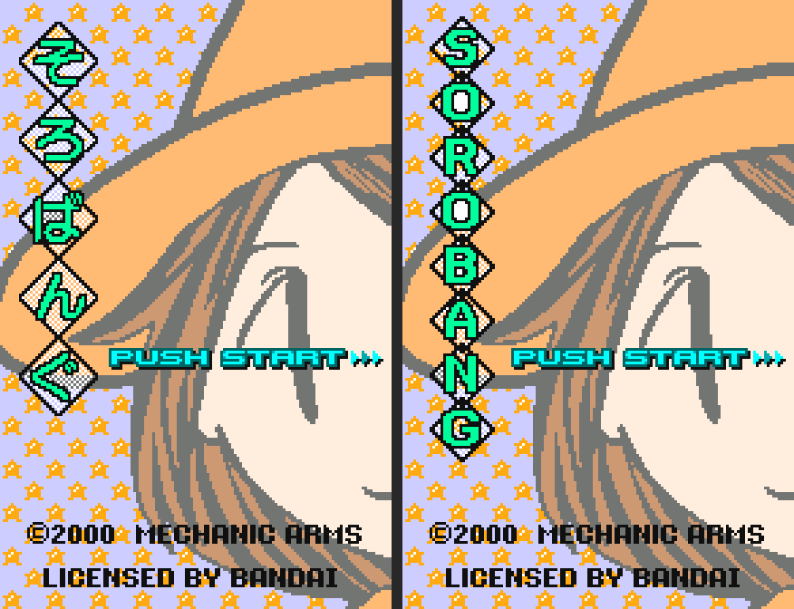

2. Mode select: TIME ATTACK, ENDLESS, RANKING, VERSUS, OPTIONS

   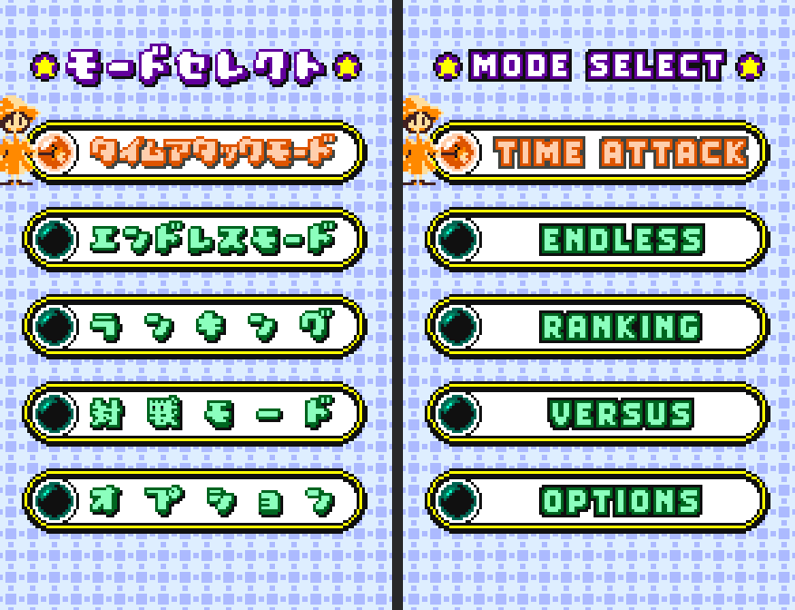

3. Settings page: SETTINGS, LEVEL and SOUND headings, CONTROLS and BLOCK TYPE labels

   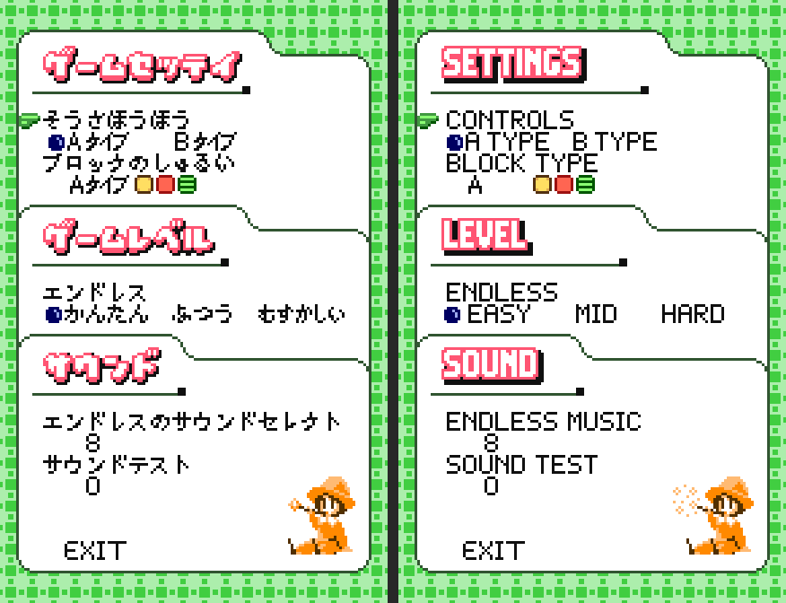

4. Settings page with the cursor on BLOCK TYPE

   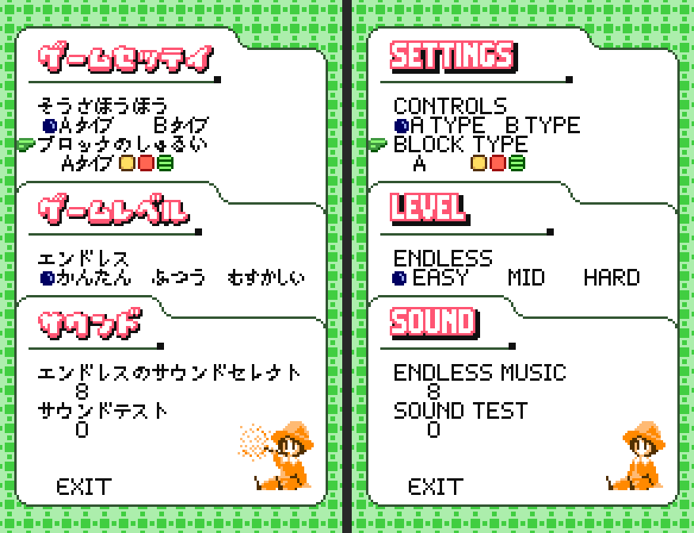

5. Endless mode in play: the labels on the board (BLOCK, MISS, NEXT, SCORE) are the game's own and unchanged

   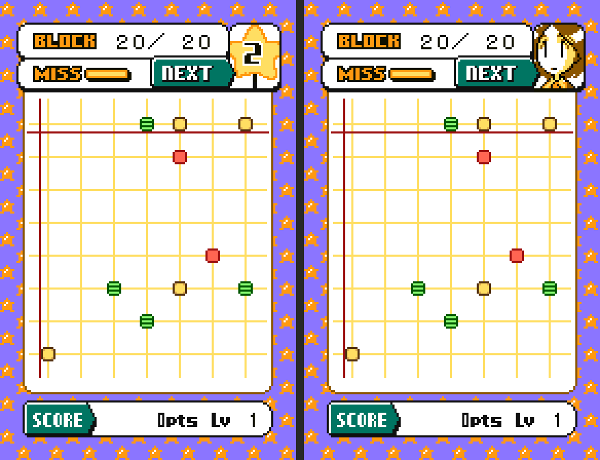

6. RETRY? prompt in Time Attack

   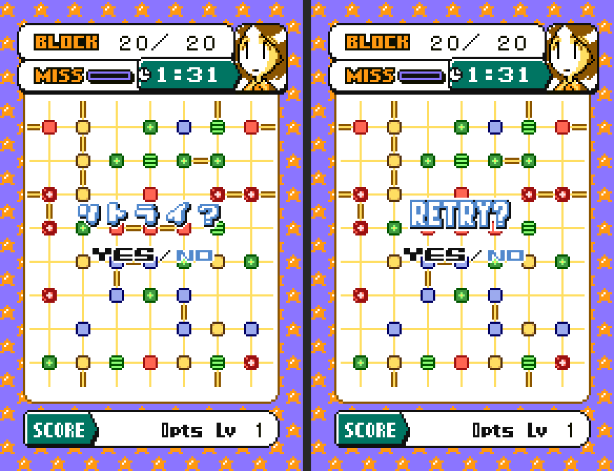

7. GAME OVER

   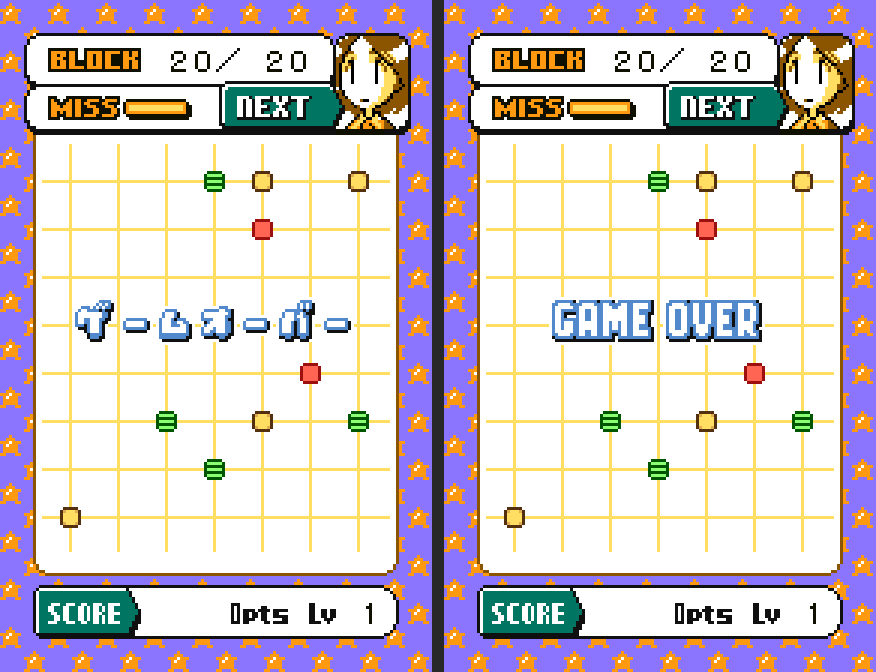

8. Ranking page (TIME ATTACK)

   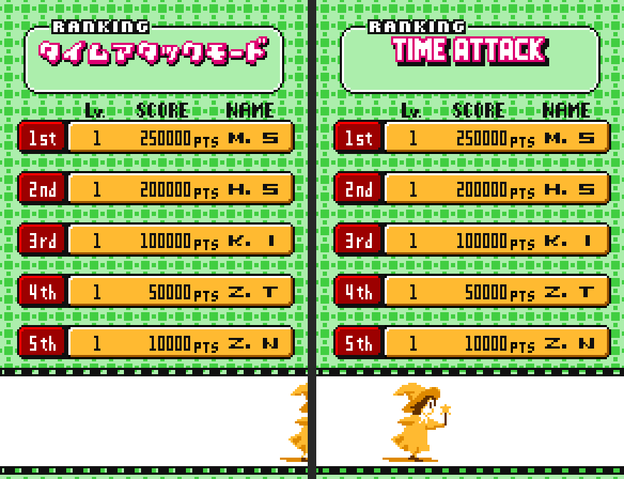

9. Name entry: ENDLESS mode heading and the EASY difficulty word

   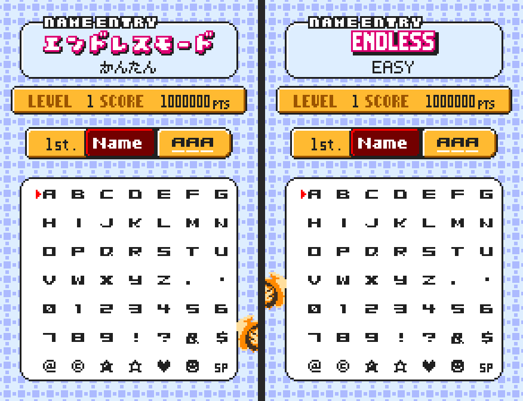

10. Level-up in Endless mode (the Lv. UP marker is the game's own Latin art)

   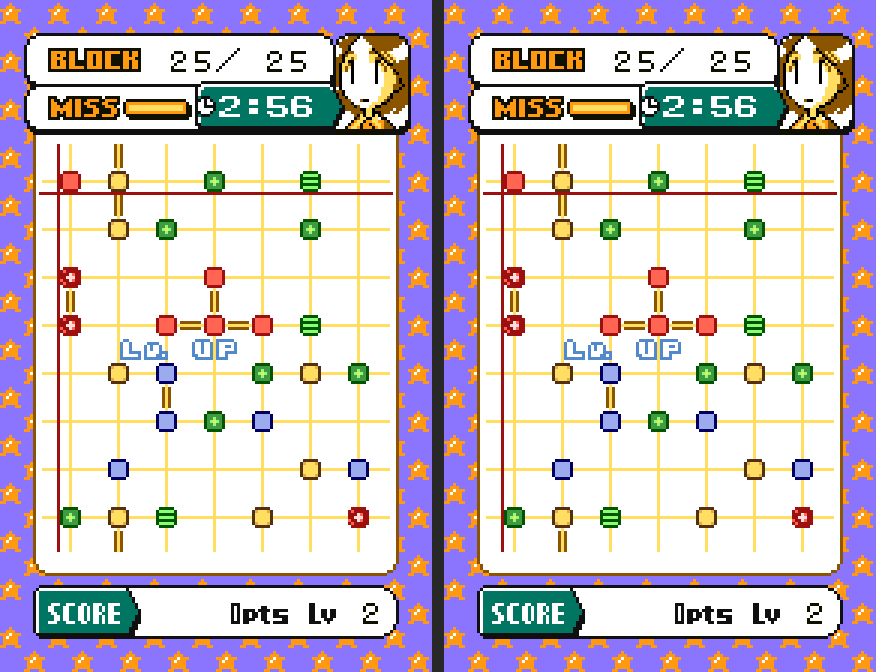

11. TIME UP!

   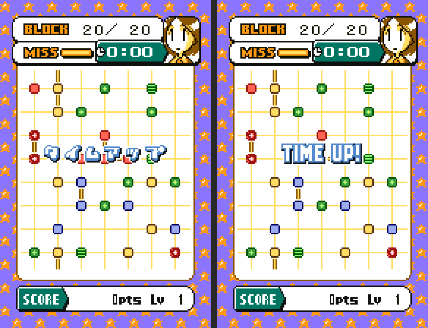

12. Staff roll: role and names romanised, family name first

   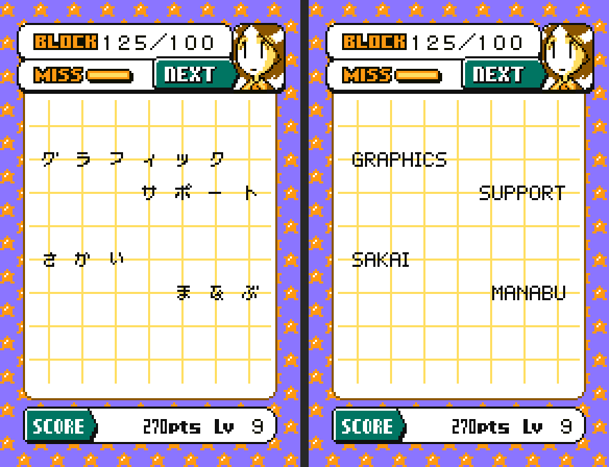

**How to patch**

Apply the BPS file to the Japanese ROM **Sorobang (Japan).wsc** (1,048,576 bytes, CRC32 `0E467D97`) in your browser with the [Swan Revival patcher](https://swanrevival.com/patcher/), or with Floating IPS, beat or ROM Patcher JS. The result is 1,048,576 bytes:

* Standard: `sorobang-en-1.0.bps`; the result should be CRC32 EB02A5E8 (1,048,576 bytes).

Keep the .wsc extension. You must provide your own copy of the original Japanese game to apply it. The patch only fits this dump (CRC32 `0E467D97`); another revision is refused or gives a wrong result. The game's header says it is a monochrome cartridge, but the game draws in colour on a WonderSwan Color; the patch changes the pictures only. Saves from the Japanese version keep working.

**Download:** `sorobang-en-1.0.bps` on the [release page](https://github.com/PokemonGoDB/wonderswan-english-patches/releases/tag/sorobang-v1.0).

**Known issues**

* It hasn't been played start to finish by a person (see "What was not seen on screen"). If you find leftover Japanese or anything broken, please tell me where it happened.
* Some wordings are shorter than the Japanese because the words did not fit: MID for the middle difficulty, FOE for the opponent's gauge, W / L / D in the versus tally, and no "mode" after TIME ATTACK, ENDLESS and VERSUS.
* The monochrome "Lv UP" marker is the game's own thin Latin art; it is lighter than the Japanese one it replaces. The staff names are readings of the kana, and the character designer's entry (KANIKANI HIRAGA) looks like a handle rather than a real name.

**Credits:** Translation and hacking: Claude (Anthropic) for the WonderSwan Translation Project.

**A Note On My Justifications for AI Use**

I have been an avid fan of the Wonderswan system for a very long time now. It was actually a motivating factor for my various attempts to learn Japanese (which have all failed so far). I always wanted to explore the game catalog more, but the lack of English translations made it extremely difficult to do so. Here's the thing: There's a reason many of these games have not been translated yet. It's not just the fact that Japanese > English translation is difficult. There's also the fact that the original developers used all kinds of tricks and technical feats to make these games work. Most games do not have a searchable directory of text that you can just replace with English equivalents. While some are easier than others, translations for some of these would take not only an expert in Japanese > English translation, but also someone with vast game development and programming experience.

I say all that to say: I get why people are apprehensive about AI usage for this type of thing. However, these games have been around for a very long time now and most of them have still not received a translation. I (and others) have chosen to spend our time and money to utilize AI to translate the games and actually make them playable for the wider community. If you don't agree with that, that's completely fine. I am more than happy to remove any of my translations if better, human ran translations are released at a later date. We already decided to skip any games where someone is actively working on a manual translation. While nowhere near what a manual translation effort would be, I do spend a considerable amount of time trying to work through each game's translation. I stress over small details and try my best to make the right calls. And I've probably messed some stuff up, which is why I welcome feedback.

I'm just looking forward to digging through all of these games. It's a great time to be into Wonderswan games.
